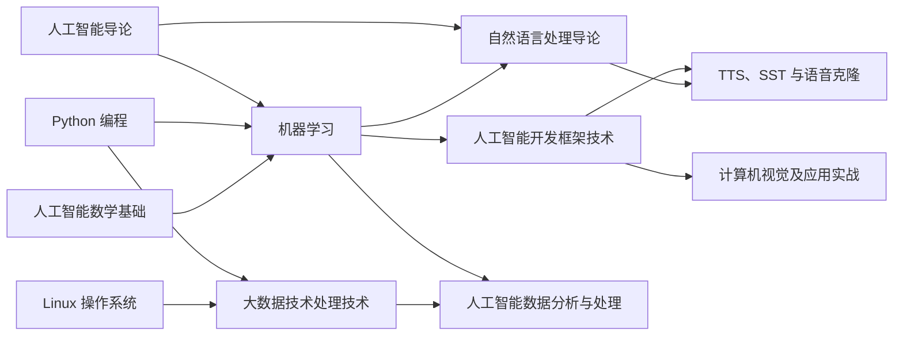

# 附录 C 专业课程地图

第 1 章 [1.5.3 节](../chapters/01-overview/index.md#153)用一张简表介绍了本专业的课程。这个附录把它展开：每门课在哪个学期学、和本书哪些章节衔接、对应哪些岗位和证书，以及系列网络教材的网址。

!!! note "说明"
    课程名称、学期、学分和考试方式依据《广州开放大学人工智能技术应用专业人才培养方案（2026）》。各校的安排可能不同，以本校的教学计划为准。

## C.1 课程安排 { #c1 }

本专业学制 2.5 年，共 5 个学期，线上学习为主。与人工智能直接相关的课程如下（“理论 + 实验”为学时）：

| 学期 | 课程 | 学分 | 学时（理论 + 实验） | 考试 | 系列网络教材 |
|---|---|---|---|---|---|
| 第 1 学期 | **人工智能导论**（本书） | 2 | 36（36 + 0） | 闭卷 | 本书 |
| 第 1 学期 | Python 编程 | — | — | — | — |
| 第 1 学期 | 人工智能数学基础 | — | — | — | — |
| 第 2 学期 | Linux 操作系统 | — | — | — | — |
| 第 3 学期 | 机器学习 | 5 | 90（60 + 30） | 闭卷 | 建设中 |
| 第 3 学期 | 大数据技术处理技术 | 4 | 72（60 + 12） | 闭卷 | 建设中 |
| 第 3 学期 | 自然语言处理导论 | 4 | 72（60 + 12） | 开卷 | [已上线](https://mingzifu9.github.io/nlp-textbook/){ target=_blank } |
| 第 3 学期 | 神经网络与深度学习（选修） | — | — | — | — |
| 第 3 学期 | 智能体开发（选修） | — | — | — | — |
| 第 4 学期 | 人工智能开发框架技术 | 4 | 72（60 + 12） | 开卷 | 建设中 |
| 第 4 学期 | 人工智能数据分析与处理 | 4 | 72（54 + 18） | 开卷 | 建设中 |
| 第 4 学期 | 计算机视觉及应用实战 | 4 | 72（36 + 36） | 开卷 | 建设中 |
| 第 4 学期 | TTS、SST 与语音克隆 | 4 | 72（36 + 36） | 开卷 | 建设中 |
| 第 4 学期 | 网络爬虫 | — | — | — | — |

表中“—”的课程不在本系列网络教材之内，学分和学时以人才培养方案为准。系列教材陆续上线后，会在这里补上网址。

## C.2 课程之间的关系 { #c2 }

下图从左到右是学习的先后顺序，箭头表示“先学好前一门，再学后一门”：

几条主线：

- **算法主线**：本书第 3、4 章 → 《机器学习》（算法原理和计算）→ 《人工智能开发框架技术》（用框架实现、在 GPU 上训练和部署）。
- **数据主线**：本书 1.4.1 节、第 3 章的数据集 → 《大数据技术处理技术》（存储和处理海量数据）→ 《人工智能数据分析与处理》（清洗、分析、标注和数据安全）。
- **应用主线**：本书第 5、6、7 章分别对应《自然语言处理导论》《计算机视觉及应用实战》《TTS、SST 与语音克隆》，每门课都有大量实验和项目。
- **智能体与伦理**：本书第 8 章的智能体在《自然语言处理导论》和选修课“智能体开发”中深入；第 9 章的伦理与法规，在每门应用课里都有专门的合规内容。

## C.3 本书各章在后续课程中的去处 { #c3 }

| 本书章节 | 后续课程中的深入内容 |
|---|---|
| 第 1 章 人工智能概述 | 各门课程的总览；算力与 GPU：《人工智能开发框架技术》 |
| 第 2 章 搜索、知识表示与专家系统 | 知识图谱的构建：《自然语言处理导论》；蒙特卡洛树搜索：《机器学习》 |
| 第 3 章 机器学习入门 | 特征工程、线性回归、逻辑回归、决策树、K 近邻、聚类的原理和代码：《机器学习》 |
| 第 4 章 深度学习入门 | 神经网络和反向传播的计算：《机器学习》；用 PyTorch、飞桨、昇思训练模型：《人工智能开发框架技术》 |
| 第 5 章 自然语言处理与大模型 | 分词、词向量、Transformer、检索增强生成、大模型微调：《自然语言处理导论》 |
| 第 6 章 计算机视觉 | 图像处理、目标检测、图像分割、文字识别的项目实战：《计算机视觉及应用实战》 |
| 第 7 章 语音技术 | 语音识别、语音合成、声纹识别、语音克隆的原理和实战：《TTS、SST 与语音克隆》 |
| 第 8 章 强化学习、生成式 AI 与智能体 | Q 学习与深度强化学习：《机器学习》；智能体开发：《自然语言处理导论》、选修课“智能体开发” |
| 第 9 章 行业应用、伦理与法规 | 数据合规与安全：《人工智能数据分析与处理》；各领域的合规：各门应用课 |

每章小结后的“深入学习”框里，有更具体的章节对应。

## C.4 岗位与证书 { #c4 }

**本专业面向的岗位**（第 9 章 [9.2.2 节](../chapters/09-applications-ethics/index.md#922)有详细介绍）：

| 岗位 | 主要对应的课程 |
|---|---|
| 数据标注员、人工智能训练师 | 人工智能数据分析与处理、机器学习、计算机视觉及应用实战 |
| AI 应用开发与实施 | 自然语言处理导论、人工智能开发框架技术、智能体开发 |
| 提示词工程师、AI 内容运营 | 人工智能导论、自然语言处理导论 |
| AI 合规与数据安全 | 人工智能导论、人工智能数据分析与处理 |
| 智能设备运维 | 计算机视觉及应用实战、TTS、SST 与语音克隆、Linux 操作系统 |

**与本专业相关的证书**：

| 证书 | 发证或标准制定机构 | 主要对应的课程 |
|---|---|---|
| 人工智能训练师（四级、三级） | 人力资源和社会保障部、工业和信息化部联合颁布的国家职业技能标准 | 四级：人工智能数据分析与处理；三级：机器学习；本书第 1、3、5、6、8 章有“证书考点”框 |
| 人工智能数据处理工程师（中级、高级） | 工业和信息化部教育与考试中心 | 中级：人工智能数据分析与处理；高级：机器学习 |
| Python 技术应用工程师（中级、高级） | 工业和信息化部教育与考试中心 | 中级：人工智能数据分析与处理；高级：机器学习 |
| 人工智能应用工程师（中级、高级） | 工业和信息化部教育与考试中心 | 中级：人工智能数据分析与处理；高级：机器学习；本书第 2 章有“证书考点”框 |
| 信息技术水平证书（人工智能 Python 方向） | 工业和信息化部教育与考试中心 | Python 编程 |

!!! tip "怎样准备证书"
    证书的考核内容会调整，报考前要到发证机构的官网查看最新的考试大纲。本书各章的“证书考点”框，标出了与人工智能训练师、人工智能应用工程师考核内容相关的知识点；“人工智能基础知识”和“职业道德”是各个证书的共同要求，学好本书就打下了基础。
