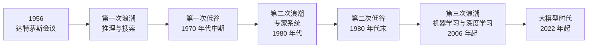
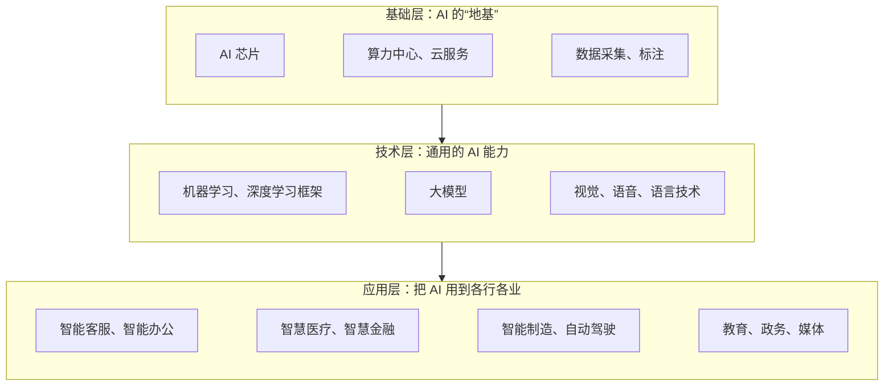
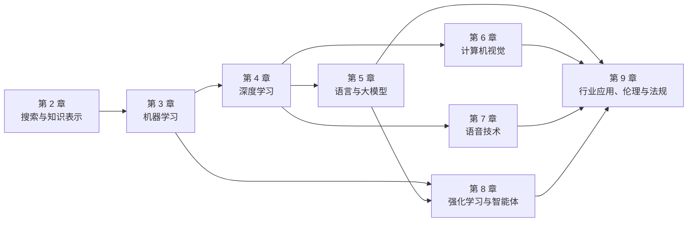
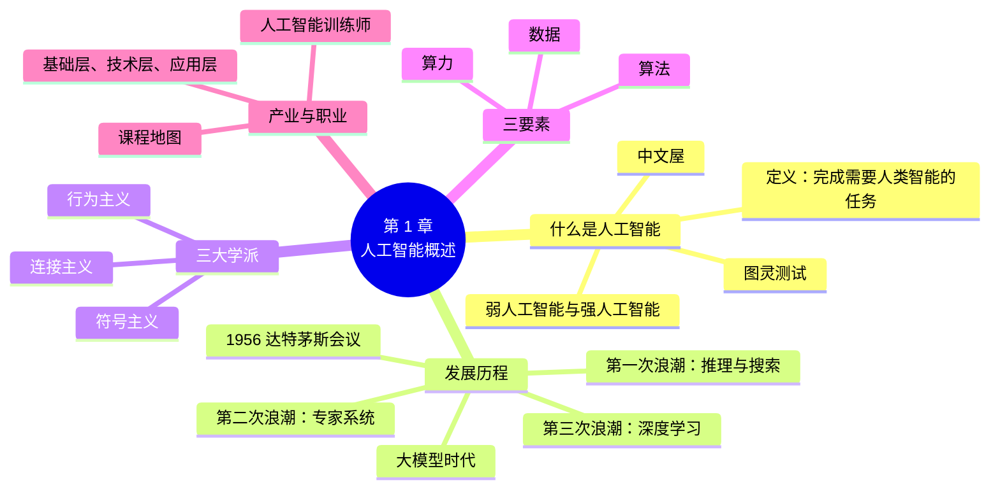

# 第 1 章 人工智能概述

!!! abstract "本章学时"
    理论 4 学时（建议线上 3 · 线下 1）· 在线体验 2 个

## 学习目标

学完本章，你应该能够：

1. **说出**人工智能的定义，复述图灵测试的过程，区分弱人工智能和强人工智能（记忆）；
2. **列出**人工智能发展的三次浪潮和两次低谷，以及每个阶段的代表事件（记忆）；
3. **解释**符号主义、连接主义、行为主义三大学派各自的基本思路，并说出本书哪几章分别属于哪个学派（理解）；
4. **用自己的话解释**数据、算法、算力三要素各起什么作用，并估算一次大模型训练需要多少算力（理解、应用）；
5. **分析**一款 AI 产品处在产业链的哪一层，用到了本书哪几章的技术（分析）；
6. **规划**自己在本专业的学习路径，说明后续各门专业课与目标岗位、证书的对应关系（创造）。

!!! info "先修要求"
    学习本章前，你需要了解：

    - 会用电脑、浏览器和手机应用，能注册一个网站账号；
    - 本章是全书的第一章，不需要任何人工智能或编程基础。

??? abstract "本章概念清单（20 个，点击查看定义和例子）"
    1. [人工智能](../../appendix/glossary.md#g-人工智能)
    2. [图灵测试](../../appendix/glossary.md#g-图灵测试)
    3. [中文屋](../../appendix/glossary.md#g-中文屋)
    4. [弱人工智能](../../appendix/glossary.md#g-弱人工智能)
    5. [强人工智能](../../appendix/glossary.md#g-强人工智能)
    6. [通用人工智能](../../appendix/glossary.md#g-通用人工智能)
    7. [达特茅斯会议](../../appendix/glossary.md#g-达特茅斯会议)
    8. [三次浪潮](../../appendix/glossary.md#g-三次浪潮)
    9. [符号主义](../../appendix/glossary.md#g-符号主义)
    10. [连接主义](../../appendix/glossary.md#g-连接主义)
    11. [行为主义](../../appendix/glossary.md#g-行为主义)
    12. [数据](../../appendix/glossary.md#g-数据)
    13. [算法](../../appendix/glossary.md#g-算法)
    14. [算力](../../appendix/glossary.md#g-算力)
    15. [人工智能三要素](../../appendix/glossary.md#g-人工智能三要素)
    16. [大模型](../../appendix/glossary.md#g-大模型)
    17. [生成式人工智能](../../appendix/glossary.md#g-生成式人工智能)
    18. [东数西算](../../appendix/glossary.md#g-东数西算)
    19. [人工智能产业链](../../appendix/glossary.md#g-人工智能产业链)
    20. [人工智能训练师](../../appendix/glossary.md#g-人工智能训练师)

## 情景导入

小周在一家快递公司做了五年调度员。去年公司上线了智能调度系统：每天早上，系统根据订单地址、路况和快递员的位置，自动排好每位快递员的派送路线；仓库里，摄像头扫一眼包裹面单就能识别出收件地址；客服热线也换成了“智能客服”，大部分查件、改地址的电话不用人接。

调度组从十二个人减到了五个人。留下来的人，工作内容也变了：不再手工排路线，而是盯着系统的建议，处理它“想不到”的特殊情况，比如某个小区突然封路、某位大客户要求上午必须送到。小周发现，那些懂一点 AI、能跟技术人员说清楚“系统哪里不对”的同事，最受领导器重。

于是小周报名了人工智能技术应用专业。开学第一天，他心里有一连串问题：人工智能到底是什么？它和平时说的“算法”“大模型”是什么关系？为什么这几年突然火起来了？学完这个专业能做什么工作？

这一章就来回答这些问题。我们先弄清“人工智能”这个词的意思，再沿着七十多年的发展历程，看看人工智能是怎样一步步走到今天的，最后画一张“地图”，看清本书各章和本专业各门课分别在地图的哪个位置。

## 1.1 什么是人工智能

### 1.1.1 几种定义

“人工智能”这个词，每个人心里的画面都不一样：有人想到科幻电影里的机器人，有人想到手机里的语音助手，有人想到能写文章、能聊天的大模型。

学术界也没有一个所有人都认可的定义。美国学者罗素（Stuart Russell）和诺维格（Peter Norvig）在被全世界一千多所大学采用的教材《人工智能：现代方法》里，把各种定义归纳成两个维度[[1]](#ref1-1)：一是看重“像人一样”还是看重“做得对”（理性），二是看重“想”还是看重“做”。于是有了四种思路：

| | 像人一样 | 理性地（做得对） |
|---|---|---|
| **思考** | 像人一样思考：研究人脑怎样思考，再让机器模仿 | 理性地思考：按逻辑规则推出正确结论 |
| **行动** | 像人一样行动：做出的事让人分不出是人还是机器（图灵测试） | 理性地行动：在给定条件下做出最好的决策 |

今天的主流教材大多采用“理性地行动”这个思路：人工智能研究的是怎样让机器在各种环境中做出好的决策，完成通常需要人类智能才能完成的任务。

本书用一个更通俗的说法：[**人工智能**](../../appendix/glossary.md#g-人工智能 "让机器具备感知、学习、推理、决策、语言交流等能力，从而完成原本需要人类智能才能完成的任务的科学和技术"){ .term }（Artificial Intelligence，AI）是让机器具备感知、学习、推理、决策、语言交流等能力，从而完成原本需要人类智能才能完成的任务的科学和技术。

这个定义里有两个关键词。一是“能力”：看、听、说、读、写、学、想、做决定，这些人人都会，但让机器学会很难。二是“任务”：人工智能不是抽象地“有智能”，而是落实到一个个具体任务上，比如认出照片里的人、把语音转成文字、规划送货路线。

!!! note "AI 和“自动化”有什么不同"
    洗衣机按程序洗衣服，红绿灯按固定时长变色，这些是自动化，不算人工智能，因为它们只是照着写死的步骤执行，环境变了也不会调整。智能调度系统就不同了：今天哪条路堵、哪个快递员请假、哪些订单要加急，它每次都要根据新情况重新做决定。能感知环境、根据情况做出判断，是人工智能和普通自动化的主要区别。当然，两者的界线并不绝对，很多系统是“自动化 + 一部分 AI”。

### 1.1.2 图灵测试

1950 年，英国数学家阿兰·图灵（Alan Turing）发表了一篇论文《计算机器与智能》[[2]](#ref1-2)，开篇就问：“机器能思考吗？”

图灵认为“思考”这个词太难定义，争论下去没有结果，于是换了一个可以操作的问题：如果一台机器在对话中能让人分不出它是机器还是人，我们就应当承认它有智能。这就是后来所说的[**图灵测试**](../../appendix/glossary.md#g-图灵测试 "图灵 1950 年提出的判断方法：提问者通过文字对话分不出对方是机器还是人，就认为机器有智能"){ .term }（Turing Test）。

测试的做法是这样的：

1. 一位提问者坐在一个房间里，通过键盘和屏幕，同时与另外两个房间里的“对象”文字聊天；
2. 两个对象中，一个是人，一个是机器，提问者事先不知道哪个是哪个；
3. 提问者可以问任何问题，聊上几分钟；
4. 最后，提问者判断哪个是人。如果机器经常被判为人，就说它通过了测试。

图灵当年预言：大约 50 年后，机器能让普通提问者在 5 分钟对话后，判断正确的概率不超过 70%。这个预言晚了一些才实现。2025 年，美国加州大学圣迭戈分校的研究者做了一次严格的三方图灵测试：每位提问者同时与一个人和一个 AI 聊 5 分钟，再判断哪个是人[[3]](#ref1-3)。结果，被要求“扮演一位内向、爱用网络用语的年轻人”的 GPT-4.5 有 73% 的时候被判为人，比真人被判为人的比例还高；而 1966 年的老聊天程序 ELIZA 只有 23%。

!!! tip "算一算：73% 意味着什么"
    三方图灵测试里，提问者面对一个人和一个 AI，必须选一个当“人”。

    - 如果提问者完全分不出来、只能瞎猜，那么 AI 被判为人的比例应当在 50% 左右；
    - GPT-4.5 被判为人的比例是 73%，明显超过 50%：提问者不仅分不出来，反而**更相信 AI 是人**；
    - ELIZA 只有 23%，明显低于 50%：大多数提问者一眼就能认出它是机器。

    想一想：如果 100 位提问者里有 73 位把 AI 判为人，那么有多少位把真人判为了 AI？（答案：73 位。三方测试里选了 AI 当“人”，就等于把真人当成了 AI。）

图灵测试的意义在于，它第一次给“机器有没有智能”提出了一个可以动手检验的标准。但它也一直有争议：能骗过人，就等于有智能吗？

<iframe class="sim-frame" src="../../sims/turing-test/main.html" height="640" loading="lazy" title="图灵测试小游戏"></iframe>

动画：图灵测试小游戏。每一轮里，同一个问题分别问了 A、B 两位对象，其中一个是人、一个是 AI。读完回答，选出你认为是人的那一个，再看提示和统计。[全屏打开](../../sims/turing-test/main.html){ target=_blank }
{ .sim-caption }

### 1.1.3 中文屋：会回答就是懂了吗

1980 年，美国哲学家约翰·塞尔（John Searle）设计了一个思想实验，叫“[**中文屋**](../../appendix/glossary.md#g-中文屋 "塞尔 1980 年提出的思想实验，说明照规则处理符号、答得正确不等于真正理解"){ .term }”（Chinese Room）[[4]](#ref1-4)。

设想一个完全不懂中文的人被关在一间屋子里。屋里有一本很厚的规则手册，上面写着：“如果收到这样一串符号，就回复那样一串符号。”屋外的人从门缝塞进写着中文问题的纸条，屋里的人一个字也不认识，只是照着手册查找、抄写，再把答案塞出去。如果手册足够完善，屋外的人会觉得屋里坐着一位中文很好的人。

塞尔问：这个人懂中文吗？显然不懂，他只是在机械地处理符号。那么，一台照着程序处理符号的计算机，即使回答得再好，是不是也谈不上真正“理解”？

中文屋之问至今没有定论，但它提醒我们注意两件事：

- **“表现得像有智能”和“真的有理解”是两回事。** 今天的大模型能流利地回答各种问题，但它是否真正“理解”了语言，科学家仍在争论。
- **评价 AI 要看具体任务的表现。** 不管它懂不懂，只要能稳定、准确地完成任务，就有实用价值；反过来，回答得再流利，也可能一本正经地说错（第 5 章会讲“幻觉”）。

### 1.1.4 弱人工智能与强人工智能

按照能力范围，人们常把人工智能分成两类：

- [**弱人工智能**](../../appendix/glossary.md#g-弱人工智能 "只能在特定领域或特定任务上表现出智能的人工智能，也叫专用人工智能"){ .term }（Weak AI，也叫专用人工智能、狭义人工智能）：只能在某个特定领域或某类任务上表现出智能。下围棋的 AlphaGo 不会开车，人脸识别系统不会翻译。到今天为止，所有投入使用的 AI 都属于这一类。
- [**强人工智能**](../../appendix/glossary.md#g-强人工智能 "在几乎所有领域都能达到甚至超过人类水平、能自主学习新事物的人工智能，目前尚未实现"){ .term }（Strong AI）：也叫[**通用人工智能**](../../appendix/glossary.md#g-通用人工智能 "强人工智能的另一种说法，强调能力的通用性"){ .term }（Artificial General Intelligence，AGI），指在几乎所有领域都能达到甚至超过人类水平、能像人一样学习新事物和应对新情况的人工智能。目前还没有实现。

大模型的出现让这条界线变得模糊了一些：同一个模型既能写文章、又能写代码、还能看图答题，比过去的专用系统“通用”得多。但它仍会在简单的问题上犯错，不能像人一样自主地长期学习，离真正的通用人工智能还有距离。至于通用人工智能什么时候到来、会带来什么影响，学术界和产业界的看法差别很大，第 9 章讨论伦理与安全时还会谈到。

!!! warning "易错点"
    “弱人工智能”的“弱”不是指能力差。AlphaGo 下围棋远超世界冠军，人脸识别比人认得更准，它们仍然是弱人工智能，因为它们只会做这一件事。“弱”和“强”区分的是**通用程度**，不是某项任务上的水平高低。

## 1.2 人工智能的发展历程

人工智能的发展不是一路上升的，而是起起落落：每次有了新突破，人们就抱有很高的期望；期望落空，经费和关注就大幅减少。人们把高潮叫作“浪潮”，把低潮叫作“寒冬”或“低谷”。一般认为，人工智能经历了[**三次浪潮**](../../appendix/glossary.md#g-三次浪潮 "人工智能发展中的三次高潮：推理与搜索、专家系统、机器学习与深度学习，中间隔着两次低谷"){ .term }和两次低谷[[1]](#ref1-1)。

<iframe class="sim-frame" src="../../sims/ai-timeline/main.html" height="660" loading="lazy" title="人工智能发展时间线"></iframe>

动画：人工智能发展时间线。点上面的阶段卡片，或者点时间轴上的圆点查看大事件。每个阶段下方都有一个“同一个问题，不同的思路”，看看不同年代的 AI 怎样去认一只猫。[全屏打开](../../sims/ai-timeline/main.html){ target=_blank }
{ .sim-caption }

### 1.2.1 诞生：达特茅斯会议

1955 年夏天，美国达特茅斯学院的年轻数学教师约翰·麦卡锡（John McCarthy），联合马文·明斯基（Marvin Minsky）、纳撒尼尔·罗切斯特（Nathaniel Rochester）和“信息论之父”克劳德·香农（Claude Shannon），写了一份研究计划书，申请经费在第二年夏天召开一次研讨会[[5]](#ref1-5)。计划书里写道：研究的出发点是这样一个猜想，学习的每个方面、智能的每个特征，原则上都可以精确地描述出来，从而让机器去模拟。

计划书里第一次正式使用了“Artificial Intelligence”这个词。1956 年夏天，十来位学者在达特茅斯学院断断续续讨论了大约两个月。这次[**达特茅斯会议**](../../appendix/glossary.md#g-达特茅斯会议 "1956 年夏天在美国达特茅斯学院召开的研讨会，被看作人工智能学科诞生的标志"){ .term }（Dartmouth Conference）通常被看作人工智能作为一门学科诞生的标志，1956 年也因此被称为“人工智能元年”。

### 1.2.2 第一次浪潮：推理与搜索

会议之后的十几年里，人工智能取得了一批让人兴奋的成果：

- 能自动证明数学定理的程序“逻辑理论家”，证明了罗素和怀特海名著《数学原理》第 2 章前 52 条定理中的 38 条；
- 能下跳棋、国际象棋的程序，第 3 章提到的塞缪尔跳棋程序就是这个时期的；
- 1966 年，美国麻省理工学院的魏森鲍姆（Joseph Weizenbaum）写出了聊天程序 ELIZA[[6]](#ref1-6)，扮演心理咨询师，靠“关键词 + 回复模板”和人聊天，不少人以为屏幕后面真的有人。

这个时期的主要思路是**推理和搜索**：把问题表示成符号，再让计算机按规则一步步推理，或者在所有可能的走法里搜索出答案（第 2 章）。研究者们非常乐观，有人预言二十年内机器就能做人能做的一切工作。

可是，这些程序只能解决“玩具问题”。一旦面对真实世界，可能的情况多到算不过来（这叫“组合爆炸”），而且机器缺少人人都有的常识。机器翻译的效果也远低于预期。1973 年，英国政府发布的一份评估报告认为人工智能没有实现当初的承诺，英美等国随后大幅削减经费，人工智能进入**第一次低谷**。

### 1.2.3 第二次浪潮：专家系统

1980 年代，人工智能换了一个方向：既然让机器“什么都会”太难，那就让它在一个窄领域里成为专家。研究者把医生、地质学家等专家的经验整理成成百上千条“如果……那么……”规则，交给计算机推理，这就是**专家系统**（第 2 章详细介绍）。

专家系统在商业上取得了成功。美国一家计算机公司用专家系统帮助配置订单，据报道每年节省数千万美元；日本在 1982 年启动了雄心勃勃的“第五代计算机”计划。人工智能迎来了**第二次浪潮**。

但专家系统的毛病很快暴露出来：知识要靠人一条条写，写不全、改不动、维护成本高，遇到规则之外的情况就束手无策（这正是第 3 章开头说的“规则写不完”）。1980 年代末，专用的人工智能计算机市场崩溃，第五代计算机计划也没有达到目标，人工智能进入**第二次低谷**。

### 1.2.4 第三次浪潮：机器学习与深度学习

1990 年代起，研究者越来越多地让计算机**从数据中学习**规律（第 3 章）。互联网带来了海量数据，计算机也越来越快，机器学习在垃圾邮件过滤、搜索引擎、推荐系统中悄悄普及开来。1997 年，美国 IBM 公司的“深蓝”计算机击败了国际象棋世界冠军卡斯帕罗夫，让公众再次关注人工智能。

真正的转折点是**深度学习**（第 4 章）。2006 年前后，加拿大学者辛顿（Geoffrey Hinton）等人提出了训练多层神经网络的新方法。2012 年，辛顿和他的学生用一个深度神经网络 AlexNet 参加 ImageNet 图像识别比赛，把错误率从上一年冠军的约 26% 一下子降到约 15%[[7]](#ref1-7)，震惊了整个学术界。此后几年，深度学习在图像识别、语音识别、机器翻译上接连突破，很多任务的准确率达到甚至超过了人类。

2016 年 3 月，谷歌旗下 DeepMind 公司的围棋程序 AlphaGo 以 4∶1 击败世界冠军李世石[[8]](#ref1-8)。围棋的可能局面比宇宙中的原子还多，靠搜索穷举根本不可能，AlphaGo 把深度学习、强化学习和搜索结合了起来（第 8 章）。这场比赛让“人工智能”成为家喻户晓的词，各国纷纷把人工智能列为国家战略，我国在 2017 年发布了《新一代人工智能发展规划》。

### 1.2.5 大模型时代 { #125 }

2022 年 11 月 30 日，美国 OpenAI 公司发布了聊天机器人 ChatGPT。它能流畅地回答问题、写文章、写代码、翻译、总结，几乎什么话题都能聊。据报道，它上线两个月用户就超过了 1 亿，是当时用户增长最快的消费应用。

ChatGPT 背后是[**大模型**](../../appendix/glossary.md#g-大模型 "用海量数据训练、参数规模巨大、能完成多种任务的人工智能模型，也叫基础模型"){ .term }（Large Model，也叫基础模型）：用海量数据训练、参数规模巨大、能完成多种任务的人工智能模型。其中处理语言的叫大语言模型（第 5 章）。和过去“一个任务训练一个模型”不同，大模型先在海量数据上学到通用的知识和能力，再稍加调整，就能用于写作、问答、编程、客服等各种任务。

能生成文字、图片、声音、视频的人工智能，统称[**生成式人工智能**](../../appendix/glossary.md#g-生成式人工智能 "能生成文字、图片、声音、视频、代码等新内容的人工智能"){ .term }（Generative AI，第 8 章）。2023 年起，我国的大模型也百花齐放：百度的文心一言、阿里巴巴的通义千问、字节跳动的豆包、月之暗面的 Kimi、智谱的 GLM 等陆续发布。2025 年 1 月，深度求索公司发布开源推理模型 DeepSeek-R1，以较低的训练成本达到了国际一流水平，在全球引起轰动，也让很多普通人第一次用上了大模型。

!!! example "案例：同一个问题，三个时代的答法"
    假设要让计算机回答“今天从公司到火车站，坐地铁还是打车更快”。

    - **规则时代**：程序员事先写好规则，“早晚高峰打车慢，坐地铁”。规则没覆盖的情况，比如下暴雨、地铁故障，程序就不会处理。
    - **机器学习时代**：导航软件从几亿次真实出行记录里学出“这条路这个时段大概要多久”，再结合实时路况给出预测，比规则准得多，但只会做“估算时间”这一件事。
    - **大模型时代**：你可以直接用一句话问大模型，它会调用地图工具查路况，再用自然语言告诉你“现在打车约 35 分钟、地铁约 28 分钟，建议坐地铁，3 号线换 1 号线”，还能接着回答“火车站哪个口离检票口近”。

    三个时代并不是“后一个取代前一个”。今天的导航软件里，规则、机器学习和大模型同时在工作：限行规定是规则，到达时间预测是机器学习，语音问答越来越多地交给大模型。

## 1.3 三大学派

人工智能发展的七十多年里，形成了三种基本思路，人们称为三大学派。它们对“智能从哪里来”的回答不同。

### 1.3.1 符号主义：智能来自推理

[**符号主义**](../../appendix/glossary.md#g-符号主义 "认为智能来自用符号表示知识并按规则推理的人工智能学派"){ .term }（Symbolism）认为，智能的核心是用符号表示知识，再按逻辑规则进行推理。人懂得“鸟会飞”“企鹅是鸟”“企鹅不会飞”，计算机只要把这些知识写成符号和规则，就能像人一样推理。

第一次浪潮中的定理证明、第二次浪潮中的专家系统，以及今天搜索引擎里的知识图谱，都是符号主义的成果（第 2 章）。它的优点是推理过程清楚，能说出“为什么得出这个结论”；缺点是知识要靠人整理，难以处理图像、声音这类说不清规则的信息。

### 1.3.2 连接主义：智能来自神经网络

[**连接主义**](../../appendix/glossary.md#g-连接主义 "认为智能来自大量简单单元相互连接、模仿人脑搭建神经网络的人工智能学派"){ .term }（Connectionism）认为，智能来自大量简单单元的相互连接，就像人脑由近千亿个神经元连接而成。它模仿神经元搭建人工神经网络，不直接写规则，而是让网络从大量例子中自己调整连接的强弱。

连接主义起步很早（1958 年就有了感知机，第 4 章），但长期受限于数据和算力。2012 年后，深度学习让连接主义成为主流，今天的人脸识别、语音识别、大模型都属于这一派（第 4～7 章）。它的优点是能从原始数据中自己学习，擅长处理图像、声音、语言；缺点是像个“黑箱”，很难解释它为什么这样判断。

### 1.3.3 行为主义：智能来自与环境互动

[**行为主义**](../../appendix/glossary.md#g-行为主义 "认为智能在与环境的互动和“感知—行动”反馈中逐步形成的人工智能学派"){ .term }（Behaviorism，也叫进化主义、控制论学派）认为，智能不一定要先有知识和推理，而是在与环境的不断互动中，通过“感知—行动”的反馈逐步形成的，就像小孩学走路，摔几次就会了。

行为主义的代表成果是会走路的机器人、扫地机器人，以及第 8 章要讲的强化学习：智能体在环境中不断试错，做得好就有奖励，逐渐学会最好的做法。今天热门的**具身智能**（人形机器人、机器狗）也与这一派关系密切。

### 1.3.4 三派对比与融合

| | 符号主义 | 连接主义 | 行为主义 |
|---|---|---|---|
| 智能来自 | 知识和推理 | 神经元的连接 | 与环境的互动 |
| 怎样获得能力 | 人把知识写成规则 | 从大量数据中学习 | 在试错中根据奖励改进 |
| 代表成果 | 专家系统、知识图谱 | 深度学习、大模型 | 强化学习、机器人 |
| 优点 | 可解释、可控 | 能处理图像声音，效果好 | 能适应变化的环境 |
| 局限 | 知识难获取、写不全 | 需要大量数据，难解释 | 试错代价大，学得慢 |
| 本书章节 | 第 2 章 | 第 3～7 章 | 第 8 章 |

三派并不是谁对谁错，而是越来越走向融合。AlphaGo 就是三派结合的典型：用神经网络判断局面（连接主义），用搜索算出后面几步（符号主义的搜索方法），用自我对弈的强化学习不断提高（行为主义）。今天的 AI 智能体也一样：大模型负责理解和生成，知识库和规则保证回答准确可控，再通过与用户和工具的互动不断改进（第 8 章）。

## 1.4 人工智能的三要素

为什么人工智能在 2012 年以后，特别是 2022 年以后突飞猛进？常见的回答是：[**数据**](../../appendix/glossary.md#g-数据 "人工智能学习规律所用的原始材料，是三要素中的“食材”"){ .term }、[**算法**](../../appendix/glossary.md#g-算法 "解决问题的一系列明确步骤，在人工智能中规定怎样学习、怎样判断，是三要素中的“菜谱”"){ .term }、[**算力**](../../appendix/glossary.md#g-算力 "计算能力，常用每秒完成的运算次数衡量，是三要素中的“炉灶”"){ .term }三个条件同时成熟了。这三者合称[**人工智能三要素**](../../appendix/glossary.md#g-人工智能三要素 "数据、算法、算力三者的合称，三者同时成熟推动了今天人工智能的发展"){ .term }。打个比方，如果把训练一个 AI 模型比作做一道菜：数据是食材，算法是菜谱，算力是炉灶。

### 1.4.1 数据：AI 的“食材” { #141 }

机器学习和深度学习要从数据中学习规律，数据就是它们的“课本”和“练习题”。人脸识别要用几百万张标好名字的人脸照片，语音识别要用几万小时配好文字的录音，大模型要读完相当于几千万本书的文字。

数据的作用有两点：一是**数量**，数据越多，模型见过的情况越多，越能举一反三；二是**质量**，数据里的错误、偏差会被模型一起学进去，“垃圾进，垃圾出”。比如一个招聘筛选模型，如果训练数据里的历史录用者大多是男性，它就可能学会歧视女性求职者（第 9 章）。

很多数据要由人来“标注”，也就是给数据加上正确答案：在图片上框出每一辆车，给每段录音写出对应的文字，给大模型的回答打分。这催生了数据标注员、人工智能训练师等新职业（1.6.3 节）。数据的采集、存储、清洗和标注，在本专业的《大数据技术处理技术》《人工智能数据分析与处理》两门课中详细学习。

### 1.4.2 算法：AI 的“菜谱” { #142 }

**算法**（Algorithm）是解决问题的一系列明确步骤。在人工智能里，算法规定了怎样从数据中学习、怎样做出判断。第 3 章的 K 近邻（找邻居、投票）、第 2 章的广度优先搜索（一层层找），都是算法。

算法的进步往往带来质的飞跃。2012 年深度学习的突破、2017 年 Transformer 结构的提出（第 5 章），都让同样的数据和算力发挥出了大得多的作用。DeepSeek 等国产大模型能以较低成本达到一流水平，很大程度上也靠的是算法和工程上的改进。

!!! note "“算法”在日常语言中的意思"
    新闻里常说“平台算法”“算法推荐”，这里的“算法”指的是平台用来决定给你推送什么内容的整套系统，包括算法、模型和数据。国家网信办等部门 2021 年发布的《互联网信息服务算法推荐管理规定》，管的就是这一类系统（第 9 章）。

### 1.4.3 算力：AI 的“炉灶” { #143 }

**算力**（Computing Power）就是计算能力，通常用每秒能完成多少次运算来衡量。训练大模型需要完成天文数字般的运算，普通电脑的处理器（CPU）一次只能处理少量计算，而图形处理器（GPU）能同时进行成千上万次简单的乘法和加法，正好适合神经网络的计算（第 4 章）。今天的大模型都是在成千上万块 GPU 或专用 AI 芯片组成的集群上训练出来的。

!!! tip "算一算：训练一个大模型要算多久"
    2020 年发布的 GPT-3 有 1750 亿个参数，训练时一共做了约 3.14 × 10²³ 次运算[[9]](#ref1-9)（3 后面跟着 23 个 0）。

    假设一块高端 AI 芯片每秒能做 10¹⁵ 次运算（1000 万亿次），并且一直满负荷工作：

    - 只用 1 块芯片：3.14 × 10²³ ÷ 10¹⁵ = 3.14 × 10⁸ 秒。一年约 3.15 × 10⁷ 秒，所以要算大约 **10 年**；
    - 用 1000 块芯片一起算：3.14 × 10⁸ ÷ 1000 = 3.14 × 10⁵ 秒，约 **3.6 天**。

    实际上，芯片之间要互相传数据，利用率一般只有 30%～50%，所以 1000 块芯片要算一到两个星期。今天更大的模型，运算量是 GPT-3 的几十倍到上百倍，要用上万块芯片算几个月，电费就要上千万元。这就是为什么说“算力是 AI 的炉灶”，也是为什么大模型的训练只有少数公司做得起。

算力已经成为和电力一样的基础设施。我国在 2022 年初全面启动“[**东数西算**](../../appendix/glossary.md#g-东数西算 "我国 2022 年全面启动的工程，把东部数据送到西部的算力枢纽计算和存储"){ .term }”工程[[10]](#ref1-10)，在京津冀、长三角、粤港澳大湾区、成渝、内蒙古、贵州、甘肃、宁夏建设 8 个国家算力枢纽节点，把东部产生的数据送到电力和土地更充足的西部去计算和存储，就像“西电东送”“南水北调”一样。算力芯片方面，除了美国英伟达公司的 GPU，我国也有华为昇腾等国产 AI 芯片（第 4 章）。算力的使用，包括怎样用 GPU 训练和部署模型，在《人工智能开发框架技术》中详细学习。

### 1.4.4 三要素缺一不可

三要素之间互相推动：数据多了，需要更强的算力来处理；算力强了，才能训练更复杂的算法；好的算法又能从同样的数据里学到更多。

回头看两次低谷，都和三要素不成熟有关：1970 年代没有足够的数据和算力，神经网络的想法早就有了却做不起来；1980 年代的专家系统靠人写规则，绕开了数据，却卡在了知识获取上。而 2012 年的深度学习突破，正是 ImageNet 的百万张标注图片（数据）、GPU（算力）和更好的神经网络训练方法（算法）凑到了一起的结果。

## 1.5 人工智能产业链与技术全景

### 1.5.1 产业链的三层

人工智能不只是一门技术，也形成了一条完整的产业。按照分工，[**人工智能产业链**](../../appendix/glossary.md#g-人工智能产业链 "人工智能产业按分工形成的链条，一般分为基础层、技术层、应用层"){ .term }一般分成三层：

- **基础层**提供算力和数据：做 AI 芯片的（如华为昇腾、寒武纪）、建算力中心和云服务的（如阿里云、华为云、百度智能云）、做数据采集和标注服务的公司都在这一层；
- **技术层**提供通用的 AI 能力：深度学习框架（如百度飞桨、华为昇思，第 4 章）、各种大模型，以及人脸识别、语音识别、文字识别等可以直接调用的技术服务；
- **应用层**把 AI 用到具体行业：医院里的影像辅助诊断、银行的智能风控、工厂的质检系统、你手机上的各种 AI 应用（第 9 章）。

同一家公司可能同时在几层都有业务。比如百度既有昆仑芯片（基础层），又有飞桨和文心大模型（技术层），还有萝卜快跑自动驾驶出租车（应用层）。本专业的毕业生，大多数会在应用层工作：把技术层提供的能力，用到本单位、本行业的具体问题上。

### 1.5.2 本书的技术全景图

下面这张图把本书各章串了起来。左边是 AI 要处理的信息，中间是核心技术，右边是落地应用：

读法是：第 2 章是“老派”的符号主义方法，至今仍在导航、知识图谱中使用；第 3 章的机器学习是今天 AI 的主干；第 4 章的深度学习是机器学习的一个分支，又是第 5～7 章三大应用方向（语言、视觉、语音）的共同基础；第 8 章把强化学习和大模型结合起来，讲能自主完成任务的智能体；第 9 章回到现实，看 AI 在各行各业的应用和它带来的伦理、法律问题。

### 1.5.3 本专业的课程地图

本书是本专业的第一门专业课，任务是先画一张地图。地图上每一块，后面都有专门的课程深入学习：

| 学期 | 课程 | 深入学习本书哪部分 |
|---|---|---|
| 第 1 学期 | Python 编程、人工智能数学基础 | 动手编程、理解公式的基础 |
| 第 3 学期 | 机器学习 | 第 3 章全部算法、第 4 章神经网络的原理、第 8 章强化学习 |
| 第 3 学期 | 大数据技术处理技术 | 1.4.1 节数据的存储与处理 |
| 第 3 学期 | 自然语言处理导论 | 第 5 章，以及第 8 章智能体的原理 |
| 第 4 学期 | 人工智能开发框架技术 | 第 4 章深度学习框架、1.4.3 节算力 |
| 第 4 学期 | 人工智能数据分析与处理 | 1.4.1 节数据的清洗、分析与标注 |
| 第 4 学期 | 计算机视觉及应用实战 | 第 6 章 |
| 第 4 学期 | TTS、SST 与语音克隆 | 第 7 章 |

附录 C 列出了完整的课程地图，包括各门课的相互关系、对应的岗位和证书，以及各门课网络教材的网址。

## 1.6 身边的 AI { #16 }

### 1.6.1 国产大模型与 AI 产品 { #161 }

今天，普通人接触人工智能最直接的方式，就是各种大模型对话产品。下表列出了几款常用的国产产品（产品名称和功能更新很快，以官网为准）：

| 产品 | 公司 | 特点 |
|---|---|---|
| DeepSeek | 深度求索 | 开源，推理能力强，可以显示“思考过程” |
| 豆包 | 字节跳动 | 用户多，语音对话、写作、图片生成功能全 |
| 通义千问 | 阿里巴巴 | 开源模型系列丰富，擅长长文档和办公 |
| 文心一言 | 百度 | 与百度搜索结合，中文知识丰富 |
| Kimi | 月之暗面 | 擅长读长文档、联网搜索 |
| 腾讯元宝 | 腾讯 | 与微信公众号文章等腾讯生态内容结合 |
| 智谱清言 | 智谱 | GLM 系列模型，学术背景深厚 |

这些产品大多可以免费使用，电脑上用浏览器打开官网，手机上下载 App 即可。附录 A 介绍了它们的注册方法和隐私设置。体验 1-2 会请你用同一组问题考一考其中三款，比较它们的表现。

除了对话产品，AI 已经融进了很多日常应用：手机相册按人物自动分类（第 6 章）、输入法的语音输入（第 7 章）、短视频和购物网站的“猜你喜欢”（第 3 章）、地图的实时路况和路线规划（第 2、3 章）、办公软件里的“AI 帮你写”（第 5 章）。

!!! warning "使用 AI 产品的三条底线"
    从第一次使用开始，就养成好习惯：

    1. **不输入敏感信息**：身份证号、银行卡号、单位的内部资料、客户的个人信息，不要发给 AI 产品；
    2. **重要信息要核查**：大模型可能一本正经地编造事实、数字和出处（第 5 章的“幻觉”），用在工作中的内容一定要核对；
    3. **如实说明 AI 的作用**：作业、报告里用了 AI 生成的内容，要按老师或单位的要求说明，不能当作自己独立完成的成果。

### 1.6.2 AI 正在改变哪些工作 { #162 }

回到情景导入里的小周。他所在的快递公司，AI 替代了大量重复的手工排单和接电话工作，但同时也需要新的人：有人要检查系统的调度建议对不对，有人要标注识别错了的面单图片，有人要整理客服机器人答不上来的问题、补充进知识库。

这是 AI 影响就业的一般规律：**重复、规则清楚的工作容易被替代；需要判断、沟通、处理例外的工作更难被替代；同时会出现一批和 AI 打交道的新工作。** 第 9 章会更详细地讨论这个问题。

### 1.6.3 AI 相关岗位与证书 { #163 }

和本专业关系密切的岗位，大致可以分成四类：

| 岗位类别 | 做什么 | 典型岗位 |
|---|---|---|
| 数据类 | 采集、清洗、标注数据，让模型有好的“食材” | 数据标注员、数据处理工程师 |
| 训练与运营类 | 设计标注规范，训练、测试和调优模型，运营 AI 产品 | 人工智能训练师、AI 产品运营 |
| 应用开发类 | 调用大模型和 AI 服务，搭建智能体和行业应用 | AI 应用开发工程师、提示词工程师、智能体搭建 |
| 算法与工程类 | 设计和改进算法，部署和维护模型 | 算法工程师、AI 运维工程师（一般要求本科以上，专科毕业生可以通过积累经验逐步发展） |

其中，[**人工智能训练师**](../../appendix/glossary.md#g-人工智能训练师 "使用智能训练软件，在人工智能产品使用过程中进行数据库管理、算法参数设置、人机交互设计、性能测试跟踪等工作的人员"){ .term }是 2020 年人力资源社会保障部发布的新职业，指使用智能训练软件，在人工智能产品实际使用过程中进行数据库管理、算法参数设置、人机交互设计、性能测试跟踪及其他辅助作业的人员。2021 年发布了它的国家职业技能标准[[11]](#ref1-11)，分为五个等级（五级 / 初级工到一级 / 高级技师），初级、中级的工作以数据采集、处理和标注为主，级别越高越偏向模型训练、测试和智能系统设计。

!!! cert "证书考点 · 人工智能训练师 · 职业道德与基础知识"
    人工智能训练师国家职业技能标准的“基本要求”包括职业道德和基础知识两部分，各个等级都要考。基础知识里的“人工智能基础知识”，对应本章的人工智能定义、发展历程、三要素和产业链。复习时注意：能说出三次浪潮的代表事件，能区分弱人工智能和强人工智能，能把一个产品放进产业链的某一层。

本专业对应的证书还有人工智能数据处理工程师、人工智能应用工程师、Python 技术应用工程师等，分别在《人工智能数据分析与处理》《机器学习》等课程中对照学习。附录 C 列出了每个证书对应的课程。

## 在线体验

!!! abstract "体验总览"

    | 体验 | 用到什么 | 时长 |
    |---|---|---|
    | 1-1 图灵测试小游戏 | 本书动画“图灵测试小游戏”“人工智能发展时间线” | 约 20 分钟 |
    | 1-2 国产大模型初体验 | 任选 3 款国产大模型对话产品 | 约 30 分钟 |

    体验 1-1 只需要浏览器；体验 1-2 需要注册大模型产品的账号，方法见附录 A。建议边做边把结果填进记录表，课后练习的实操题会用到。

### 体验 1-1 图灵测试小游戏

**体验目的**：通过亲自当一回“提问者”，体会图灵测试是怎样判断机器智能的，思考“能骗过人”和“真的懂”之间的区别；再通过时间线回顾人工智能的三次浪潮。

**打开方式**：1.1.2 节中嵌入的动画，或者[全屏打开“图灵测试小游戏”](../../sims/turing-test/main.html){ target=_blank }。

**第一部分：当一回提问者**

1. 游戏共 10 轮。每一轮里，同一个问题分别问了 A、B 两位对象，其中一位是人，一位是 AI。
2. 读完两边的回答，点“A 是人”或“B 是人”，页面会告诉你判断对不对，并给出一条提示。
3. 每一轮判断前，先在记录表里写下你的判断依据（比如“回答太完美”“有错别字”“答非所问”）。
4. 10 轮做完，记下你的总正确率，以及页面给出的“提示”中你最认同的一条。
5. 点“再玩一次”，题目顺序和左右位置会打乱，看看第二次的正确率有没有提高。

**第二部分：时间线上的三次浪潮**

打开 1.2 节中的动画，或者[全屏打开“人工智能发展时间线”](../../sims/ai-timeline/main.html){ target=_blank }。

1. 依次点四个阶段卡片，读一读每个阶段“人要做什么”“机器做什么”，把关键词填进记录表。
2. 在每个阶段下方，看一看“怎样认出一只猫”的不同思路。
3. 在时间轴上找到灰色的两段“低谷”，点开前后的事件，想一想低谷是怎样形成的、又是怎样走出来的。

**记录表**

| 轮次 | 我的判断 | 判断依据 | 对不对 |
|---|---|---|---|
| 1 | A / B 是人 | | |
| 2 | | | |
| …… | | | |
| 10 | | | |
| 合计 | 第一次正确 ___ / 10，第二次正确 ___ / 10 | 最有用的判断依据：______ | |

| 阶段 | 人要做什么 | 机器做什么 | 局限 |
|---|---|---|---|
| 第一次浪潮 | | | |
| 第二次浪潮 | | | |
| 第三次浪潮 | | | |
| 大模型时代 | | | |

**想一想**

1. 你用来判断“谁是人”的依据中，哪些在今天的大模型面前已经不管用了？
2. 如果一个 AI 在游戏里次次被判为人，你会认为它“有智能”吗？结合 1.1.3 节的中文屋谈谈你的看法。

### 体验 1-2 国产大模型初体验

**体验目的**：亲手使用几款国产大模型，了解它们能做什么、容易在哪里出错，学会用对比表客观评价 AI 产品。

**准备**：从 1.6.1 节的表中任选 3 款产品，按附录 A 的方法注册账号（用手机号即可）。电脑和手机都可以做，电脑上更方便复制和截图。

**步骤**

1. 在 3 款产品中分别新建一个对话，依次输入下面 5 个问题。每个问题都要**原样输入**，这样比较才公平。
    - 问题 1（常识）：“为什么夏天白天比冬天长？请用 100 字以内回答。”
    - 问题 2（计算）：“一件衣服先涨价 20%，再降价 20%，现在的价格比原价高还是低？差多少？”
    - 问题 3（写作）：“我是快递公司的调度员，请帮我写一段 150 字左右的通知，告诉快递员明天因暴雨提前一小时到岗。”
    - 问题 4（本地信息）：“我所在城市（换成你的城市）今年有哪些新开通的地铁线路？请列出线路名称和开通日期。”
    - 问题 5（自我认识）：“你是谁？你的知识截止到什么时候？你可能会犯哪些错误？”
2. 把每款产品对每个问题的回答截图保存。
3. 按下面的评分标准，给每个回答打 1～5 分，填进对比表：5 分 = 完全正确、清楚、符合要求；3 分 = 基本正确但有小问题；1 分 = 明显错误或答非所问。
4. 重点核查问题 2 和问题 4：问题 2 自己动手算一遍（提示：设原价 100 元）；问题 4 到城市地铁官网或新闻中核对，看有没有编造的线路或日期。
5. 选一款你觉得最好用的产品，写两三句话说明理由。

**对比表**

| 问题 | 产品 1：______ | 产品 2：______ | 产品 3：______ | 备注（发现的错误等） |
|---|---|---|---|---|
| 1 常识 | | | | |
| 2 计算 | | | | 正确答案：______ |
| 3 写作 | | | | |
| 4 本地信息 | | | | 核查结果：______ |
| 5 自我认识 | | | | |
| 总分 | | | | |

**想一想**

1. 三款产品在哪个问题上差别最大？在哪个问题上最容易出错？
2. 问题 4 中如果出现了编造的内容，你是怎么发现的？如果你没有去核查，可能会造成什么后果？
3. 体验中你有没有输入任何个人信息？回顾 1.6.1 节的“三条底线”，检查一下自己的做法。

## 本章小结

- **人工智能**是让机器具备感知、学习、推理、决策、语言交流等能力，完成原本需要人类智能才能完成的任务的科学和技术。
- **图灵测试**用“对话中分不出是人还是机器”来判断机器有没有智能；**中文屋**思想实验提醒我们，“表现得像懂”不等于“真的懂”。
- 今天所有投入使用的 AI 都是**弱人工智能**，只擅长特定任务；在几乎所有领域都能达到人类水平的**强人工智能**（通用人工智能）还没有实现。
- 1956 年的**达特茅斯会议**标志着人工智能诞生。此后经历了**三次浪潮**：推理与搜索、专家系统、机器学习与深度学习，中间有两次低谷；2022 年起进入**大模型**时代。
- **符号主义**认为智能来自推理，**连接主义**认为智能来自神经网络，**行为主义**认为智能来自与环境的互动。三派越来越走向融合。
- **数据**是食材，**算法**是菜谱，**算力**是炉灶，三要素同时成熟，带来了今天 AI 的繁荣。
- **人工智能产业链**分基础层、技术层、应用层，本专业毕业生大多在应用层工作。人工智能训练师、数据标注员、AI 应用开发等岗位与本专业对应。

!!! info "深入学习"
    本章是全书的总览，各部分的深入内容分布在本专业的其他课程中：

    - 数据的采集、存储与处理：《大数据技术处理技术》；数据清洗、分析与标注：《人工智能数据分析与处理》；
    - 算力、GPU 与深度学习框架的使用：《人工智能开发框架技术》；
    - 人工智能的历史与思想：可以阅读参考文献 [1] 的第 1 章，以及附录 B 的人工智能大事年表；
    - 各门课程的关系、岗位与证书：附录 C 专业课程地图。

**下一章预告**

第一次浪潮中，研究者让计算机“推理和搜索”。今天你打开导航软件规划路线、在搜索引擎里看到人物的“知识卡片”，背后用的仍是这一类方法。下一章我们就从走迷宫开始，看看计算机怎样把问题变成搜索，怎样把知识写成规则，又怎样用这些规则像专家一样推理。

## 参考文献

正文中的上标编号（如[[1]](#ref1-1)）对应下面的文献。带链接的可以直接打开；书籍可在图书馆或电子书平台查阅。

**教材与专著**

- [1] 罗素 S, 诺维格 P. 人工智能：现代方法（第 4 版）[M]. 张博雅, 陈坤, 田超, 等译. 北京：人民邮电出版社，2022.
    全世界使用最广的人工智能教材，第 1 章讲人工智能的定义、四种思路和发展历史，对应 1.1、1.2 节。原书：Russell S, Norvig P. Artificial Intelligence: A Modern Approach. 4th ed. Pearson, 2020。

**经典论文**

- [2] Turing A M. Computing Machinery and Intelligence[J]. Mind, 1950, 59(236): 433-460. <https://doi.org/10.1093/mind/LIX.236.433>
    图灵提出“模仿游戏”（即图灵测试）的论文，文字通俗，对应 1.1.2 节。
- [3] Jones C R, Bergen B K. Large Language Models Pass the Turing Test[EB/OL]. arXiv: 2503.23674, 2025. <https://arxiv.org/abs/2503.23674>
    加州大学圣迭戈分校的三方图灵测试研究，GPT-4.5 有 73% 的时候被判为人，对应 1.1.2 节。
- [4] Searle J R. Minds, Brains, and Programs[J]. Behavioral and Brain Sciences, 1980, 3(3): 417-424. <https://doi.org/10.1017/S0140525X00005756>
    提出“中文屋”思想实验的论文，对应 1.1.3 节。
- [5] McCarthy J, Minsky M L, Rochester N, et al. A Proposal for the Dartmouth Summer Research Project on Artificial Intelligence, August 31, 1955[J]. AI Magazine, 2006, 27(4): 12-14.
    达特茅斯会议的研究计划书，第一次正式使用“人工智能”一词，2006 年在 AI Magazine 重新刊出，对应 1.2.1 节。
- [6] Weizenbaum J. ELIZA: A Computer Program for the Study of Natural Language Communication between Man and Machine[J]. Communications of the ACM, 1966, 9(1): 36-45. <https://doi.org/10.1145/365153.365168>
    早期聊天程序 ELIZA 的论文，对应 1.2.2 节。
- [7] Krizhevsky A, Sutskever I, Hinton G E. ImageNet Classification with Deep Convolutional Neural Networks[C]//Advances in Neural Information Processing Systems 25. 2012: 1097-1105.
    AlexNet 论文，2012 年 ImageNet 比赛前五错误率约 15.3%，第二名约 26.2%，标志着深度学习时代到来，对应 1.2.4 节。
- [8] Silver D, Huang A, Maddison C J, et al. Mastering the Game of Go with Deep Neural Networks and Tree Search[J]. Nature, 2016, 529(7587): 484-489. <https://doi.org/10.1038/nature16961>
    AlphaGo 的论文，介绍了神经网络与搜索、强化学习的结合，对应 1.2.4、1.3.4 节。
- [9] Brown T B, Mann B, Ryder N, et al. Language Models are Few-Shot Learners[C]//Advances in Neural Information Processing Systems 33. 2020: 1877-1901.
    GPT-3 的论文，附录中给出了训练所用的运算量（约 3.14 × 10²³ 次），对应 1.4.3 节的“算一算”。

**在线资源与政策文件**

- [10] 中国日报网. “东数西算”工程正式全面启动[EB/OL]. (2022-02-18). <https://language.chinadaily.com.cn/a/202202/18/WS620f468aa310cdd39bc878b2.html>（2026-10-30 访问）
    介绍“东数西算”工程的 8 个国家算力枢纽节点和 10 个国家数据中心集群，对应 1.4.3 节。
- [11] 人力资源社会保障部, 工业和信息化部. 人工智能训练师国家职业技能标准（2021 年版）[S]. 2021.
    规定了人工智能训练师的职业定义、五个等级和各级的工作要求，对应 1.6.3 节。

## 课后练习

选择题和判断题可以直接点击选项作答，系统会马上告诉你对错，并展开答案与解析；多选题选好后点“提交答案”。简答和实操题请先自己作答，再点开“答案与解析”核对。每道题的解析下方都有“回看”链接，做错了可以直接跳回正文复习。

**一、单项选择题**

**1.** 下列关于人工智能的说法，最准确的是（　　）。

- A. 人工智能就是会说话的机器人
- B. 人工智能是让机器完成原本需要人类智能才能完成的任务的科学和技术
- C. 凡是能自动运行的机器都属于人工智能
- D. 人工智能只研究怎样让机器像人一样思考

??? tip "答案与解析"
    **答案：B**

    解析：人工智能的核心是让机器具备感知、学习、推理、决策等能力，完成需要人类智能的任务。A 把人工智能等同于机器人，太窄；C 混淆了人工智能和普通自动化，洗衣机按程序运行不算人工智能；D 只是四种思路之一，今天的主流更看重“理性地行动”。

    考查：人工智能的定义 · 认知层次：理解 · [回看 1.1.1](#111)
    { .quiz-meta }

**2.** 图灵测试判断机器是否有智能的依据是（　　）。

- A. 机器的运算速度是否超过人
- B. 机器能否通过数学考试
- C. 在文字对话中，提问者能否分辨出它是机器还是人
- D. 机器能否自己设计出新的机器

??? tip "答案与解析"
    **答案：C**

    解析：图灵把“机器能思考吗”换成一个可以操作的问题：在对话中，如果提问者分不出对方是机器还是人，就应当承认机器有智能。测试只看对话表现，不看运算速度或其他能力。

    考查：图灵测试 · 认知层次：记忆 · [回看 1.1.2](#112)
    { .quiz-meta }

**3.** “中文屋”思想实验想说明的问题是（　　）。

- A. 中文比英文更难学
- B. 照规则处理符号、给出正确回答，不一定代表真正理解
- C. 计算机无法处理中文
- D. 图灵测试一定能判断出机器是否有智能

??? tip "答案与解析"
    **答案：B**

    解析：屋里的人不懂中文，只是照手册处理符号，屋外的人却以为他懂中文。塞尔借此说明：机器“表现得像懂”和“真的理解”是两回事。D 正好相反，中文屋是对图灵测试的质疑。

    考查：中文屋 · 认知层次：理解 · [回看 1.1.3](#113)
    { .quiz-meta }

**4.** 下列系统中，属于强人工智能的是（　　）。

- A. 击败李世石的 AlphaGo
- B. 手机上的人脸解锁
- C. 能写文章、写代码的大模型对话产品
- D. 目前还没有已经实现的例子

??? tip "答案与解析"
    **答案：D**

    解析：强人工智能（通用人工智能）指在几乎所有领域都能达到人类水平的 AI，目前还没有实现。AlphaGo、人脸解锁都只会做一件事，属于弱人工智能；大模型虽然通用得多，但仍会在简单问题上犯错，也不能像人一样自主地长期学习，一般也不认为它已经是强人工智能。

    考查：弱人工智能与强人工智能 · 认知层次：理解 · [回看 1.1.4](#114)
    { .quiz-meta }

**5.** 人们通常把（　　）看作人工智能作为一门学科诞生的标志。

- A. 1950 年图灵发表《计算机器与智能》
- B. 1956 年达特茅斯会议
- C. 1997 年“深蓝”击败卡斯帕罗夫
- D. 2016 年 AlphaGo 击败李世石

??? tip "答案与解析"
    **答案：B**

    解析：1955 年麦卡锡等人在研究计划书中第一次正式使用“人工智能”一词，1956 年夏天召开的达特茅斯会议被看作人工智能诞生的标志。图灵的论文更早，但当时还没有“人工智能”这个学科名称。

    考查：达特茅斯会议 · 认知层次：记忆 · [回看 1.2.1](#121)
    { .quiz-meta }

**6.** 第二次人工智能浪潮的代表性技术是（　　）。

- A. 专家系统
- B. 深度学习
- C. 大模型
- D. 定理证明与跳棋程序

??? tip "答案与解析"
    **答案：A**

    解析：第一次浪潮（1956 年起）以推理与搜索为主，代表成果有定理证明、跳棋程序；第二次浪潮（1980 年代）以专家系统为代表；第三次浪潮以机器学习和深度学习为代表，2022 年起进入大模型时代。

    考查：人工智能三次浪潮 · 认知层次：记忆 · [回看 1.2.3](#123)
    { .quiz-meta }

**7.** 2012 年 AlexNet 在 ImageNet 比赛中的突破，标志着（　　）兴起。

- A. 专家系统
- B. 深度学习
- C. 知识图谱
- D. 强化学习

??? tip "答案与解析"
    **答案：B**

    解析：AlexNet 是一个深度卷积神经网络，把 ImageNet 图像识别的错误率从约 26% 降到约 15%，此后深度学习在图像、语音、翻译上接连突破，成为第三次浪潮的核心技术。

    考查：第三次浪潮 · 认知层次：记忆 · [回看 1.2.4](#124)
    { .quiz-meta }

**8.** 认为“智能来自大量简单单元的相互连接”，并模仿人脑搭建神经网络的学派是（　　）。

- A. 符号主义
- B. 连接主义
- C. 行为主义
- D. 逻辑主义

??? tip "答案与解析"
    **答案：B**

    解析：连接主义模仿神经元搭建人工神经网络，让网络从数据中自己调整连接强弱，深度学习和大模型都属于这一派。符号主义重视知识和推理，行为主义重视与环境的互动。

    考查：三大学派 · 认知层次：记忆 · [回看 1.3.2](#132)
    { .quiz-meta }

**9.** 用“做菜”比喻人工智能三要素，“算力”相当于（　　）。

- A. 食材
- B. 菜谱
- C. 炉灶
- D. 食客

??? tip "答案与解析"
    **答案：C**

    解析：数据是食材，算法是菜谱，算力是炉灶。没有足够的算力，再好的数据和算法也“做不熟”。

    考查：人工智能三要素 · 认知层次：理解 · [回看 1.4](#14)
    { .quiz-meta }

**10.** 某公司专门为自动驾驶企业提供道路图片的采集和标注服务，它处在人工智能产业链的（　　）。

- A. 基础层
- B. 技术层
- C. 应用层
- D. 不属于人工智能产业链

??? tip "答案与解析"
    **答案：A**

    解析：基础层为 AI 提供算力和数据，数据采集和标注服务属于基础层。技术层提供框架、大模型、通用识别能力，应用层把 AI 用到具体行业。

    考查：人工智能产业链 · 认知层次：应用 · [回看 1.5.1](#151)
    { .quiz-meta }

**二、多项选择题**

**1.** 下列关于人工智能三次浪潮的说法，正确的有（　　）。

- A. 第一次浪潮以推理和搜索为主要思路
- B. 专家系统靠人把专家经验写成规则
- C. 第一次低谷的一个原因是程序只能解决“玩具问题”，面对真实世界会出现组合爆炸
- D. 第三次浪潮的兴起与数据、算力、算法同时成熟有关
- E. 大模型时代开始后，规则方法已经完全被淘汰

??? tip "答案与解析"
    **答案：ABCD**

    解析：A、B、C、D 都是正文的要点。E 错误：今天的导航软件、搜索引擎里，规则、机器学习和大模型同时在工作，规则方法仍在使用。

    考查：人工智能发展历程 · 认知层次：理解 · [回看 1.2](#12)
    { .quiz-meta }

**2.** 下列成果中，主要属于符号主义的有（　　）。

- A. 专家系统
- B. 知识图谱
- C. 人脸识别中的深度神经网络
- D. 自动证明数学定理的程序
- E. 扫地机器人通过试错学会绕开障碍

??? tip "答案与解析"
    **答案：ABD**

    解析：专家系统、知识图谱、定理证明都用符号表示知识并进行推理，属于符号主义。C 属于连接主义，E 属于行为主义。

    考查：三大学派 · 认知层次：理解 · [回看 1.3.1](#131)
    { .quiz-meta }

**3.** AlphaGo 结合了三大学派的方法，下列对应关系正确的有（　　）。

- A. 用神经网络判断局面 —— 连接主义
- B. 用搜索算出后面几步 —— 符号主义的搜索方法
- C. 通过自我对弈的强化学习不断提高 —— 行为主义
- D. 把围棋规则写成专家系统 —— 连接主义

??? tip "答案与解析"
    **答案：ABC**

    解析：AlphaGo 是三派融合的典型：神经网络属于连接主义，搜索来自符号主义，强化学习来自行为主义。D 的对应关系错误，专家系统属于符号主义，而且 AlphaGo 并不是靠专家规则下棋的。

    考查：三派融合 · 认知层次：分析 · [回看 1.3.4](#134)
    { .quiz-meta }

**4.** 下列做法中，符合使用 AI 产品“三条底线”的有（　　）。

- A. 让大模型帮忙润色一份不含个人信息的通知
- B. 把客户的姓名、电话和地址表格发给大模型整理
- C. 把大模型给出的统计数字核对原始出处后再写进报告
- D. 作业中用了 AI 生成的内容，按老师要求注明
- E. 大模型说的法律条文一定是准确的，可以直接引用

??? tip "答案与解析"
    **答案：ACD**

    解析：B 把客户个人信息发给了 AI 产品，违反“不输入敏感信息”；E 违反“重要信息要核查”，大模型可能编造法律条文。A、C、D 都符合要求。

    考查：安全使用 AI 产品 · 认知层次：评价 · [回看 1.6.1](#161)
    { .quiz-meta }

**5.** 下列岗位中，与本专业专科毕业生对口、主要在人工智能应用层或基础层工作的有（　　）。

- A. 数据标注员
- B. 人工智能训练师
- C. AI 应用开发工程师（搭建智能体和行业应用）
- D. AI 芯片的芯片设计工程师

??? tip "答案与解析"
    **答案：ABC**

    解析：数据标注员、人工智能训练师、AI 应用开发工程师都是本专业的对口岗位。AI 芯片设计属于集成电路专业的工作，一般要求微电子等专业背景，不是本专业的培养方向。

    考查：AI 相关岗位 · 认知层次：分析 · [回看 1.6.3](#163)
    { .quiz-meta }

**三、判断题**

**1.** 洗衣机按设定好的程序自动洗衣服，属于人工智能。

- √ 正确
- × 错误

??? tip "答案与解析"
    **答案：×**

    解析：洗衣机只是照着写死的步骤执行，环境变了也不会调整，属于普通自动化。能感知环境、根据情况做出判断，才是人工智能和普通自动化的主要区别。

    考查：人工智能与自动化 · 认知层次：理解 · [回看 1.1.1](#111)
    { .quiz-meta }

**2.** 在三方图灵测试中，如果提问者完全分不出谁是人、只能瞎猜，那么 AI 被判为人的比例应当在 50% 左右。

- √ 正确
- × 错误

??? tip "答案与解析"
    **答案：√**

    解析：三方测试里提问者必须在一个人和一个 AI 中选一个当“人”，瞎猜时选中 AI 的概率是一半。GPT-4.5 达到 73%，说明提问者反而更相信 AI 是人。

    考查：图灵测试 · 认知层次：应用 · [回看 1.1.2](#112)
    { .quiz-meta }

**3.** “弱人工智能”是指在某项任务上水平不高的人工智能。

- √ 正确
- × 错误

??? tip "答案与解析"
    **答案：×**

    解析：“弱”和“强”区分的是通用程度，不是水平高低。AlphaGo 下围棋远超世界冠军，仍然属于弱人工智能，因为它只会下围棋。

    考查：弱人工智能与强人工智能 · 认知层次：理解 · [回看 1.1.4](#114)
    { .quiz-meta }

**4.** 人工智能的发展一直是稳步上升的，没有经历过低谷。

- √ 正确
- × 错误

??? tip "答案与解析"
    **答案：×**

    解析：人工智能经历了三次浪潮和两次低谷：1970 年代中期和 1980 年代末，都因为期望落空而经费和关注大幅减少。

    考查：人工智能发展历程 · 认知层次：记忆 · [回看 1.2](#12)
    { .quiz-meta }

**5.** ChatGPT 于 2022 年 11 月发布，它背后的技术是大语言模型。

- √ 正确
- × 错误

??? tip "答案与解析"
    **答案：√**

    解析：ChatGPT 于 2022 年 11 月 30 日发布，基于大语言模型，标志着人工智能进入大模型时代。

    考查：大模型时代 · 认知层次：记忆 · [回看 1.2.5](#125)
    { .quiz-meta }

**6.** 行为主义认为，智能在与环境的不断互动中，通过“感知—行动”的反馈逐步形成，强化学习是它的代表。

- √ 正确
- × 错误

??? tip "答案与解析"
    **答案：√**

    解析：行为主义强调与环境的互动和试错，代表成果有会走路的机器人和第 8 章的强化学习。

    考查：三大学派 · 认知层次：记忆 · [回看 1.3.3](#133)
    { .quiz-meta }

**7.** 只要训练数据足够多，数据里的错误和偏差就不会影响模型。

- √ 正确
- × 错误

??? tip "答案与解析"
    **答案：×**

    解析：数据的质量和数量同样重要。数据里的错误、偏差会被模型一起学进去，“垃圾进，垃圾出”，比如历史录用者多为男性的数据，可能让招聘模型歧视女性。

    考查：数据的作用 · 认知层次：理解 · [回看 1.4.1](#141)
    { .quiz-meta }

**8.** 图形处理器（GPU）能同时进行大量简单的乘法和加法，因此适合训练神经网络。

- √ 正确
- × 错误

??? tip "答案与解析"
    **答案：√**

    解析：神经网络的计算主要是大量的乘法和加法，GPU 能并行完成成千上万次这样的计算，所以大模型都在 GPU 或专用 AI 芯片集群上训练。

    考查：算力 · 认知层次：理解 · [回看 1.4.3](#143)
    { .quiz-meta }

**9.** “东数西算”工程是把西部产生的数据送到东部去计算和存储。

- √ 正确
- × 错误

??? tip "答案与解析"
    **答案：×**

    解析：方向说反了。“东数西算”是把东部产生的数据送到电力和土地更充足的西部去计算和存储。

    考查：东数西算 · 认知层次：记忆 · [回看 1.4.3](#143)
    { .quiz-meta }

**10.** 人工智能训练师是人力资源社会保障部发布的新职业，它的国家职业技能标准分为五个等级。

- √ 正确
- × 错误

??? tip "答案与解析"
    **答案：√**

    解析：人工智能训练师是 2020 年发布的新职业，2021 年发布的国家职业技能标准分为五级到一级共五个等级。

    考查：人工智能训练师 · 认知层次：记忆 · [回看 1.6.3](#163)
    { .quiz-meta }

**四、简答题**

**1.** 用“做菜”的比喻说明人工智能三要素各起什么作用，并结合 2012 年深度学习的突破，说明为什么三要素缺一不可。

??? tip "答案与解析"
    **参考答案：** 数据是食材，是模型学习的“课本”，数量越多、质量越好，模型越能举一反三；算法是菜谱，规定了怎样从数据中学习、怎样做判断；算力是炉灶，决定了能不能在合理的时间内完成训练。2012 年 AlexNet 的突破，正是 ImageNet 的百万张标注图片（数据）、GPU（算力）和更好的神经网络训练方法（算法）同时具备的结果。神经网络的想法 1950 年代就有了，但当时缺数据、缺算力，做不起来，说明三要素缺一不可。

    **解析：** 三要素的比喻和作用各占一部分分，能用 2012 年的例子或两次低谷的例子说明“缺一不可”得另一部分分。

    考查：人工智能三要素 · 认知层次：理解 · [回看 1.4.4](#144)
    { .quiz-meta }

**2.** 比较符号主义和连接主义：它们分别认为智能从哪里来？各有什么优点和局限？各举一个代表成果。

??? tip "答案与解析"
    **参考答案：**

    | | 符号主义 | 连接主义 |
    |---|---|---|
    | 智能来自 | 用符号表示知识，按规则推理 | 大量简单单元（神经元）的相互连接 |
    | 优点 | 推理过程清楚，可解释、可控 | 能从原始数据中自己学习，擅长图像、声音、语言 |
    | 局限 | 知识要靠人整理，写不全，难处理说不清规则的信息 | 需要大量数据和算力，像“黑箱”，难以解释 |
    | 代表成果 | 专家系统、知识图谱 | 深度学习、人脸识别、大模型 |

    **解析：** 两派的基本观点、优缺点、代表成果，每项答对一点即可得分。

    考查：三大学派 · 认知层次：分析 · [回看 1.3.4](#134)
    { .quiz-meta }

**3.** 小周所在的快递公司上线了智能调度系统后，调度组从十二个人减到了五个人。请结合本章内容，分析哪些工作被 AI 替代了，哪些工作留给了人，又出现了哪些新工作，并说说这对你规划自己的学习有什么启发。

??? tip "答案与解析"
    **参考答案：** 被替代的是重复、规则清楚的工作，例如手工排派送路线、接听查件和改地址的电话。留给人的是需要判断、沟通和处理例外的工作，例如处理小区封路、大客户特殊要求等系统“想不到”的情况，检查系统建议对不对。新出现的工作包括标注识别错误的面单图片、整理客服机器人答不上来的问题并补充知识库等。启发：要学会和 AI 合作，既懂业务又懂一点 AI，能说清“系统哪里不对”；可以把人工智能训练师、AI 应用开发等岗位作为目标，按课程地图有计划地学习后续课程、考取相关证书。

    **解析：** 能区分“被替代”“留下来”“新出现”三类工作并各举一例，得大部分分；能结合自己的情况谈学习规划，得满分。

    考查：AI 对工作的影响 · 认知层次：评价 · [回看 1.6.2](#162)
    { .quiz-meta }

**五、实操题**

**1.** 完成体验 1-1：玩两遍“图灵测试小游戏”，提交记录表的截图或照片，写出你两次的正确率，以及你认为最有用的两条判断依据。再用 100 字左右谈谈：如果一个 AI 在游戏里次次被判为人，你会认为它“有智能”吗？

??? tip "答案与解析"
    **参考答案：** 正确率因人而异，评分时看记录是否完整、判断依据是否具体。常见的有用依据有：回答是否“太完美、太全面”；是否带有个人经历和情绪；对本地、当下的具体问题是否答得含糊；遇到不会的问题是承认不知道还是编一个答案等。第二个问题没有标准答案：可以从图灵测试的角度说“只看表现，它就有智能”，也可以从中文屋的角度说“能骗过人不等于真正理解”，能说出理由即可。

    **解析：** 记录表完整、判断依据具体得一半分；观点有理有据、能联系图灵测试或中文屋得另一半分。

    考查：图灵测试、中文屋 · 认知层次：评价 · [回看体验 1-1](#1-1)
    { .quiz-meta }

**2.** 完成体验 1-2：用同一组 5 个问题测试 3 款国产大模型，提交对比表和至少 3 张截图。要求写明：（1）问题 2 的正确答案和你的计算过程，有没有产品算错；（2）问题 4 的核查方法和结果，有没有产品编造了线路或日期；（3）你最推荐哪一款，理由是什么。

??? tip "答案与解析"
    **参考答案：** （1）设原价 100 元，涨价 20% 后为 120 元，再降价 20% 后为 120 × 0.8 = 96 元，比原价低 4 元，即低 4%。（2）应到城市地铁官方网站、官方公众号或权威新闻中核对，不能只问另一个大模型。若产品给出了不存在的线路或错误的开通日期，就是“幻觉”。（3）推荐理由应结合对比表的分数和具体表现，例如“计算全对、承认不知道最新信息、写作格式规范”。

    **解析：** 对比表完整得 40%；计算和核查过程正确得 40%；推荐理由与表中数据一致得 20%。

    考查：评价大模型产品 · 认知层次：评价 · [回看体验 1-2](#1-2)
    { .quiz-meta }

