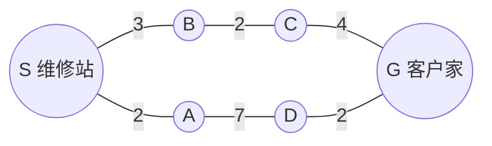
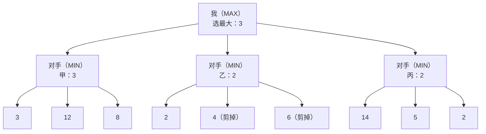
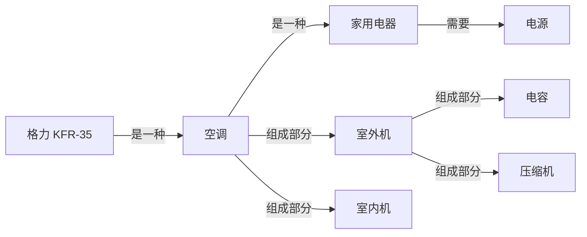
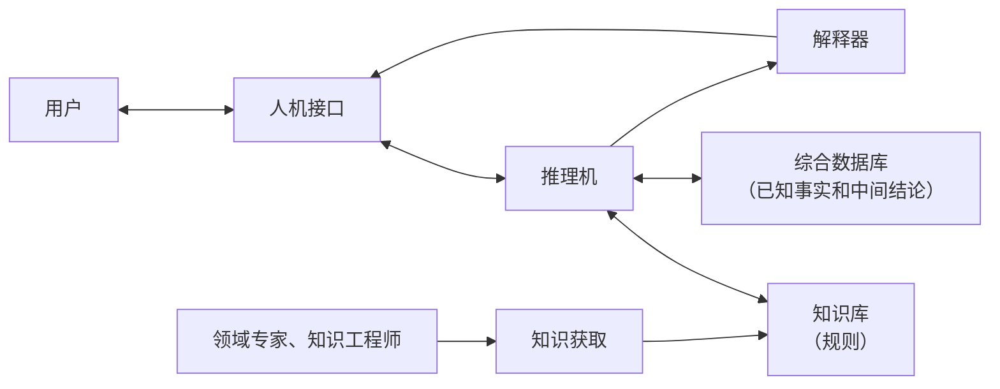
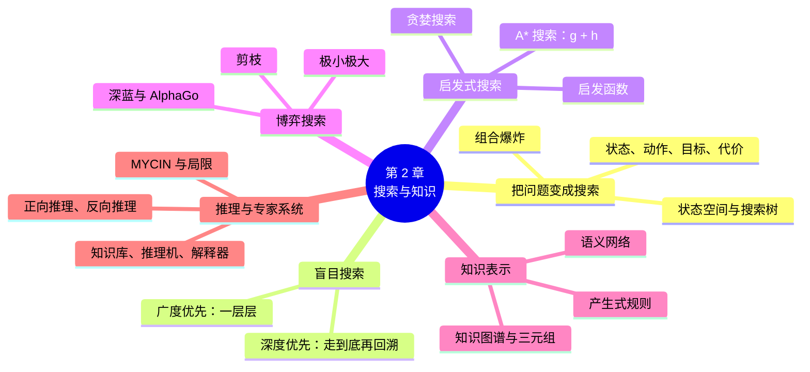

# 第 2 章 搜索、知识表示与专家系统

!!! abstract "本章学时"
    理论 4 学时（建议线上 3 · 线下 1）· 在线体验 2 个

## 学习目标

学完本章，你应该能够：

1. **说出**状态、动作、状态空间、搜索树的含义，能把一个简单问题表示成搜索问题（记忆、理解）；
2. **解释**广度优先、深度优先和启发式搜索的区别，说明 A* 搜索为什么既快又能找到最短路线（理解）；
3. **手动执行**一次广度优先搜索和 A* 搜索，并用极小极大方法为一棵小博弈树选出最好的一步（应用）；
4. **说明**产生式规则、语义网络、知识图谱三种知识表示方法，能把一句话写成三元组（理解、应用）；
5. **用产生式规则完成**一次专家系统的正向推理和反向推理，说出专家系统由哪几部分组成（应用）；
6. **分析**专家系统的局限，判断一个实际问题适合用规则、机器学习还是大模型来解决（分析）。

!!! info "先修要求"
    学习本章前，你需要了解：

    - 人工智能的三大学派，尤其是符号主义“用符号表示知识、按规则推理”的思路（[1.3 三大学派](../01-overview/index.md#13)）；
    - 第一次、第二次人工智能浪潮的大致经过（[1.2 人工智能的发展历程](../01-overview/index.md#12)）；
    - 不需要编程基础。本章的“算一算”只用到加法和比较大小。

??? abstract "本章概念清单（25 个，点击查看定义和例子）"
    1. [状态](../../appendix/glossary.md#g-状态)
    2. [问题求解](../../appendix/glossary.md#g-问题求解)
    3. [状态空间](../../appendix/glossary.md#g-状态空间)
    4. [搜索树](../../appendix/glossary.md#g-搜索树)
    5. [组合爆炸](../../appendix/glossary.md#g-组合爆炸)
    6. [盲目搜索](../../appendix/glossary.md#g-盲目搜索)
    7. [广度优先搜索](../../appendix/glossary.md#g-广度优先搜索)
    8. [深度优先搜索](../../appendix/glossary.md#g-深度优先搜索)
    9. [启发函数](../../appendix/glossary.md#g-启发函数)
    10. [启发式搜索](../../appendix/glossary.md#g-启发式搜索)
    11. [A* 搜索](../../appendix/glossary.md#g-A*-搜索)
    12. [博弈搜索](../../appendix/glossary.md#g-博弈搜索)
    13. [极小极大算法](../../appendix/glossary.md#g-极小极大算法)
    14. [剪枝](../../appendix/glossary.md#g-剪枝)
    15. [知识表示](../../appendix/glossary.md#g-知识表示)
    16. [产生式规则](../../appendix/glossary.md#g-产生式规则)
    17. [语义网络](../../appendix/glossary.md#g-语义网络)
    18. [知识图谱](../../appendix/glossary.md#g-知识图谱)
    19. [三元组](../../appendix/glossary.md#g-三元组)
    20. [推理](../../appendix/glossary.md#g-推理)
    21. [正向推理](../../appendix/glossary.md#g-正向推理)
    22. [反向推理](../../appendix/glossary.md#g-反向推理)
    23. [专家系统](../../appendix/glossary.md#g-专家系统)
    24. [知识库](../../appendix/glossary.md#g-知识库)
    25. [推理机](../../appendix/glossary.md#g-推理机)

## 情景导入

小陈在一家家电售后服务中心做客服调度。每天早上，系统里排着几十张维修单：东城区一台空调不制冷，西城区一台洗衣机漏水，南边新区一台热水器打不着火……

小陈的工作有两件。第一件是**排路线**：给每位维修师傅安排上门顺序，路上少绕远，客户少等。以前他靠记忆和地图一单单排，现在系统会自动给出路线，他只需要检查一下。第二件是**帮客户初步判断故障**：客户打电话说“空调开了半小时还是不凉”，小陈要按照公司的故障排查手册一步步问：“室外机转不转？”“遥控器上是不是设成了制热？”问清楚了，就能判断是让客户自己调一下，还是要派师傅带着零件上门。

这两件事，正是人工智能最早研究的两个问题。排路线是**搜索**：在很多种可能的走法里，找出最好的那一种；按手册排查故障是**知识和推理**：把专家的经验写成“如果……那么……”的规则，再一步步推出结论。

这一章，我们先看计算机怎样把问题变成搜索，怎样又快又好地找到答案，再看怎样把知识表示出来、让计算机像专家一样推理。这些方法属于第 1 章说的符号主义，虽然“年纪”最大，但今天的导航软件、搜索引擎、智能客服里都还在用。

## 2.1 把问题变成搜索

### 2.1.1 状态、动作与目标

要让计算机解决一个问题，先要把问题说清楚。以走迷宫为例，需要说清四件事：

- **初始状态**：从哪里出发。比如迷宫的入口；
- **动作**：每一步可以做什么。比如向上、下、左、右走一格（前提是那边不是墙）；
- **目标**：怎样算解决了问题。比如到达迷宫的出口；
- **代价**：每一步的“成本”。走迷宫时每一步都算 1，开车导航时可以是公里数或分钟数。

这里的[**状态**](../../appendix/glossary.md#g-状态 "对问题在某一时刻情况的完整描述"){ .term }（State）是对问题在某一时刻情况的完整描述。走迷宫时，状态就是“人现在站在哪一格”；下棋时，状态是“棋盘上每个位置有什么棋子、轮到谁走”；八数码游戏（在 3 × 3 的格子里移动 8 块数字滑块，把它们排成 1～8 的顺序）中，状态是 8 块滑块和 1 个空格的摆放方式。

把问题描述成“从初始状态出发，通过一系列动作，到达目标状态”，叫作[**问题求解**](../../appendix/glossary.md#g-问题求解 "把问题描述成“从初始状态出发，通过一系列动作到达目标状态”，再寻找这串动作"){ .term }（Problem Solving）。一旦这样描述清楚，各种看起来毫不相干的问题，比如走迷宫、拼图、排送货路线、安排课程表，就都变成了同一种问题：找一串动作。

### 2.1.2 状态空间与搜索树

一个问题所有可能的状态，以及它们之间通过动作连接起来的关系，合起来叫[**状态空间**](../../appendix/glossary.md#g-状态空间 "一个问题所有可能的状态以及它们之间由动作连接起来的关系"){ .term }（State Space）。可以把它想象成一张地图：每个状态是一个地点，每个动作是一条路。

计算机寻找答案的过程，就是从初始状态出发，一步步“展开”可以到达的状态，直到碰到目标状态。把这个过程画出来，就是一棵[**搜索树**](../../appendix/glossary.md#g-搜索树 "从初始状态出发、逐层展开可到达状态所形成的树形结构"){ .term }（Search Tree）：最上面的“根”是初始状态，每展开一个状态，就把它一步能到达的状态画在下面，作为它的“孩子”。

下面是小陈排路线时的一张简化地图：维修站 S 要派师傅去客户家 G，中间可以经过 A、B、C、D 几个路口，边上的数字是距离（公里）。

从 S 出发，第一层可以到 A、B；从 A 可以到 D，从 B 可以到 C；再往下就到 G 了。这就是一棵很小的搜索树。从 S 到 G 有两条路：S → A → D → G 共 2 + 7 + 2 = 11 公里，S → B → C → G 共 3 + 2 + 4 = 9 公里。我们一眼就能看出后一条更近，但计算机没有“一眼”，它得按某种规则一步步去找。

### 2.1.3 组合爆炸

小地图上的搜索很简单，可是状态空间往往大得惊人。

!!! tip "算一算：状态空间有多大"
    - **八数码**：9 个位置摆 8 块滑块和 1 个空格，共有 9 × 8 × 7 × … × 1 = 362880 种摆法，其中能从初始状态移动到达的恰好一半，即 181440 种。计算机几秒钟就能全部搜一遍。
    - **送货路线**：一位师傅一天要去 10 户人家，按不同顺序上门，有 10 × 9 × 8 × … × 1 = 3628800 种排法；如果是 20 户，就有大约 2.4 × 10¹⁸ 种，计算机每秒检查 10 亿种也要算 70 多年。
    - **围棋**：19 × 19 的棋盘上，合法的局面约有 2.08 × 10¹⁷⁰ 种[[1]](#ref2-1)，而整个可观测宇宙中的原子数大约只有 10⁸⁰ 个。

状态数随着问题规模的增大急剧增长，叫作[**组合爆炸**](../../appendix/glossary.md#g-组合爆炸 "问题的状态数随规模增大而急剧增长、无法逐一检查的现象"){ .term }。第 1 章说的“第一次浪潮中的程序只能解决玩具问题”，原因之一就在这里。所以，研究搜索的关键不是“能不能找到”，而是“怎样少走冤枉路、尽快找到好的答案”。

## 2.2 盲目搜索

最基本的搜索方法，只知道“从哪里出发、哪里是目标”，对目标在哪个方向一无所知，只能按固定的顺序一个个去试，所以叫[**盲目搜索**](../../appendix/glossary.md#g-盲目搜索 "不利用目标方向等额外信息、按固定顺序展开状态的搜索方法，也叫无信息搜索"){ .term }（也叫无信息搜索）。最常用的两种是广度优先和深度优先。

### 2.2.1 广度优先搜索：一层一层地找

[**广度优先搜索**](../../appendix/glossary.md#g-广度优先搜索 "先展开离起点近的状态、一层层向外扩展的搜索方法，能找到步数最少的路线"){ .term }（Breadth-First Search，BFS）先把离起点一步远的状态全部看一遍，再看两步远的，再看三步远的……像往水里扔一颗石子，波纹一圈圈向外扩散。

它的做法是排一个“待查队列”：先进队的先查，查一个状态时，把它的孩子排到队尾。

!!! tip "算一算：在小地图上做广度优先搜索"
    在 2.1.2 节的地图上，从 S 出发找 G（遇到同一层的多个状态，按字母顺序排队）：

    | 步骤 | 取出查看 | 新排进队尾的 | 待查队列 |
    |---|---|---|---|
    | 1 | S | A、B | A、B |
    | 2 | A | D | B、D |
    | 3 | B | C | D、C |
    | 4 | D | G | C、G |
    | 5 | C | （G 已在队中） | G |
    | 6 | G：找到目标 | | |

    找到的路线是 S → A → D → G，经过 3 段路，共 11 公里。

    注意：广度优先搜索保证找到的是**步数最少**的路线，但这里两条路都是 3 段，它不管每段路有多长，所以找到的反而是更远的那条。如果每一步的代价都一样（比如走迷宫，每步都算 1），广度优先找到的就是最短路线。

广度优先搜索的优点是：只要答案存在，就一定能找到，而且找到的是步数最少的答案。缺点是要同时记住很多“待查”的状态，问题一大，内存就不够用了。

### 2.2.2 深度优先搜索：一条路走到黑

[**深度优先搜索**](../../appendix/glossary.md#g-深度优先搜索 "沿一条路一直走到底、走不通再回溯的搜索方法"){ .term }（Depth-First Search，DFS）正好相反：选一条路一直往下走，走到头（没有新的状态可去）了，再退回上一个岔路口，换一条路继续走。这个“退回去换条路”的动作叫回溯。走迷宫时“右手扶着墙一直走”，就是一种深度优先的走法。

在小地图上，深度优先搜索从 S 出发，先走 A，再走 D，再走 G，三步就找到了，一次回溯都不用。但如果运气不好，先走进一条很深的死胡同，就要走很久才退回来。

| | 广度优先搜索 | 深度优先搜索 |
|---|---|---|
| 展开顺序 | 一层层向外扩，先近后远 | 一条路走到底，走不通再回溯 |
| 待查的状态怎样排 | 队列：先进先出 | 栈：后进先出 |
| 一定能找到答案吗 | 能（答案存在时） | 状态空间无限大时可能一直走下去 |
| 找到的是最短的吗 | 步数最少 | 不一定 |
| 占用内存 | 多，要记住整层的状态 | 少，只需记住当前这条路 |
| 生活中的例子 | 找人时先问身边的朋友，再问朋友的朋友 | 走迷宫时右手扶墙一直走 |

### 2.2.3 考虑距离：一致代价搜索

开车导航时，每段路的长度不一样，“步数最少”没有意义，要的是“总距离最短”。这时可以把广度优先稍作修改：每次不再取最早进队的，而是取**从起点算起累计距离最短**的那个状态来展开。这叫一致代价搜索，它和荷兰计算机科学家迪杰斯特拉（Edsger Dijkstra）1959 年提出的最短路径算法[[2]](#ref2-2)思路一致。

在小地图上，一致代价搜索会先展开 A（累计 2），再展开 B（累计 3），再展开 C（累计 5），然后 D（累计 9）和 G（经 C 到 G，累计 9）谁先谁后都可以，最终找到 9 公里的那条路。它能保证找到最短路线，但仍然是“盲目”的：它不知道 G 在哪个方向，会朝四面八方均匀地扩展，在大城市的路网上要展开大量明显走反了的路口。

## 2.3 启发式搜索

### 2.3.1 启发函数：给搜索一个“方向感”

人找路时不是盲目的。要从城东去城西，你不会先往东走，因为你知道目标大致在哪个方向。如果给搜索也加上这样的“方向感”，就能少走很多冤枉路。

[**启发函数**](../../appendix/glossary.md#g-启发函数 "对从当前状态到目标还有多远的估计，记作 h"){ .term }（Heuristic Function）就是对“从当前状态到目标还有多远”的一个估计，通常记作 h。它不需要很精确，但要容易算。常用的启发函数有：

- **直线距离**：地图上两点之间的直线距离。真正的路一定比直线长（或相等），所以它总是“往少里估”；
- **曼哈顿距离**：在方格迷宫里，横着差几格加上竖着差几格。像在曼哈顿那样街道横平竖直的城市里打车，不能斜着穿过楼房；
- **八数码中不在正确位置的滑块数**：差得越多，离目标越远。

利用启发函数来决定先展开哪个状态的搜索方法，叫[**启发式搜索**](../../appendix/glossary.md#g-启发式搜索 "利用启发函数决定先展开哪个状态的搜索方法"){ .term }（Heuristic Search）。

### 2.3.2 只看“还剩多远”：贪婪搜索

最简单的启发式搜索是：每次都展开 h 最小、也就是看起来“离目标最近”的状态，这叫贪婪最佳优先搜索，简称贪婪搜索。

给小地图上每个路口标上到 G 的直线距离：S 为 8，A 为 4，B 为 5，C 为 3，D 为 1，G 为 0。贪婪搜索从 S 出发，比较 A（4）和 B（5），选 A；从 A 只能到 D（1），选 D；从 D 到 G，找到了。一共只展开了 4 个路口，很快，可找到的是 11 公里的那条路，不是最短的。

问题出在：贪婪搜索只看“还剩多远”，不管“已经走了多远”。A 离目标看起来近，但从 A 过去要绕一段 7 公里的路。

### 2.3.3 A* 搜索：已走的加上还剩的 { #233 }

1968 年，美国斯坦福研究所的哈特（Peter Hart）、尼尔森（Nils Nilsson）和拉斐尔（Bertram Raphael）提出了 [**A\* 搜索**](../../appendix/glossary.md#g-A*-搜索 "每次展开“已走的代价 g + 估计剩余代价 h”最小的状态的启发式搜索，h 不高估时能找到最短路线"){ .term }[[3]](#ref2-3)（读作“A 星”），把两者结合起来。它给每个状态算一个分数：

\[ f = g + h \]

其中 g 是从起点到这个状态**已经走了**多远（精确值），h 是从这个状态到目标**估计还剩**多远（启发函数），f 就是“经过这个状态的整条路线大约多长”。每次展开 f 最小的状态。

!!! tip "算一算：在小地图上做 A\* 搜索"
    用 2.1.2 节的地图和 2.3.2 节的直线距离 h：

    | 步骤 | 展开 | 新加入的候选（g + h = f） | 待选的候选及其 f |
    |---|---|---|---|
    | 1 | S | A：2 + 4 = 6；B：3 + 5 = 8 | A 6、B 8 |
    | 2 | A（f = 6 最小） | D：2 + 7 = 9，9 + 1 = 10 | B 8、D 10 |
    | 3 | B（f = 8） | C：3 + 2 = 5，5 + 3 = 8 | C 8、D 10 |
    | 4 | C（f = 8） | G：5 + 4 = 9，9 + 0 = 9 | G 9、D 10 |
    | 5 | G（f = 9 最小）：找到目标 | | |

    找到的路线是 S → B → C → G，9 公里，是最短的。A\* 一开始也被 A 的“近”吸引过去看了一眼，但算出经过 A 的路线至少要 10 公里后，就转回了 B 那边。

只要启发函数从不“往多里估”（比如直线距离永远不会超过真实路程），A\* 就**保证能找到最短路线**；而且启发函数估得越准，展开的状态越少，搜得越快。这正是 A\* 半个多世纪来一直被广泛使用的原因：既快，又好。

| | 广度优先 | 一致代价 | 贪婪搜索 | A\* 搜索 |
|---|---|---|---|---|
| 按什么选下一个 | 先进队的 | 已走距离 g 最小 | 估计剩余 h 最小 | g + h 最小 |
| 有没有方向感 | 没有 | 没有 | 有 | 有 |
| 找到的一定最短吗 | 步数最少 | 是 | 不一定 | 是（h 不高估时） |
| 速度 | 慢 | 较慢 | 快 | 快 |

<iframe class="sim-frame" src="../../sims/maze-search/main.html" height="700" loading="lazy" title="迷宫寻路：三种搜索比一比"></iframe>

动画：迷宫寻路。在同一个迷宫上分别运行广度优先、深度优先和 A\* 搜索，看彩色格子怎样一步步“铺开”，比较展开的格子数和找到的路线长度。可以点格子加墙、去墙。[全屏打开](../../sims/maze-search/main.html){ target=_blank }
{ .sim-caption }

### 2.3.4 导航软件怎样规划路线

手机导航软件规划路线，核心思路就是 A\* 一类的启发式搜索，只是做了很多工程上的改进：

- **代价不只是距离**：每段路的“代价”可以是预计通行时间，结合实时路况、红绿灯、限速来算；选“躲避拥堵”“不走高速”，就是改了代价的算法；
- **路网先分层**：先在高速和主干道组成的“大地图”上规划大方向，再在起点、终点附近的小路上细化，就像人先想“走哪条高速”，再想“从哪个口下”；
- **提前算好一部分**：城市里常用的路段组合，服务器提前算好存起来，你点“开始导航”时只需拼一下；
- **路况要预测**：现在不堵的路，半小时后到那里时可能会堵，导航软件用第 3 章的机器学习，根据历史数据预测未来的通行时间。

所以，一次导航背后，既有半个多世纪前的搜索算法（符号主义），又有从海量出行数据中学出的预测模型（连接主义），这正是第 1 章所说的“三派融合”。

## 2.4 博弈搜索

### 2.4.1 博弈树：两个人轮流走

走迷宫只有一个人在做决定。下棋就不一样了：你走一步，对手走一步，对手会千方百计让你输。这类有对手的搜索叫[**博弈搜索**](../../appendix/glossary.md#g-博弈搜索 "在有对手、双方轮流行动的问题中寻找最好走法的搜索"){ .term }（Game Search）。

把双方轮流走棋的所有可能画出来，就是一棵博弈树。树根是当前局面，第一层是“我”的各种走法，第二层是对手对每种走法的各种应对，第三层又轮到“我”……一直到棋局结束，结束时给局面打分：我赢了记 +1，输了记 −1，和棋记 0。复杂的棋类走不到结束，就在走几步之后，用一个“局面评估函数”估计当前局面对我有多有利。

### 2.4.2 极小极大：假设对手也很聪明

怎样在博弈树上选出最好的一步？关键是假设**对手也会选对他最有利、对我最不利的走法**。于是：

- 轮到我走的那一层（叫 MAX 层），我选孩子中分数**最大**的；
- 轮到对手走的那一层（叫 MIN 层），对手会选孩子中分数**最小**的；
- 从最底下的叶子开始，一层层往上算，算到树根，就知道该怎么走了。

这就是[**极小极大算法**](../../appendix/glossary.md#g-极小极大算法 "假设对手总选对我最不利的走法，在博弈树上自下而上取最小、最大值来选出最好一步的方法"){ .term }（Minimax）。

!!! tip "算一算：一棵小博弈树"
    轮到我走，我有甲、乙、丙三种走法；每种走法之后，对手各有三种应对；最下面一行是这样走完后局面的分数（越大对我越有利）：

    | 我的走法 | 对手应对后的分数 | 对手会选（MIN） |
    |---|---|---|
    | 甲 | 3、12、8 | 3 |
    | 乙 | 2、4、6 | 2 |
    | 丙 | 14、5、2 | 2 |

    我在 3、2、2 中选最大的，所以走**甲**，能保证至少得 3 分。

    注意：只看最下面一行，丙里有全场最高的 14 分，很诱人。但对手不会让我得到 14 分，他会选 2。极小极大算法的精髓就是：**不指望对手犯错**。

### 2.4.3 剪枝：不必算的就不算

再仔细看乙这一支：已经知道走甲至少能得 3 分。算乙时，对手的第一种应对就让我只得 2 分，比 3 还小。既然对手在乙这一支最多只会给我 2 分，乙已经不可能比甲好了，乙剩下的 4 和 6 根本不用再算。

这种“已经知道不可能更好，就不再往下算”的方法叫[**剪枝**](../../appendix/glossary.md#g-剪枝 "在搜索中跳过已知不可能更好的分支、以减少计算量的方法，常用 α-β 剪枝"){ .term }（Pruning），常用的是 α-β 剪枝[[4]](#ref2-4)。剪枝不会改变最后选出的走法，却能省掉大量计算。在国际象棋这样的游戏里，好的剪枝能让同样的时间里多算好几步。

<iframe class="sim-frame" src="../../sims/tic-tac-toe/main.html" height="620" loading="lazy" title="井字棋对弈：极小极大"></iframe>

动画：井字棋对弈。你执 ×，计算机执 ○，计算机用极小极大算法下棋。打开“显示评分”，可以看到每个空格在极小极大算法眼里的分数；比较“剪枝”开、关时计算机要检查多少个局面。[全屏打开](../../sims/tic-tac-toe/main.html){ target=_blank }
{ .sim-caption }

井字棋的局面不多，计算机能算到棋局结束，所以它**永远不会输**：只要你不犯错，结果一定是和棋。你可以在动画里试一试。

### 2.4.4 从“深蓝”到 AlphaGo { #244 }

国际象棋的博弈树比井字棋大得多，算不到底。1997 年击败卡斯帕罗夫的“深蓝”[[5]](#ref2-5)，用的就是极小极大加剪枝，再配上专门设计的芯片，每秒能评估约两亿个局面，一般能往后算十几步；它的局面评估函数，则是由国际象棋大师和程序员一起手工设计的。

围棋就难多了。一是每步可选的位置有两百多个，比国际象棋多得多，树长得太“宽”；二是围棋局面的好坏很难用规则打分，连职业棋手也常说不清为什么这步好。所以直到 2015 年，最强的围棋程序也只有业余高手的水平。

AlphaGo 的办法是：用深度神经网络从大量棋谱和自我对弈中学出两样东西，一是“这一步大概该下在哪几个位置”（让树变“窄”），二是“这个局面我方胜率多少”（代替手工设计的评估函数），再用一种叫蒙特卡洛树搜索的方法，把搜索集中在最有希望的走法上（第 8 章）。搜索还是那个搜索，但“往哪里搜”“搜到这里好不好”交给了从数据中学出来的神经网络。

## 2.5 知识表示

搜索解决的是“怎样找到答案”。但很多问题光靠搜索不够，还需要**知识**：医生诊断要懂医学知识，客服排查故障要懂家电知识。怎样把人的知识用计算机能处理的形式写下来，叫[**知识表示**](../../appendix/glossary.md#g-知识表示 "把人的知识用计算机能够存储和处理的形式写下来的方法"){ .term }（Knowledge Representation）。本节介绍三种常用的方法。

### 2.5.1 产生式规则：如果……那么……

[**产生式规则**](../../appendix/glossary.md#g-产生式规则 "“如果 条件 那么 结论”形式的知识表示方法"){ .term }（Production Rule）是最直观的一种，形式是：

> 如果　条件（可以有多个，用“并且”“或者”连接）　那么　结论（或动作）

比如售后服务中心的故障排查手册，可以写成这样的规则：

- 规则 1：如果 空调不制冷 并且 遥控器设为制热模式，那么 故障原因是模式设置错误；
- 规则 2：如果 空调不制冷 并且 室外机不转，那么 怀疑室外机电源或电容故障；
- 规则 3：如果 怀疑室外机电源或电容故障，那么 派师傅携带电容上门。

规则的好处是：和人的思考方式接近，一条条独立，容易读懂，也容易增删。它的问题在 2.6 节和第 3 章都说过：规则多了，难免互相矛盾，也总有写不到的情况。

### 2.5.2 语义网络：用“点”和“线”表示知识

[**语义网络**](../../appendix/glossary.md#g-语义网络 "用点表示事物或概念、用带名称的有向线表示它们之间关系的知识表示方法"){ .term }（Semantic Network）用图来表示知识：点表示事物或概念，带箭头的线表示它们之间的关系，线上写着关系的名称。

语义网络的一大好处是**继承**：知道“格力 KFR-35 是一种空调”“空调是一种家用电器”“家用电器需要电源”，计算机就能顺着箭头推出“格力 KFR-35 需要电源”，不用每样东西都写一遍。

### 2.5.3 知识图谱与三元组

[**知识图谱**](../../appendix/glossary.md#g-知识图谱 "以实体为节点、关系为边组织知识的图结构"){ .term }（Knowledge Graph）可以看作超大规模的语义网络。2012 年，谷歌在搜索引擎中推出“知识图谱”[[6]](#ref2-6)，提出要从搜索“字符串”变成理解“事物”：搜一位名人，结果页旁边直接显示他的出生日期、代表作、家人等信息卡片。今天各大搜索引擎、电商平台、银行、医院都有自己的知识图谱，规模从几百万到几十亿条知识不等。

知识图谱里的每一条知识，都写成一个[**三元组**](../../appendix/glossary.md#g-三元组 "知识图谱中一条知识的基本形式：（头实体，关系，尾实体）或（实体，属性，值）"){ .term }（Triple）：

> （头实体，关系，尾实体）　或　（实体，属性，值）

比如：

- （鲁迅，出生地，绍兴）
- （绍兴，所属省份，浙江）
- （鲁迅，代表作，《呐喊》）
- （格力 KFR-35，品牌，格力）

!!! tip "算一算：顺着三元组找答案"
    问题：“鲁迅出生在哪个省？”知识图谱里没有直接写（鲁迅，出生省份，?）。

    1. 先找头实体是“鲁迅”、关系是“出生地”的三元组，得到“绍兴”；
    2. 再找头实体是“绍兴”、关系是“所属省份”的三元组，得到“浙江”；
    3. 答案：浙江。

    这种顺着关系一步步走的查询叫“多跳”查询。想一想：“《呐喊》的作者出生在哪个省？”要走几跳？（答案：三跳，先从《呐喊》反查作者鲁迅，再查出生地，再查省份。）

知识图谱怎样建起来？早期靠人工整理，后来更多地用自然语言处理技术，自动从大量文本中找出实体和它们之间的关系（《自然语言处理导论》第 7 章）。今天，知识图谱还常和大模型配合使用：大模型擅长理解和表达，但可能编造事实；知识图谱里的知识经过核实，可以拿来给大模型的回答“把关”（第 5 章的检索增强生成）。

| | 产生式规则 | 语义网络 | 知识图谱 |
|---|---|---|---|
| 形式 | 如果……那么…… | 点 + 带名称的线 | 海量三元组组成的图 |
| 擅长表示 | 判断和操作的步骤 | 概念之间的关系、继承 | 大量实体和事实 |
| 典型用途 | 专家系统、故障排查 | 早期的知识系统 | 搜索引擎、推荐、问答、风控 |

## 2.6 推理与专家系统

### 2.6.1 推理：从已知推出未知

有了知识，还要会用。从已知的事实和知识出发，按规则推出新结论的过程，叫[**推理**](../../appendix/glossary.md#g-推理 "从已知事实和知识出发，按规则推出新结论的过程"){ .term }（Reasoning）。用产生式规则推理，有两个方向。

[**正向推理**](../../appendix/glossary.md#g-正向推理 "从已知事实出发，不断执行条件已满足的规则、推出新结论的推理方式（由因到果）"){ .term }（Forward Reasoning）从已知事实出发，看哪些规则的条件已经满足，就执行这条规则，把结论加入已知事实，再看又有哪些规则能用，如此反复，直到推出结论或者没有规则可用。这是“由因到果”的思路，像侦探从线索出发一步步推理。

[**反向推理**](../../appendix/glossary.md#g-反向推理 "先提出假设的结论，再寻找并验证支持它所需条件的推理方式（由果找因）"){ .term }（Backward Reasoning）先提出一个假设的结论，看要证明它需要哪些条件，再看这些条件是已知的、还是需要进一步证明或者问用户。这是“由果找因”的思路，像医生先怀疑“是不是肺炎”，再去开相应的检查。

下面用一组经典的“动物识别”规则来演示[[7]](#ref2-7)（节选，完整的 15 条规则见体验 2-2 的动画）：

| 规则 | 如果 | 那么 |
|---|---|---|
| R1 | 有毛发 | 是哺乳动物 |
| R5 | 吃肉 | 是食肉动物 |
| R7 | 是哺乳动物 并且 有蹄 | 是有蹄类动物 |
| R9 | 是哺乳动物 并且 是食肉动物 并且 黄褐色 并且 有暗斑点 | 是金钱豹 |
| R10 | 是哺乳动物 并且 是食肉动物 并且 黄褐色 并且 有黑色条纹 | 是虎 |
| R12 | 是有蹄类动物 并且 有黑色条纹 | 是斑马 |

!!! tip "算一算：正向推理和反向推理"
    **正向推理**。已知事实：有毛发、吃肉、黄褐色、有黑色条纹。

    1. 看 R1：条件“有毛发”满足，得出“是哺乳动物”，加入已知事实；
    2. 看 R5：条件“吃肉”满足，得出“是食肉动物”，加入已知事实；
    3. 看 R7：“有蹄”不知道，不能用；
    4. 看 R9：“有暗斑点”不满足，不能用；
    5. 看 R10：四个条件都满足，得出“**是虎**”，推理结束。

    **反向推理**。假设：这只动物是斑马。

    1. 要证明“是斑马”，根据 R12，需要“是有蹄类动物”并且“有黑色条纹”；
    2. 要证明“是有蹄类动物”，根据 R7，需要“是哺乳动物”并且“有蹄”；
    3. 要证明“是哺乳动物”，根据 R1，需要“有毛发”：问用户，用户回答“有”；
    4. “有蹄”：问用户，用户回答“有”；“有黑色条纹”：问用户，用户回答“有”；
    5. 所有条件都成立，结论“是斑马”得证。

    比较一下：正向推理不需要先猜结论，但可能执行很多和最终结论无关的规则；反向推理目标明确，只问和假设有关的问题，适合需要一步步向用户提问的场合，但先要猜对假设，猜错了就要换一个假设重来。

### 2.6.2 专家系统的组成

把某个领域专家的知识写成规则，再配上推理程序，让计算机像专家一样解决问题，这就是[**专家系统**](../../appendix/glossary.md#g-专家系统 "把领域专家的知识写成规则、配上推理程序，像专家一样解决问题的计算机系统"){ .term }（Expert System）。一个典型的专家系统由下面几部分组成：

- [**知识库**](../../appendix/glossary.md#g-知识库 "专家系统中存放领域知识（主要是规则）的部分"){ .term }（Knowledge Base）：存放领域知识，主要是一条条规则，相当于专家的“经验”；
- **综合数据库**：存放当前问题的已知事实和推理过程中得出的中间结论，相当于专家的“草稿纸”；
- [**推理机**](../../appendix/glossary.md#g-推理机 "专家系统中决定使用哪条规则、按什么顺序推理的部分"){ .term }（Inference Engine）：决定用哪条规则、按什么顺序推理（正向、反向或两者结合），相当于专家的“思考方法”；
- **解释器**：回答用户“为什么问这个问题”“这个结论是怎么得出来的”，把用到的规则一条条列出来；
- **知识获取**：由知识工程师和领域专家一起，把专家的经验整理成规则，录入、修改知识库；
- **人机接口**：和用户对话，提问、接收回答、显示结论。

知识库和推理机分开，是专家系统的一个重要设计：换一个领域，推理机不用改，只需换一套知识库。会解释，则是专家系统的一大优点，也是它在今天仍有用武之地的原因：银行拒绝一笔贷款、医院给出一条用药提醒，常常要求说得清理由。

### 2.6.3 MYCIN：一个著名的专家系统 { #263 }

1970 年代，美国斯坦福大学开发了一个叫 MYCIN 的专家系统[[8]](#ref2-8)，帮助医生诊断血液感染、脑膜炎等细菌感染，并推荐抗生素。它的知识库有大约 600 条规则，采用反向推理：先假设可能是哪种细菌，再一步步向医生询问病人的化验结果和症状。为了处理医学中常见的“不太确定”，MYCIN 给每条规则和每个结论都配了一个“可信度”。

研究者请专家对 MYCIN 和几位医生给出的治疗方案进行盲评，MYCIN 方案的可接受率约为 65%，与参与评比的斯坦福医学院教员相当，甚至更高[[9]](#ref2-9)。可是 MYCIN 从来没有在临床上正式使用：医生要一条条手工输入病人的资料，非常麻烦；当时的计算机也没法和医院的其他系统连起来；万一诊断错了谁来负责，也说不清楚。

### 2.6.4 专家系统的局限

MYCIN 的故事说明了专家系统的几个典型问题：

- **知识获取难**：专家很多经验是“只可意会”的，很难说成规则，整理一个领域的知识要花几年时间，这被称为专家系统的“知识获取瓶颈”；
- **脆弱**：只能处理规则覆盖到的情况，遇到规则之外的新情况，不会像人一样随机应变，甚至给出荒唐的答案；
- **难维护**：规则多到几千条以后，改一条可能影响一大片，很难保证规则之间不互相矛盾；
- **不会学习**：知识不会随着使用自动增长，要靠人不断补充。

这些问题，正是第二次低谷的原因，也引出了第 3 章的机器学习：与其让人一条条写规则，不如让计算机从数据中自己学。但规则方法并没有消失。今天，在需要**规则明确、结果可解释、出错代价大**的地方，规则仍然是主角：税务计算、保险理赔的条款审核、银行的合规检查、家电售后的标准排查流程。

!!! example "案例：怎样选择解决问题的方法"
    同样是售后服务中心，不同的问题适合不同的方法：

    | 问题 | 适合的方法 | 理由 |
    |---|---|---|
    | 根据保修政策判断能不能免费维修 | 规则 | 条款明确，必须严格执行，要能向客户说明理由 |
    | 根据客户描述和机器上传的运行数据，预测是哪个零件坏了 | 机器学习 | 规律复杂，专家也说不全，但有大量历史维修记录可以学习 |
    | 理解客户五花八门的口语描述，自动整理成维修单 | 大模型 | 语言表达千变万化，需要很强的语言理解能力 |
    | 给 30 张维修单排上门路线 | 搜索 | 目标明确（总路程最短），可以用启发式搜索求解 |

    实际系统常把几种方法组合起来：大模型听懂客户的话，机器学习预测故障，规则判断保修政策，搜索排路线。

## 2.7 身边的 AI

### 2.7.1 地图导航与路线规划

每天有数亿人次使用手机地图导航。除了 2.3.4 节说的路线规划，外卖平台给骑手派单、快递公司给快递员排派送顺序、网约车平台给司机派单，都要在“哪个人去哪里、按什么顺序走”的巨大状态空间里快速找到好的方案。这类问题规模很大，往往不追求“最好”，而是用启发式方法在几秒钟内找到“足够好”的方案，再结合机器学习预测的送达时间不断调整。

### 2.7.2 搜索引擎和电商里的知识图谱

在搜索引擎里搜一个城市、一位名人、一部电影，结果页常会出现一张知识卡片，这就是知识图谱的直接应用。电商平台也有商品知识图谱：知道“羽绒服”适合“冬季”、“登山”需要“冲锋衣”，你搜“冬天去哈尔滨穿什么”，它能推荐相关商品。银行用知识图谱把人、账户、手机号、设备连起来，发现一伙人共用几台设备频繁转账这样的可疑团伙。

### 2.7.3 智能客服的知识库

你在购物 App、银行 App 里咨询的智能客服，背后都有一个知识库：常见问题和标准答案、业务办理流程、各种规则和政策。过去，智能客服靠关键词匹配问题，常常答非所问；现在越来越多的智能客服用大模型来理解问题、组织回答，但答案的依据仍然来自经过审核的知识库，这样既说得自然，又不乱说（第 5、8 章）。维护这个知识库，正是人工智能训练师的日常工作之一。

### 2.7.4 医疗和法律中的知识系统

医院的临床决策支持系统，会在医生开处方时自动检查：这两种药能不能一起吃？剂量是否超过上限？病人是否对某种药过敏？这些检查大多靠规则和医学知识图谱完成。法院、律师事务所用法律知识图谱，把法条、案例、罪名、量刑情节关联起来，帮助检索类似案例。这些领域对“可解释”的要求很高，规则和知识图谱至今是重要的工具。

!!! cert "证书考点 · 人工智能应用工程师 · 知识图谱"
    人工智能应用工程师（高级）的考核内容中包括知识图谱的基本概念与应用。本节内容建议这样复习：能用三元组表示一句话里的知识；能说出知识图谱在搜索、推荐、问答、风控中的一个应用；能说明知识图谱和大模型配合使用的好处（知识图谱保证事实准确，大模型负责理解和表达）。

## 在线体验

!!! abstract "体验总览"

    | 体验 | 用到什么 | 时长 |
    |---|---|---|
    | 2-1 迷宫寻路：比一比三种搜索 | 本书动画“迷宫寻路”“井字棋对弈” | 约 25 分钟 |
    | 2-2 动物识别专家系统 | 本书动画“动物识别专家系统” | 约 20 分钟 |

    两个体验都只需要浏览器，电脑和手机都可以。建议边做边把结果填进记录表，课后练习的实操题会用到。

### 体验 2-1 迷宫寻路：比一比三种搜索

**体验目的**：通过观察三种搜索在同一个迷宫上的表现，理解广度优先“一层层扩”、深度优先“一条路走到黑”、A\* “朝着目标去”的区别；通过和计算机下井字棋，体会极小极大和剪枝。

**打开方式**：2.3.3 节中嵌入的动画，或者[全屏打开“迷宫寻路”](../../sims/maze-search/main.html){ target=_blank }。

**第一部分：迷宫寻路**

1. 默认迷宫中，绿色方块是起点，红色方块是终点。先选“广度优先”，点“自动运行”，观察浅蓝色的已展开格子怎样一圈圈扩散。运行结束后，把“展开格子数”和“路线长度”填进记录表。
2. 点“重置”，依次换成“深度优先”和“A\*”，各运行一次，记录同样的两个数。
3. 点“换一个迷宫”，在第二个迷宫上把三种方法再各运行一次。
4. 点“清空墙壁”，在空地上比较三种方法。想一想：没有墙的时候，深度优先找到的路线为什么会弯弯绕绕？
5. 自己点格子加几道墙，设计一个能让 A\* 也“上当”（展开很多格子）的迷宫，截图保存。

**第二部分：井字棋对弈**

打开 2.4.3 节中的动画，或者[全屏打开“井字棋对弈”](../../sims/tic-tac-toe/main.html){ target=_blank }。

1. 和计算机下三盘，记录结果。你能赢吗？
2. 打开“显示评分”，再下一盘，每一步之前看看各个空格的分数（+1 表示你走这里最终能赢，0 表示和棋，−1 表示会输），想一想计算机为什么认为某一步好。
3. 计算机每走一步，页面会显示它检查了多少个局面。分别在“剪枝：开”和“剪枝：关”下，记录计算机走第一步时检查的局面数。

**记录表**

| 迷宫 | 方法 | 展开格子数 | 路线长度 | 是不是最短 |
|---|---|---|---|---|
| 迷宫 1 | 广度优先 | | | |
| 迷宫 1 | 深度优先 | | | |
| 迷宫 1 | A\* | | | |
| 迷宫 2 | 广度优先 / 深度优先 / A\* | ___ / ___ / ___ | ___ / ___ / ___ | |
| 空地 | 广度优先 / 深度优先 / A\* | ___ / ___ / ___ | ___ / ___ / ___ | |

| 井字棋 | 结果或数字 |
|---|---|
| 三盘的结果 | |
| 计算机第一步检查的局面数（剪枝开 / 关） | ___ / ___ |

**想一想**

1. 三种方法中，哪一种展开的格子最少？哪几种找到的路线一定最短？
2. 为什么剪枝开、关时，计算机下出的棋一样，检查的局面数却差很多？

### 体验 2-2 动物识别专家系统

**体验目的**：通过逐条触发规则，亲手完成一次正向推理，看懂专家系统的知识库、综合数据库、推理机和解释器各自在做什么；通过自己添加规则，体会“知识获取”的难处。

**打开方式**：[全屏打开“动物识别专家系统”](../../sims/animal-expert/main.html){ target=_blank }，或者打开本节下方嵌入的动画。

<iframe class="sim-frame" src="../../sims/animal-expert/main.html" height="720" loading="lazy" title="动物识别专家系统"></iframe>

动画：动物识别专家系统。左边勾选观察到的特征（已知事实），点“推理一步”，看推理机找到哪条规则可以用、得出什么新结论；右边是 15 条规则组成的知识库。[全屏打开](../../sims/animal-expert/main.html){ target=_blank }
{ .sim-caption }

**步骤**

1. 勾选“有毛发”“吃肉”“黄褐色”“有黑色条纹”，点“推理一步”，每点一次记录用到了哪条规则、得出了什么结论，直到推出最终结论。和 2.6.1 节的“算一算”对照。
2. 点“清空”，换一组特征：“有羽毛”“不会飞”“会游泳”“有黑白二色”，一步步推理，看推出了什么动物。
3. 点“清空”，只勾选“有毛发”和“有蹄”，推理到底。系统给出最终结论了吗？为什么？
4. 点“为什么”按钮，查看解释器给出的推理过程，抄下其中一条推理链。
5. 在“添加规则”中，自己写一条新规则，比如“如果 是哺乳动物 并且 有长鼻子 那么 是大象”，再勾选相应的特征测试它能不能生效。试着再加一条和已有规则矛盾的规则，看看会发生什么。

**记录表**

| 序号 | 已知事实 | 用到的规则（按顺序） | 最终结论 |
|---|---|---|---|
| 1 | 有毛发、吃肉、黄褐色、有黑色条纹 | | |
| 2 | 有羽毛、不会飞、会游泳、有黑白二色 | | |
| 3 | 有毛发、有蹄 | | |
| 4 | 我添加的规则：______ | 测试用的事实：______ | 是否生效：______ |

**想一想**

1. 第 3 组事实推不出最终结论，如果这是一个真正的专家系统，它接下来应该怎么做？（提示：想想反向推理。）
2. 你添加规则时，有没有遇到“条件怎么写才准确”的困难？结合 2.6.4 节，谈谈专家系统的知识获取为什么难。

## 本章小结

- 把问题描述成**状态**、动作、目标和代价，就能用搜索求解。所有状态及其关系构成**状态空间**，搜索的过程可以画成**搜索树**。状态数随问题规模急剧增长，叫组合爆炸。
- **广度优先搜索**一层层扩展，能找到步数最少的路线，但占内存多；**深度优先搜索**一条路走到底再回溯，省内存，但不保证最短。
- **启发函数**估计离目标还有多远，给搜索加上方向感。**A\* 搜索**按“已走的 + 估计还剩的”选择下一步，只要启发函数不高估，就能又快又准地找到最短路线。导航软件的路线规划就基于这一类方法。
- **博弈搜索**要考虑对手。**极小极大算法**假设对手总选对我最不利的走法，从下往上算出最好的一步；**剪枝**省去不可能更好的分支。从“深蓝”到 AlphaGo，搜索仍是核心，但“往哪里搜”越来越多地交给神经网络。
- **知识表示**的常用方法有**产生式规则**（如果……那么……）、**语义网络**（点和带名称的线）和**知识图谱**（海量**三元组**）。
- **推理**分**正向推理**（由因到果）和**反向推理**（由果找因）。**专家系统**由**知识库**、综合数据库、**推理机**、解释器、知识获取和人机接口组成，优点是可解释，局限是知识获取难、脆弱、难维护、不会学习。

!!! info "深入学习"
    本章的搜索和知识表示方法，在系列其他教材中的去处：

    - 知识图谱的构建（从文本中自动找出实体和关系）：《自然语言处理导论》第 7 章；
    - 用知识库和检索给大模型“把关”（检索增强生成）：本书第 5 章，《自然语言处理导论》第 11 章；
    - AlphaGo 中的蒙特卡洛树搜索和强化学习：本书第 8 章，《机器学习》第 12 章；
    - 搜索算法的完整理论（包括更多启发式搜索、约束满足问题）：参考文献 [10] 的第 3～6 章。

**下一章预告**

专家系统的规则要靠人一条条写，写不全、改不动。能不能换个思路，让计算机自己从大量例子里总结规律？下一章就从一家奶茶店的销量、差评和会员数据讲起，看看机器学习是怎样“从数据中学”的。

## 参考文献

正文中的上标编号（如[[1]](#ref2-1)）对应下面的文献。带链接的可以直接打开；书籍可在图书馆或电子书平台查阅。

**教材与专著**

- [7] 王万良. 人工智能导论（第 5 版）[M]. 北京：高等教育出版社，2020.
    国内常用的人工智能导论教材，“动物识别系统”是其中讲解产生式系统和推理的经典例子，对应 2.6.1 节和体验 2-2。
- [8] Buchanan B G, Shortliffe E H. Rule-Based Expert Systems: The MYCIN Experiments of the Stanford Heuristic Programming Project[M]. Reading, MA: Addison-Wesley, 1984.
    MYCIN 项目的总结性专著，第 31 章收录了下面 [9] 的评估研究，对应 2.6.3 节。
- [10] 罗素 S, 诺维格 P. 人工智能：现代方法（第 4 版）[M]. 张博雅, 陈坤, 田超, 等译. 北京：人民邮电出版社，2022.
    第 3 章讲搜索、第 5 章讲博弈搜索与 α-β 剪枝，2.4.2 节的小博弈树就改编自书中的例子。

**经典论文**

- [2] Dijkstra E W. A Note on Two Problems in Connexion with Graphs[J]. Numerische Mathematik, 1959, 1: 269-271. <https://doi.org/10.1007/BF01386390>
    提出最短路径算法的论文，只有三页，对应 2.2.3 节。
- [3] Hart P E, Nilsson N J, Raphael B. A Formal Basis for the Heuristic Determination of Minimum Cost Paths[J]. IEEE Transactions on Systems Science and Cybernetics, 1968, 4(2): 100-107. <https://doi.org/10.1109/TSSC.1968.300136>
    提出 A\* 搜索并证明它能找到最短路线的论文，对应 2.3.3 节。
- [4] Knuth D E, Moore R W. An Analysis of Alpha-Beta Pruning[J]. Artificial Intelligence, 1975, 6(4): 293-326. <https://doi.org/10.1016/0004-3702(75)90019-3>
    系统分析 α-β 剪枝效果的经典论文，对应 2.4.3 节。
- [5] Campbell M, Hoane A J, Hsu F. Deep Blue[J]. Artificial Intelligence, 2002, 134(1-2): 57-83. <https://doi.org/10.1016/S0004-3702(01)00129-1>
    “深蓝”研发团队对系统的完整介绍，包括专用芯片和搜索方法，对应 2.4.4 节。
- [9] Yu V L, Fagan L M, Wraith S M, et al. Antimicrobial Selection by a Computer: A Blinded Evaluation by Infectious Diseases Experts[J]. JAMA, 1979, 242(12): 1279-1282. <https://doi.org/10.1001/jama.1979.03300120033020>
    对 MYCIN 治疗方案的盲评研究，对应 2.6.3 节。

**在线资源与数据**

- [1] Tromp J. Number of Legal Go Positions[EB/OL]. <https://tromp.github.io/go/legal.html>（2026-10-30 访问）
    2016 年算出 19 × 19 围棋合法局面数约为 2.08 × 10¹⁷⁰，对应 2.1.3 节。
- [6] Singhal A. Introducing the Knowledge Graph: Things, Not Strings[EB/OL]. (2012-05-16). <https://blog.google/products-and-platforms/products/search/introducing-knowledge-graph-things-not/>（2026-10-30 访问）
    谷歌发布知识图谱的官方博客，对应 2.5.3 节。

## 课后练习

选择题和判断题可以直接点击选项作答，系统会马上告诉你对错，并展开答案与解析；多选题选好后点“提交答案”。简答和实操题请先自己作答，再点开“答案与解析”核对。每道题的解析下方都有“回看”链接，做错了可以直接跳回正文复习。

**一、单项选择题**

**1.** 在走迷宫问题中，“状态”最合适的描述是（　　）。

- A. 迷宫一共有多少格
- B. 人现在站在哪一格
- C. 向上、下、左、右走一格
- D. 到达出口

??? tip "答案与解析"
    **答案：B**

    解析：状态是对问题在某一时刻情况的完整描述，走迷宫时就是“人现在站在哪一格”。C 是动作，D 是目标，A 是迷宫的规模。

    考查：状态 · 认知层次：理解 · [回看 2.1.1](#211)
    { .quiz-meta }

**2.** 广度优先搜索的特点是（　　）。

- A. 一条路走到底，走不通再回溯
- B. 先把离起点近的状态全部看完，再看远一些的
- C. 每次都展开离目标看起来最近的状态
- D. 只在有对手的问题中使用

??? tip "答案与解析"
    **答案：B**

    解析：广度优先搜索一层层向外扩，像水波一样。A 是深度优先，C 是贪婪搜索，D 说的是博弈搜索。

    考查：广度优先搜索 · 认知层次：理解 · [回看 2.2.1](#221)
    { .quiz-meta }

**3.** 深度优先搜索在内存方面的优点是（　　）。

- A. 只需要记住当前这条路，占用内存少
- B. 要记住整层的状态，占用内存少
- C. 不需要任何内存
- D. 保证找到最短路线，所以省内存

??? tip "答案与解析"
    **答案：A**

    解析：深度优先一条路走到底，只需记住当前路径和路上的岔路口；广度优先要记住整层的状态，内存占用大。深度优先并不保证找到最短路线。

    考查：深度优先搜索 · 认知层次：理解 · [回看 2.2.2](#222)
    { .quiz-meta }

**4.** A* 搜索中，f = g + h 里的 h 表示（　　）。

- A. 从起点到当前状态已经走过的精确距离
- B. 从当前状态到目标估计还剩的距离
- C. 搜索树的高度
- D. 已经展开的状态个数

??? tip "答案与解析"
    **答案：B**

    解析：g 是已经走了多远（精确值），h 是启发函数，估计到目标还剩多远，f 是经过这个状态的整条路线大约多长。

    考查：A* 搜索 · 认知层次：记忆 · [回看 2.3.3](#233)
    { .quiz-meta }

**5.** 在 2.1.2 节的小地图上，贪婪搜索找到的路线是 11 公里，没有找到 9 公里的最短路线，主要原因是（　　）。

- A. 它没有使用启发函数
- B. 它只看“估计还剩多远”，不管“已经走了多远”
- C. 直线距离估计得太大了
- D. 它是盲目搜索

??? tip "答案与解析"
    **答案：B**

    解析：贪婪搜索每次选 h 最小的状态，被 A 看起来离目标近所吸引，却没有考虑从 A 过去要走 7 公里。A* 把已走的 g 也算进来，就能避免这个问题。

    考查：贪婪搜索与 A* · 认知层次：分析 · [回看 2.3.2](#232)
    { .quiz-meta }

**6.** 在方格迷宫中，从 (1, 1) 到 (4, 5) 的曼哈顿距离是（　　）。

- A. 5
- B. 7
- C. 9
- D. 25

??? tip "答案与解析"
    **答案：B**

    解析：曼哈顿距离 = 横向相差格数 + 纵向相差格数 = |4 − 1| + |5 − 1| = 3 + 4 = 7。

    考查：启发函数 · 认知层次：应用 · [回看 2.3.1](#231)
    { .quiz-meta }

**7.** 一棵博弈树中，轮到我走，我有两种走法：走法甲之后对手的应对会得到 5、9 分，走法乙之后会得到 1、20 分（分数越大对我越有利）。按极小极大算法，我应该（　　）。

- A. 走甲，因为能保证至少得 5 分
- B. 走乙，因为有机会得 20 分
- C. 两种都一样
- D. 无法判断

??? tip "答案与解析"
    **答案：A**

    解析：对手会选对我最不利的应对：甲之后对手选 5，乙之后对手选 1。我在 5 和 1 中选大的，走甲。乙的 20 分虽然诱人，但对手不会让我得到。

    考查：极小极大算法 · 认知层次：应用 · [回看 2.4.2](#242)
    { .quiz-meta }

**8.** 把“长江流经武汉”写成知识图谱的三元组，正确的是（　　）。

- A. （长江，流经，武汉）
- B. （流经，长江，武汉）
- C. （武汉，长江，流经）
- D. （长江，武汉）

??? tip "答案与解析"
    **答案：A**

    解析：三元组的形式是（头实体，关系，尾实体），头实体是长江，关系是流经，尾实体是武汉。

    考查：三元组 · 认知层次：应用 · [回看 2.5.3](#253)
    { .quiz-meta }

**9.** 专家系统中，负责决定用哪条规则、按什么顺序推理的部分是（　　）。

- A. 知识库
- B. 综合数据库
- C. 推理机
- D. 人机接口

??? tip "答案与解析"
    **答案：C**

    解析：推理机相当于专家的“思考方法”。知识库存规则，综合数据库存当前的事实和中间结论，人机接口负责和用户对话。

    考查：专家系统的组成 · 认知层次：记忆 · [回看 2.6.2](#262)
    { .quiz-meta }

**10.** MYCIN 专家系统最终没有在临床上正式使用，下列原因中正文没有提到的是（　　）。

- A. 要一条条手工输入病人资料，太麻烦
- B. 当时的计算机没法和医院其他系统连起来
- C. 诊断错了谁来负责说不清楚
- D. 它的治疗方案可接受率远低于普通医生

??? tip "答案与解析"
    **答案：D**

    解析：盲评中 MYCIN 方案的可接受率约 65%，与斯坦福医学院教员相当，D 与事实不符。它没有投入使用，主要是 A、B、C 这些使用和责任方面的原因。

    考查：MYCIN · 认知层次：理解 · [回看 2.6.3](#263)
    { .quiz-meta }

**二、多项选择题**

**1.** 把一个问题表示成搜索问题，需要说清楚的有（　　）。

- A. 初始状态
- B. 可以采取的动作
- C. 目标
- D. 每一步的代价
- E. 最终答案是什么

??? tip "答案与解析"
    **答案：ABCD**

    解析：搜索问题需要说清初始状态、动作、目标和代价。最终答案正是要通过搜索找出来的，事先并不知道。

    考查：问题求解 · 认知层次：理解 · [回看 2.1.1](#211)
    { .quiz-meta }

**2.** 关于 A* 搜索，下列说法正确的有（　　）。

- A. 它每次展开 g + h 最小的状态
- B. 只要启发函数不高估真实距离，就能找到最短路线
- C. 启发函数估得越准，展开的状态通常越少
- D. 它不需要知道目标在哪里
- E. 导航软件的路线规划用的是 A* 一类的启发式搜索

??? tip "答案与解析"
    **答案：ABCE**

    解析：A* 依靠启发函数估计到目标的距离，必须知道目标在哪里，D 错误。其余都是正文的要点。

    考查：A* 搜索 · 认知层次：理解 · [回看 2.3.3](#233)
    { .quiz-meta }

**3.** 下列关于博弈搜索的说法，正确的有（　　）。

- A. 极小极大算法假设对手总会选对我最不利的走法
- B. 剪枝会改变计算机最后选出的走法
- C. 井字棋可以一直算到棋局结束，所以计算机可以做到永远不输
- D. “深蓝”用的是极小极大加剪枝和专用芯片
- E. AlphaGo 完全不用搜索，只靠神经网络

??? tip "答案与解析"
    **答案：ACD**

    解析：剪枝只省去不可能更好的分支，不改变选出的走法，B 错误。AlphaGo 把神经网络和蒙特卡洛树搜索结合起来，仍然离不开搜索，E 错误。

    考查：博弈搜索 · 认知层次：理解 · [回看 2.4](#24)
    { .quiz-meta }

**4.** 下列属于知识图谱应用的有（　　）。

- A. 搜索名人时结果页旁的知识卡片
- B. 电商根据“冬天去哈尔滨穿什么”推荐羽绒服
- C. 银行发现共用设备、频繁转账的可疑团伙
- D. 医院开处方时自动检查药物相互作用
- E. 用手机计算器算加法

??? tip "答案与解析"
    **答案：ABCD**

    解析：A、B、C、D 都是正文提到的知识图谱或知识系统的应用。E 只是普通计算，不需要知识表示。

    考查：知识图谱的应用 · 认知层次：应用 · [回看 2.7](#27)
    { .quiz-meta }

**5.** 专家系统的局限包括（　　）。

- A. 知识获取难，专家的很多经验说不成规则
- B. 只能处理规则覆盖到的情况，比较脆弱
- C. 规则多了难以维护，容易互相矛盾
- D. 不会从使用中自动学习
- E. 无法解释自己是怎样得出结论的

??? tip "答案与解析"
    **答案：ABCD**

    解析：能解释推理过程恰恰是专家系统的优点，E 错误。A～D 是正文列出的四个局限。

    考查：专家系统的局限 · 认知层次：理解 · [回看 2.6.4](#264)
    { .quiz-meta }

**三、判断题**

**1.** 八数码游戏能从初始状态移动到达的状态有 181440 种，计算机可以很快全部搜索一遍。

- √ 正确
- × 错误

??? tip "答案与解析"
    **答案：√**

    解析：9 个位置的全部摆法是 362880 种，能到达的恰好一半，即 181440 种，规模不大，计算机几秒钟就能搜完。

    考查：状态空间 · 认知层次：记忆 · [回看 2.1.3](#213)
    { .quiz-meta }

**2.** 广度优先搜索找到的路线，一定是总距离最短的路线。

- √ 正确
- × 错误

??? tip "答案与解析"
    **答案：×**

    解析：广度优先保证的是步数最少，不考虑每一步的代价。在 2.1.2 节的小地图上，它找到的是 11 公里的路线，而最短的是 9 公里。只有每步代价相同时，步数最少才等于最短。

    考查：广度优先搜索 · 认知层次：理解 · [回看 2.2.1](#221)
    { .quiz-meta }

**3.** 一致代价搜索每次展开从起点算起累计距离最短的状态，它能找到最短路线，但仍属于盲目搜索。

- √ 正确
- × 错误

??? tip "答案与解析"
    **答案：√**

    解析：一致代价搜索不知道目标在哪个方向，只按已走的距离排序，所以是盲目搜索；它能保证找到最短路线。

    考查：一致代价搜索 · 认知层次：理解 · [回看 2.2.3](#223)
    { .quiz-meta }

**4.** 地图上两点之间的直线距离可以作为 A* 搜索的启发函数，因为它不会超过真实的道路距离。

- √ 正确
- × 错误

??? tip "答案与解析"
    **答案：√**

    解析：道路距离一定大于或等于直线距离，所以直线距离总是“往少里估”，满足 A* 找到最短路线的条件。

    考查：启发函数 · 认知层次：理解 · [回看 2.3.3](#233)
    { .quiz-meta }

**5.** 在极小极大算法中，轮到对手走的那一层应当选孩子中分数最大的。

- √ 正确
- × 错误

??? tip "答案与解析"
    **答案：×**

    解析：对手要让我的分数尽量小，所以 MIN 层选最小的；轮到我走的 MAX 层才选最大的。

    考查：极小极大算法 · 认知层次：记忆 · [回看 2.4.2](#242)
    { .quiz-meta }

**6.** 语义网络中，知道“格力 KFR-35 是一种空调”“空调是一种家用电器”，就可以推出“格力 KFR-35 是一种家用电器”。

- √ 正确
- × 错误

??? tip "答案与解析"
    **答案：√**

    解析：这是语义网络的继承：顺着“是一种”的箭头，下位概念可以继承上位概念的性质。

    考查：语义网络 · 认知层次：应用 · [回看 2.5.2](#252)
    { .quiz-meta }

**7.** 正向推理是先提出假设的结论，再去寻找支持它的条件。

- √ 正确
- × 错误

??? tip "答案与解析"
    **答案：×**

    解析：题目描述的是反向推理（由果找因）。正向推理是从已知事实出发，不断用规则推出新结论（由因到果）。

    考查：正向推理与反向推理 · 认知层次：理解 · [回看 2.6.1](#261)
    { .quiz-meta }

**8.** 专家系统把知识库和推理机分开，换一个领域时，通常只需要更换知识库。

- √ 正确
- × 错误

??? tip "答案与解析"
    **答案：√**

    解析：知识库和推理机分开是专家系统的重要设计，推理方法在不同领域可以通用。

    考查：专家系统的组成 · 认知层次：理解 · [回看 2.6.2](#262)
    { .quiz-meta }

**9.** MYCIN 采用的推理方式主要是反向推理。

- √ 正确
- × 错误

??? tip "答案与解析"
    **答案：√**

    解析：MYCIN 先假设可能是哪种细菌，再一步步向医生询问化验结果和症状，属于反向推理。

    考查：MYCIN · 认知层次：记忆 · [回看 2.6.3](#263)
    { .quiz-meta }

**10.** 有了机器学习和大模型以后，规则方法已经没有用处了。

- √ 正确
- × 错误

??? tip "答案与解析"
    **答案：×**

    解析：在规则明确、结果要可解释、出错代价大的地方，如税务计算、保险理赔、合规检查，规则仍是主角；实际系统常把规则、机器学习、大模型组合起来使用。

    考查：规则方法的适用场合 · 认知层次：评价 · [回看 2.6.4](#264)
    { .quiz-meta }

**四、简答题**

**1.** 用自己的话比较广度优先搜索、深度优先搜索和 A* 搜索：它们分别按什么顺序展开状态？找到的路线一定最短吗？各举一个生活中的类比。

??? tip "答案与解析"
    **参考答案：**

    | | 广度优先 | 深度优先 | A* |
    |---|---|---|---|
    | 展开顺序 | 一层层向外扩，先近后远 | 一条路走到底，走不通再回溯 | 每次展开“已走的 + 估计还剩的”最小的 |
    | 一定最短吗 | 步数最少；每步代价相同时最短 | 不一定 | 启发函数不高估时一定最短 |
    | 类比 | 找人时先问身边朋友，再问朋友的朋友 | 走迷宫时右手扶墙一直走 | 认得大致方向的人朝着目的地走，同时记着已经走了多远 |

    **解析：** 三种方法的展开顺序、是否最短各答对得大部分分，类比恰当得满分。

    考查：搜索方法比较 · 认知层次：分析 · [回看 2.3.3](#233)
    { .quiz-meta }

**2.** 下面是一组家电故障排查规则：R1 如果 空调不制冷 并且 室外机不转，那么 怀疑电容或电源故障；R2 如果 怀疑电容或电源故障 并且 室外机有电，那么 是电容故障；R3 如果 是电容故障，那么 派师傅携带电容上门。已知：空调不制冷、室外机不转、室外机有电。请写出正向推理的过程和最终结论，并说明专家系统中哪一部分负责回答“为什么要带电容”。

??? tip "答案与解析"
    **参考答案：** 正向推理：① 已知“空调不制冷”“室外机不转”，R1 的条件满足，得出“怀疑电容或电源故障”，加入已知事实；② 已知“怀疑电容或电源故障”“室外机有电”，R2 的条件满足，得出“是电容故障”；③ R3 的条件满足，得出“派师傅携带电容上门”。最终结论：派师傅携带电容上门。回答“为什么”的是解释器，它会列出用到的 R1、R2、R3 和相应的事实。

    **解析：** 推理三步顺序正确、每步写出用到的规则和得出的结论，得大部分分；答出解释器得满分。

    考查：正向推理、专家系统的组成 · 认知层次：应用 · [回看 2.6.1](#261)
    { .quiz-meta }

**3.** 某快递公司要做三件事：（1）根据公司规定，判断一个超重包裹要加收多少运费；（2）根据过去三年的数据，预测“双十一”每个网点每天要处理多少件包裹；（3）给一位快递员当天的 25 个派送地址排上门顺序。请判断每件事更适合用规则、机器学习还是搜索，并说明理由。

??? tip "答案与解析"
    **参考答案：** （1）适合用规则：收费标准是公司明确规定的，必须严格执行，还要能向客户说明怎么算的。（2）适合用机器学习：件量受日期、促销、天气、地区等很多因素影响，规律复杂，人说不全，但有大量历史数据可以学习。（3）适合用搜索：目标明确（总路程或总时间最短），可以用启发式搜索在很多种排法中快速找到好的方案；路上每段的通行时间可以用机器学习预测。

    **解析：** 每件事判断正确并给出合理理由各得三分之一分。

    考查：选择解决问题的方法 · 认知层次：评价 · [回看 2.6.4](#264)
    { .quiz-meta }

**五、实操题**

**1.** 完成体验 2-1 第一部分：在“迷宫寻路”动画的迷宫 1 上分别运行广度优先、深度优先和 A*，提交三张运行结束后的截图和记录表。根据记录回答：哪种方法展开的格子最少？哪几种找到的路线最短？为什么深度优先在空地上找到的路线会弯弯绕绕？

??? tip "答案与解析"
    **参考答案：** 具体数字以动画显示为准。一般能观察到：A* 展开的格子最少；广度优先和 A* 找到的路线长度相同，都是最短的；深度优先展开的格子数不确定，找到的路线往往更长。在空地上，深度优先按固定的方向顺序（比如先上、再右、再下、再左）一条路走到底，碰到边界才转弯，它并不知道终点在哪里，所以路线弯弯绕绕。

    **解析：** 截图和记录表完整得一半分；结论与记录一致、能用“深度优先没有方向感、只按固定顺序走到底”解释得另一半分。

    考查：广度优先、深度优先与 A* 搜索 · 认知层次：分析 · [回看体验 2-1](#2-1)
    { .quiz-meta }

**2.** 完成体验 2-2：在“动物识别专家系统”动画中完成记录表的 4 行，并提交“为什么”按钮显示的一条推理链截图。在第 4 行中，写出你添加的规则，并说明它是否生效、为什么。

??? tip "答案与解析"
    **参考答案：** 第 1 行：R1（有毛发 → 哺乳动物）、R5（吃肉 → 食肉动物）、R10 → 虎。第 2 行：R3（有羽毛 → 鸟）、R14 → 企鹅。第 3 行：R1 → 哺乳动物，R7 → 有蹄类动物，之后没有规则可用，推不出具体动物，系统应当提示还需要更多特征（真正的专家系统会转入反向推理，向用户提问，比如“有没有黑色条纹”“脖子长不长”）。第 4 行：只要新规则的条件都能在已知事实中找到，它就会生效；如果条件写成了知识库里没有的说法（比如写“鼻子很长”而勾选项是“有长鼻子”），规则就不会被触发，这正说明知识获取时措辞要统一、准确。

    **解析：** 前 3 行推理链正确各得 20%；第 4 行能说明规则是否生效及原因得 20%；推理链截图得 20%。

    考查：正向推理、知识获取 · 认知层次：应用 · [回看体验 2-2](#2-2)
    { .quiz-meta }

