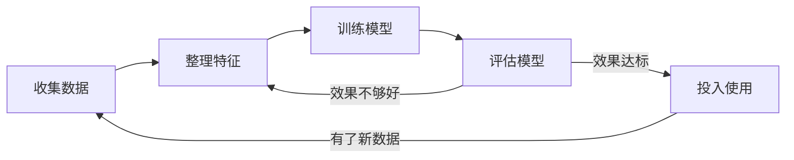
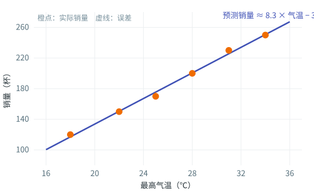
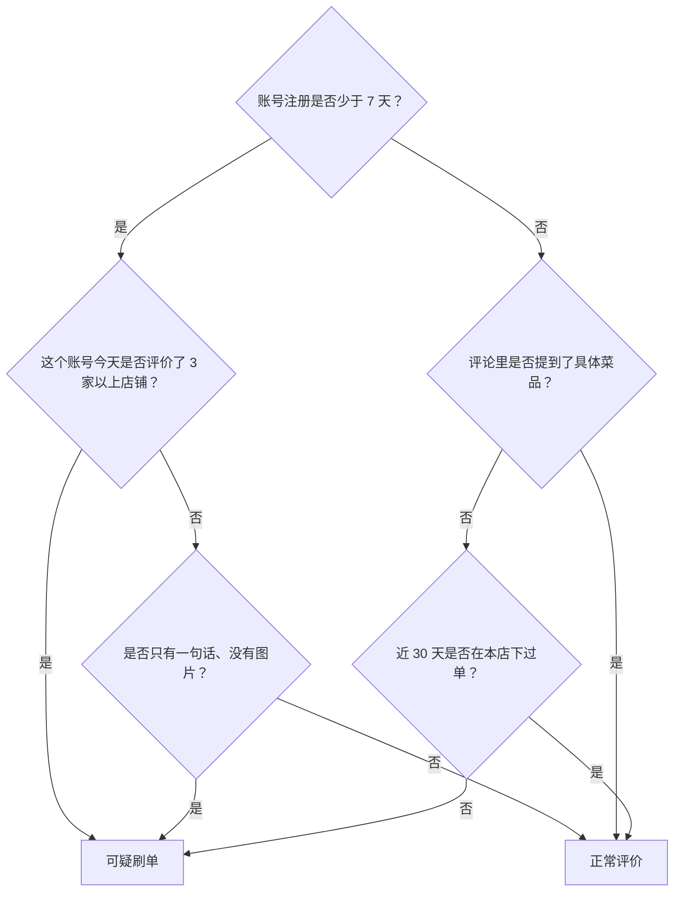
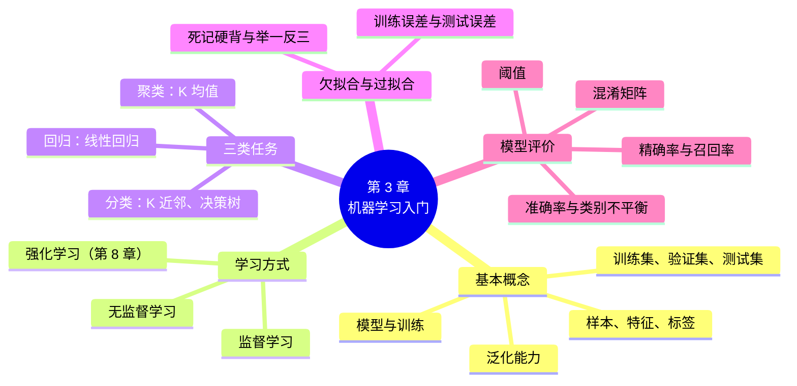

# 第 3 章 机器学习入门

!!! abstract "本章学时"
    理论 4 学时（建议线上 3 · 线下 1）· 在线体验 2 个

## 学习目标

学完本章，你应该能够：

1. **说出**机器学习的定义和基本流程，区分样本、特征、标签、模型这几个基本概念（记忆）；
2. **解释**训练集和测试集为什么要分开，说明监督学习和无监督学习的区别并各举一个例子（理解）；
3. **说明**回归、分类、聚类分别解决什么问题，用自己的话描述线性回归、K 近邻、决策树和 K 均值的直观思路（理解）；
4. **手算**简单的 K 近邻投票、K 均值分组，以及混淆矩阵上的准确率、精确率和召回率（应用）；
5. **判断**一个模型是欠拟合还是过拟合，分析“准确率很高”在什么情况下会误导人（分析）；
6. **评价**一个实际业务该更看重精确率还是召回率，并说明理由（评价）。

!!! info "先修要求"
    学习本章前，你需要了解：

    - 人工智能的三要素，尤其是“数据”的作用（[1.4 人工智能的三要素](../01-overview/index.md#14)）；
    - 用规则表示知识的思路，以及它的局限（[2.6 推理与专家系统](../02-search-knowledge/index.md#26)）；
    - 不需要编程和高等数学基础。本章出现的“平均值”“距离”“百分比”，都是初中数学就学过的内容。

??? abstract "本章概念清单（30 个，点击查看定义和例子）"
    1. [机器学习](../../appendix/glossary.md#g-机器学习)
    2. [样本](../../appendix/glossary.md#g-样本)
    3. [特征](../../appendix/glossary.md#g-特征)
    4. [标签](../../appendix/glossary.md#g-标签)
    5. [模型](../../appendix/glossary.md#g-模型)
    6. [特征工程](../../appendix/glossary.md#g-特征工程)
    7. [训练集](../../appendix/glossary.md#g-训练集)
    8. [测试集](../../appendix/glossary.md#g-测试集)
    9. [验证集](../../appendix/glossary.md#g-验证集)
    10. [泛化能力](../../appendix/glossary.md#g-泛化能力)
    11. [监督学习](../../appendix/glossary.md#g-监督学习)
    12. [无监督学习](../../appendix/glossary.md#g-无监督学习)
    13. [自监督学习](../../appendix/glossary.md#g-自监督学习)
    14. [回归](../../appendix/glossary.md#g-回归)
    15. [线性回归](../../appendix/glossary.md#g-线性回归)
    16. [误差](../../appendix/glossary.md#g-误差)
    17. [分类](../../appendix/glossary.md#g-分类)
    18. [K 近邻](../../appendix/glossary.md#g-K-近邻)
    19. [决策树](../../appendix/glossary.md#g-决策树)
    20. [聚类](../../appendix/glossary.md#g-聚类)
    21. [K 均值](../../appendix/glossary.md#g-K-均值)
    22. [欠拟合](../../appendix/glossary.md#g-欠拟合)
    23. [过拟合](../../appendix/glossary.md#g-过拟合)
    24. [准确率](../../appendix/glossary.md#g-准确率)
    25. [类别不平衡](../../appendix/glossary.md#g-类别不平衡)
    26. [混淆矩阵](../../appendix/glossary.md#g-混淆矩阵)
    27. [精确率](../../appendix/glossary.md#g-精确率)
    28. [召回率](../../appendix/glossary.md#g-召回率)
    29. [阈值](../../appendix/glossary.md#g-阈值)
    30. [自动机器学习](../../appendix/glossary.md#g-自动机器学习)

## 情景导入

小林是一家连锁奶茶店的店长。这家店的会员小程序上线两年，后台已经攒下了几万条订单记录。最近总部的数据部门给门店推送了三个新功能。

第一个是“明日备料建议”：每天打烊前，系统根据天气预报告诉小林，明天大概能卖多少杯，珍珠、鲜奶该备多少。第二个是“可疑差评提醒”：外卖平台上出现一条差评，系统会标出它像不像同行恶意刷的。第三个是“会员分群”：系统把几千位会员自动分成几类，比如“工作日午后的上班族”“周末结伴来的学生”，方便总部给不同人群推送不同的优惠券。

小林很好奇：数据部门的同事没有一条条写“气温超过 30℃ 就多备 20% 鲜奶”这样的规则，系统是怎么知道这些的？答案是，它们都是**从数据中学出来的**。预测销量、识别差评、给会员分群，正好对应机器学习最常见的三类任务：回归、分类和聚类。

上一章的专家系统靠人把知识写成规则。这一章我们换一种思路，看看怎样让计算机自己从数据里找规律。本章不写代码，也不推导公式，但会请你动手算几道小题，并在两个交互动画里亲手“训练”模型。

## 3.1 从写规则到从数据中学

### 3.1.1 规则写不完

假设要让手机自动拦截垃圾短信。按第 2 章的思路，可以写一组规则：

- 如果短信里有“中奖”“领取奖金”，那么判为垃圾短信；
- 如果短信里有陌生网址，并且有“点击”“登录”，那么判为垃圾短信；
- 如果发信号码以 106 开头，并且有“退订回 T”，那么判为营销短信……

一开始效果不错。可是没过几天，骗子就把“中奖”写成“中-奖”“zhong奖”，或者干脆把文字做成图片。规则只能越写越多，几百条规则之间还会互相打架：“您的快递已到驿站，点击查看取件码”到底算不算垃圾短信？

规则方法有三个难处：一是**写不全**，现实中的情况千变万化；二是**改不动**，规则多了以后，改一条可能影响一大片；三是**说不清**，很多判断靠的是人的经验和感觉，比如“这条差评读起来就像刷的”，很难写成“如果……那么……”。

### 3.1.2 让计算机从例子中学

换一个思路：不告诉计算机规则，而是给它看大量例子。收集十万条短信，每条都由人标好“垃圾”或“正常”，然后让计算机自己去琢磨：垃圾短信通常有哪些词、多长、带不带网址、在什么时间发出。琢磨出来的规律，就用来判断新收到的短信。

这就是[**机器学习**](../../appendix/glossary.md#g-机器学习 "让计算机从数据中自动找出规律，并用这些规律对新数据做出判断或预测的方法"){ .term }（Machine Learning）：让计算机从数据中自动找出规律，并用这些规律对新的数据做出判断或预测。

“机器学习”这个词是美国 IBM 公司的工程师阿瑟·塞缪尔（Arthur Samuel）在 1959 年的一篇论文里用开的。他编了一个下西洋跳棋的程序，让程序自己跟自己下了成千上万盘，从输赢中调整下法，最后棋力超过了塞缪尔本人。[[1]](#ref3-1) 程序比编写者更会下棋，这在当时非常轰动，因为它说明：程序的本事不一定要由人一条条写进去，也可以靠“练”出来。

1997 年，卡内基梅隆大学的汤姆·米切尔（Tom Mitchell）在教材里给了一个更精确的定义：对于某类任务 T 和衡量好坏的标准 P，如果一个程序在任务 T 上的表现（用 P 衡量）随着经验 E 的增加而提高，就说这个程序从经验 E 中学习。[[2]](#ref3-2) 拿垃圾短信来说，任务 T 是判断短信是不是垃圾短信，标准 P 是判对的比例，经验 E 就是那十万条标好的短信。看过的例子越多、判得越准，就说明它“学会了”。

!!! example "案例：一封邮件里的机器学习"
    邮箱的垃圾邮件过滤是最早大规模使用机器学习的应用之一。用户每点一次“这是垃圾邮件”或“这不是垃圾邮件”，就相当于给系统多标了一个例子。所以垃圾邮件过滤器不是一次写好的，而是被几亿用户每天一点一点“教”出来的。你下次点这个按钮时，可以想想自己正在给一个机器学习模型提供经验 E。

### 3.1.3 机器学习的基本流程

不管是预测销量、识别差评还是给会员分群，机器学习项目大致都走下面五步：

1. **收集数据**：例如奶茶店过去两年每天的销量、气温、星期几、是否节假日；
2. **整理特征**：把原始数据整理成计算机能处理的数字，例如把“星期六”变成 6，把“下雨”变成 1；
3. **训练模型**：让计算机在数据上寻找规律；
4. **评估模型**：拿一批它没见过的数据考一考，看预测得准不准；
5. **投入使用**：效果达标就上线，每天给店长出备料建议；用的过程中又会积累新数据，过一段时间再重新训练。

图里有两条往回走的箭头，这很重要。真实的机器学习项目很少一次成功，通常要在“整理特征—训练—评估”之间来回好几轮。另外，前两步往往占掉一个项目大部分的时间。业内常说“数据决定了模型的上限”，数据质量不好，后面的算法再高明也补不回来。

!!! note "机器学习和人工智能、深度学习是什么关系"
    人工智能是最大的范围，包括第 2 章的搜索、知识表示等方法；机器学习是人工智能的一个分支，强调“从数据中学”；下一章的深度学习又是机器学习的一个分支，用多层神经网络来学。今天人们说的“AI”，绝大多数都是机器学习，尤其是深度学习。

## 3.2 样本、特征与标签

### 3.2.1 把数据整理成一张表

机器学习的数据，大多可以整理成一张表。下面是奶茶店“备料建议”用到的部分数据：

| 日期 | 最高气温（℃） | 星期几 | 是否下雨 | 是否节假日 | 销量（杯） |
|---|---|---|---|---|---|
| 6 月 1 日 | 25 | 6 | 0 | 0 | 172 |
| 6 月 2 日 | 28 | 7 | 0 | 0 | 205 |
| 6 月 3 日 | 22 | 1 | 1 | 0 | 118 |
| …… | …… | …… | …… | …… | …… |

这张表里有几个基本概念：

- 每一行是一个[**样本**](../../appendix/glossary.md#g-样本 "数据中的一个个体或一条记录，是机器学习的基本单位"){ .term }（Sample），在这里就是一天的记录；
- 中间几列是[**特征**](../../appendix/glossary.md#g-特征 "描述样本的属性，通常整理成数字，作为模型的输入"){ .term }（Feature），即描述样本的属性：气温、星期几、是否下雨、是否节假日；
- 最后一列是[**标签**](../../appendix/glossary.md#g-标签 "样本的正确答案，也就是希望模型学会预测的那个量"){ .term }（Label），即希望模型学会预测的“答案”：销量。

机器学习要找的，就是从特征到标签的规律。把这个规律用某种形式记下来，就得到一个[**模型**](../../appendix/glossary.md#g-模型 "机器学习从数据中学到的、能把特征转换成预测结果的规律"){ .term }（Model）。可以把模型想成一个“黑盒子”：输入明天的特征（气温 30℃、星期三、不下雨、不是节假日），输出一个预测（大约 215 杯）。从数据中找规律、得到模型的过程叫**训练**，用模型对新样本做判断叫**预测**。

同一张表，换一个标签，就是另一个任务。在“可疑差评”任务里，每个样本是一条评论，特征可以是评论字数、发评论的账号注册了几天、这个账号一天内评论了几家店，标签是“正常”或“刷单”。在“会员分群”任务里，每个样本是一位会员，特征是每月到店次数、平均消费、常来的时间段，而这个任务**没有**标签，后面 3.3 节会讲这意味着什么。

### 3.2.2 特征从哪里来

原始数据往往不能直接用。外卖评论是一段文字，会员的到店记录是一串时间，图片是一堆像素，都要先变成数字。把原始数据加工成合适特征的工作叫[**特征工程**](../../appendix/glossary.md#g-特征工程 "把原始数据加工、挑选成更能反映规律的特征的过程"){ .term }（Feature Engineering）。

举个例子，订单表里只有每笔订单的下单时间。数据分析员可以从中算出“这位会员每月来几次”“上次来是几天前”“工作日来得多还是周末来得多”，这些新算出来的特征，往往比原始的下单时间更能说明问题。好的特征需要懂业务：一个干了十年的店长知道“发工资那几天销量会涨”，把“是否发薪日”加进特征，模型可能就准了不少。

特征工程是机器学习里最花时间、也最需要经验的环节，具体方法在《机器学习》第 2 章展开。到了下一章的深度学习，计算机可以自己从原始的像素、文字中提取特征，这正是深度学习厉害的地方。

### 3.2.3 训练集和测试集：不能拿练习题当考卷

模型学得好不好，要考一考才知道。可是不能拿它学过的数据来考。这就像老师把期末考题原封不动地发给学生当练习题，考试时人人满分，但这说明不了谁真学会了。

所以要把数据分成几份：

- [**训练集**](../../appendix/glossary.md#g-训练集 "用来训练模型的数据，相当于“课本和练习题”"){ .term }（Training Set）用来训练模型，相当于“课本和练习题”，通常占 70%～80%；
- [**测试集**](../../appendix/glossary.md#g-测试集 "训练时不让模型看见、训练完成后用来评估模型的数据，相当于“期末考试卷”"){ .term }（Test Set）训练时完全不让模型看见，训练完成后才拿出来考试，相当于“期末考试卷”；
- 有时还会从训练数据里再分出一份[**验证集**](../../appendix/glossary.md#g-验证集 "训练过程中用来调整参数、选择阈值的数据，相当于“模拟考试”"){ .term }（Validation Set），在训练过程中用来比较几个方案、调整设置，相当于“模拟考试”。

!!! tip "算一算：怎样分数据"
    奶茶店有 700 天的销量记录。按 8∶1∶1 分成训练集、验证集和测试集，各有多少天？

    训练集 700 × 0.8 = 560 天，验证集 700 × 0.1 = 70 天，测试集 700 × 0.1 = 70 天。

    想一想：如果按日期顺序，把最早的 560 天当训练集、最后的 70 天当测试集，和随机抽 70 天当测试集相比，哪种更像“真实使用”？（提示：模型上线后，永远是用过去的数据预测未来。）

模型在没见过的新数据上也能做出准确判断的能力，叫[**泛化能力**](../../appendix/glossary.md#g-泛化能力 "模型在没见过的新数据上也能表现良好的能力，是评价模型最重要的标准"){ .term }（Generalization）。我们真正关心的不是模型能不能背出训练集的答案，而是它能不能“举一反三”，泛化能力是评价模型最重要的标准。测试集的作用，就是在模型上线之前估计一下它的泛化能力。

## 3.3 三类学习方式

按照训练数据有没有标签、模型从什么样的“反馈”中学习，机器学习主要分为三类。

### 3.3.1 监督学习：有老师批改的学习

训练数据带有标签的学习方式叫[**监督学习**](../../appendix/glossary.md#g-监督学习 "从带有正确答案（标签）的样本中学习规律的机器学习方式"){ .term }（Supervised Learning）。“监督”的意思是有一位“老师”，告诉模型每个样本的正确答案，模型做错了就能知道。

预测销量（标签是销量）、识别刷单差评（标签是“正常 / 刷单”）、识别垃圾短信、看 X 光片判断有没有肺炎，都是监督学习。监督学习是目前用得最多、效果最可靠的一类，但它有个代价：**标签要有人来标**。几万张 X 光片，要请医生一张张看过、标出结果，费时又费钱。这正是“数据标注员”“人工智能训练师”这些岗位存在的原因，后续《人工智能数据分析与处理》会专门讲数据标注。

### 3.3.2 无监督学习：自己找规律

训练数据没有标签，让模型自己从数据中发现结构的学习方式叫[**无监督学习**](../../appendix/glossary.md#g-无监督学习 "训练数据没有标签，由模型自己发现数据中的结构或规律的机器学习方式"){ .term }（Unsupervised Learning）。

奶茶店的会员分群就是无监督学习：没有人事先告诉系统“这位是上班族、那位是学生”，系统只是发现有一群人总在工作日下午两三点来、点的都是少糖冰美式，另一群人总在周末来、一次买四五杯。至于这两群人该叫什么名字、给他们推什么优惠，要由人来解读。

无监督学习不需要标注，数据好收集，但它没有标准答案，结果好不好要靠人结合业务来判断。

### 3.3.3 强化学习：在试错中学习

第三类是强化学习：模型（在强化学习里叫“智能体”）在一个环境中不断尝试各种动作，做得好就得到奖励，做得不好就受到惩罚，慢慢学会怎样做能拿到更多奖励。塞缪尔的跳棋程序、下围棋的 AlphaGo、学走路的机器狗，都用到了强化学习。它和前两类差别较大，我们放到第 8 章专门讲。

### 3.3.4 三类方式对比

| | 监督学习 | 无监督学习 | 强化学习 |
|---|---|---|---|
| 训练数据 | 有标签 | 没有标签 | 没有现成数据，靠与环境互动产生 |
| 学习信号 | 每个样本的正确答案 | 数据本身的结构 | 动作带来的奖励或惩罚 |
| 典型任务 | 回归、分类 | 聚类、降维 | 下棋、游戏、机器人控制、自动驾驶决策 |
| 生活例子 | 识别垃圾短信、预测销量 | 会员分群、发现异常交易 | AlphaGo、扫地机器人学习路线 |
| 本书位置 | 3.4、3.5 节 | 3.6 节 | 第 8 章 |

!!! note "大模型是怎么学的"
    还有一种介于中间的方式叫[**自监督学习**](../../appendix/glossary.md#g-自监督学习 "从数据本身自动构造标签来训练模型的方式，大模型的预训练就是一例"){ .term }（Self-supervised Learning）：不用人来标，而是从数据本身自动“造”出标签。比如把一句话的最后一个词遮住，让模型猜被遮住的是什么，原句就是标准答案。DeepSeek、通义千问这类大模型的预训练，就是在海量文本上做这种“猜下一个词”的练习，我们在第 5 章会看到。

## 3.4 回归：预测一个数

### 3.4.1 什么是回归

要预测的标签是一个连续的数值，这类任务叫[**回归**](../../appendix/glossary.md#g-回归 "预测一个连续数值的监督学习任务，如预测销量、房价、气温"){ .term }（Regression）。预测明天卖多少杯奶茶、一套房子值多少钱、一位顾客下个月会花多少钱、一台机器还能运转多少小时，都是回归。

“回归”这个名字有点奇怪，它来自 19 世纪英国学者高尔顿对父母和子女身高的研究：特别高的父母，孩子往往没有那么高，身高有“回归”平均值的倾向。后来人们把这类“用一个量预测另一个量”的方法统称为回归，名字就沿用了下来。

### 3.4.2 线性回归：画一条最贴近数据的直线

最简单的回归方法是[**线性回归**](../../appendix/glossary.md#g-线性回归 "用一条直线（或平面）描述特征与数值标签之间关系的回归方法"){ .term }（Linear Regression）。先只看一个特征：气温。把奶茶店 6 天的数据列成表，再画在坐标图上，横轴是气温，纵轴是销量：

| 最高气温（℃） | 18 | 22 | 25 | 28 | 31 | 34 |
|---|---|---|---|---|---|---|
| 销量（杯） | 120 | 150 | 170 | 200 | 230 | 250 |

{ .figure }

能看出“天越热卖得越多”，而且这些点大致排在一条直线附近。线性回归要做的，就是找一条**最贴近这些点**的直线（图中的蓝线），然后用它来预测：

\[ \text{预测销量} = w \times \text{气温} + b \]

这里的 \( w \) 表示“气温每升高 1℃，销量大约多几杯”，\( b \) 是直线的起点高度。\( w \) 和 \( b \) 叫模型的**参数**，“训练”就是在数据上把它们找出来。用这 6 天的数据，计算机找到的最佳直线大约是：

\[ \text{预测销量} \approx 8.3 \times \text{气温} - 33 \]

意思是气温每升高 1℃，大约多卖 8 杯。如果天气预报说明天最高 30℃，预测销量就是 8.3 × 30 − 33 ≈ 216 杯。

特征不止一个时，道理一样，只是每个特征各有一个权重：

\[ \text{预测销量} = w_1 \times \text{气温} + w_2 \times \text{是否节假日} + w_3 \times \text{是否下雨} + \cdots + b \]

训练完以后，看各个权重的大小和正负，还能读出不少业务信息：比如“是否下雨”的权重是 −35，说明下雨天大约少卖 35 杯。这种“看得懂”的特点，是线性回归在商业分析中很受欢迎的原因之一。

### 3.4.3 哪条直线最好

“最贴近”是什么意思？对每个样本，把预测值和实际值相减，得到[**误差**](../../appendix/glossary.md#g-误差 "模型预测值与真实值之间的差距"){ .term }（Error）。误差越小越好。把所有样本的误差（取绝对值，不管正负）求平均，就得到“平均绝对误差”，可以理解为“平均每天差了几杯”。

!!! tip "算一算：比一比三条直线"
    用上面 6 天的数据，比较三条直线的平均绝对误差。

    | 气温（℃） | 18 | 22 | 25 | 28 | 31 | 34 | 平均绝对误差 |
    |---|---|---|---|---|---|---|---|
    | 实际销量 | 120 | 150 | 170 | 200 | 230 | 250 | — |
    | 直线甲：8 × 气温 | 144 | 176 | 200 | 224 | 248 | 272 | 24.0 杯 |
    | 直线乙：10 × 气温 − 60 | 120 | 160 | 190 | 220 | 250 | 280 | 16.7 杯 |
    | 直线丙：8.3 × 气温 − 33 | 116 | 150 | 175 | 199 | 224 | 249 | 约 2.8 杯 |

    以直线乙为例：误差依次是 0、10、20、20、20、30，加起来 100，除以 6 约等于 16.7。直线丙是计算机找到的最佳直线，平均每天只差两三杯。

    （直线丙这一行是把 8.3 × 气温 − 33 算出来后四舍五入到整数，按表中的整数算，平均绝对误差约 2.8 杯；用计算机求出的精确直线来算约 2.4 杯。）

计算机找最佳直线的办法，最常用的叫“最小二乘法”：把每个误差先平方再加起来，找让这个总和最小的 \( w \) 和 \( b \)。平方是为了让正负误差不互相抵消，并且让大的误差受到更重的“惩罚”。具体怎么求，《机器学习》第 3 章会讲；对我们来说，记住一句话就够了：**训练就是找一组参数，让模型在训练数据上的误差尽量小**。下一章的神经网络也是这个道理，只是参数从两个变成了几百万、几十亿个。

!!! example "案例：用回归预测，用回归“解释”"
    回归在商业里有两种用法。一种是**预测**，比如零售企业预测每家门店每种商品的日销量，据此自动补货，减少缺货和过期浪费；电网预测明天每个小时的用电量，安排发电计划。另一种是**解释**，比如房产平台用回归分析“离地铁站近 500 米，房价平均高多少”。前者看重预测准不准，后者看重每个特征的权重是否合理、能不能讲清楚。

## 3.5 分类：判断属于哪一类

### 3.5.1 什么是分类

要预测的标签是有限的几个类别，这类任务叫[**分类**](../../appendix/glossary.md#g-分类 "预测样本属于预先定义好的哪个类别的监督学习任务"){ .term }（Classification）。只有两个类别的叫二分类（垃圾短信 / 正常短信、刷单 / 正常、批准贷款 / 拒绝贷款），有多个类别的叫多分类（把一张照片分为猫、狗、鸟、汽车……中的一类；把客服对话分为“查物流”“退货”“投诉”“咨询”）。

分类可能是机器学习里应用最广的任务。很多看起来很复杂的系统，核心都是一个或几个分类器：刷脸支付要判断“是不是本人”，自动驾驶要判断前方物体是“行人、车辆还是路标”，银行风控要判断一笔交易“正常还是可疑”。

回归和分类的区别只在于标签：标签是数（销量 215 杯）就是回归，标签是类别（刷单 / 正常）就是分类。同一个业务问题，有时两种做法都行，比如“预测会员下个月消费多少钱”是回归，“预测会员下个月会不会流失”是分类。

### 3.5.2 K 近邻：看看你的邻居是谁 { #352 }

中国有句老话：“近朱者赤，近墨者黑。”[**K 近邻**](../../appendix/glossary.md#g-K-近邻 "找出与新样本最相近的 K 个已知样本，按它们的类别投票决定新样本类别的方法"){ .term }（K-Nearest Neighbors，KNN）算法就是这个思路：要判断一个新样本属于哪一类，就在已知样本里找出离它最近的 K 个“邻居”，邻居里哪一类多，就判它是哪一类。1967 年，斯坦福大学的考弗（Cover）和哈特（Hart）系统研究了这种方法，证明了它在数据足够多时的可靠性。[[3]](#ref3-3)

K 近邻的步骤只有三步：

1. **算距离**：计算新样本和每个已知样本之间的距离；
2. **找邻居**：挑出距离最近的 K 个；
3. **投票**：K 个邻居里哪个类别最多，就判为哪一类。

!!! tip "算一算：这位新会员是不是常客"
    奶茶店把会员分为“常客”和“普通会员”两类。已知 6 位会员的情况（特征：每月到店次数、平均每次消费），现在来了一位新会员：每月到店 7 次、平均消费 26 元。用 K = 3 判断他属于哪一类。

    | 会员 | 到店次数 | 平均消费（元） | 类别 | 与新会员的距离 |
    |---|---|---|---|---|
    | A | 2 | 30 | 普通 | 6.40 |
    | B | 3 | 25 | 普通 | 4.12 |
    | C | 8 | 28 | 常客 | 2.24 |
    | D | 10 | 35 | 常客 | 9.49 |
    | E | 6 | 18 | 普通 | 8.06 |
    | F | 9 | 22 | 常客 | 4.47 |

    距离用初中学过的勾股定理算。以 C 为例：到店次数差 8 − 7 = 1，消费差 28 − 26 = 2，距离 = √(1² + 2²) = √5 ≈ 2.24。

    最近的 3 位是 C（2.24，常客）、B（4.12，普通）、F（4.47，常客），常客 2 票、普通 1 票，所以判为**常客**。

    想一想：如果 K = 1 呢？如果 K = 5 呢？（K = 1 只看 C，判为常客；K = 5 再加上 A 和 E，变成常客 2 票、普通 3 票，判为普通会员。K 值不同，结论可能不同。）

从这个例子能看出 K 近邻的几个特点：

- **简单直观**，几乎没有“训练”过程，只要把已知样本存起来；
- **K 的取值有讲究**：K 太小，容易被个别特殊的邻居带偏；K 太大，远处的样本也来投票，类别之间的界线就模糊了。K 一般取奇数，避免平票；
- **特征的单位会影响距离**：上例中消费金额以“元”计，数字比到店次数大，在距离里占的分量就重。实际使用时要先把各个特征换算到相近的范围，这叫特征缩放；
- **样本多了会变慢**：每来一个新样本，都要和所有已知样本算一遍距离。

<iframe class="sim-frame" src="../../sims/knn-kmeans/main.html" height="720" loading="lazy" title="K 近邻与 K 均值"></iframe>

动画：K 近邻与 K 均值。在“K 近邻分类”模式下点图上任意位置放一位新会员，看虚线连到哪几位邻居、投票结果是什么；拖动 K 值，看结果会不会变。[全屏打开](../../sims/knn-kmeans/main.html){ target=_blank }
{ .sim-caption }

### 3.5.3 决策树：问一连串问题

玩过“猜人物”游戏吗？一个人心里想一位名人，其他人只能问“是 / 不是”的问题：“是男的吗？”“还活着吗？”“是演员吗？”……问得好的人，五六个问题就能猜中。[**决策树**](../../appendix/glossary.md#g-决策树 "用一连串是 / 否问题对样本逐步划分，最后得出类别或数值的模型"){ .term }（Decision Tree）就是这样工作的：它把判断过程画成一棵倒过来的树，从树根开始，每个节点问一个问题，根据回答走向不同的分支，走到树叶就得到结论。

下面是一棵判断外卖差评是不是“可疑刷单”的决策树（为了便于理解做了简化）：

看到这里你可能会问：这和第 2 章的专家系统有什么区别？外形确实很像，都是一串“如果……那么……”。关键区别在于**这棵树是谁画出来的**：专家系统的规则是专家一条条写的；决策树是计算机从几万条标好“正常 / 刷单”的评论中**自动学出来的**。先问哪个问题、阈值定在 7 天还是 10 天，都由算法根据数据决定。挑问题的原则是：先问最能把两类样本分开的问题，就像猜人物时先问“是男的吗”比先问“是不是 1983 年出生”有用得多。至于“最能分开”怎样计算，要用到信息增益、基尼系数等指标，《机器学习》第 5 章会从手算讲起。澳大利亚学者昆兰（Quinlan）在 1986 年的论文中系统介绍了经典的决策树算法 ID3。[[4]](#ref3-4)

决策树最大的优点是**看得懂**：每一个判断都能顺着树枝说出理由，“因为这个账号注册不到 7 天，今天又评价了 5 家店”。这在银行贷款审批、医疗辅助诊断这类需要向人解释的场合特别重要。它的缺点是一棵树容易“想太多”，树长得太深，就会把训练数据里的偶然情况也当成规律（这就是 3.7 节要讲的过拟合）。实际中常把几百棵树组合起来，让它们一起投票，叫随机森林；在比赛和工业界很常用的 XGBoost、LightGBM 也是由很多棵树组合而成的。

### 3.5.4 其他常见的分类方法

除了 K 近邻和决策树，常见的分类方法还有：

| 方法 | 一句话直观 | 详细内容 |
|---|---|---|
| 逻辑回归 | 给每个特征一个权重、加起来，再换算成“属于某类的概率” | 《机器学习》第 4 章 |
| 朴素贝叶斯 | 根据每个特征在各类中出现的概率，算出样本最可能属于哪一类 | 《机器学习》第 7 章 |
| 支持向量机 | 在两类样本之间找一条“离两边都尽量远”的分界线 | 《机器学习》第 6 章 |
| 神经网络 | 用很多层“人工神经元”自动学习复杂的规律 | 本书第 4 章，《机器学习》第 10 章 |

没有哪种方法在所有问题上都最好。数据少、要求能解释时，常用逻辑回归和决策树；数据多、规律复杂时，常用集成的决策树和神经网络。实际项目里，往往要把几种方法都试一试，用测试集上的成绩说话。[[5]](#ref3-5)

## 3.6 聚类：物以类聚

### 3.6.1 什么是聚类

把没有标签的样本按相似程度自动分成若干组，让同一组内的样本尽量相似、不同组之间尽量不同，这类任务叫[**聚类**](../../appendix/glossary.md#g-聚类 "把没有标签的样本按相似程度自动分成若干组的无监督学习任务"){ .term }（Clustering），是最典型的无监督学习任务。分出来的每一组叫一个“簇”。

聚类和分类听起来很像，区别在于：分类的类别是**事先定好的**（常客 / 普通），而且训练数据有标签；聚类事先不知道有哪些类别，分出几组、每组是什么人，都要看数据本身，分完以后再由人来解读。“物以类聚，人以群分”，聚类就是让计算机自己去发现“群”。

聚类的用处很多：电商和连锁门店给用户分群，做精准营销；新闻客户端把讲同一件事的上百篇报道归成一个话题；银行把交易行为分群，那些不属于任何一群的“离群点”，可能就是盗刷。

### 3.6.2 K 均值：先分组，再挪中心 { #362 }

最常用的聚类方法是[**K 均值**](../../appendix/glossary.md#g-K-均值 "先选 K 个中心、再交替执行“分组”和“更新中心”的聚类方法"){ .term }（K-Means），由麦奎因（MacQueen）在 1967 年命名。[[6]](#ref3-6) 这里的 K 是要分的组数，由人事先指定；“均值”是指每组的中心取组内样本的平均值。步骤是：

1. **选起点**：随便选 K 个点作为各组的中心；
2. **分组**：每个样本归到离它最近的那个中心所在的组；
3. **更新中心**：把每组的中心挪到本组所有样本的平均位置；
4. **重复**第 2、3 步，直到中心不再移动。

!!! tip "算一算：给 6 位会员分两组"
    6 位会员的每月到店次数分别是 1、2、3、8、9、10 次。用 K 均值分成 2 组，起点随便选 1 和 2。

    **第 1 轮分组**：1 离中心 1 最近，归第一组；2、3、8、9、10 离中心 2 更近，都归第二组。
    **第 1 轮更新**：第一组中心 = 1；第二组中心 = (2 + 3 + 8 + 9 + 10) ÷ 5 = 6.4。

    **第 2 轮分组**：2 离 1 的距离是 1，离 6.4 的距离是 4.4，改归第一组；3 离 1 是 2、离 6.4 是 3.4，也归第一组；8、9、10 仍在第二组。
    **第 2 轮更新**：第一组中心 = (1 + 2 + 3) ÷ 3 = 2；第二组中心 = (8 + 9 + 10) ÷ 3 = 9。

    **第 3 轮分组**：结果和上一轮一样，中心不再移动，结束。最后分出“每月来 2 次左右”和“每月来 9 次左右”两群人。

    一开始的起点选得很差，两个中心都挤在左边，但经过两轮就自己“走”到了合适的位置，这就是 K 均值的巧妙之处。

K 均值简单、速度快，但有几个要注意的地方：K 要由人来定，分 3 组还是 5 组，没有标准答案，要结合业务判断；起点选得不同，结果有时也不同，所以实际使用时常常换几组起点多跑几次；它适合“一团一团”的数据，形状奇怪的群就分不好。

在前面的动画里切换到“K 均值聚类”模式，点“下一步”，就能看到中心一步步移动的过程。

!!! example "案例：会员分群之后"
    某连锁茶饮品牌用会员的到店频率、平均消费、常来的时段和偏好的口味做聚类，分出了“工作日午后提神族”“周末聚会族”“新品尝鲜族”等几个群体。之后，“提神族”在工作日下午收到第二杯半价券，“尝鲜族”在新品上市前一天收到试饮邀请。聚类本身只给出了“这些人很像”，群的名字、营销策略，都是市场部门的同事根据每群的特点想出来的。机器负责发现，人负责解读和决策，这是无监督学习最常见的用法。

## 3.7 欠拟合与过拟合

### 3.7.1 死记硬背和举一反三

回想一下学生时代，班上大概有三种同学：

- 第一种**没学会**：课本没看懂，练习题做不对，考试也考不好；
- 第二种**死记硬背**：把练习册的答案全背下来，练习题次次满分，可考试换个说法就不会了；
- 第三种**真学会了**：理解了道理，练习题做得不错，考试遇到新题也能举一反三。

模型也一样。第一种叫[**欠拟合**](../../appendix/glossary.md#g-欠拟合 "模型太简单、没学到规律，训练集和测试集成绩都差的现象"){ .term }（Underfitting）：模型太简单，连训练数据里的规律都没学到，训练集和测试集上成绩都差。第二种叫[**过拟合**](../../appendix/glossary.md#g-过拟合 "模型在训练集上表现好、在新数据上表现差的现象"){ .term }（Overfitting）：模型太复杂，把训练数据里的偶然波动、甚至错误也当成了规律记下来，训练集上表现很好，在新数据上却表现很差。我们想要的是第三种：泛化能力好的模型。

### 3.7.2 看一个例子

还是奶茶店。这次用 22 天的数据，其中 10 天做训练集，12 天做测试集。真实的规律是“气温越高卖得越多，但过了 33℃ 左右增长就放缓了”（太热了大家不愿出门），再加上每天的随机波动。我们用越来越复杂的曲线去拟合训练数据：1 次是直线，2 次是一条抛物线，次数越高，曲线能拐的弯就越多。

| 模型复杂度 | 训练误差（杯） | 测试误差（杯） | 判断 |
|---|---|---|---|
| 1 次（直线） | 16.4 | 20.2 | 欠拟合：直线画不出“先升后平” |
| 2 次 | 10.1 | 9.0 | 刚好：测试误差最小 |
| 4 次 | 7.9 | 14.8 | 开始过拟合 |
| 9 次 | 0.0 | 943.4 | 严重过拟合：曲线穿过每个训练点，在别处乱跳 |

规律很清楚：**模型越复杂，训练误差越小**，9 次曲线甚至能穿过全部 10 个训练点，训练误差为 0；但**测试误差先降后升**，2 次时最小，到 9 次时预测得一塌糊涂。如果只看训练误差，我们会选 9 次曲线，那就上当了。这也说明了 3.2.3 节为什么一定要留出测试集。[[7]](#ref3-7)

<iframe class="sim-frame" src="../../sims/curve-fitting/main.html" height="760" loading="lazy" title="曲线拟合与过拟合"></iframe>

动画：曲线拟合与过拟合。拖动模型复杂度，观察曲线形状、训练误差和测试误差的变化，找到测试误差最小的那个位置。[全屏打开](../../sims/curve-fitting/main.html){ target=_blank }
{ .sim-caption }

### 3.7.3 怎样避免过拟合

过拟合是机器学习里最常见的问题，常用的应对办法有：

- **多收集数据**：数据越多，偶然的波动越容易被“平均掉”，模型越难死记硬背；
- **选简单一点的模型**：能用简单模型解决的，就不用复杂模型。决策树可以限制树的深度，不让它长得太细；
- **用验证集挑选**：准备几种复杂度不同的方案，在验证集上比一比，选验证成绩最好的，而不是训练成绩最好的；
- **把多个模型组合起来**：随机森林让几百棵树投票，单棵树“想太多”的毛病就被冲淡了。

!!! warning "易错点"
    “训练集上准确率 99%”并不说明模型好，反而可能是过拟合的信号。评价模型一定要看它在**没见过的数据**上的表现。同样，测试集只能在最后用一次，如果反复用测试集来挑方案，测试集就变成了另一种“练习题”，成绩又会虚高。

## 3.8 模型评价：准确率会骗人

### 3.8.1 准确率

评价分类模型最直观的指标是[**准确率**](../../appendix/glossary.md#g-准确率 "预测正确的样本占全部样本的比例"){ .term }（Accuracy），即判对的样本占全部样本的比例。100 条评论判对了 90 条，准确率就是 90%。

可准确率有时会骗人。外卖平台上，刷单差评毕竟是少数。假设 1000 条差评里只有 50 条是刷单，有个“偷懒”的模型，不管什么评论都判为“正常”，它的准确率是多少？950 ÷ 1000 = 95%！看起来很高，可它一条刷单也没找出来，毫无用处。

像这样各类样本数量相差悬殊的情况，叫[**类别不平衡**](../../appendix/glossary.md#g-类别不平衡 "各类别样本数量相差很大的情况"){ .term }（Class Imbalance）。信用卡盗刷、疾病筛查、设备故障预警、刷单识别，几乎都是类别不平衡的问题，而且我们要找的，恰恰是数量少的那一类。这时只看准确率就不够了。

### 3.8.2 混淆矩阵

为了看清模型到底错在哪里，可以把预测结果按“实际是什么 × 预测成什么”列成一张表，叫[**混淆矩阵**](../../appendix/glossary.md#g-混淆矩阵 "按“实际类别 × 预测类别”交叉统计样本数量的表格"){ .term }（Confusion Matrix）。以“找刷单”为例，我们把要找的“刷单”叫正类：

| | 预测为刷单 | 预测为正常 |
|---|---|---|
| **实际是刷单** | TP：抓对了 | FN：漏掉了 |
| **实际是正常** | FP：冤枉了 | TN：放对了 |

四个格子的英文缩写是：T（True）表示判对，F（False）表示判错；P（Positive）表示预测为正类，N（Negative）表示预测为负类。抓对和放对是好事，漏掉和冤枉是两种不同的错误，它们带来的后果往往很不一样。

### 3.8.3 精确率和召回率

从混淆矩阵可以算出两个比准确率更有用的指标：

- [**精确率**](../../appendix/glossary.md#g-精确率 "预测为某类的样本中，真正属于该类的比例（判得准不准）"){ .term }（Precision）：模型判为刷单的评论里，真正是刷单的比例，回答“抓的人里有没有冤枉好人”，即**判得准不准**；
- [**召回率**](../../appendix/glossary.md#g-召回率 "某类的全部样本中，被正确找出来的比例（找得全不全）"){ .term }（Recall）：所有真正的刷单评论里，被模型找出来的比例，回答“坏人有没有漏网”，即**找得全不全**。

\[ \text{精确率} = \frac{TP}{TP + FP} \qquad \text{召回率} = \frac{TP}{TP + FN} \]

!!! tip "算一算：刷单识别模型的成绩单"
    1000 条差评中有 50 条刷单。一个新模型的混淆矩阵如下：

    | | 预测为刷单 | 预测为正常 |
    |---|---|---|
    | **实际是刷单（50 条）** | TP = 40 | FN = 10 |
    | **实际是正常（950 条）** | FP = 20 | TN = 930 |

    - 准确率 = (40 + 930) ÷ 1000 = 97%
    - 精确率 = 40 ÷ (40 + 20) ≈ 66.7%：判为刷单的 60 条里，有 20 条冤枉了正常顾客；
    - 召回率 = 40 ÷ (40 + 10) = 80%：50 条刷单找出了 40 条，漏了 10 条。

    再算那个“全判正常”的偷懒模型：TP = 0、FN = 50、FP = 0、TN = 950，准确率 95%，召回率 0%。两个模型的准确率只差 2 个百分点，召回率却是 80% 对 0%，差别一目了然。

### 3.8.4 精确率和召回率此消彼长

很多分类模型并不直接给出“是”或“否”，而是给出一个概率，比如“这条评论是刷单的可能性为 0.73”。概率超过多少就判为刷单，这个分界值叫[**阈值**](../../appendix/glossary.md#g-阈值 "把概率转换成类别时使用的分界值"){ .term }（Threshold）。

阈值调低（比如 0.3），宁可错抓、不可放过，召回率上升，但会冤枉更多好人，精确率下降；阈值调高（比如 0.8），只抓最有把握的，精确率上升，但会漏掉更多，召回率下降。两者通常此消彼长，不可能同时都到 100%。

该更看重哪一个，要看两种错误哪个代价更大：

| 场景 | 更怕哪种错误 | 更看重 | 阈值怎么调 |
|---|---|---|---|
| 癌症早期筛查 | 漏诊（FN）：耽误治疗 | 召回率 | 调低，宁可多复查几个 |
| 垃圾短信拦截 | 误拦（FP）：错过银行验证码 | 精确率 | 调高，拿不准的就放行 |
| 信用卡盗刷预警 | 漏报会造成损失，误报可以打电话核实 | 召回率 | 调低，再由人工复核 |
| 刷单差评处理（直接删评论） | 误删正常顾客的差评，损害平台公信力 | 精确率 | 调高，拿不准的转人工 |

想同时照顾两者时，可以用 F1 值，它是精确率和召回率的一种综合平均，在《机器学习》第 4 章介绍。谷歌的免费课程里也有讲阈值和混淆矩阵的交互图，可以对照着看。[[8]](#ref3-8)

<iframe class="sim-frame" src="../../sims/threshold-confusion/main.html" height="640" loading="lazy" title="阈值与混淆矩阵"></iframe>

动画：阈值与混淆矩阵（来自《自然语言处理导论》）。这里的任务是从 2398 条外卖评论中找出差评。拖动阈值，观察混淆矩阵四个格子和精确率、召回率的变化。[全屏打开](../../sims/threshold-confusion/main.html){ target=_blank }
{ .sim-caption }

在这个动画里，阈值为 0.5 时，2398 条评论中有 1598 条差评，模型找出了 1528 条，漏掉 70 条；另外有 221 条好评被误判为差评。你可以自己验算一下：准确率 = (1528 + 579) ÷ 2398 ≈ 87.9%，差评的精确率 = 1528 ÷ (1528 + 221) ≈ 87.4%，召回率 = 1528 ÷ 1598 ≈ 95.6%。

## 3.9 身边的 AI

### 3.9.1 你每天都在和机器学习打交道

打开手机的一天，你可能已经和十几个机器学习模型打过交道：

- **推荐**：短视频、电商、外卖平台根据你过去看过、买过、点过的内容，预测你可能喜欢什么。这背后既有分类（你会不会点这个视频），也有回归（你会看多长时间），还会用到聚类（和你口味相似的人还喜欢什么）。推荐系统在《人工智能数据分析与处理》中专门讲；
- **风控**：网购付款、手机银行转账时，系统会在零点几秒内判断这笔交易是否可疑，可疑的会要求你再验证一次；
- **预测**：网约车预估到达时间、外卖预估送达时间、天气预报中的降水概率，都有回归模型的参与；
- **识别**：输入法联想下一个词、相册把照片分成人物和风景、邮箱识别垃圾邮件，都是分类。

### 3.9.2 工厂和田间的机器学习

机器学习也在改变很多传统行业。在工厂里，**预测性维护**把机器上传感器的温度、振动、电流数据交给模型，提前几天预测哪台设备可能出故障，在坏之前就安排检修，减少停产损失。在电网和水务公司，回归模型预测每个小时的用电量、用水量，帮助调度。在农业中，模型根据土壤湿度、气象数据和历年产量，给出灌溉和施肥建议。这些应用的共同点是：数据早就有，只是以前没人能从中读出规律，机器学习让这些“沉睡的数据”发挥了作用。

### 3.9.3 不会编程也能训练模型

过去，训练一个模型要会编程、懂算法。现在有了很多**零代码或低代码**的平台，上传数据、点几下鼠标就能训练模型。例如百度的 EasyDL 自称“零门槛 AI 开发平台”，支持图像分类、物体检测、文本分类、表格数据预测等多种任务，训练好的模型可以直接生成接口供程序调用，或者部署到小程序和设备上。[[9]](#ref3-9) 阿里云、华为云等也有类似的平台。这类“自动帮你选算法、调参数”的技术，统称为[**自动机器学习**](../../appendix/glossary.md#g-自动机器学习 "自动完成选择算法、调整参数等步骤，降低机器学习使用门槛的技术，简称 AutoML"){ .term }（Automated Machine Learning，AutoML）。

这些平台大大降低了门槛，但不会让人失去作用：数据要人来收集和标注，标签要定义得清楚，结果要用业务常识去检查，混淆矩阵要会看。本章学的这些概念，正是用好这些平台必备的“常识”。

### 3.9.4 机器学习获得诺贝尔奖

2024 年 10 月 8 日，瑞典皇家科学院宣布把当年的诺贝尔物理学奖授予美国科学家约翰·霍普菲尔德（John Hopfield）和英裔加拿大科学家杰弗里·辛顿（Geoffrey Hinton），获奖理由是“为利用人工神经网络实现机器学习做出的奠基性发现和发明”。[[10]](#ref3-10) 机器学习的基础研究获得物理学奖，说明这门技术的影响已经远远超出计算机领域。辛顿的工作正是下一章“深度学习”的源头之一。

!!! cert "证书考点 · 人工智能训练师 · 基础知识"
    人工智能训练师国家职业技能标准把“人工智能基础知识”列为各级别的基础要求。本章内容建议这样复习：给出一个场景，能判断它属于监督学习还是无监督学习、属于回归、分类还是聚类；给出一个混淆矩阵，能算出准确率、精确率和召回率。最容易错的是把“聚类”和“分类”混为一谈，以及在类别不平衡时只看准确率。

## 在线体验

!!! abstract "体验总览"

    | 体验 | 用到什么 | 时长 |
    |---|---|---|
    | 3-1 分类与聚类 | 本书动画“K 近邻与 K 均值” | 约 20 分钟 |
    | 3-2 过拟合与混淆矩阵 | 本书动画“曲线拟合与过拟合”“阈值与混淆矩阵” | 约 25 分钟 |

    两个体验都只需要浏览器，电脑和手机都可以。建议边做边把结果填进记录表，课后练习的实操题会用到。

### 体验 3-1 分类与聚类

**体验目的**：通过亲手操作，理解 K 近邻怎样“看邻居投票”、K 值怎样影响结果，理解 K 均值怎样一步步把样本分成几组，并体会分类和聚类的区别。

**打开方式**：本节 3.5.2 中嵌入的动画，或者[全屏打开“K 近邻与 K 均值”](../../sims/knn-kmeans/main.html){ target=_blank }。

**第一部分：K 近邻分类**

1. 确认上方选中的是“K 近邻分类”。图上蓝点是普通会员，橙点是常客，共 24 位。
2. 默认的新会员（三角形）每月到店 7 次、平均消费 26 元，K = 3。读出下方的投票结果，填入记录表第 1 行。
3. 把 K 依次改为 1、5、9，每次记下投票结果和预测类别。
4. 点击图上**两类点交界的地方**（大约到店 6～7 次的位置）放一位新会员，再把 K 从 1 拖到 9，观察预测结果会不会来回变化。
5. 点击图的**右上角**（到店 12 次、消费 44 元左右），再点击**左下角**（到店 1 次、消费 12 元左右），看这两位新会员的预测结果是否随 K 变化。

**第二部分：K 均值聚类**

1. 切换到“K 均值聚类”，K 取 2。此时所有点都变成灰色，因为 K 均值看不到“常客 / 普通”的标签。
2. 反复点“下一步”，观察每一轮中“分组”和“更新中心”交替进行，直到提示“中心不再移动”。记下用了几轮、两组各有多少人。
3. 比较分出来的两组和第一部分里“常客 / 普通”的颜色是否一致。
4. 点几次“换一组起点”，每次都跑到结束，看最终结果是否总是一样。
5. 把 K 改为 3、4，各跑一次，想一想：分成 3 组时，每组大概是什么样的会员？你会给它们起什么名字？

**记录表**

| 序号 | 操作 | 观察结果 |
|---|---|---|
| 1 | K 近邻，新会员 (7 次, 26 元)，K = 3 | 常客 ___ 票，普通 ___ 票，判为 ______ |
| 2 | 同一位新会员，K = 1 / 5 / 9 | 判为 ______ / ______ / ______ |
| 3 | 交界处的新会员，K 从 1 到 9 | 结果有没有变化？在 K = ___ 时发生变化 |
| 4 | 右上角、左下角的新会员 | 结果是否随 K 变化？为什么？ |
| 5 | K 均值，K = 2 | 用了 ___ 轮；两组人数 ___ / ___；与常客 / 普通是否一致：___ |
| 6 | 换起点多跑几次 | 最终结果是否总一样：___ |
| 7 | K 均值，K = 3 | 我给三组起的名字：______、______、______ |

**想一想**

1. 为什么交界处的新会员，预测结果对 K 值特别敏感，而远离交界的不敏感？
2. K 均值分出来的组，为什么不能直接叫“常客”和“普通会员”？要叫这两个名字，还需要谁来做什么？

### 体验 3-2 过拟合与混淆矩阵

**体验目的**：通过调整模型复杂度，看清欠拟合、过拟合和“刚刚好”的区别；通过调整阈值，学会读混淆矩阵，体会精确率与召回率此消彼长。

**第一部分：曲线拟合与过拟合**

打开 3.7.2 节中的动画，或者[全屏打开“曲线拟合与过拟合”](../../sims/curve-fitting/main.html){ target=_blank }。

1. 先只看蓝点（训练集），把复杂度从 1 慢慢拖到 9。在不看误差数字的情况下，凭直觉选一条你认为“最好”的曲线，记下它的次数。
2. 再看左下方的误差条和右下方的误差曲线，把 1～9 次的训练误差、测试误差抄进记录表（至少记 1、2、3、5、9 次）。
3. 找到测试误差最小的次数，和你第 1 步凭直觉选的比较一下。
4. 把复杂度拖到 9，观察曲线在两个蓝点之间、以及图的两端是什么样子，想一想它为什么在橙点上错得那么离谱。

**第二部分：阈值与混淆矩阵**

打开 3.8.4 节中的动画，或者[全屏打开“阈值与混淆矩阵”](../../sims/threshold-confusion/main.html){ target=_blank }。这里的“正类”是差评。

1. 阈值为默认的 0.5 时，读出 TP、FN、FP、TN 四个数，并**自己用计算器**算出准确率、精确率、召回率，再和页面上的数字核对。
2. 点“差评预警 0.7”，记录四个格子和三个指标的变化。
3. 点“统计好评率 0.4”，同样记录。
4. 拖动阈值，找出准确率最高的位置，记下此时的阈值和召回率。
5. 看页面底部“阈值附近的评论”，找一条你认为人也很难判断的评论，抄下来。

**记录表**

| 复杂度（次） | 1 | 2 | 3 | 5 | 9 |
|---|---|---|---|---|---|
| 训练误差（杯） | | | | | |
| 测试误差（杯） | | | | | |
| 判断（欠拟合 / 刚好 / 过拟合） | | | | | |

| 阈值 | TP | FN | FP | TN | 准确率 | 精确率 | 召回率 |
|---|---|---|---|---|---|---|---|
| 0.5 | | | | | | | |
| 0.7 | | | | | | | |
| 0.4 | | | | | | | |
| 准确率最高时：___ | | | | | | | |

**想一想**

1. 第一部分中，你凭直觉选的曲线和测试误差最小的曲线一致吗？这说明了什么？
2. 第二部分中，阈值从 0.5 调到 0.7，召回率和精确率分别怎样变化？如果平台要“发现差评就立刻打电话回访顾客”，回访人手有限，你会选哪个阈值？如果要“一条差评都不能漏”，又会怎么选？

## 本章小结

- **机器学习**让计算机从数据中自动找出规律，用来对新数据做判断或预测。基本流程是：收集数据 → 整理特征 → 训练模型 → 评估模型 → 投入使用，前几步往往要反复多轮。
- 数据整理成表后，每一行是一个**样本**，描述样本的列是**特征**，要预测的答案是**标签**，学到的规律就是**模型**。
- 数据要分成**训练集**和**测试集**（有时还有验证集），不能拿练习题当考卷。模型在新数据上的表现叫**泛化能力**，这是最重要的评价标准。
- 有标签的是**监督学习**，没有标签的是**无监督学习**，在试错中通过奖励学习的是强化学习（第 8 章）。
- **回归**预测一个数，**线性回归**找一条最贴近数据的直线；**分类**判断属于哪一类，**K 近邻**看邻居投票，**决策树**问一连串问题；**聚类**把没有标签的样本分组，**K 均值**交替“分组”和“更新中心”。
- 模型太简单会**欠拟合**，太复杂会**过拟合**：训练误差一路下降，测试误差先降后升。多收集数据、选简单的模型、用验证集挑选，可以减轻过拟合。
- 类别不平衡时，**准确率**会骗人。要看**混淆矩阵**，计算**精确率**（判得准不准）和**召回率**（找得全不全）；调整**阈值**时两者此消彼长，该看重哪个，取决于哪种错误的代价更大。

!!! info "深入学习"
    本章每个算法都只讲了直观思路。想弄清楚它们是怎样计算的，可以在第 3 学期的《机器学习》课程中继续学习：

    - 特征工程、数据预处理：《机器学习》第 2 章；
    - 线性回归与最小二乘法、梯度下降：《机器学习》第 3 章；
    - 逻辑回归、混淆矩阵、精确率与召回率、F1 值：《机器学习》第 4 章；
    - 决策树、信息增益与基尼系数、随机森林：《机器学习》第 5 章；
    - K 近邻：《机器学习》第 7 章；K 均值聚类：《机器学习》第 8 章；
    - 交叉验证、调参与防止过拟合：《机器学习》第 9 章。

**下一章预告**

本章的模型，特征都要由人来设计：气温、到店次数、评论字数……可是面对一张照片、一段语音，人很难说清该用哪些特征。下一章我们认识**深度学习**：它模仿人脑神经元的连接方式，搭起多层“神经网络”，能直接从像素、声音中自己学出特征。你会看到，本章的“训练就是让误差尽量小”在那里依然成立，只是参数从两个变成了成千上万个。

## 参考文献

正文中的上标编号（如[[1]](#ref3-1)）对应下面的文献。带链接的可以直接打开；书籍可在图书馆或电子书平台查阅。

**教材与专著**

- [2] Mitchell T M. Machine Learning[M]. New York: McGraw-Hill, 1997.
    经典的机器学习教材，第 1 章给出了“任务 T、标准 P、经验 E”的定义，对应 3.1.2 节。
- [5] 李航. 统计学习方法（第 2 版）[M]. 北京：清华大学出版社，2019.
    国内常用的机器学习教材，第 3 章 K 近邻、第 5 章决策树、第 14 章聚类方法，公式较多，适合学完《机器学习》课程后查阅。
- [7] 周志华. 机器学习[M]. 北京：清华大学出版社，2016.
    俗称“西瓜书”。第 1 章“绪论”和第 2 章“模型评估与选择”讲了本章的基本概念、过拟合和各种评价指标，适合想再深入一点的同学。

**经典论文**

- [1] Samuel A L. Some Studies in Machine Learning Using the Game of Checkers[J]. IBM Journal of Research and Development, 1959, 3(3): 210-229. <https://doi.org/10.1147/rd.33.0210>
    塞缪尔的跳棋程序论文，“机器学习”一词由此流行开来，对应 3.1.2 节。
- [3] Cover T M, Hart P E. Nearest Neighbor Pattern Classification[J]. IEEE Transactions on Information Theory, 1967, 13(1): 21-27.
    系统研究最近邻分类方法的经典论文，对应 3.5.2 节。
- [4] Quinlan J R. Induction of Decision Trees[J]. Machine Learning, 1986, 1: 81-106. <https://doi.org/10.1023/A:1022643204877>
    提出决策树算法 ID3 的论文，对应 3.5.3 节。
- [6] MacQueen J. Some Methods for Classification and Analysis of Multivariate Observations[C]//Proceedings of the Fifth Berkeley Symposium on Mathematical Statistics and Probability. Berkeley: University of California Press, 1967: 281-297.
    “K 均值”（K-means）这个名称出自这篇论文，对应 3.6.2 节。

**在线资源与数据**

- [8] Google. 机器学习速成课程[EB/OL]. <https://developers.google.cn/machine-learning/crash-course>（2026-10-29 访问）
    谷歌的免费在线课程，有中文版，其中“分类”单元用交互图讲解阈值、混淆矩阵、精确率和召回率，可作为 3.8 节的补充。
- [9] 百度智能云. EasyDL 零门槛 AI 开发平台：帮助文档[EB/OL]. <https://ai.baidu.com/ai-doc/EASYDL/8l39rbhq8>（2026-10-29 访问）
    零代码训练模型平台的使用文档，支持的任务类型见文档目录，对应 3.9.3 节。
- [10] Science News. The discovery of tools key to machine learning wins the 2024 physics Nobel[EB/OL]. <https://sciencenews.org/article/nobel-physics-2024-machine-learning>（2026-10-29 访问）
    2024 年诺贝尔物理学奖授予霍普菲尔德和辛顿的报道，含诺贝尔委员会的获奖理由，对应 3.9.4 节。

## 课后练习

选择题和判断题可以直接点击选项作答，系统会马上告诉你对错，并展开答案与解析；多选题选好后点“提交答案”。简答和实操题请先自己作答，再点开“答案与解析”核对。每道题的解析下方都有“回看”链接，做错了可以直接跳回正文复习。

**一、单项选择题**

**1.** 与第 2 章的专家系统相比，机器学习最根本的不同是（　　）。

- A. 机器学习不需要计算机
- B. 判断的规律是从数据中自动学出来的，而不是由专家一条条写出来的
- C. 机器学习得出的结论一定比专家系统准确
- D. 机器学习只能处理文字数据

??? tip "答案与解析"
    **答案：B**

    解析：专家系统的规则由人来写，机器学习让计算机从大量例子中自己总结规律。C 错在“一定”，机器学习的效果取决于数据和模型，并不保证比专家系统准；A、D 明显错误，机器学习也能处理图像、声音、表格等各种数据。

    考查：机器学习的定义 · 认知层次：理解 · [回看 3.1.2](#312)
    { .quiz-meta }

**2.** 按照米切尔的定义，在“识别垃圾短信”这个任务中，“经验 E”指的是（　　）。

- A. 判断一条短信是不是垃圾短信
- B. 判断正确的短信所占的比例
- C. 大量已经由人标好“垃圾 / 正常”的短信
- D. 编写拦截规则的工程师的工作经验

??? tip "答案与解析"
    **答案：C**

    解析：A 是任务 T，B 是衡量标准 P，C 是程序用来学习的经验 E。D 是人的经验，不是程序从中学习的数据。

    考查：机器学习的定义 · 认知层次：理解 · [回看 3.1.2](#312)
    { .quiz-meta }

**3.** 在用“气温、星期几、是否下雨、是否节假日”预测“销量”的数据表中，“销量”这一列是（　　）。

- A. 样本
- B. 特征
- C. 标签
- D. 模型

??? tip "答案与解析"
    **答案：C**

    解析：每一行（一天）是样本，气温、星期几等是特征，要预测的销量是标签，模型是从特征到标签的规律。

    考查：样本、特征与标签 · 认知层次：记忆 · [回看 3.2.1](#321)
    { .quiz-meta }

**4.** 训练模型时要留出一部分数据作为测试集，主要目的是（　　）。

- A. 让训练的速度更快
- B. 增加训练数据的数量
- C. 让模型在训练时多看几遍答案
- D. 估计模型在没见过的新数据上的表现，也就是泛化能力

??? tip "答案与解析"
    **答案：D**

    解析：测试集训练时不让模型看见，相当于“期末考试卷”，用来估计泛化能力。留出测试集反而会让训练数据变少（B 错）；C 恰恰是要避免的情况。

    考查：训练集与测试集、泛化能力 · 认知层次：理解 · [回看 3.2.3](#323)
    { .quiz-meta }

**5.** 奶茶店把几千位会员按到店频率、消费金额、常来时段自动分成几群，事先并不知道有哪些群。这属于（　　）。

- A. 监督学习中的分类
- B. 无监督学习中的聚类
- C. 监督学习中的回归
- D. 强化学习

??? tip "答案与解析"
    **答案：B**

    解析：数据没有标签、事先不知道有哪些类别，由模型自己按相似程度分组，是无监督学习中的聚类。如果类别是事先定好的（如“常客 / 普通”），并且训练数据有标签，才是分类。

    考查：无监督学习、聚类 · 认知层次：应用 · [回看 3.3.2](#332)
    { .quiz-meta }

**6.** 下列任务中，属于回归任务的是（　　）。

- A. 预测某城市明天每个小时的用电量
- B. 判断一封邮件是不是垃圾邮件
- C. 把一张照片分为猫、狗或鸟
- D. 把新闻报道按话题自动归成几组

??? tip "答案与解析"
    **答案：A**

    解析：用电量是一个连续的数值，预测它是回归。B、C 是分类（类别事先定好），D 是聚类。

    考查：回归与分类的区别 · 认知层次：应用 · [回看 3.4.1](#341)
    { .quiz-meta }

**7.** 某线性回归模型为“预测销量 = 8.3 × 气温 − 33”。如果明天最高气温为 20℃，预测销量约为（　　）。

- A. 166 杯
- B. 113 杯
- C. 133 杯
- D. 199 杯

??? tip "答案与解析"
    **答案：C**

    解析：8.3 × 20 − 33 = 166 − 33 = 133。A 是忘了减 33；D 是把 20 和 28℃ 弄混了。

    考查：线性回归 · 认知层次：应用 · [回看 3.4.2](#342)
    { .quiz-meta }

**8.** 使用 K 近邻分类时，K 一般取奇数，主要是为了（　　）。

- A. 让计算速度更快
- B. 让模型更不容易过拟合
- C. 让距离计算更精确
- D. 在二分类时避免两类票数相同

??? tip "答案与解析"
    **答案：D**

    解析：二分类时，K 取奇数，两类的票数就不可能相等。K 取奇数还是偶数，和计算速度、距离精度都没有关系。

    考查：K 近邻 · 认知层次：理解 · [回看 3.5.2](#352)
    { .quiz-meta }

**9.** 一个模型在训练集上的误差接近 0，在测试集上的误差却非常大。这种现象最可能是（　　）。

- A. 欠拟合
- B. 过拟合
- C. 类别不平衡
- D. 数据量太大

??? tip "答案与解析"
    **答案：B**

    解析：训练集上表现很好、新数据上表现很差，是典型的过拟合，相当于“死记硬背”。欠拟合是训练集、测试集都差。数据多一般有助于减轻过拟合，不会导致过拟合。

    考查：欠拟合与过拟合 · 认知层次：分析 · [回看 3.7.2](#372)
    { .quiz-meta }

**10.** 1000 条差评中有 50 条是刷单。一个模型把所有评论都判为“正常”，它的准确率是（　　）。

- A. 5%
- B. 50%
- C. 95%
- D. 100%

??? tip "答案与解析"
    **答案：C**

    解析：它把 950 条正常评论全判对了，准确率 = 950 ÷ 1000 = 95%，但一条刷单也没找出来，召回率是 0。这说明类别不平衡时，准确率会骗人。

    考查：准确率、类别不平衡 · 认知层次：应用 · [回看 3.8.1](#381)
    { .quiz-meta }

**二、多项选择题**

**1.** 下列任务中，属于监督学习的有（　　）。

- A. 用标好“垃圾 / 正常”的短信训练垃圾短信识别模型
- B. 用历史成交记录训练房价预测模型
- C. 把讲同一件事的上百篇新闻自动归成一个话题
- D. 用医生标注过的 X 光片训练肺炎识别模型

??? tip "答案与解析"
    **答案：ABD**

    解析：A、D 是分类，B 是回归，训练数据都有标签，属于监督学习。C 没有事先定好的类别和标签，属于无监督学习中的聚类。

    考查：监督学习与无监督学习 · 认知层次：应用 · [回看 3.3.4](#334)
    { .quiz-meta }

**2.** 下列做法中，能够减轻过拟合的有（　　）。

- A. 收集更多的训练数据
- B. 改用简单一些的模型，例如限制决策树的深度
- C. 准备几种方案，在验证集上比较后选成绩最好的
- D. 反复用测试集挑选方案，直到测试成绩最高

??? tip "答案与解析"
    **答案：ABC**

    解析：A、B、C 都是 3.7.3 节介绍的办法。D 是常见错误：反复用测试集挑方案，测试集就变成了“练习题”，测试成绩会虚高，不能再反映真实的泛化能力。

    考查：避免过拟合 · 认知层次：理解 · [回看 3.7.3](#373)
    { .quiz-meta }

**3.** 关于 K 均值聚类，下列说法正确的有（　　）。

- A. 要分成几组（K 的值）需要由人事先指定
- B. 不管起点怎样选，最终结果总是完全一样
- C. 计算过程是“分组”和“更新中心”交替进行，直到中心不再移动
- D. 训练数据必须带有类别标签

??? tip "答案与解析"
    **答案：AC**

    解析：K 均值是无监督学习，不需要标签（D 错）；起点不同，结果有时不同，所以实际使用时常常换几组起点多跑几次（B 错）。

    考查：K 均值 · 认知层次：理解 · [回看 3.6.2](#362)
    { .quiz-meta }

**4.** 关于决策树，下列说法正确的有（　　）。

- A. 每一个判断都可以顺着树枝说出理由，比较容易解释
- B. 树长得越深，在新数据上的效果一定越好
- C. 先问哪个问题、阈值定为多少，由算法根据数据决定
- D. 把很多棵决策树组合起来投票，就是随机森林的思路

??? tip "答案与解析"
    **答案：ACD**

    解析：树太深会把训练数据中的偶然情况也当成规律，容易过拟合，所以 B 错。C 是决策树和专家系统的关键区别：规则是从数据中学出来的。

    考查：决策树 · 认知层次：理解 · [回看 3.5.3](#353)
    { .quiz-meta }

**5.** 下列场景中，应当更看重召回率（宁可多查、不可漏掉）的有（　　）。

- A. 癌症早期筛查
- B. 垃圾短信自动拦截
- C. 信用卡盗刷预警（预警后由人工打电话核实）
- D. 自动删除被判为刷单的差评

??? tip "答案与解析"
    **答案：AC**

    解析：A 漏诊会耽误治疗，C 漏报会造成损失而误报可以人工核实，都更怕漏掉。B 误拦可能让用户错过验证码，D 误删会伤害正常顾客，都更怕冤枉，应当更看重精确率。

    考查：精确率与召回率的取舍 · 认知层次：评价 · [回看 3.8.4](#384)
    { .quiz-meta }

**三、判断题**

**1.** 机器学习是人工智能的一个分支，深度学习又是机器学习的一个分支。

- √ 正确
- × 错误

??? tip "答案与解析"
    **答案：√**

    解析：人工智能范围最大，机器学习强调从数据中学，深度学习用多层神经网络来学。

    考查：人工智能、机器学习与深度学习的关系 · 认知层次：记忆 · [回看 3.1.3](#313)
    { .quiz-meta }

**2.** 一个模型在训练集上的准确率达到 99%，就说明它是一个好模型。

- √ 正确
- × 错误

??? tip "答案与解析"
    **答案：×**

    解析：训练集上成绩很高，可能是过拟合。评价模型要看它在没见过的测试集上的表现。

    考查：过拟合、泛化能力 · 认知层次：理解 · [回看 3.7.3](#373)
    { .quiz-meta }

**3.** 无监督学习的训练数据中，每个样本都带有正确答案。

- √ 正确
- × 错误

??? tip "答案与解析"
    **答案：×**

    解析：每个样本都带正确答案（标签）的是监督学习；无监督学习的数据没有标签。

    考查：监督学习与无监督学习 · 认知层次：记忆 · [回看 3.3.2](#332)
    { .quiz-meta }

**4.** 分类的类别是事先定好的，聚类分出几组、每组是什么，事先并不知道。

- √ 正确
- × 错误

??? tip "答案与解析"
    **答案：√**

    解析：这正是分类和聚类的主要区别。聚类分完以后，还要由人结合业务来解读每一组。

    考查：分类与聚类的区别 · 认知层次：理解 · [回看 3.6.1](#361)
    { .quiz-meta }

**5.** 在“预测销量 = w × 气温 + b”中，w 表示气温每升高 1℃，预测销量大约增加多少。

- √ 正确
- × 错误

??? tip "答案与解析"
    **答案：√**

    解析：w 是直线的斜率，表示特征每变化 1 个单位，预测值变化多少；b 是直线的起点高度。

    考查：线性回归 · 认知层次：理解 · [回看 3.4.2](#342)
    { .quiz-meta }

**6.** K 近邻算法需要很长的训练时间，但训练好以后预测新样本非常快。

- √ 正确
- × 错误

??? tip "答案与解析"
    **答案：×**

    解析：恰好相反。K 近邻几乎没有训练过程，只要把已知样本存起来；但每预测一个新样本，都要和所有已知样本算一遍距离，样本多了会变慢。

    考查：K 近邻 · 认知层次：理解 · [回看 3.5.2](#352)
    { .quiz-meta }

**7.** 在 K 近邻中，各个特征的单位和数值范围不同，会影响距离的计算结果。

- √ 正确
- × 错误

??? tip "答案与解析"
    **答案：√**

    解析：数值范围大的特征在距离中占的分量更重，所以使用前一般要做特征缩放，把各个特征换算到相近的范围。

    考查：K 近邻、特征缩放 · 认知层次：理解 · [回看 3.5.2](#352)
    { .quiz-meta }

**8.** 把分类模型的阈值调高，精确率通常会上升，召回率通常会下降。

- √ 正确
- × 错误

??? tip "答案与解析"
    **答案：√**

    解析：阈值调高，模型只判最有把握的样本为正类，冤枉的少了（精确率上升），漏掉的多了（召回率下降）。可以在“阈值与混淆矩阵”动画中验证。

    考查：阈值、精确率与召回率 · 认知层次：理解 · [回看 3.8.4](#384)
    { .quiz-meta }

**9.** 类别不平衡时，准确率是评价分类模型最可靠的指标。

- √ 正确
- × 错误

??? tip "答案与解析"
    **答案：×**

    解析：类别不平衡时，把所有样本都判为多数类也能得到很高的准确率，所以准确率会骗人，要结合混淆矩阵看精确率和召回率。

    考查：类别不平衡 · 认知层次：分析 · [回看 3.8.1](#381)
    { .quiz-meta }

**10.** 大模型在海量文本上做“猜下一个词”的练习，标准答案就是原文本身，不需要人来标注，这属于自监督学习。

- √ 正确
- × 错误

??? tip "答案与解析"
    **答案：√**

    解析：自监督学习从数据本身自动构造标签，大模型的预训练是最典型的例子，第 5 章还会详细介绍。

    考查：自监督学习 · 认知层次：理解 · [回看 3.3.4](#334)
    { .quiz-meta }

**四、简答题**

**1.** 用“死记硬背”和“举一反三”的比喻，解释什么是欠拟合、什么是过拟合，并说明为什么训练模型时一定要留出测试集。

??? tip "答案与解析"
    **参考答案：** 欠拟合相当于“没学会”：模型太简单，连训练数据里的规律都没学到，训练集和测试集上的成绩都差。过拟合相当于“死记硬背”：模型太复杂，把训练数据里的偶然波动甚至错误都记了下来，训练集上成绩很好，遇到新数据就不行。好的模型应当“举一反三”，在新数据上也表现良好，即泛化能力强。如果不留测试集、只看训练集上的成绩，过拟合的模型看起来反而最好，就会选错模型，所以要留出训练时完全不用的测试集来估计泛化能力。

    **解析：** 答出欠拟合、过拟合各自的含义和表现（训练误差、测试误差的高低），以及测试集的作用，即可得满分。

    考查：欠拟合与过拟合、测试集 · 认知层次：理解 · [回看 3.7.1](#371)
    { .quiz-meta }

**2.** 从“训练数据是否有标签”“类别是否事先确定”“结果怎样使用”三个方面比较分类和聚类，并各举一个生活中的例子。

??? tip "答案与解析"
    **参考答案：**

    | | 分类 | 聚类 |
    |---|---|---|
    | 训练数据 | 有标签，属于监督学习 | 没有标签，属于无监督学习 |
    | 类别 | 事先定好，例如“垃圾 / 正常” | 事先不知道，分几组、每组是什么由数据决定 |
    | 结果使用 | 直接给出新样本的类别 | 分完后要由人结合业务解读每组、给组命名 |
    | 例子 | 垃圾短信识别、刷单差评识别 | 会员分群、新闻话题归并 |

    **解析：** 三个方面各答对一点，并举出恰当的例子即可。

    考查：分类与聚类 · 认知层次：分析 · [回看 3.6.1](#361)
    { .quiz-meta }

**3.** 某医院用一个模型从 10000 名体检者中筛查早期肺癌，其中实际患病的有 50 人。模型的混淆矩阵为：TP = 45，FN = 5，FP = 150，TN = 9800。请计算准确率、精确率和召回率，并评价这个模型能否用于初筛，阈值应往哪个方向调整。

??? tip "答案与解析"
    **参考答案：** 准确率 = (45 + 9800) ÷ 10000 = 98.45%；精确率 = 45 ÷ (45 + 150) ≈ 23.1%；召回率 = 45 ÷ (45 + 5) = 90%。

    作为初筛工具，这个模型是可用的：50 名患者中找出了 45 名，召回率较高。精确率只有 23.1%，即被判为“疑似”的 195 人中多数其实没有患病，但他们只需要进一步检查，代价远小于漏诊。由于漏诊的代价更大，阈值应保持较低甚至再调低一些，以进一步提高召回率；同时要安排好复查流程，并向被判为“疑似”的人解释这只是初筛结果。

    **解析：** 计算正确得一半分；能指出“筛查场景更看重召回率”“精确率低可以通过复查弥补”，并给出阈值方向，得另一半分。

    考查：混淆矩阵、精确率与召回率的取舍 · 认知层次：评价 · [回看 3.8.4](#384)
    { .quiz-meta }

**五、实操题**

**1.** 打开交互动画“K 近邻与 K 均值”，在 K 近邻模式下完成以下操作并截图：（1）在每月到店 6.5 次、平均消费约 30 元的位置放一位新会员，记录 K = 1、3、5、7、9 时的预测结果；（2）切换到 K 均值模式，取 K = 2 运行到结束，记录用了几轮、两组各有多少人；再点三次“换一组起点”，每次都运行到结束，记录结果是否一样。最后用两三句话说明你观察到的规律。

??? tip "答案与解析"
    **参考答案：** 第（1）步的具体结果与点击位置有关，评分时看记录是否完整、截图是否与记录一致。一般能观察到：新会员位于两类交界附近时，不同 K 值的预测结果可能来回变化；K 较大时，结果更多地受到整体分布的影响。第（2）步中，K = 2 时一般两三轮就能结束，两组大致对应“到店次数少”和“到店次数多”的会员；换不同起点后，多数情况下结果相同，偶尔分组略有不同。

    规律可以写成：交界处的样本对 K 值敏感，远离交界的样本不敏感；K 均值的结果可能受起点影响，所以实际使用时要多跑几次。

    考查：K 近邻、K 均值 · 认知层次：应用 · [回看体验 3-1](#3-1)
    { .quiz-meta }

**2.** 奶茶店想提前知道哪些会员下个月可能不再光顾（流失），好及时发一张优惠券挽留。请为它设计一个机器学习方案，写明：（1）这是回归、分类还是聚类任务，属于哪类学习方式；（2）一个样本是什么，标签是什么；（3）至少列出 4 个你认为有用的特征；（4）数据怎样划分；（5）用什么指标评价，更看重精确率还是召回率，为什么。

??? tip "答案与解析"
    **参考答案：**

    1. 二分类任务（会流失 / 不会流失），属于监督学习。
    2. 一个样本是一位会员在某个月底的情况；标签是这位会员下个月是否还来过店（来过 = 未流失，没来 = 流失），可以从历史订单中自动得到。
    3. 特征示例：近 3 个月每月到店次数、距离上次到店的天数、平均每次消费金额、近 3 个月到店次数是增加还是减少、是否领过并使用过优惠券、会员等级、常来的时段等。
    4. 例如用前 18 个月的数据训练、接下来 3 个月做验证、最后 3 个月做测试，用过去预测未来，与真实使用情况一致；也可以按 8∶1∶1 随机划分。
    5. 用混淆矩阵、精确率和召回率评价，不能只看准确率，因为流失会员通常只占少数（类别不平衡）。一张优惠券成本不高，漏掉一位要流失的会员损失更大，所以一般更看重召回率；如果优惠券力度大、预算有限，就要兼顾精确率。

    **解析：** 本题没有唯一答案。任务类型、标签定义正确，特征合理且与流失有关，数据划分不让测试集参与训练，评价指标考虑到类别不平衡并说清取舍理由，即可得高分。

    考查：机器学习基本流程的综合应用 · 认知层次：创造 · [回看 3.1.3](#313)
    { .quiz-meta }
