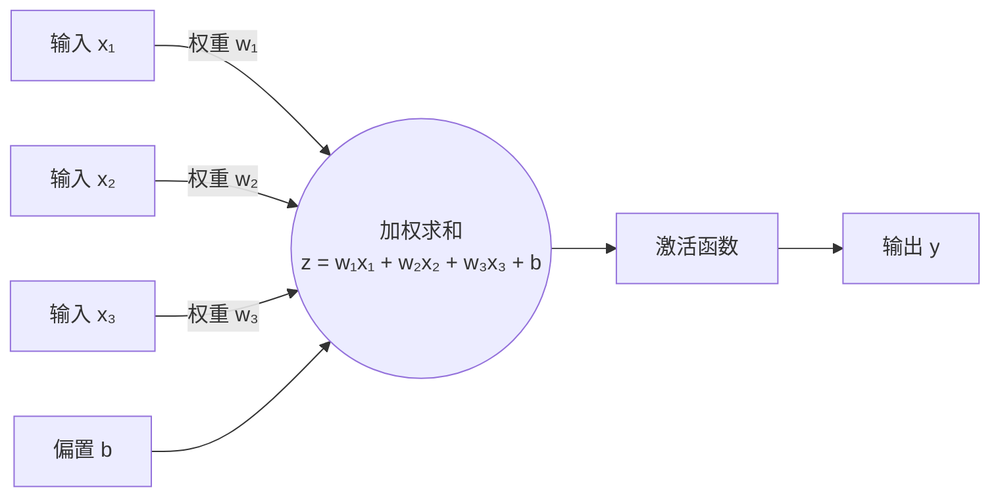
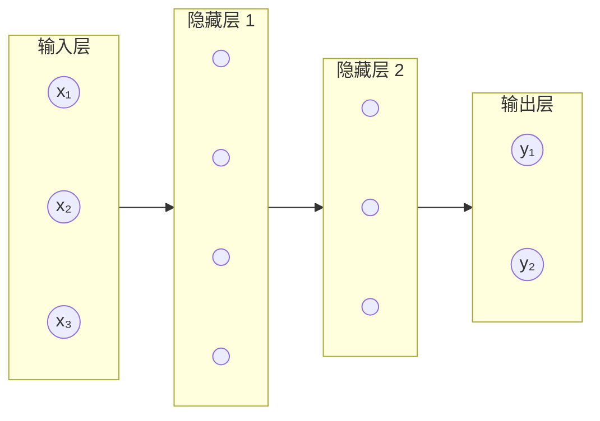
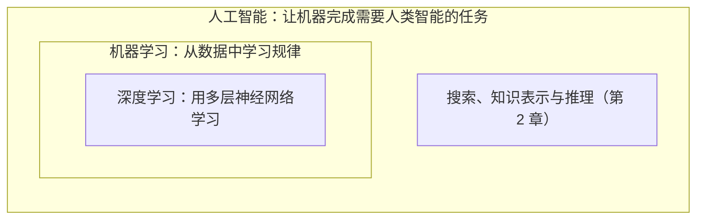
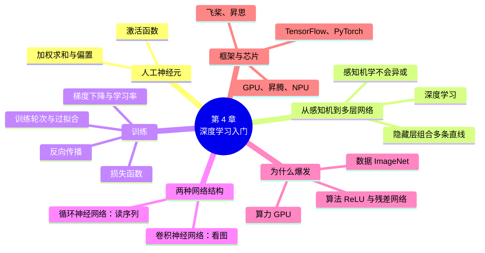

# 第 4 章 深度学习入门

!!! abstract "本章学时"
    理论 4 学时（建议全部线上）· 在线体验 2 个

## 学习目标

学完本章，你应该能够：

1. **说出**人工神经元的组成（输入、权重、偏置、激活函数、输出），区分深度学习、机器学习和人工智能的关系（记忆）；
2. **解释**人工神经元怎样把输入加权求和再“激活”，说明感知机为什么学不会“异或”、多层网络为什么更强（理解）；
3. **用自己的话说明**训练在调什么：损失函数、梯度下降、反向传播、学习率和训练轮次各起什么作用（理解）；
4. **手算**一个神经元的输出、一个两层小网络完成“异或”的过程，以及几步梯度下降（应用）；
5. **说明**卷积神经网络和循环神经网络各适合处理什么数据，深度学习在 2012 年以后爆发的三个原因（理解）；
6. **列举**主流深度学习框架（PyTorch、TensorFlow、飞桨、昇思）和 AI 芯片，分析一个身边的 AI 应用用到了哪种神经网络（分析）。

!!! info "先修要求"
    学习本章前，你需要了解：

    - 机器学习的基本概念：样本、特征、标签、模型、训练集与测试集、过拟合（[3.2 样本、特征与标签](../03-machine-learning/index.md#32)、[3.7 欠拟合与过拟合](../03-machine-learning/index.md#37)）；
    - 连接主义的基本思路（[1.3.2 连接主义](../01-overview/index.md#132)）；
    - 不需要高等数学。本章的“算一算”只用到乘法、加法和比较大小，“坡度”用生活中的上坡下坡来理解。

??? abstract "本章概念清单（24 个，点击查看定义和例子）"
    1. [人工神经元](../../appendix/glossary.md#g-人工神经元)
    2. [权重](../../appendix/glossary.md#g-权重)
    3. [偏置](../../appendix/glossary.md#g-偏置)
    4. [激活函数](../../appendix/glossary.md#g-激活函数)
    5. [感知机](../../appendix/glossary.md#g-感知机)
    6. [输入层](../../appendix/glossary.md#g-输入层)
    7. [隐藏层](../../appendix/glossary.md#g-隐藏层)
    8. [输出层](../../appendix/glossary.md#g-输出层)
    9. [多层神经网络](../../appendix/glossary.md#g-多层神经网络)
    10. [深度学习](../../appendix/glossary.md#g-深度学习)
    11. [损失函数](../../appendix/glossary.md#g-损失函数)
    12. [梯度下降](../../appendix/glossary.md#g-梯度下降)
    13. [学习率](../../appendix/glossary.md#g-学习率)
    14. [局部最低点](../../appendix/glossary.md#g-局部最低点)
    15. [反向传播](../../appendix/glossary.md#g-反向传播)
    16. [训练轮次](../../appendix/glossary.md#g-训练轮次)
    17. [卷积神经网络](../../appendix/glossary.md#g-卷积神经网络)
    18. [循环神经网络](../../appendix/glossary.md#g-循环神经网络)
    19. [长短期记忆网络](../../appendix/glossary.md#g-长短期记忆网络)
    20. [梯度消失](../../appendix/glossary.md#g-梯度消失)
    21. [深度学习框架](../../appendix/glossary.md#g-深度学习框架)
    22. [GPU](../../appendix/glossary.md#g-GPU)
    23. [专用 AI 芯片](../../appendix/glossary.md#g-专用-AI-芯片)
    24. [神经网络处理器](../../appendix/glossary.md#g-神经网络处理器)

## 情景导入

还记得第 1 章快递公司的调度员小周吗？这学期他被调到了面单处理组。仓库每天要处理几十万件包裹，绝大多数面单是打印的，但还有不少是寄件人手写的：歪歪扭扭的电话号码、连笔的地址、写错又涂掉的字。

以前，看不清的面单要由人一张张核对、录入。现在，分拣线上的摄像头一拍，系统就能把手写的电话号码认出来，认不准的才交给人复核。小周所在的组，每天要复核的面单从一万多张降到了一千多张。

小周很好奇：第 3 章学的 K 近邻、决策树，特征都要由人来设计，比如“每月到店几次”“评论有多少字”。可是一个手写的“7”，该用什么特征来描述？“有一横”“有一撇”？那带横杠的“7”和不带横杠的“7”怎么办？写得像“1”的“7”又怎么办？人自己都说不清是怎么认出来的。

答案是：让机器**自己从大量例子里学出该看什么**。这就是深度学习。这一章，我们从模仿人脑神经元的“人工神经元”讲起，看看一层层神经元怎样连成网络、又是怎样被“训练”出来的，最后看看今天训练神经网络用的软件和芯片。体验 4-2 里，你还可以亲手写几个数字，看一个小小的神经网络怎样认字。

## 4.1 从生物神经元到人工神经元

### 4.1.1 大脑里的神经元

人的大脑大约有 860 亿个神经元[[1]](#ref4-1)。每个神经元的结构都差不多：

- **树突**：像树枝一样伸出去，接收其他神经元传来的信号；
- **细胞体**：把收到的信号汇总起来；
- **轴突**：如果汇总的信号足够强，超过了某个门槛，神经元就“兴奋”起来，通过轴突把信号传给下一批神经元。

神经元之间连接的地方叫突触。有的突触连接很强，传过来的信号影响大；有的很弱，影响小。人学习新东西时，大脑里发生的一个重要变化，就是突触连接的强弱在改变。

单个神经元做的事情非常简单：收信号、加起来、超过门槛就往下传。但几百亿个神经元连在一起，就有了看、听、说、思考的能力。连接主义的想法正是由此而来：能不能用很多个简单的“人工神经元”连成网络，让它也具备智能？

### 4.1.2 人工神经元：加权求和，再过一道“门” { #412 }

1943 年，美国神经科学家麦卡洛克（Warren McCulloch）和数学家皮茨（Walter Pitts）提出了第一个人工神经元的数学模型[[2]](#ref4-2)。今天的人工神经元，基本结构仍然和它一样：

- **输入**：相当于树突收到的信号，是一组数字，比如图片的像素值、样本的特征；
- [**权重**](../../appendix/glossary.md#g-权重 "神经元中每个输入对应的系数，相当于突触连接的强弱，由训练学习得到"){ .term }（Weight）：每个输入配一个权重，相当于突触连接的强弱。权重大，这个输入的影响就大；权重是负数，这个输入起反作用；
- [**偏置**](../../appendix/glossary.md#g-偏置 "神经元加权求和后额外加上的数，相当于“门槛”的高低，由训练学习得到"){ .term }（Bias）：一个额外加上的数，相当于“门槛”的高低；
- **加权求和**：把每个输入乘以它的权重，全部加起来，再加上偏置，得到一个数 z；
- [**激活函数**](../../appendix/glossary.md#g-激活函数 "决定神经元加权和怎样变成输出、为神经网络引入非线性的函数，如阶跃、Sigmoid、Tanh、ReLU"){ .term }（Activation Function）：决定 z 怎样变成输出，相当于“超过门槛才兴奋”。

这样的计算单元叫[**人工神经元**](../../appendix/glossary.md#g-人工神经元 "对输入加权求和、加上偏置后经激活函数输出的计算单元，通常简称神经元，是神经网络的基本组成部分"){ .term }（Artificial Neuron），通常简称神经元。

!!! tip "算一算：周末去不去看电影"
    用一个神经元来模拟“周末去不去看电影”的决定。三个输入（是 = 1，否 = 0）和它们的权重是：

    | 输入 | 这周末的情况 | 权重 |
    |---|---|---|
    | x₁ 有没有想看的好电影 | 有，x₁ = 1 | w₁ = 0.6 |
    | x₂ 有没有朋友一起去 | 没有，x₂ = 0 | w₂ = 0.3 |
    | x₃ 天气好不好 | 好，x₃ = 1 | w₃ = 0.1 |

    偏置 b = −0.5，激活函数是“z 大于 0 就输出 1（去），否则输出 0（不去）”。

    加权求和：z = 0.6 × 1 + 0.3 × 0 + 0.1 × 1 + (−0.5) = 0.2。

    0.2 大于 0，输出 1：**去看电影**。

    权重最大的是“有没有好电影”（0.6），说明这个人最看重电影本身。如果偏置改成 −0.8（门槛更高，更“宅”），z = −0.1，就不去了。想一想：偏置是 −0.8 时，三个条件怎样组合才会去？（答案：好电影和朋友同时满足，z = 0.6 + 0.3 − 0.8 = 0.1 > 0，去。）

### 4.1.3 激活函数

上面用的激活函数是“大于 0 输出 1，否则输出 0”，叫阶跃函数，它像一个开关，只有“开”和“关”两种状态。实际的神经网络里，更常用的是下面几种：

| 激活函数 | 输出范围 | 形状和特点 | 常用在哪里 |
|---|---|---|---|
| 阶跃函数 | 0 或 1 | 像开关，非开即关 | 早期的感知机 |
| Sigmoid | 0 到 1 之间 | 平滑的 S 形曲线，可以理解为“概率” | 二分类的输出层 |
| Tanh | −1 到 1 之间 | 也是 S 形，以 0 为中心 | 循环神经网络 |
| ReLU | 0 到正无穷 | 小于 0 输出 0，大于 0 原样输出 | 今天最常用，几乎所有隐藏层 |

为什么一定要有激活函数？如果没有它，神经元只做加权求和，那么不管叠多少层，整个网络算出来的还是一个加权求和，和一个神经元没有区别，只能画直线。激活函数让网络能表示弯弯曲曲的复杂规律，这一点在 4.2 节会看得更清楚。

<iframe class="sim-frame" src="../../sims/neuron-activation/main.html" height="760" loading="lazy" title="神经元与激活函数"></iframe>

动画：神经元与激活函数（来自《自然语言处理导论》）。左边勾选输入、拖动权重和偏置，看神经元的输出怎样变化，换一个激活函数看曲线形状；右边让感知机学“与”“或”“异或”。[全屏打开](../../sims/neuron-activation/main.html){ target=_blank }
{ .sim-caption }

## 4.2 从感知机到多层神经网络

### 4.2.1 感知机：会学习的神经元

1958 年，美国心理学家罗森布拉特（Frank Rosenblatt）提出了[**感知机**](../../appendix/glossary.md#g-感知机 "只有一个神经元、使用阶跃激活函数、能从例子中学习权重的最简单神经网络"){ .term }（Perceptron）[[3]](#ref4-3)。它只有一个神经元，用阶跃函数做激活函数，但它有一个了不起的地方：**权重不是人设定的，而是从例子中学出来的**。

感知机的学习方法很直观：拿一个例子让它判断，判对了就不动；判错了，就把权重往“能判对”的方向调一点。比如本该输出 1 却输出了 0，说明加权和太小了，那就把取值为 1 的那些输入的权重调大一点。一个个例子反复练，权重就慢慢调好了。

罗森布拉特还造出了一台感知机硬件，能学会分辨简单的图形。当时的报纸兴奋地预言，这种机器将来能走路、说话、看东西，甚至有自我意识。

### 4.2.2 感知机的局限：学不会“异或”

可惜感知机有一个致命的弱点。1969 年，明斯基和帕珀特（Seymour Papert）出版了《感知机》一书[[4]](#ref4-4)，严格证明了：单个感知机只能学会**用一条直线就能分开**的问题。

看两个逻辑运算。“与”（AND）：两个输入都是 1，输出才是 1。“异或”（XOR）：两个输入不同时输出 1，相同时输出 0。把四种输入画在平面上：

| 输入 (x₁, x₂) | (0, 0) | (0, 1) | (1, 0) | (1, 1) |
|---|---|---|---|---|
| 与 | 0 | 0 | 0 | 1 |
| 异或 | 0 | 1 | 1 | 0 |

“与”的情况下，只有右上角 (1, 1) 是 1，画一条斜线就能把它和另外三个点分开，感知机能学会。“异或”的情况下，两个 1 在对角线的两端，两个 0 在另一条对角线的两端，**不管怎样画一条直线，都没法把 1 和 0 分开**，感知机怎么调权重都学不会。你可以在上面的动画里试一试，“异或”训练再多轮，也总有点判错。

异或看起来是个很小的问题，但它说明单个神经元能力有限。这本书出版后，神经网络的研究冷了十多年。

### 4.2.3 多层神经网络：把直线组合起来

解决办法其实明斯基也知道：**多用几层神经元**。在输入和输出之间加一层或几层神经元，这些中间层叫[**隐藏层**](../../appendix/glossary.md#g-隐藏层 "位于输入层和输出层之间、对数据逐层加工的神经元层"){ .term }（Hidden Layer），因为从外面看不到它们的输入和输出。这样的网络叫[**多层神经网络**](../../appendix/glossary.md#g-多层神经网络 "在输入层和输出层之间含有一个或多个隐藏层的神经网络，也叫多层感知机"){ .term }，也叫多层感知机。

!!! tip "算一算：两层网络完成“异或”"
    用三个神经元搭一个两层网络，激活函数都是“大于 0 输出 1，否则输出 0”：

    - 隐藏神经元 h₁ = 阶跃(x₁ + x₂ − 0.5)：只要有一个输入是 1，h₁ 就是 1，它学会的是“或”；
    - 隐藏神经元 h₂ = 阶跃(x₁ + x₂ − 1.5)：两个输入都是 1，h₂ 才是 1，它学会的是“与”；
    - 输出神经元 y = 阶跃(h₁ − h₂ − 0.5)：“或”成立但“与”不成立时输出 1。

    | x₁ | x₂ | h₁（或） | h₂（与） | y = 阶跃(h₁ − h₂ − 0.5) | 异或的正确答案 |
    |---|---|---|---|---|---|
    | 0 | 0 | 0 | 0 | 阶跃(−0.5) = 0 | 0 |
    | 0 | 1 | 1 | 0 | 阶跃(0.5) = 1 | 1 |
    | 1 | 0 | 1 | 0 | 阶跃(0.5) = 1 | 1 |
    | 1 | 1 | 1 | 1 | 阶跃(−0.5) = 0 | 0 |

    四种情况全对。两个隐藏神经元各画了一条直线，输出神经元再把这两条线的结果组合起来，就把平面分成了“两条线中间”和“两条线外面”，这是一条直线做不到的。

这个例子说明了多层网络的基本道理：**每一层把上一层的结果再组合一次，层数越多，能表示的规律越复杂**。前面的层学简单的东西，后面的层把简单的东西组合成复杂的东西。

### 4.2.4 深度学习：很多层的神经网络

一个神经网络分成三部分：[**输入层**](../../appendix/glossary.md#g-输入层 "神经网络中接收原始数据的第一层"){ .term }接收数据（比如图片的每个像素），一个或多个**隐藏层**逐层加工，[**输出层**](../../appendix/glossary.md#g-输出层 "神经网络中给出最终结果的最后一层"){ .term }给出结果（比如 10 个数字各自的概率）。相邻两层的神经元之间两两相连，每条连接上有一个权重。

隐藏层多的神经网络叫深度神经网络，用深度神经网络从数据中学习的方法，就是[**深度学习**](../../appendix/glossary.md#g-深度学习 "使用多层神经网络从数据中自动学习特征的机器学习方法"){ .term }（Deep Learning）。“深”指的就是层数多。今天的图像识别网络常有几十层到上百层，大模型则有几十到上百层的 Transformer 结构（第 5 章）。

深度学习和第 3 章的机器学习方法相比，最大的不同在于**特征**：

| | 传统机器学习 | 深度学习 |
|---|---|---|
| 特征从哪里来 | 人来设计，比如“到店次数”“评论字数” | 网络自己从原始数据（像素、声音、文字）中学 |
| 擅长的数据 | 整理好的表格数据 | 图像、声音、文字等原始数据 |
| 需要的数据量 | 几百到几万条就能用 | 通常要几万到几百万条甚至更多 |
| 需要的算力 | 普通电脑就行 | 通常要 GPU |
| 可解释性 | 较好，比如决策树能说出理由 | 较差，像“黑箱” |

所以，人工智能、机器学习、深度学习是一层套一层的关系：人工智能范围最大，机器学习是让计算机从数据中学习的那一部分，深度学习是机器学习中用多层神经网络来学的那一部分。

## 4.3 训练在做什么

一个神经网络搭好了，一开始它的权重和偏置都是随机的数，什么也不会。**训练**，就是用大量带标签的例子，一点点调整这些权重和偏置，让网络的输出越来越接近正确答案。体验 4-2 的手写数字识别网络有 3610 个权重和偏置，今天的大模型则有几千亿个，它们全都是训练出来的，没有一个是人设定的。

### 4.3.1 损失函数：错得有多厉害

要调整，先要知道“现在错得有多厉害”。衡量网络的输出和正确答案之间差距的函数，叫[**损失函数**](../../appendix/glossary.md#g-损失函数 "衡量模型输出与正确答案之间差距的函数，训练的目标是让损失尽量小"){ .term }（Loss Function），算出来的数叫损失。损失越小，说明网络判得越准；训练的目标，就是让训练集上的平均损失尽量小。

第 3 章比较三条直线时用的“平均绝对误差”，就是一种损失。神经网络常用的有：

- 预测数值（回归）：常用均方误差，把每个误差平方后求平均；
- 分类：常用交叉熵。直观地说，如果正确答案是“7”，网络给“7”的概率是 0.9，损失就小；只给了 0.1，损失就大。

### 4.3.2 梯度下降：蒙着眼睛下山

损失和权重之间的关系，可以想象成一片连绵起伏的山地：脚下的位置代表一组权重，地面的高度代表损失。训练就是要找到这片山地里最低的地方。

可是这片山地有成千上万甚至几千亿个“方向”（每个权重都是一个方向），没法画出来，也没法一眼看到最低点在哪里。我们就像一个**蒙着眼睛下山**的人，只能用脚感觉脚下的坡度：

1. 感觉一下脚下往哪边是下坡、有多陡；
2. 往下坡的方向迈一小步；
3. 重复 1、2，直到脚下几乎是平的。

这就是[**梯度下降**](../../appendix/glossary.md#g-梯度下降 "沿着坡度（梯度）的反方向一步步调整参数、使损失减小的优化方法"){ .term }（Gradient Descent）。“梯度”就是数学上的坡度，它告诉我们每个权重往哪个方向调、能让损失减小得最快。每一步怎么调，可以写成：

> 新的权重 = 旧的权重 − 学习率 × 坡度

坡度是正的（往右是上坡），就把权重调小；坡度是负的，就把权重调大。

[**学习率**](../../appendix/glossary.md#g-学习率 "梯度下降中每一步更新参数的步长，是训练时最重要的设置之一"){ .term }（Learning Rate）决定每一步迈多大。它是训练时最重要的设置之一：

- 学习率太小，每步只挪一点点，要走很多很多步才能下山，训练很慢；
- 学习率太大，一步迈过了谷底，跳到对面的山坡上，甚至越跳越高，永远下不了山；
- 学习率合适，几步就能走到谷底附近。

!!! tip "算一算：几步梯度下降"
    假设损失和某个权重 w 的关系是一个“山谷”，谷底在 w = 2。在任意位置，坡度等于 w − 2（在谷底左边是负的，右边是正的）。从 w = −2 出发，学习率取 0.5：

    | 步数 | 当前 w | 坡度 w − 2 | 新的 w = w − 0.5 × 坡度 |
    |---|---|---|---|
    | 1 | −2 | −4 | −2 − 0.5 × (−4) = 0 |
    | 2 | 0 | −2 | 0 − 0.5 × (−2) = 1 |
    | 3 | 1 | −1 | 1 − 0.5 × (−1) = 1.5 |
    | 4 | 1.5 | −0.5 | 1.5 − 0.5 × (−0.5) = 1.75 |

    每走一步，离谷底的距离就缩小一半：4 → 2 → 1 → 0.5 → 0.25，越来越近。

    如果学习率取 2.2 呢？第一步：w = −2 − 2.2 × (−4) = 6.8，离谷底 4.8，比原来的 4 还远，冲过头了；再走一步，w = 6.8 − 2.2 × 4.8 = −3.76，离谷底 5.76，越跳越远。学习率太大，训练就“发散”了。

<iframe class="sim-frame" src="../../sims/gradient-descent/main.html" height="700" loading="lazy" title="梯度下降：蒙着眼睛下山"></iframe>

动画：梯度下降。小球只能感觉到脚下的坡度（红色的切线），每一步往下坡方向挪一点。拖动学习率，看小球是慢慢走下去、来回跳，还是冲出去；切换到“两个山谷”，看小球会不会停在浅的那个谷里。[全屏打开](../../sims/gradient-descent/main.html){ target=_blank }
{ .sim-caption }

在“两个山谷”的曲线上，你会发现：从右边出发、学习率小时，小球会停在右边那个浅一些的谷底，而不是左边更深的那个。这叫陷入[**局部最低点**](../../appendix/glossary.md#g-局部最低点 "比周围都低、但不是整体最低的位置，梯度下降可能停在这里"){ .term }。真实的神经网络也会遇到类似的问题，不过研究发现，在参数非常多的大网络里，大多数“谷底”的好坏相差不大，所以梯度下降在实践中效果很好。

### 4.3.3 反向传播：谁的错就改谁

一个网络有很多层、很多权重，输出错了，到底该怪哪个权重、每个权重该调多少？这就需要[**反向传播**](../../appendix/glossary.md#g-反向传播 "从输出层的误差出发，一层层往回分摊、算出每个权重坡度的算法"){ .term }（Backpropagation）。

打个比方。一家公司的年度业绩没完成，总经理要找原因：先看各个部门经理的贡献，业绩差得多的部门，责任大；部门经理再往下看各个小组，小组长再看每个员工。责任从结果出发，**一层一层往回分摊**，每个人按自己的责任大小改进工作。

反向传播也是这样：先算出输出层的误差，再根据每条连接的权重，把误差一层层往回分摊到前面的每个神经元，从而算出每个权重的坡度。有了坡度，就可以用梯度下降调整所有权重。1986 年，鲁梅尔哈特（David Rumelhart）、辛顿和威廉姆斯（Ronald Williams）在《自然》杂志上发表论文[[5]](#ref4-5)，展示了反向传播能有效训练多层网络，让神经网络研究重新活跃起来。

整个训练过程就是这几步不断循环：

### 4.3.4 训练轮次与过拟合

训练数据不是一次全部用完的，通常每次取一小批（比如 64 张图片）来算损失、调权重，叫一个“批”。把训练集里所有的样本都用过一遍，叫一个[**训练轮次**](../../appendix/glossary.md#g-训练轮次 "把训练集中的全部样本完整使用一遍称为一个训练轮次；每次更新所用的一小组样本称为一批"){ .term }（Epoch）。一个网络往往要训练几轮到几百轮。

轮次多了，训练集上的损失会越来越小，但第 3 章说过，这不一定是好事：网络可能开始死记硬背训练数据，在测试集上反而变差，这就是**过拟合**。神经网络的参数很多，特别容易过拟合。常用的办法有：多收集数据、训练时随机“关掉”一部分神经元（叫随机失活，让网络不能依赖某几个神经元）、在验证集上的成绩不再提高时就停止训练（叫提前停止）。

!!! tip "算一算：一个小网络有多少个参数"
    体验 4-2 的手写数字识别网络：输入层 64 个神经元（8 × 8 像素），一个隐藏层 48 个神经元，输出层 10 个神经元（数字 0～9）。

    - 输入层到隐藏层：每个隐藏神经元和 64 个输入都有连接，共 64 × 48 = 3072 个权重，再加上 48 个隐藏神经元各自的偏置，共 3120 个；
    - 隐藏层到输出层：48 × 10 = 480 个权重，加上 10 个偏置，共 490 个；
    - 合计：3120 + 490 = **3610** 个参数。

    就这么一个小网络，已经要调三千多个数。2020 年的 GPT-3 有 1750 亿个参数，是它的近 5000 万倍。

## 4.4 卷积神经网络与循环神经网络概览

上面讲的网络，相邻两层的神经元两两相连，叫全连接网络。它可以处理任何数据，但对于图像和文字、声音这类有特殊结构的数据，有更合适的网络结构。本节只做概览，第 5～7 章会在具体领域里再讲。

### 4.4.1 卷积神经网络：一小块一小块地看图

一张 1000 × 1000 像素的照片有 100 万个像素。如果用全连接网络，第一个隐藏层每个神经元就要连 100 万个输入，权重多得吓人，而且它不懂一个基本事实：**图片里相邻的像素关系最密切**，一只猫的眼睛不管出现在照片的左上角还是右下角，都是眼睛。

[**卷积神经网络**](../../appendix/glossary.md#g-卷积神经网络 "用小窗口（卷积核）在图像上滑动、逐层提取特征的神经网络，擅长处理图像"){ .term }（Convolutional Neural Network，CNN）专门为图像设计。它的核心是一个个小“窗口”（比如 3 × 3 个像素），叫卷积核。卷积核在图片上从左到右、从上到下地滑动，每到一个位置，就把窗口里的像素加权求和，看这一小块像不像它要找的图案。同一个卷积核在整张图上共用一组权重，所以不管猫眼睛出现在哪里，都能被找到，权重也少得多。

卷积神经网络一层层叠起来，就能**逐层提取特征**：

这正好回答了情景导入里小周的问题：手写的“7”该用什么特征？不用人来设计，卷积神经网络的前几层会自己学出“横线”“斜线”这样的笔画，后几层再把笔画组合成数字。1998 年，美国学者杨立昆（Yann LeCun）等人用卷积神经网络 LeNet 识别支票上的手写数字[[6]](#ref4-6)，当时就在美国的银行里用来读支票。2012 年的 AlexNet、今天的人脸识别和医学影像分析，用的也是卷积神经网络（第 6 章）。

### 4.4.2 循环神经网络：带着记忆往下读

文字、语音、股价这类数据有一个共同点：它们是**序列**，有先后顺序，前面的内容会影响后面的意思。“我不喜欢这部电影”和“我喜欢这部电影，不是吗”，关键在于词的顺序。

[**循环神经网络**](../../appendix/glossary.md#g-循环神经网络 "通过隐藏状态把前面的信息带到后面、按顺序处理序列数据的神经网络"){ .term }（Recurrent Neural Network，RNN）像人读书一样，一个词一个词地往下读，每读一个词，就把“到目前为止读到的意思”记在一个“记忆”（叫隐藏状态）里，带着它去读下一个词。读完整句话，记忆里就有了整句的意思。

普通的循环神经网络记性不好，句子一长，前面的内容就忘了。1997 年提出的[**长短期记忆网络**](../../appendix/glossary.md#g-长短期记忆网络 "加了“门”来决定记住和忘掉哪些内容的循环神经网络，能记住更长的序列"){ .term }（LSTM）[[7]](#ref4-7)加了几道“门”，决定哪些该记住、哪些该忘掉，记性好了很多，曾广泛用于机器翻译、语音识别和输入法。2017 年以后，在处理文字上，循环神经网络逐渐被能同时看整句话的 Transformer 取代（第 5 章），但它“带着记忆读序列”的思路仍然很有启发性。

| | 全连接网络 | 卷积神经网络（CNN） | 循环神经网络（RNN） |
|---|---|---|---|
| 怎样看数据 | 一次看全部，每个输入都连 | 用小窗口一块块地看 | 按顺序一个个地看，带着记忆 |
| 擅长的数据 | 表格数据、简单任务 | 图像、视频 | 文字、语音、时间序列 |
| 典型应用 | 体验 4-2 的小网络 | 人脸识别、医学影像、工业质检 | 早期的机器翻译、语音识别、输入法 |
| 本书章节 | 本章 | 第 6 章 | 第 5、7 章 |

## 4.5 深度学习为什么爆发

神经网络的想法在 1940～1950 年代就有了，反向传播在 1986 年就流行开来，为什么直到 2012 年以后才迎来大爆发？答案就是第 1 章说的三要素在这个时候同时成熟了。

### 4.5.1 数据：有了足够多的“练习题”

深度神经网络参数多，需要大量数据才能训练好，否则很容易过拟合。2009 年，美国普林斯顿大学的李飞飞团队发布了 ImageNet 图像数据集[[8]](#ref4-8)，最终收录了 1400 多万张人工标注的图片，涵盖两万多个类别。从 2010 年起，基于它举办的图像识别比赛使用其中约 120 万张训练图片、1000 个类别。这是此前任何数据集都无法相比的规模。与此同时，互联网和智能手机让照片、语音、文字的数量急剧增长，深度学习有了足够的“练习题”。

### 4.5.2 算力：GPU 让训练快了几十倍 { #452 }

训练神经网络，主要就是做大量的乘法和加法。CPU 像几位能力很强的教授，什么题都会做，但人少；GPU 原本是为电脑游戏画图设计的，像几千名小学生，每人只会做简单的算术，但可以同时做。神经网络的计算恰好是“大量简单算术”，交给 GPU 快得多。2012 年的 AlexNet 就是在两块游戏显卡上训练了五六天完成的[[9]](#ref4-9)，如果用当时的 CPU，可能要几个月。

### 4.5.3 算法：一系列关键改进

除了数据和算力，研究者还找到了一系列让深层网络更好训练的方法：

- 用 ReLU 代替 Sigmoid 做激活函数，解决了层数多时坡度在反向传播中越来越小、前面的层几乎学不动的问题（[**梯度消失**](../../appendix/glossary.md#g-梯度消失 "反向传播中坡度逐层变小，使前面的层几乎学不动的现象"){ .term }）；
- 随机失活（Dropout）等方法，减轻了过拟合；
- 2015 年提出的残差网络（ResNet）[[10]](#ref4-10)，在层与层之间加“捷径”，让 152 层的网络也能训练好；
- 更好的权重初始化方法、更聪明的梯度下降变体（如 Adam），让训练更快更稳定。

### 4.5.4 一张时间表

| 年份 | 事件 | 意义 |
|---|---|---|
| 1943 | 麦卡洛克和皮茨提出人工神经元模型 | 连接主义的起点 |
| 1958 | 罗森布拉特提出感知机 | 第一个会学习的神经网络 |
| 1969 | 《感知机》一书指出单层网络学不会异或 | 神经网络研究进入低谷 |
| 1986 | 反向传播用于训练多层网络 | 神经网络再次兴起 |
| 1997 | 长短期记忆网络（LSTM）提出 | 循环神经网络能记住更长的内容 |
| 1998 | LeNet 识别手写数字 | 卷积神经网络走向实用 |
| 2006 | 辛顿等人提出训练深层网络的新方法 | “深度学习”一词流行 |
| 2012 | AlexNet 在 ImageNet 比赛中大幅领先 | 深度学习爆发 |
| 2015 | 残差网络（ResNet） | 上百层的网络也能训练 |
| 2017 | Transformer 提出 | 大模型的基础（第 5 章） |

## 4.6 深度学习框架与算力

### 4.6.1 深度学习框架：搭神经网络的“积木”

自己从零写代码来实现神经网络的前向计算、反向传播和梯度下降，非常麻烦，也容易出错。[**深度学习框架**](../../appendix/glossary.md#g-深度学习框架 "提供搭建网络、自动反向传播、调用 GPU 等功能的软件工具"){ .term }（Deep Learning Framework）把这些常用的功能都做好了：搭网络像搭积木一样，选好层的类型和数量；反向传播自动完成，不用自己算坡度；还能自动调用 GPU 加速。今天几乎所有的深度学习项目都是在框架上完成的。

| 框架 | 开发者 | 开源时间 | 特点 |
|---|---|---|---|
| TensorFlow | 谷歌 | 2015 年 | 最早流行的框架之一，部署工具丰富，常配合更简洁的 Keras 接口使用 |
| PyTorch | Meta（原 Facebook） | 2016 年 | 写法灵活直观，学术界和大模型领域用得最多 |
| 飞桨（PaddlePaddle） | 百度 | 2016 年 | 我国第一个开源开放的产业级深度学习平台，中文文档、产业模型库丰富 |
| 昇思（MindSpore） | 华为 | 2020 年 | 与华为昇腾 AI 芯片深度配合，支持端、边、云多种场景 |

国产框架的意义不只是“多一个选择”。在关键技术上实现自主可控，是我国人工智能发展战略的一部分。飞桨提供了大量面向产业的现成模型，比如文字识别 PaddleOCR、目标检测 PaddleDetection，很多企业直接拿来用；昇思则和国产昇腾芯片一起，构成了一整套国产的 AI 软硬件体系。框架的安装、使用和模型训练，在《人工智能开发框架技术》中详细学习。

### 4.6.2 AI 芯片：深度学习的“发动机” { #462 }

第 1 章说算力是 AI 的炉灶。具体到硬件，训练和运行神经网络的芯片主要有：

- [**GPU**](../../appendix/glossary.md#g-GPU "图形处理器，能同时进行大量简单计算，是训练神经网络的主流硬件"){ .term }（图形处理器）：美国英伟达公司的 GPU 是目前训练大模型的主流选择，它配套的 CUDA 软件平台让框架能方便地调用 GPU；
- [**专用 AI 芯片**](../../appendix/glossary.md#g-专用-AI-芯片 "专门为神经网络计算设计、比通用 GPU 更省电高效的芯片"){ .term }：专门为神经网络计算设计的芯片，比通用 GPU 更省电、更高效。国产的有华为昇腾、寒武纪思元、百度昆仑芯等，谷歌也有自己的 TPU；
- **手机和终端里的 AI 芯片**：手机芯片里常集成一块[**神经网络处理器**](../../appendix/glossary.md#g-神经网络处理器 "集成在手机等终端芯片中、在本地运行神经网络模型的处理单元"){ .term }（NPU），专门负责刷脸解锁、拍照优化、语音唤醒这类计算，不用把数据传到云端，速度快，也更保护隐私。

训练一个大模型要用上万块芯片，而在手机上运行一个人脸识别模型，一块小小的 NPU 就够了。这是因为**训练**（反复调整几千亿个参数）比**推理**（用训练好的模型做一次判断）的计算量大得多。

!!! note "推理的两种意思"
    第 2 章的“推理”指从已知事实按规则推出结论；在深度学习里，“推理”（Inference）还指用训练好的模型对新数据做判断，比如手机用人脸识别模型认出你的脸。两个意思不同，要根据上下文区分。

## 4.7 身边的 AI { #47 }

### 4.7.1 刷脸解锁

拿起手机，看一眼就解锁了。手机前置的摄像头（有的还有专门的红外和深度传感器）拍下你的脸，一个卷积神经网络把它变成一串数字（相当于“人脸特征”），再和你录入时保存的那串数字比较，足够接近就解锁。整个过程在手机的 NPU 上完成，不到一秒，你的人脸数据也不用上传到网上（第 6 章）。

### 4.7.2 相册自动分类

手机相册能按“人物”“宠物”“美食”“风景”自动分类，还能搜“海边”“生日蛋糕”找出相应的照片。这背后是一个在大量图片上训练好的卷积神经网络，它能识别照片里有哪些东西。同一个人在不同照片里的脸，也能被自动归到一起。

### 4.7.3 AI 修图和拍照 { #473 }

手机拍照时的“人像模式”能把背景虚化，靠的是神经网络判断哪些像素是人、哪些是背景（这叫图像分割，第 6 章）；夜景模式把几张照片合成一张又亮又清楚的照片，修图软件一键去掉路人、把模糊的老照片变清晰，也都用到了深度学习。

### 4.7.4 读懂手写的字

回到情景导入，快递面单上手写的电话号码，银行支票上手写的金额，学生作业上手写的答案，都可以用深度学习识别。手机输入法的手写输入、拍照搜题，也是同样的原理。今天的文字识别（OCR，第 6 章）已经能识别连笔字、表格、印章，准确率很高，但遇到特别潦草的字，仍然需要人来复核。

!!! example "案例：为什么还要人来复核"
    快递公司的手写识别系统，每认出一个数字，都会给出一个“把握”（概率）。小周所在的组定了一条规则：一张面单上，只要有一个数字的把握低于 90%，就交给人工复核。

    这正是第 3 章“阈值”的用法：阈值定得高，交给人的面单多，工作量大，但出错少；定得低，人轻松了，但寄错的包裹会变多。深度学习再强，也有认不准的时候，**把握不大的交给人**，是很多 AI 系统的标准做法，也是人工智能训练师、数据标注员这些岗位存在的原因。

## 在线体验

!!! abstract "体验总览"

    | 体验 | 用到什么 | 时长 |
    |---|---|---|
    | 4-1 神经元与梯度下降 | 本书动画“神经元与激活函数”“梯度下降” | 约 30 分钟 |
    | 4-2 手写数字识别 | 本书动画“手写数字识别” | 约 20 分钟 |

    两个体验都只需要浏览器。体验 4-2 在手机上用手指写字更方便。建议边做边把结果填进记录表，课后练习的实操题会用到。

### 体验 4-1 神经元与梯度下降

**体验目的**：通过调整权重和偏置，看懂一个神经元是怎样计算的；通过让感知机学“异或”，体会单个神经元的局限；通过调整学习率，理解梯度下降“蒙眼下山”的过程。

**第一部分：一个神经元**

打开 4.1.3 节中的动画，或者[全屏打开“神经元与激活函数”](../../sims/neuron-activation/main.html){ target=_blank }。

1. 默认设置就是 4.1.2 节“算一算”的例子。读出加权和 z 和输出 y，和你手算的结果核对。
2. 把偏置 b 从 −0.5 慢慢往左拖，找出“刚好不去看电影”时的偏置值，记下来。
3. 把激活函数依次换成 Sigmoid、Tanh、ReLU，记下每种情况下的输出 y。
4. 在右边选“与”，点“训练一轮”，直到错 0 个点，记下用了几轮。
5. 选“异或”，点“训练 10 轮”三次，记下每次之后还错几个点。

**第二部分：梯度下降**

打开 4.3.2 节中的动画，或者[全屏打开“梯度下降”](../../sims/gradient-descent/main.html){ target=_blank }。

1. 选“一个山谷”，学习率 0.1，点“走 10 步”，记下 10 步后的损失。
2. 依次把学习率改为 0.6、1.9、2.2，每次都点“回到起点”再走 10 步，记下损失，并描述小球是怎样走的。
3. 切换到“两个山谷”，学习率 0.1，走 20 步，小球停在哪个谷？
4. 保持“两个山谷”，试着调大学习率或者点曲线换一个起点，让小球走到左边更深的谷里，记下你的办法。

**记录表**

| 序号 | 操作 | 观察结果 |
|---|---|---|
| 1 | 默认设置的 z 和 y | z = ___，y = ___ |
| 2 | 刚好不去时的偏置 | b ≈ ___ |
| 3 | Sigmoid / Tanh / ReLU 的输出 | ___ / ___ / ___ |
| 4 | 感知机学会“与”用了几轮 | ___ 轮 |
| 5 | “异或”训练 10、20、30 轮后错几个点 | ___ / ___ / ___ |
| 6 | 学习率 0.1 / 0.6 / 1.9 / 2.2 走 10 步后的损失 | ___ / ___ / ___ / ___ |
| 7 | 学习率 1.9 和 2.2 时小球怎样走 | |
| 8 | “两个山谷”中让小球到达深谷的办法 | |

**想一想**

1. 感知机为什么学不会“异或”？要让网络学会“异或”，该怎么改？（提示：4.2.3 节。）
2. 学习率是越大越好，还是越小越好？用你的记录说明。

### 体验 4-2 手写数字识别

**体验目的**：亲手考一考一个训练好的神经网络，看懂输入层、隐藏层、输出层各在做什么，体会神经网络“把握”大小的含义，以及它在什么情况下会出错。

**打开方式**：[全屏打开“手写数字识别”](../../sims/digit-recognition/main.html){ target=_blank }，或者使用下面嵌入的动画。

<iframe class="sim-frame" src="../../sims/digit-recognition/main.html" height="680" loading="lazy" title="手写数字识别"></iframe>

动画：手写数字识别。在方框里写一个 0～9 的数字，看网络把它缩成的 8 × 8 图像、隐藏层 48 个神经元的激活程度，以及 10 个数字各自的概率。[全屏打开](../../sims/digit-recognition/main.html){ target=_blank }
{ .sim-caption }

**步骤**

1. 点几次“换一个样例”，看网络对测试集里的数字认得准不准。这些数字都是网络训练时没见过的。
2. 点“清空”，自己端端正正地写 0～9 十个数字，每写一个记下网络的识别结果和把握（概率），然后清空再写下一个。
3. 挑一个网络认对了的数字，故意写歪一点、写小一点、只写一半，看把握怎样变化，什么时候开始认错。
4. 写一个容易混淆的数字，比如写得像“7”的“1”、像“9”的“4”，看概率最高的两个数字分别是什么。
5. 观察写不同数字时，隐藏层里哪些方块变深了。写两次同一个数字，深色方块的位置是否相似？

**记录表**

| 数字 | 网络的识别结果 | 把握 | 对不对 |
|---|---|---|---|
| 0 | | | |
| 1 | | | |
| …… | | | |
| 9 | | | |
| 合计 | 十个数字认对 ___ 个 | | |

| 序号 | 操作 | 观察结果 |
|---|---|---|
| 1 | 故意写歪 / 写小 / 只写一半 | 把握从 ___% 变为 ___%，从 ___ 开始认错 |
| 2 | 容易混淆的数字 | 我写的是 ___，概率最高的两个是 ___ 和 ___ |
| 3 | 隐藏层 | 写同一个数字两次，深色方块的位置：相似 / 不相似 |

**想一想**

1. 网络在测试集上的准确率很高，为什么你写的数字有时认不出来？（提示：它只见过训练数据里的写法。联系第 3 章的“泛化能力”。）
2. 如果你是快递公司的工程师，会怎样利用“把握”来决定哪些面单交给人工复核？

## 本章小结

- **人工神经元**模仿生物神经元：把输入乘以**权重**后求和，加上**偏置**，再经过**激活函数**得到输出。常用的激活函数有阶跃、Sigmoid、Tanh 和 ReLU。
- **感知机**是会从例子中学习权重的单个神经元，但只能学会用一条直线分开的问题，学不会“异或”。加上**隐藏层**的**多层神经网络**能组合多条直线，表示复杂的规律。
- 隐藏层很多的神经网络叫深度神经网络，用它从数据中学习就是**深度学习**。它能自己从原始数据中学出特征，是机器学习的一个分支。
- **训练**就是不断调整权重和偏置：用**损失函数**衡量错得有多厉害，用**反向传播**把误差一层层往回分摊、算出每个权重的坡度，用**梯度下降**往下坡方向迈一步。**学习率**决定步子大小，太小太慢，太大会冲过头。用完一遍训练数据叫一个**训练轮次**。
- **卷积神经网络**用小窗口在图上滑动，逐层提取边缘、纹理、部件、物体等特征，擅长图像；**循环神经网络**带着记忆按顺序读，擅长文字和语音等序列。
- 深度学习在 2012 年后爆发，是因为数据（ImageNet）、算力（GPU）、算法（ReLU、残差网络等）同时成熟。
- **深度学习框架**有 TensorFlow、PyTorch 和国产的飞桨、昇思；**AI 芯片**有 GPU 和昇腾等专用芯片，手机里的 NPU 负责在本地运行模型。

!!! info "深入学习"
    本章只讲了神经网络的直观思路。想弄清楚它们是怎样计算和实现的，可以在后续课程中继续学习：

    - 神经网络、反向传播与梯度下降的计算：《机器学习》第 10 章；
    - 卷积神经网络与循环神经网络的原理：《机器学习》第 11 章；
    - 用 PyTorch、飞桨、昇思搭建和训练网络，在 GPU 上训练、部署模型：《人工智能开发框架技术》；
    - 卷积神经网络在图像中的应用：本书第 6 章、《计算机视觉及应用实战》；循环神经网络与 Transformer：本书第 5 章、《自然语言处理导论》第 8、9 章。

**下一章预告**

本章讲的神经网络，一个只会做一件事：认数字的只会认数字，认猫的只会认猫。可是 2022 年以后，一个模型就能写文章、答问题、写代码、做翻译。下一章我们来看，计算机是怎样读懂人类语言的，大模型又是怎样炼成的。

## 参考文献

正文中的上标编号（如[[1]](#ref4-1)）对应下面的文献。带链接的可以直接打开；书籍可在图书馆或电子书平台查阅。

**教材与专著**

- [4] Minsky M, Papert S. Perceptrons: An Introduction to Computational Geometry[M]. Cambridge, MA: MIT Press, 1969.
    证明单层感知机无法解决异或等线性不可分问题的著作，对应 4.2.2 节。
- [11] 邱锡鹏. 神经网络与深度学习[M]. 北京：机械工业出版社，2020. <https://nndl.github.io/>
    国内广泛使用的深度学习教材，作者在网上公开了电子版和课件，第 4～6 章讲前馈网络、卷积网络和循环网络，适合学完《机器学习》后深入阅读。

**经典论文**

- [1] Azevedo F A C, Carvalho L R B, Grinberg L T, et al. Equal Numbers of Neuronal and Nonneuronal Cells Make the Human Brain an Isometrically Scaled-up Primate Brain[J]. Journal of Comparative Neurology, 2009, 513(5): 532-541. <https://doi.org/10.1002/cne.21974>
    统计出成年人大脑约有 860 亿个神经元的研究，对应 4.1.1 节。
- [2] McCulloch W S, Pitts W. A Logical Calculus of the Ideas Immanent in Nervous Activity[J]. Bulletin of Mathematical Biophysics, 1943, 5(4): 115-133. <https://doi.org/10.1007/BF02478259>
    提出第一个人工神经元数学模型的论文，对应 4.1.2 节。
- [3] Rosenblatt F. The Perceptron: A Probabilistic Model for Information Storage and Organization in the Brain[J]. Psychological Review, 1958, 65(6): 386-408. <https://doi.org/10.1037/h0042519>
    提出感知机的论文，对应 4.2.1 节。
- [5] Rumelhart D E, Hinton G E, Williams R J. Learning Representations by Back-propagating Errors[J]. Nature, 1986, 323(6088): 533-536. <https://doi.org/10.1038/323533a0>
    展示反向传播能有效训练多层神经网络的论文，对应 4.3.3 节。
- [6] LeCun Y, Bottou L, Bengio Y, et al. Gradient-Based Learning Applied to Document Recognition[J]. Proceedings of the IEEE, 1998, 86(11): 2278-2324. <https://doi.org/10.1109/5.726791>
    介绍卷积神经网络 LeNet 识别手写数字和支票的论文，对应 4.4.1 节。
- [7] Hochreiter S, Schmidhuber J. Long Short-Term Memory[J]. Neural Computation, 1997, 9(8): 1735-1780. <https://doi.org/10.1162/neco.1997.9.8.1735>
    提出长短期记忆网络（LSTM）的论文，对应 4.4.2 节。
- [8] Deng J, Dong W, Socher R, et al. ImageNet: A Large-Scale Hierarchical Image Database[C]//2009 IEEE Conference on Computer Vision and Pattern Recognition. 2009: 248-255. <https://doi.org/10.1109/CVPR.2009.5206848>
    ImageNet 数据集的论文，对应 4.5.1 节。
- [9] Krizhevsky A, Sutskever I, Hinton G E. ImageNet Classification with Deep Convolutional Neural Networks[C]//Advances in Neural Information Processing Systems 25. 2012: 1097-1105.
    AlexNet 论文，文中说明网络在两块 GTX 580 显卡上训练了五到六天，对应 4.5.2 节。
- [10] He K, Zhang X, Ren S, et al. Deep Residual Learning for Image Recognition[C]//2016 IEEE Conference on Computer Vision and Pattern Recognition. 2016: 770-778. <https://doi.org/10.1109/CVPR.2016.90>
    提出残差网络（ResNet）的论文，2015 年发布，对应 4.5.3 节。

**在线资源与数据**

- [12] scikit-learn. The Digits Dataset[EB/OL]. <https://scikit-learn.org/stable/auto_examples/datasets/plot_digits_last_image.html>（2026-10-30 访问）
    体验 4-2 的网络所用的手写数字数据集（1797 张 8 × 8 图像），原始数据来自 UCI 机器学习数据库。

## 课后练习

选择题和判断题可以直接点击选项作答，系统会马上告诉你对错，并展开答案与解析；多选题选好后点“提交答案”。简答和实操题请先自己作答，再点开“答案与解析”核对。每道题的解析下方都有“回看”链接，做错了可以直接跳回正文复习。

**一、单项选择题**

**1.** 在人工神经元中，相当于生物神经元“突触连接强弱”的是（　　）。

- A. 输入
- B. 权重
- C. 激活函数
- D. 输出

??? tip "答案与解析"
    **答案：B**

    解析：每个输入配一个权重，权重大，这个输入的影响就大，相当于突触连接的强弱。偏置相当于门槛，激活函数相当于“超过门槛才兴奋”。

    考查：权重 · 认知层次：理解 · [回看 4.1.2](#412)
    { .quiz-meta }

**2.** 一个神经元有两个输入 x₁ = 1、x₂ = 1，权重 w₁ = 0.4、w₂ = −0.7，偏置 b = 0.2，激活函数是“z 大于 0 输出 1，否则输出 0”。它的输出是（　　）。

- A. 0，因为 z = −0.1
- B. 1，因为 z = 0.1
- C. 1，因为 z = 1.3
- D. 0，因为 z = −0.5

??? tip "答案与解析"
    **答案：A**

    解析：z = 0.4 × 1 + (−0.7) × 1 + 0.2 = −0.1，小于 0，输出 0。

    考查：人工神经元 · 认知层次：应用 · [回看 4.1.2](#412)
    { .quiz-meta }

**3.** 今天的神经网络隐藏层中最常用的激活函数是（　　）。

- A. 阶跃函数
- B. Sigmoid
- C. ReLU
- D. 没有激活函数

??? tip "答案与解析"
    **答案：C**

    解析：ReLU 小于 0 输出 0、大于 0 原样输出，计算简单，还能缓解梯度消失，是今天隐藏层最常用的激活函数。Sigmoid 常用在二分类的输出层。

    考查：激活函数 · 认知层次：记忆 · [回看 4.1.3](#413)
    { .quiz-meta }

**4.** 单个感知机学不会“异或”，根本原因是（　　）。

- A. 训练的轮数不够
- B. 异或的四个点不能用一条直线分开
- C. 学习率设得太大
- D. 输入的数据太少

??? tip "答案与解析"
    **答案：B**

    解析：单个感知机只能学会用一条直线分开的问题。异或的两个 1 在一条对角线两端，两个 0 在另一条对角线两端，任何直线都分不开，训练再多轮也学不会。

    考查：感知机的局限 · 认知层次：理解 · [回看 4.2.2](#422)
    { .quiz-meta }

**5.** 与传统机器学习相比，深度学习最大的不同在于（　　）。

- A. 不需要数据
- B. 特征可以由网络自己从原始数据中学出来
- C. 一定比传统机器学习更容易解释
- D. 只能处理表格数据

??? tip "答案与解析"
    **答案：B**

    解析：传统机器学习的特征通常要人来设计，深度学习能从像素、声音、文字等原始数据中自己学出特征。深度学习需要的数据更多，可解释性也更差。

    考查：深度学习 · 认知层次：理解 · [回看 4.2.4](#424)
    { .quiz-meta }

**6.** 梯度下降中，权重的更新方法是（　　）。

- A. 新的权重 = 旧的权重 + 学习率 × 坡度
- B. 新的权重 = 旧的权重 − 学习率 × 坡度
- C. 新的权重 = 学习率 × 坡度
- D. 新的权重 = 旧的权重 × 学习率

??? tip "答案与解析"
    **答案：B**

    解析：往下坡方向走，就要沿坡度的反方向调：坡度为正时把权重调小，坡度为负时把权重调大，所以是“减去学习率乘以坡度”。

    考查：梯度下降 · 认知层次：记忆 · [回看 4.3.2](#432)
    { .quiz-meta }

**7.** 损失与权重 w 的关系是一个谷底在 w = 2 的山谷，任意位置的坡度为 w − 2。从 w = 4 出发，学习率取 0.5，走一步后 w 等于（　　）。

- A. 2
- B. 3
- C. 5
- D. 1

??? tip "答案与解析"
    **答案：B**

    解析：坡度 = 4 − 2 = 2，新的 w = 4 − 0.5 × 2 = 3。离谷底的距离从 2 缩小到 1。

    考查：梯度下降、学习率 · 认知层次：应用 · [回看 4.3.2](#432)
    { .quiz-meta }

**8.** 把训练集里所有的样本都用过一遍，叫作一个（　　）。

- A. 批
- B. 训练轮次
- C. 隐藏层
- D. 损失

??? tip "答案与解析"
    **答案：B**

    解析：每次取一小批样本调整权重叫一个“批”；把训练集全部用过一遍叫一个训练轮次（Epoch）。

    考查：训练轮次 · 认知层次：记忆 · [回看 4.3.4](#434)
    { .quiz-meta }

**9.** 一个全连接网络：输入层 4 个神经元，隐藏层 3 个神经元，输出层 2 个神经元。它一共有多少个参数（权重加偏置）？（　　）

- A. 9
- B. 18
- C. 23
- D. 24

??? tip "答案与解析"
    **答案：C**

    解析：输入层到隐藏层：4 × 3 = 12 个权重，加 3 个偏置，共 15 个；隐藏层到输出层：3 × 2 = 6 个权重，加 2 个偏置，共 8 个。合计 15 + 8 = 23 个。

    考查：神经网络的参数 · 认知层次：应用 · [回看 4.3.4](#434)
    { .quiz-meta }

**10.** 下列框架中，由华为开发、与昇腾 AI 芯片深度配合的是（　　）。

- A. TensorFlow
- B. PyTorch
- C. 飞桨
- D. 昇思

??? tip "答案与解析"
    **答案：D**

    解析：昇思（MindSpore）由华为开发，2020 年开源。飞桨是百度的，TensorFlow 是谷歌的，PyTorch 是 Meta 的。

    考查：深度学习框架 · 认知层次：记忆 · [回看 4.6.1](#461)
    { .quiz-meta }

**二、多项选择题**

**1.** 一个人工神经元的计算过程包括（　　）。

- A. 把每个输入乘以它的权重
- B. 把乘积全部加起来，再加上偏置
- C. 把加权和送进激活函数得到输出
- D. 根据输出结果自动修改下一个神经元的输入数据
- E. 把输入按大小排序

??? tip "答案与解析"
    **答案：ABC**

    解析：人工神经元先加权求和、加偏置，再经过激活函数得到输出。D、E 都不是神经元的计算步骤。

    考查：人工神经元 · 认知层次：理解 · [回看 4.1.2](#412)
    { .quiz-meta }

**2.** 关于学习率，下列说法正确的有（　　）。

- A. 学习率决定梯度下降每一步迈多大
- B. 学习率太小，训练会很慢
- C. 学习率太大，可能冲过谷底，甚至越跳越远
- D. 学习率越大，训练效果一定越好
- E. 学习率是网络自己训练出来的，不需要人设置

??? tip "答案与解析"
    **答案：ABC**

    解析：学习率决定步子大小，太小太慢，太大会发散，要选合适的值。它是训练前由人设置的，不是训练出来的。

    考查：学习率 · 认知层次：理解 · [回看 4.3.2](#432)
    { .quiz-meta }

**3.** 神经网络的训练过程中，一轮循环包括的步骤有（　　）。

- A. 前向计算出网络的输出
- B. 用损失函数算出和正确答案差多少
- C. 用反向传播算出每个权重的坡度
- D. 用梯度下降把每个权重调一小步
- E. 由人逐个设定每个权重的值

??? tip "答案与解析"
    **答案：ABCD**

    解析：训练就是“前向计算 → 算损失 → 反向传播 → 梯度下降”的不断循环。权重全是训练出来的，不是人设定的。

    考查：训练过程 · 认知层次：理解 · [回看 4.3.3](#433)
    { .quiz-meta }

**4.** 深度学习在 2012 年以后迎来大爆发，原因包括（　　）。

- A. 出现了 ImageNet 这样的大规模标注数据集
- B. GPU 让训练速度快了几十倍
- C. ReLU、随机失活、残差网络等算法改进
- D. 神经网络的想法在 2012 年才第一次提出
- E. 不再需要训练数据

??? tip "答案与解析"
    **答案：ABC**

    解析：数据、算力、算法三要素同时成熟，深度学习才爆发。神经网络的想法在 1940 年代就有了，深度学习仍然离不开大量训练数据。

    考查：深度学习爆发的原因 · 认知层次：理解 · [回看 4.5](#45)
    { .quiz-meta }

**5.** 下列说法中，正确描述卷积神经网络和循环神经网络的有（　　）。

- A. 卷积神经网络用小窗口在图片上滑动，一块块地看
- B. 卷积神经网络能逐层提取边缘、纹理、部件、物体等特征
- C. 循环神经网络按顺序读数据，带着“记忆”往下读
- D. 循环神经网络特别擅长处理图像中的空间关系
- E. 长短期记忆网络（LSTM）是一种改进的循环神经网络

??? tip "答案与解析"
    **答案：ABCE**

    解析：卷积神经网络擅长图像，循环神经网络擅长文字、语音等序列。D 把两者弄反了。

    考查：卷积神经网络与循环神经网络 · 认知层次：理解 · [回看 4.4](#44)
    { .quiz-meta }

**三、判断题**

**1.** 单个神经元做的事情很简单，但大量神经元连接成网络后，就能表示复杂的规律。

- √ 正确
- × 错误

??? tip "答案与解析"
    **答案：√**

    解析：这正是连接主义的基本思想。大脑的神经元如此，人工神经网络也是如此。

    考查：连接主义 · 认知层次：理解 · [回看 4.1.1](#411)
    { .quiz-meta }

**2.** 如果神经网络中没有激活函数，不管叠多少层，整个网络算出来的仍然只相当于一个加权求和。

- √ 正确
- × 错误

??? tip "答案与解析"
    **答案：√**

    解析：加权求和再加权求和，结果还是加权求和，只能画直线。激活函数让网络能表示弯曲的复杂规律。

    考查：激活函数 · 认知层次：理解 · [回看 4.1.3](#413)
    { .quiz-meta }

**3.** 感知机的权重是由程序员根据经验一个个设定好的。

- √ 正确
- × 错误

??? tip "答案与解析"
    **答案：×**

    解析：感知机的了不起之处在于：权重是从例子中学出来的，判错了就往能判对的方向调一点。

    考查：感知机 · 认知层次：记忆 · [回看 4.2.1](#421)
    { .quiz-meta }

**4.** 在多层神经网络中加入隐藏层后，网络就能学会单个感知机学不会的“异或”。

- √ 正确
- × 错误

??? tip "答案与解析"
    **答案：√**

    解析：4.2.3 节用两个隐藏神经元（分别学“或”和“与”）加一个输出神经元，就完成了异或。

    考查：多层神经网络 · 认知层次：理解 · [回看 4.2.3](#423)
    { .quiz-meta }

**5.** 深度学习、机器学习、人工智能三者是并列关系，互不包含。

- √ 正确
- × 错误

??? tip "答案与解析"
    **答案：×**

    解析：三者是一层套一层的关系：人工智能包含机器学习，机器学习包含深度学习。

    考查：人工智能、机器学习与深度学习的关系 · 认知层次：理解 · [回看 4.2.4](#424)
    { .quiz-meta }

**6.** 损失越小，说明网络在这批数据上的输出越接近正确答案。

- √ 正确
- × 错误

??? tip "答案与解析"
    **答案：√**

    解析：损失函数衡量的就是输出和正确答案之间的差距，训练的目标是让训练集上的平均损失尽量小。

    考查：损失函数 · 认知层次：理解 · [回看 4.3.1](#431)
    { .quiz-meta }

**7.** 反向传播从网络的输入层开始，把误差一层层往后传到输出层。

- √ 正确
- × 错误

??? tip "答案与解析"
    **答案：×**

    解析：反向传播是从输出层的误差出发，一层层往回（往输入层方向）分摊，所以叫“反向”。

    考查：反向传播 · 认知层次：理解 · [回看 4.3.3](#433)
    { .quiz-meta }

**8.** 训练轮次越多越好，因为训练集上的损失总会越来越小。

- √ 正确
- × 错误

??? tip "答案与解析"
    **答案：×**

    解析：轮次太多，网络可能开始死记硬背训练数据，在测试集上反而变差，这就是过拟合。常在验证集成绩不再提高时提前停止训练。

    考查：训练轮次与过拟合 · 认知层次：分析 · [回看 4.3.4](#434)
    { .quiz-meta }

**9.** GPU 适合训练神经网络，是因为神经网络的计算主要是大量可以同时进行的简单乘法和加法。

- √ 正确
- × 错误

??? tip "答案与解析"
    **答案：√**

    解析：GPU 像几千名同时做简单算术的小学生，正适合神经网络“大量简单算术”的计算特点。

    考查：GPU · 认知层次：理解 · [回看 4.5.2](#452)
    { .quiz-meta }

**10.** 手机刷脸解锁时，必须把人脸照片上传到云端服务器才能完成识别。

- √ 正确
- × 错误

??? tip "答案与解析"
    **答案：×**

    解析：手机里的 NPU 可以在本地运行人脸识别模型，不到一秒就完成，人脸数据不用上传，速度快也更保护隐私。

    考查：专用 AI 芯片 · 认知层次：应用 · [回看 4.7.1](#471)
    { .quiz-meta }

**四、简答题**

**1.** 用“蒙着眼睛下山”的比喻，说明梯度下降是怎样工作的，并解释学习率太小和太大分别会出现什么情况。

??? tip "答案与解析"
    **参考答案：** 损失和权重的关系像一片山地，位置代表一组权重，高度代表损失，训练要找最低的地方。蒙眼的人看不到整座山，只能用脚感觉脚下的坡度（梯度），然后往下坡方向迈一小步，重复多次，直到脚下几乎平了。每一步的大小由学习率决定：学习率太小，每步挪一点点，要走很多步，训练很慢；学习率太大，一步迈过谷底跳到对面山坡，甚至越跳越高，训练发散。

    **解析：** 比喻对应关系（位置 = 权重、高度 = 损失、坡度 = 梯度）说清楚得一半分；学习率太小和太大的后果各得四分之一分。

    考查：梯度下降、学习率 · 认知层次：理解 · [回看 4.3.2](#432)
    { .quiz-meta }

**2.** 小周要做一个识别快递面单手写电话号码的系统。请说明：（1）为什么用深度学习比用人来设计特征更合适？（2）他该选择全连接网络、卷积神经网络还是循环神经网络来认单个数字的图片？为什么？（3）系统上线后，怎样减少寄错包裹的风险？

??? tip "答案与解析"
    **参考答案：** （1）手写数字的写法千变万化，人很难说清用什么特征来区分，深度学习能从大量带标签的数字图片中自己学出笔画等特征。（2）选卷积神经网络：它用小窗口在图上滑动，能利用相邻像素的关系，逐层提取笔画、拐角、数字形状等特征，参数也少；循环神经网络更适合文字、语音这样的序列。（3）利用网络给出的“把握”（概率）设定阈值，把握低于阈值的面单交给人工复核；阈值越高，出错越少，但人工工作量越大，要根据实际情况权衡。

    **解析：** 三问各占三分之一分；第（2）问要说出卷积神经网络适合图像的理由，第（3）问要提到把握或阈值和人工复核。

    考查：卷积神经网络、人机协作 · 认知层次：应用 · [回看 4.7.4](#474)
    { .quiz-meta }

**3.** 简述深度学习框架的作用，并列举两个国外框架和两个国产框架。我国为什么要发展自己的深度学习框架？

??? tip "答案与解析"
    **参考答案：** 作用：把神经网络常用的功能都做好，搭网络像搭积木一样选层的类型和数量；反向传播和坡度计算自动完成；能自动调用 GPU 等芯片加速。国外框架：TensorFlow（谷歌）、PyTorch（Meta）；国产框架：飞桨（百度）、昇思（华为）。发展国产框架是为了在关键技术上实现自主可控，不受制于人；国产框架还提供丰富的中文文档和产业模型库（如飞桨的 PaddleOCR），并能与昇腾等国产芯片配合，形成国产的 AI 软硬件体系。

    **解析：** 作用答出两点以上得三分之一分；四个框架及开发者基本正确得三分之一分；能说出自主可控等理由得三分之一分。

    考查：深度学习框架 · 认知层次：理解 · [回看 4.6.1](#461)
    { .quiz-meta }

**五、实操题**

**1.** 完成体验 4-1，提交记录表。根据记录回答：（1）感知机学会“与”用了几轮？“异或”训练 30 轮后还错几个点？为什么？（2）学习率 0.1、0.6、1.9、2.2 时，小球分别是怎样走的？哪个学习率最合适？

??? tip "答案与解析"
    **参考答案：** 具体数字以动画显示为准。（1）“与”一般几轮就能全部判对；“异或”训练再多轮也总会错 1～2 个点，因为异或的点不能用一条直线分开，单个感知机做不到。（2）学习率 0.1 时小球慢慢往谷底挪，10 步后还没到底；0.6 左右时很快到达谷底附近；1.9 时小球在谷底两边来回跳，慢慢靠近；2.2 时越跳越远，损失越来越大，训练发散。在这个例子中，0.6～1 左右的学习率最合适。

    **解析：** 记录表完整得一半分；两个问题的结论与记录一致、解释正确各得四分之一分。

    考查：感知机、梯度下降与学习率 · 认知层次：分析 · [回看体验 4-1](#4-1)
    { .quiz-meta }

**2.** 完成体验 4-2，提交十个数字的识别记录和一张截图。回答：你写的十个数字认对了几个？认错的是哪几个，网络把它认成了什么？把一个数字写歪、写小后，把握有什么变化？结合第 3 章的“泛化能力”解释原因。

??? tip "答案与解析"
    **参考答案：** 结果因人而异。一般端正书写时大部分数字能认对，6、7、8、9 等形状相近或笔画较多的数字较容易出错。写歪、写小、只写一半时，把握通常明显下降，到一定程度就会认错。原因是网络只从训练数据中学习，训练数据里的数字都比较端正、大小居中；你的写法和训练数据差别越大，网络越难推广到它，这就是泛化能力的限制。要提高识别效果，需要用更多样的写法来训练。

    **解析：** 记录和截图完整得一半分；能观察到把握的变化并用“训练数据与新数据差别”或泛化能力解释得另一半分。

    考查：神经网络的泛化 · 认知层次：分析 · [回看体验 4-2](#4-2)
    { .quiz-meta }

