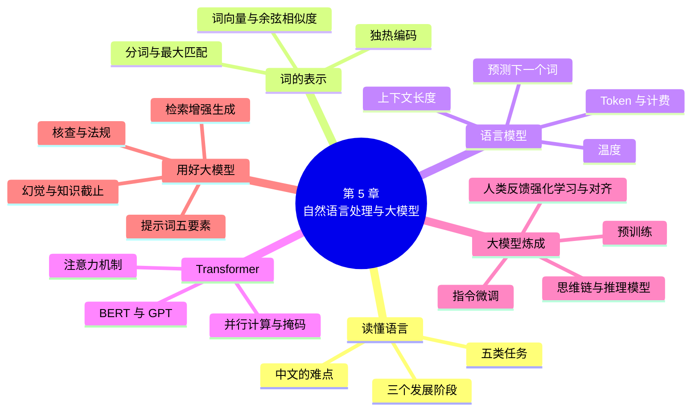

# 第 5 章 自然语言处理与大模型

!!! abstract "本章学时"
    理论 4 学时（建议线上 3 · 线下 1）· 在线体验 2 个

## 学习目标

学完本章，你应该能够：

1. **说出**自然语言处理的主要任务，以及中文处理特有的难点（记忆）；
2. **解释**词向量“意思相近的词距离更近”的含义，语言模型怎样一个词一个词地生成文字，Token、上下文长度和温度分别是什么（理解）；
3. **用自己的话说明**注意力机制和 Transformer 的直观含义，大模型经过预训练、指令微调、人类反馈强化学习三个阶段“炼成”的过程（理解）；
4. **手算**两个词向量的余弦相似度，估算一次大模型调用要消耗多少 Token、花多少钱（应用）；
5. **按**角色、任务、背景、格式、示例五要素写出结构清楚的提示词，并对大模型的输出进行核查（应用）；
6. **分析**大模型产生幻觉的原因，判断一个场景是否需要检索增强生成或人工核查（分析）。

!!! info "先修要求"
    学习本章前，你需要了解：

    - 神经网络、训练、损失函数和梯度下降的直观含义（[4.2 从感知机到多层神经网络](../04-deep-learning/index.md#42)、[4.3 训练在做什么](../04-deep-learning/index.md#43)）；
    - 循环神经网络“带着记忆往下读”的思路（[4.4.2 循环神经网络](../04-deep-learning/index.md#442)）；
    - 第 3 章的监督学习和自监督学习（[3.3 机器学习的三种方式](../03-machine-learning/index.md#33)）。本章只用到加、减、乘、除和开平方。

??? abstract "本章概念清单（26 个，点击查看定义和例子）"
    1. [自然语言处理](../../appendix/glossary.md#g-自然语言处理)
    2. [分词](../../appendix/glossary.md#g-分词)
    3. [最大匹配法](../../appendix/glossary.md#g-最大匹配法)
    4. [独热编码](../../appendix/glossary.md#g-独热编码)
    5. [词向量](../../appendix/glossary.md#g-词向量)
    6. [余弦相似度](../../appendix/glossary.md#g-余弦相似度)
    7. [语言模型](../../appendix/glossary.md#g-语言模型)
    8. [自回归生成](../../appendix/glossary.md#g-自回归生成)
    9. [Token](../../appendix/glossary.md#g-Token)
    10. [上下文长度](../../appendix/glossary.md#g-上下文长度)
    11. [温度](../../appendix/glossary.md#g-温度)
    12. [注意力机制](../../appendix/glossary.md#g-注意力机制)
    13. [Transformer](../../appendix/glossary.md#g-Transformer)
    14. [大语言模型](../../appendix/glossary.md#g-大语言模型)
    15. [预训练](../../appendix/glossary.md#g-预训练)
    16. [基座模型](../../appendix/glossary.md#g-基座模型)
    17. [指令微调](../../appendix/glossary.md#g-指令微调)
    18. [人类反馈强化学习](../../appendix/glossary.md#g-人类反馈强化学习)
    19. [对齐](../../appendix/glossary.md#g-对齐)
    20. [思维链](../../appendix/glossary.md#g-思维链)
    21. [推理模型](../../appendix/glossary.md#g-推理模型)
    22. [提示词](../../appendix/glossary.md#g-提示词)
    23. [提示词工程](../../appendix/glossary.md#g-提示词工程)
    24. [幻觉](../../appendix/glossary.md#g-幻觉)
    25. [知识截止](../../appendix/glossary.md#g-知识截止)
    26. [检索增强生成](../../appendix/glossary.md#g-检索增强生成)

## 情景导入

小林在一家家电公司的客服中心当组长。每天，客服中心要接几千个电话、回复上万条在线消息，还要把顾客的投诉整理成周报交给产品部门。以前，写周报要两个人花一整天：把几千条投诉一条条看过去，分成“噪音大”“不制冷”“安装慢”这些类别，再挑出典型的写进报告。

去年，公司开始试用大模型。小林把一周的投诉记录交给它，几分钟就得到了一份分好类、带统计数字的初稿；顾客发来一大段情绪激动的长消息，大模型能帮客服先概括要点、再起草一份语气得体的回复。小林的工作，从“自己写”变成了“告诉大模型怎么写，再检查它写得对不对”。

但小林也踩过坑。有一次，大模型在回复里写了一条“国家规定空调包修六年”，小林差点就发出去了，一查才发现：国家三包规定里根本没有这一条，是大模型自己“编”的。还有一次，同样一个问题问两遍，大模型给了两个不同的答案。

计算机是怎样“读懂”人说的话的？大模型为什么能写出通顺的文章，却又会一本正经地胡说八道？怎样才能让它干活干得又快又好？这一章，我们从计算机处理语言最基本的问题讲起，一直讲到今天的大模型。体验 5-1 里，你会亲手把一句简单的提示词改写成结构清楚的提示词，比一比输出的差别。

## 5.1 让计算机读懂语言

### 5.1.1 自然语言处理做什么

人和人交流用的汉语、英语这些语言，叫自然语言，以区别于编程语言这类人造的语言。让计算机理解、处理和生成自然语言的技术，叫[**自然语言处理**](../../appendix/glossary.md#g-自然语言处理 "让计算机理解、处理和生成人类自然语言的技术"){ .term }（Natural Language Processing，NLP）。它是人工智能最重要的方向之一，因为人类的大部分知识都是用语言记录下来的。

自然语言处理要完成的任务很多，常见的有下面几类：

| 任务 | 做什么 | 身边的例子 |
|---|---|---|
| 文本分类 | 给一段文字贴上类别标签 | 垃圾短信识别、把投诉分成“噪音大”“不制冷”、评论的好评差评判断（情感分析） |
| 信息抽取 | 从文字中找出人名、地名、时间、金额等关键信息 | 从快递单的地址里找出省、市、区，从合同里找出金额和日期 |
| 机器翻译 | 把一种语言翻译成另一种语言 | 翻译软件、拍照翻译、视频的双语字幕 |
| 问答 | 根据问题给出答案 | 智能客服、搜索引擎直接给出答案、企业内部的知识库问答 |
| 文本生成 | 写出新的文字 | 写摘要、写邮件、写文案、写代码、和人聊天 |

在大模型出现以前，每一种任务都要单独做一个系统：分类一个模型，翻译一个模型，问答又是一个模型。今天的大模型能用同一个模型完成上面所有的任务，这是自然语言处理在这几年最大的变化。

### 5.1.2 中文处理的难点

语言是人类最复杂的发明之一，让计算机读懂它很不容易。中文还有一些特别的难点：

- **词与词之间没有空格**。英文的“I love Beijing”，空格天然把词分开了；中文的“我爱北京天安门”，计算机首先得弄清楚哪几个字组成一个词，这一步叫[**分词**](../../appendix/glossary.md#g-分词 "把没有空格的中文句子切分成一个个词"){ .term }。
- **歧义多**。“南京市长江大桥”可以读成“南京市 / 长江大桥”，也可以读成“南京 / 市长 / 江大桥”；“咬死了猎人的狗”，是狗咬死了猎人，还是猎人的狗被咬死了？人靠常识一眼就能判断，计算机却要费很大的劲。
- **一词多义**。“苹果”可能是水果，也可能是手机品牌；“意思”在“这是什么意思”“一点小意思”“你这人真有意思”里，意思各不相同。
- **省略和言外之意**。“明天的会你去吗？”“我请假了。”回答里没有“去”或“不去”，但人都听得懂。“你可真行啊”，可能是夸奖，也可能是讽刺。
- **新词层出不穷**。网络流行语、新产品名、行业术语不断出现，计算机的词表总是跟不上。

### 5.1.3 三个发展阶段

自然语言处理的发展，正好对应第 1 章讲的几个学派：

| 阶段 | 大致时间 | 怎么做 | 局限 |
|---|---|---|---|
| 规则方法 | 1950～1980 年代 | 语言学家把语法规则、词典一条条写下来 | 规则写不完，遇到不规范的说法就出错 |
| 统计与机器学习方法 | 1990～2010 年代 | 从大量文本中统计规律，用第 3 章的机器学习方法训练模型 | 特征要人设计，每个任务都要单独标注数据、单独训练 |
| 深度学习与大模型 | 2013 年以后 | 用神经网络从海量文本中自己学习，2018 年以后进入预训练大模型时代 | 需要海量数据和算力，会出现“幻觉” |

这一章接下来按这个顺序，先讲分词和词向量，再讲语言模型和 Transformer，最后讲大模型。

## 5.2 从分词到词向量

### 5.2.1 分词：先把字切成词

中文处理的第一步往往是分词。最简单的分词方法，是拿一本词典，从句子开头开始，**每次尽量切出词典里最长的词**，这叫[**最大匹配法**](../../appendix/glossary.md#g-最大匹配法 "按词典每次尽量切出最长的词的分词方法，简单但遇到歧义容易出错"){ .term }。

!!! tip "算一算：最大匹配法会切错吗"
    词典里有：研究、研究生、生命、命、起源、的。用最大匹配法切分“研究生命的起源”：

    1. 从“研”开始，词典里最长能匹配的是“研究生”（三个字），切出“研究生”；
    2. 剩下“命的起源”，从“命”开始，只能匹配“命”，切出“命”；
    3. 剩下“的起源”，切出“的”“起源”。

    结果：研究生 / 命 / 的 / 起源。显然错了，正确的是：研究 / 生命 / 的 / 起源。

    最大匹配法简单快速，但“只顾眼前、尽量切长”，遇到歧义就会出错。后来的统计方法会比较整句话各种切法出现的可能性大小，选最合理的那一种。

今天常用的中文分词工具（比如 jieba、哈工大 LTP）都是统计或深度学习方法，准确率在 95% 以上。不过大模型处理文字时，并不完全按“词”来切，而是按 Token 来切，这一点在 5.3.2 节再讲。

### 5.2.2 把词变成数字

第 3 章说过，机器学习的模型只认数字。怎样把“手机”“香蕉”这样的词变成数字呢？

最直接的办法是[**独热编码**](../../appendix/glossary.md#g-独热编码 "用只有一个位置是 1、其余都是 0 的一串数字表示一个词的方法"){ .term }：把词表里所有的词排成一队，每个词用一串 0 和 1 表示，只有它自己的位置是 1，其他全是 0。假设词表只有 5 个词：

| 词 | 独热编码 |
|---|---|
| 手机 | [1, 0, 0, 0, 0] |
| 电脑 | [0, 1, 0, 0, 0] |
| 香蕉 | [0, 0, 1, 0, 0] |
| 橙子 | [0, 0, 0, 1, 0] |
| 酒店 | [0, 0, 0, 0, 1] |

独热编码有两个大问题。第一，**太长**：真实的词表有几万到几十万个词，每个词就要用几万到几十万个数字来表示，而且绝大多数是 0。第二，**看不出意思**：任意两个词的编码都一样“不同”，“手机”和“电脑”之间的差别，跟“手机”和“香蕉”之间的差别一样大。可是我们都知道，手机和电脑的意思更接近。

### 5.2.3 词向量：意思相近的词距离更近

[**词向量**](../../appendix/glossary.md#g-词向量 "用几十到几百个小数表示一个词、使意思相近的词距离更近的表示方法"){ .term }（Word Vector）换了一种思路：用一串几十到几百个小数来表示一个词，并且让意思相近的词，这串数字也相近。你可以把每个词想象成一张“词语地图”上的一个点，地图上，“手机”“电脑”“屏幕”挤在一起，“香蕉”“橙子”“榴莲”挤在另一处，“酒店”“前台”“房间”又在另一处。

词向量是怎么得到的？不是人一个个设定的，而是从海量文本里学出来的。基本的想法是：**经常出现在相似上下文里的词，意思也相近**。“我买了一部新____”，空格里常填“手机”“电脑”，很少填“香蕉”。2013 年，谷歌的米科洛夫（Tomas Mikolov）等人提出了 Word2Vec 方法[[1]](#ref5-1)，用一个简单的神经网络在几十亿词的文本上做“填空练习”，很快就能学出高质量的词向量，从此词向量被广泛使用。

怎样衡量两个词向量“近不近”？常用的是[**余弦相似度**](../../appendix/glossary.md#g-余弦相似度 "用两个向量方向的接近程度衡量相似度的方法，取值在 −1 到 1 之间"){ .term }（Cosine Similarity）：看两个向量的**方向**是不是一致。方向完全相同，余弦相似度是 1；互相垂直，是 0；方向相反，是 −1。

!!! tip "算一算：手机和电脑有多像"
    假设在一张二维的词语地图上，手机 = (4, 1)，电脑 = (4, 2)，香蕉 = (−1, 4)。余弦相似度的计算方法是：

    > 余弦相似度 = (两个向量对应位置相乘再相加) ÷ (两个向量长度的乘积)

    其中向量 (a, b) 的长度是 √(a² + b²)。

    - 手机和电脑：对应相乘再相加 = 4 × 4 + 1 × 2 = 18；长度分别是 √17 ≈ 4.12、√20 ≈ 4.47；余弦相似度 ≈ 18 ÷ (4.12 × 4.47) ≈ **0.98**，非常接近 1，意思很相近。
    - 手机和香蕉：对应相乘再相加 = 4 × (−1) + 1 × 4 = 0；余弦相似度 = **0**，两个方向互相垂直，意思不相关。

词向量还有一个神奇的性质：词和词之间的关系，可以用向量的加减来表示。最有名的例子是：

> 国王 − 男人 + 女人 ≈ 女王

“国王”减去“男人”，剩下的大致是“王室”的意思，再加上“女人”，就得到了“女王”附近的位置。同样，“北京 − 中国 + 日本 ≈ 东京”。这说明词向量确实学到了一部分词语之间的意义关系。

不过，早期的词向量有一个缺点：一个词只有一个向量。“苹果”不管是指水果还是指手机，都是同一个点，只能落在两类词中间的某个位置。后来的语言模型会根据上下文给同一个词不同的向量：“我吃了一个苹果”里的“苹果”靠近水果，“我买了一部苹果”里的“苹果”靠近手机。这要用到 5.4 节的注意力机制。

<iframe class="sim-frame" src="../../sims/word-vectors/main.html" height="820" loading="lazy" title="词向量与余弦相似度"></iframe>

动画：词向量与余弦相似度（来自《自然语言处理导论》）。左边拖动两支箭头，看余弦相似度怎样随方向变化；右边在二维词语地图上点一个词，找出和它最相近的词，再试试“国王 − 男人 + 女人”的类比。地图坐标是为演示编写的示意数据。[全屏打开](../../sims/word-vectors/main.html){ target=_blank }
{ .sim-caption }

## 5.3 语言模型与 Token { #53 }

### 5.3.1 语言模型：预测下一个词

打字时，输入法会猜你接下来要打什么：输入“今天天气”，它提示“很好”“怎么样”；输入“生日”，它提示“快乐”。这背后就是一个语言模型。

[**语言模型**](../../appendix/glossary.md#g-语言模型 "根据前面的文字预测下一个词概率的模型"){ .term }（Language Model）做的事情可以用一句话概括：**根据前面的文字，预测下一个词是什么**。更准确地说，它给出的是下一个词的**概率**：

!!! tip "算一算：一个字一个字地写出一句话"
    假设语言模型读到“今天天气很”，给出的下一个字的概率是：

    | 下一个字 | 好 | 热 | 冷 | 不 | 其他 |
    |---|---|---|---|---|---|
    | 概率 | 0.50 | 0.20 | 0.15 | 0.10 | 0.05 |

    所有可能加起来等于 1。如果每次都选概率最大的，下一个字就是“好”。把“好”接上去，变成“今天天气很好”，再预测下一个字，可能是“，”“。”“啊”……这样一个字接一个字地往下写，就生成了一整段话。

    想一想：如果每次都选概率最大的那个字，同样的开头每次都会写出完全相同的话吗？（会。所以实际使用时，模型通常会按概率“抽签”，见 5.3.4 节。）

这种“预测下一个词、接上去、再预测下一个”的生成方式，叫[**自回归生成**](../../appendix/glossary.md#g-自回归生成 "每次预测一个词，接到前文后面再预测下一个，逐个生成文字的方式"){ .term }。今天的大模型，不管是写文章、回答问题还是写代码，本质上都在做这件事：一个 Token 接一个 Token 地往外“吐”字。你在大模型产品里看到回答是一个字一个字“打”出来的，原因就在这里。

训练语言模型很方便：**不需要人工标注**。随便拿一段文字，遮住后面的部分，让模型去猜，正确答案就是原文本身。这就是第 3 章讲的**自监督学习**。互联网上有数不清的文字，都可以拿来当练习题，所以语言模型能用非常多的数据来训练。

“只会猜下一个词”听起来很简单，为什么能学会那么多本领？因为要猜得准，模型就必须“懂”很多东西：要猜出“中国的首都是____”，它得知道地理知识；要猜出一道算术题后面的答案，它得会算术；要接着写一段代码，它得懂编程。在足够多的文字上练习“猜下一个词”，模型就把文字里蕴含的大量知识和规律都学进去了。

### 5.3.2 Token：大模型读写的单位 { #532 }

大模型并不是一个字一个字、也不是一个词一个词地处理文字的，它用的单位叫 [**Token**](../../appendix/glossary.md#g-Token "大模型处理文字的基本单位，可以是一个字、一个词或词的一部分，中文常译作“词元”"){ .term }（中文常译作“词元”）。一个 Token 可能是一个汉字、一个常用词、一个英文单词，也可能是一个英文单词的一部分，还可能是一个标点符号。模型的“分词器”会按照训练时统计出来的规律，把文字切成一个个 Token：常见的组合合成一个 Token，少见的拆成几个。

Token 和字数怎么换算，不同的模型不一样。以 DeepSeek 为例，它的官方文档给出的大致换算是：**1 个中文字符约 0.6 个 Token，1 个英文字符约 0.3 个 Token**[[2]](#ref5-2)。实际用了多少，以模型返回的统计为准。

Token 为什么重要？因为它和两件事直接相关。

第一，**计费**。大模型的接口通常按 Token 收费，而且输入（你发给模型的内容）和输出（模型写出来的内容）分开计价，输出一般更贵。

!!! tip "算一算：客服中心一天要花多少钱"
    小林的客服中心打算用大模型帮客服起草回复。每次调用，发给模型的内容（顾客的消息、公司的规定、提示词）约 1500 字，模型写出的回复约 500 字，每天调用 1000 次。

    假设按 1 个汉字约 0.6 个 Token 估算，价格是输入每百万 Token 2 元、输出每百万 Token 8 元（价格只是举例，各家不同，而且经常调整）：

    - 每天输入：1500 × 0.6 × 1000 = 90 万 Token，费用 = 0.9 × 2 = 1.8 元；
    - 每天输出：500 × 0.6 × 1000 = 30 万 Token，费用 = 0.3 × 8 = 2.4 元；
    - 合计每天约 **4.2 元**，一个月约 126 元。

    比起人工，这个成本很低。但如果每次都把一本几十万字的产品手册整个发给模型，输入的 Token 就会多几百倍。所以实际做系统时，常常只挑出和问题有关的几段发给模型（5.7.3 节的检索增强生成）。

第二，[**上下文长度**](../../appendix/glossary.md#g-上下文长度 "模型一次能处理的最大 Token 数，对话历史、上传的文件和回答都要放在里面"){ .term }。

### 5.3.3 上下文长度：模型一次能看多少

模型在生成每一个 Token 时，能“看到”的前文是有上限的，这个上限叫**上下文长度**（Context Length），也叫上下文窗口，用 Token 数来衡量。你在对话里说过的话、上传的文件、模型自己的回答，全都要放进这个窗口。

可以把上下文窗口想象成一张办公桌：桌面上能摊开的资料是有限的，摊不下的就只能收起来，看不到了。早期的模型上下文只有几千个 Token，聊得久一点就“忘了”开头说过什么；今天主流的大模型一般支持十几万甚至上百万个 Token。比如 12.8 万个 Token，按 1 个汉字约 0.6 个 Token 换算，大约是 21 万个汉字，差不多是一本长篇小说的篇幅。

上下文长度不等于“记性”。对话结束后，模型并不会记住你，下次开始新对话时一切从零开始（有些产品提供了“记忆”功能，那是另外把信息保存下来，下次再放进上下文里）。而且，内容太多时，模型对中间部分的关注往往不如开头和结尾，重要的要求最好放在提示词的开头或结尾，或者再强调一遍。

### 5.3.4 温度：选概率最大的，还是抽签

回到 5.3.1 节，模型给出了下一个字的概率，到底选哪一个？

- 每次都选概率最大的，叫“贪心”。它最稳定，但写出来的文字往往平淡、重复，同一个问题每次的回答一模一样。
- 按概率抽签：概率大的容易被抽中，概率小的也有机会。这样写出来的文字更多样、更有新意。

[**温度**](../../appendix/glossary.md#g-温度 "调节大模型按概率选词时随机程度的设置，越低越稳定，越高越多样"){ .term }（Temperature）就是调节“抽签”随机程度的设置。温度低（接近 0），概率大的更占优势，回答稳定、保守；温度高，各个选项的概率被拉平，回答更多样，但也更容易“跑偏”、出现奇怪的词。

| 用途 | 建议的温度 | 原因 |
|---|---|---|
| 翻译、信息抽取、数据整理 | 低，如 0～0.3 | 答案基本是确定的，需要稳定准确 |
| 问答、写摘要 | 中，如 0.3～0.7 | 既要准确，又要表达自然 |
| 写文案、起名字、头脑风暴 | 高，如 0.8～1.0 | 需要多样和新意 |

这就解释了情景导入里的问题：同一个问题问两遍得到不同答案，是因为模型在“抽签”。很多大模型产品不让用户直接调温度，但开发者通过接口调用时可以设置。

<iframe class="sim-frame" src="../../sims/temperature-sampling/main.html" height="640" loading="lazy" title="温度与 Top-p 采样"></iframe>

动画：温度与采样（来自《自然语言处理导论》）。语言模型在“味道”后面给出了下一个字的概率，拖动温度滑块，看概率分布怎样变“尖”或变“平”，再点“抽 20 次”看实际选出了哪些字。Top-k 和 Top-p 是另外两种限制候选范围的办法，只从概率最大的几个字里抽。[全屏打开](../../sims/temperature-sampling/main.html){ target=_blank }
{ .sim-caption }

## 5.4 Transformer 与注意力 { #54 }

### 5.4.1 注意力：读到一个词时，该看哪些词

读这句话：“小猫追老鼠，它跑累了。”“它”指的是谁？大多数人会觉得是小猫，因为追的一方更容易跑累。再读：“小猫追老鼠，它躲进了洞里。”这回“它”是老鼠。要弄懂“它”，必须**回头去看句子里的其他词**，并且判断哪个词最相关。

第 4 章的循环神经网络是一个词一个词往下读的，读到“它”的时候，“小猫”已经是好几个词以前的事了，只能靠“记忆”里残留的一点信息。[**注意力机制**](../../appendix/glossary.md#g-注意力机制 "根据相关程度为不同位置的信息分配权重并加权求和的机制"){ .term }（Attention Mechanism）换了一种做法：读到每一个词时，都直接回头看一遍句子里的所有词，给每个词打一个“相关程度”的分数，相关的多看，不相关的少看，然后把它们的信息按分数混合起来，得到这个词“结合了上下文”的新意思。

就像你在一页书里找答案时，眼睛会自动在关键的几个词上多停留一会儿。打分越高的词，对理解当前这个词的帮助越大。读到“它”时，“小猫”“老鼠”的分数高，“，”的分数低；再结合“跑累了”，“小猫”的分数最高。

这正好解决了 5.2.3 节说的一词多义问题：“苹果”这个词，在“吃了一个苹果”里会更多地注意“吃”，在“买了一部苹果”里会更多地注意“一部”“买”，于是同一个“苹果”得到了不同的、和上下文相符的意思。

<iframe class="sim-frame" src="../../sims/self-attention/main.html" height="720" loading="lazy" title="自注意力热力图"></iframe>

动画：自注意力热力图（来自《自然语言处理导论》）。表格每一行是一个词对句子里所有词的注意力分数，颜色越深分数越高，每行加起来等于 1。点“它”所在的行，看它最关注哪几个词；勾选“掩码”，看只许看前文时分数怎样变化。这里的词向量是手工编写的 4 维示意数据。[全屏打开](../../sims/self-attention/main.html){ target=_blank }
{ .sim-caption }

### 5.4.2 Transformer：今天所有大模型的基础 { #542 }

2017 年，谷歌的研究人员发表了一篇题为《注意力就是你所需要的一切》（Attention Is All You Need）的论文[[3]](#ref5-3)，提出了 [**Transformer**](../../appendix/glossary.md#g-Transformer "以自注意力为核心、可并行计算的神经网络结构，2017 年提出，是今天大模型的基础"){ .term } 模型。它完全抛弃了循环神经网络“一个个往下读”的方式，只用注意力机制，让每个词同时看到整句话。

Transformer 有两个大优点：

- **看得全**：每个词都能直接看到句子里任何位置的词，不管隔得多远，不会像循环神经网络那样“读到后面忘了前面”；
- **算得快**：循环神经网络必须读完第 1 个词才能读第 2 个，而 Transformer 可以让所有词同时计算，正好发挥第 4 章讲的 GPU“几千人同时做算术”的优势，所以能用更多的数据训练更大的模型。

一个 Transformer 由很多个相同的“层”叠起来，每一层都做两件事：先用注意力让每个词看一看其他词、融合上下文，再用一个小的全连接网络对每个词单独加工。层数越多，模型对文字的理解越深。今天的大模型往往叠了几十到上百层。

用来生成文字的 Transformer 有一个规定：预测下一个词时，**只许看前面的词，不许偷看后面的词**，这叫“掩码”。道理很简单：写文章时，后面的字还没写出来，当然看不到。你可以在上面的动画里勾选“掩码”试一试。

### 5.4.3 两类预训练模型：BERT 和 GPT { #543 }

Transformer 出现后，2018 年前后出现了两类有代表性的预训练模型：

| | BERT 一类 | GPT 一类 |
|---|---|---|
| 提出者 | 谷歌，2018 年[[4]](#ref5-4) | OpenAI，2018 年起陆续推出 GPT、GPT-2、GPT-3 等 |
| 怎样练习 | 完形填空：遮住句子中间的词，前后文都可以看，猜被遮住的词 | 续写：只看前文，猜下一个词 |
| 擅长 | 理解：分类、抽取、判断两句话的意思是否相同 | 生成：写文章、对话、翻译、写代码 |
| 今天的情况 | 仍广泛用于搜索、分类等理解任务和检索系统（5.7.3 节） | 今天的对话大模型基本都属于这一类 |

GPT 一类模型的发展，最能说明“规模”的作用：2018 年的 GPT 有 1 亿多个参数，2019 年的 GPT-2 有 15 亿个，2020 年的 GPT-3 有 1750 亿个参数，在约 3000 亿个 Token 的文本上训练[[5]](#ref5-5)。研究者发现，模型越大、数据越多、算力越多，模型的能力就越强，而且一些小模型完全不具备的能力，比如只看几个例子就学会一项新任务，在大模型身上“冒”了出来。参数达到几十亿、上百亿甚至更多的语言模型，就是我们常说的[**大语言模型**](../../appendix/glossary.md#g-大语言模型 "参数规模巨大、在海量文本上预训练、具有通用语言理解与生成能力的模型，简称大模型"){ .term }（Large Language Model，LLM），简称大模型。

## 5.5 大模型是怎样炼成的

一个能聊天、能干活的大模型，一般要经过三个阶段的训练。可以把它比作一个人的成长：先在学校里读万卷书，再参加岗前培训，最后在师傅的点评下不断改进。

### 5.5.1 预训练：读万卷书

第一阶段叫[**预训练**](../../appendix/glossary.md#g-预训练 "在大规模通用数据上训练模型，学习一般的语言规律和知识"){ .term }（Pre-training）：让模型在海量的文本上反复练习“猜下一个词”。这些文本来自网页、书籍、百科、论文、新闻、代码等，规模达到几万亿个 Token。这一阶段花费的算力最多，往往要用几千甚至上万块 GPU 训练几周到几个月，成本动辄几百万到上亿元。

!!! tip "算一算：GPT-3 读了多少书"
    GPT-3 训练时用了约 3000 亿个 Token[[5]](#ref5-5)。为了方便想象，假设 1 个汉字约等于 0.6 个 Token，那么 3000 亿个 Token 大约相当于：

    3000 亿 ÷ 0.6 = 5000 亿个汉字。

    一个人如果每天读 2 万字（大约一本薄书的五分之一），一年读 2 × 365 = 730 万字，读完 5000 亿字需要：

    5000 亿 ÷ 730 万 ≈ **6.8 万年**。

    而今天的大模型，预训练数据往往是 GPT-3 的几十倍。

预训练结束后，得到的模型叫[**基座模型**](../../appendix/glossary.md#g-基座模型 "只经过预训练、尚未进行指令微调的模型"){ .term }。它“肚子里”有了大量知识，也很会续写文字，但还不太会“听话”。你问它“中国的首都是哪里？”，它可能接着写出“美国的首都是哪里？日本的首都是哪里？”，因为在网上的文字里，一串问题后面常常跟着另一串问题。

### 5.5.2 指令微调：学会听指令

第二阶段叫[**指令微调**](../../appendix/glossary.md#g-指令微调 "用“指令和标准回答”数据继续训练，使模型能遵循人类指令，也叫有监督微调"){ .term }（Instruction Tuning），也叫有监督微调。研究人员准备几万到几十万条“指令和标准回答”的样例，比如：

| 指令 | 标准回答 |
|---|---|
| 把下面这句话翻译成英文：今天天气很好。 | The weather is nice today. |
| 用三句话总结下面这段投诉…… | 1. 顾客反映空调外机噪音大…… |
| 中国的首都是哪里？ | 中国的首都是北京。 |

模型在这些样例上继续训练，就学会了“人家问什么就答什么、让做什么就做什么”的对话方式。这一阶段用的数据比预训练少得多，但每一条都要人来写或者人来把关，质量要求很高。

### 5.5.3 人类反馈强化学习：学会说人爱听的、该说的

第三阶段叫[**人类反馈强化学习**](../../appendix/glossary.md#g-人类反馈强化学习 "利用人对回答的偏好排序训练模型，使回答更有用、更安全"){ .term }（Reinforcement Learning from Human Feedback，RLHF）。同一个问题，让模型写出几个不同的回答，请标注人员按照“哪个更有用、更真实、更安全”排个序。用这些排序数据训练一个“打分模型”，再让大模型不断按照打分模型的评价改进自己的回答。“强化学习”的意思是通过奖励来学习，第 8 章会详细讲。

这一步的目的，是让模型的行为符合人的期望和价值观，这叫[**对齐**](../../appendix/glossary.md#g-对齐 "让模型的行为符合人的期望和价值观，目标是有用、诚实、无害"){ .term }（Alignment）。对齐的目标常被概括为三点：**有用**（真正帮人解决问题）、**诚实**（不编造，不知道就说不知道）、**无害**（不教人做坏事、不歧视、不泄露隐私）。

对齐的效果非常明显。OpenAI 在 2022 年的研究中发现，经过指令微调和人类反馈强化学习的 13 亿参数模型，人们对它的回答的喜爱程度，反而超过了没有经过这两步、参数多 100 多倍的 1750 亿参数的 GPT-3[[6]](#ref5-6)。同年 11 月，OpenAI 发布了用类似方法训练的 ChatGPT，大模型从此走进了普通人的生活。

### 5.5.4 推理模型与思维链

人做一道复杂的数学题，不会一下子说出答案，而是在草稿纸上一步一步地算。2022 年，谷歌的研究人员发现，如果在提示词里给大模型示范“一步一步地写出推理过程”，它解数学题、逻辑题的正确率会大幅提高[[7]](#ref5-7)。这种先写出中间步骤、再给出答案的做法，叫[**思维链**](../../appendix/glossary.md#g-思维链 "让模型先写出推理步骤再给出答案的方法"){ .term }（Chain of Thought，CoT）。

!!! example "直接回答和一步一步回答"
    问题：小林的客服组有 12 个人，每人每天处理 80 条消息。下周有 3 个人请假，但消息量预计增加 25%。剩下的人每人每天要处理多少条？

    直接回答，模型可能脱口而出一个错误的数字。让它“一步一步地想”：

    1. 现在每天的消息量：12 × 80 = 960 条；
    2. 下周的消息量：960 × 1.25 = 1200 条；
    3. 下周在岗人数：12 − 3 = 9 人；
    4. 每人每天：1200 ÷ 9 ≈ 133 条。

    每一步都很简单，不容易出错，出了错也容易发现是哪一步错了。

后来，研究者干脆把“先想清楚再回答”训练成了模型的习惯，这样的模型叫[**推理模型**](../../appendix/glossary.md#g-推理模型 "经过训练、回答前先进行较长思考的大模型"){ .term }。2024 年 9 月 OpenAI 发布了 o1 推理模型；2025 年 1 月，我国深度求索公司发布并开源了 DeepSeek-R1[[8]](#ref5-8)，它主要用强化学习训练出了长篇“思考”的能力，在数学、编程等任务上达到了当时国际领先模型的水平，而训练成本低得多，引起了全世界的关注。你在一些大模型产品里打开“深度思考”，看到模型先写一大段思考过程再回答，用的就是推理模型。

推理模型在数学、编程、复杂分析上更强，但回答更慢、消耗的 Token 更多。查个天气、写个通知这种简单的事，用普通模式就够了。

## 5.6 提示词工程

### 5.6.1 为什么要学写提示词

发给大模型的指令和内容，叫[**提示词**](../../appendix/glossary.md#g-提示词 "发给大模型的指令和输入内容"){ .term }（Prompt）。同一个模型，提示词写得好不好，输出的质量差别很大。研究和改进提示词写法、让大模型更好地完成任务的方法，叫[**提示词工程**](../../appendix/glossary.md#g-提示词工程 "研究和改进提示词写法、让大模型更好地完成任务的方法"){ .term }（Prompt Engineering）。

为什么提示词这么重要？想象一下：你给一位刚入职、什么背景都不知道的新同事布置任务，只说一句“写个回复”，他多半写不到点子上；如果你告诉他“你是客服，顾客因为什么事情不满意，公司的规定是什么，回复要多长、什么语气，以前写得好的回复是什么样的”，他就能写得又快又好。大模型就像这样一位知识渊博、但对你的具体情况一无所知的新同事。

### 5.6.2 提示词的五要素

一份结构清楚的提示词，通常包含下面五个要素：

| 要素 | 说什么 | 例子 |
|---|---|---|
| 角色 | 让模型以什么身份来做 | 你是一名有十年经验的家电售后客服 |
| 任务 | 要它做什么，越具体越好 | 给下面这位顾客写一条回复 |
| 背景 | 完成任务需要知道的情况和限制 | 顾客的空调买了 3 个月，外机噪音大，已经上门检修过一次没修好；公司规定购买一年内同一问题维修两次仍未解决的可以换机 |
| 格式 | 输出的形式、长度、语气 | 150 字以内，先道歉，再说明处理方案，语气诚恳，不要使用“亲”等称呼 |
| 示例 | 给一两个好的样例 | 下面是一条写得好的回复，可以参考它的语气：…… |

五个要素不是每次都要写全，简单的任务写清楚任务和格式就够了，越复杂、越重要的任务越要写全。

!!! example "案例：小林改写提示词"
    **改写前**：帮我回复一下这个顾客。（后面贴上顾客的消息）

    大模型写出了一段 400 多字的回复，开头是“亲爱的顾客您好”，中间说了很多“非常理解您的心情”，最后建议顾客“耐心等待”，完全没有提换机的事。

    **改写后**：

    > 你是一名有十年经验的家电售后客服。（角色）
    >
    > 请给下面这位顾客写一条在线回复。（任务）
    >
    > 背景：顾客的空调购买 3 个月，外机噪音大，已上门检修一次未解决。按公司规定，购买一年内同一问题维修两次仍未解决的，可以免费换新机。这次我们会安排第二次上门，如果仍不能解决就给顾客换机。（背景）
    >
    > 要求：150 字以内；先真诚道歉，再说明第二次上门的安排和换机政策；语气诚恳、简洁，不要用“亲”这样的称呼，不要承诺规定以外的赔偿。（格式）
    >
    > 顾客的消息：……
    
    这一次，大模型写出的回复只有 130 字，道歉、上门安排、换机政策都说清楚了。小林只改了两个词就发出去了。

### 5.6.3 几个实用技巧

除了五要素，下面几个技巧也很常用：

- **给例子**：想让模型按某种固定的格式或风格输出，最有效的办法是给它看一两个例子。只给几个例子就能让模型学会一种新任务，叫少样本提示。
- **让它一步一步想**：复杂的计算和分析，加一句“请一步一步地分析，最后给出结论”，就是 5.5.4 节的思维链。
- **把大任务拆成小任务**：写一份周报，可以先让模型给投诉分类，你检查分类对不对，再让它统计，最后让它写总结。每一步都检查，比一次让它写完更可靠。
- **用符号把资料隔开**：把要处理的文字放在引号、三个横线或者“【顾客消息】……【顾客消息结束】”中间，模型就不会把资料里的话当成你的指令。
- **多轮修改**：第一次输出不满意，不要从头再来，直接指出问题：“第二段太啰嗦，压缩到 50 字”“语气再正式一点”。
- **让它说明依据**：涉及事实的回答，要求它“说明信息来源，不确定的地方请标出来”，方便自己核查。

### 5.6.4 常见的提示词模板

工作和学习中经常遇到的任务，可以总结成模板，以后填空就能用：

| 任务 | 模板 |
|---|---|
| 总结 | 请用不超过【字数】字总结下面的【文档类型】，列出【几】个要点，每个要点一句话。【原文】 |
| 改写 | 请把下面的文字改写成【面向谁】的【什么风格】，保留【哪些信息】，长度约【字数】字。【原文】 |
| 分类 | 请把下面每条【内容】归入以下类别之一：【类别 1】【类别 2】……，用表格输出“编号、类别、理由”。【内容】 |
| 写作 | 你是【角色】。请写一份【文体】，主题是【主题】，读者是【读者】，要求【长度、结构、语气】。可参考的例子：【例子】 |
| 学习 | 我是【专业、年级】的学生，请用通俗的语言和一个生活中的例子解释【概念】，然后出 3 道判断题考考我，先不要给答案。 |

!!! cert "证书考点 · 人工智能训练师 · 生成式人工智能应用"
    提示词的编写和优化、对大模型输出结果的评估和纠错，是人工智能训练师和生成式人工智能相关岗位的日常工作。2024 年人力资源和社会保障部发布的 19 个新职业中，就有“生成式人工智能系统应用员”。复习时注意：能按角色、任务、背景、格式、示例写出完整的提示词，能说出温度对输出的影响，能列出大模型输出需要核查的几类内容（事实、数字、引用、法规）。

## 5.7 大模型的局限与应对

大模型很强大，但它有一些与生俱来的局限。会用大模型的人，不是对它的话全盘相信的人，而是知道它什么时候可能出错、并且有办法核查的人。

### 5.7.1 幻觉：一本正经地胡说八道

大模型生成看似合理、实际上错误或者凭空编造的内容，叫[**幻觉**](../../appendix/glossary.md#g-幻觉 "大模型生成看似合理、但与事实不符或凭空编造的内容"){ .term }（Hallucination）[[9]](#ref5-9)。情景导入里的“国家规定空调包修六年”就是一个例子。常见的幻觉有：

- 编造不存在的事实、数据、人物经历；
- 编造参考文献：作者、题目、期刊看起来都像真的，一查根本没有这篇文章；
- 编造法律条文、政策规定、产品参数；
- 算错数字，特别是多步计算和大数字的计算；
- 张冠李戴：把甲公司的事说成乙公司的，把两件事混在一起。

为什么会有幻觉？回到 5.3.1 节：大模型的本质是**根据前文，生成一个“看起来最合理”的下一个词**。它追求的是“说得通顺、像那么回事”，而不是“说的是真的”。它并没有一个可以查证的“事实数据库”，当它对某件事知道得不多时，依然会按照语言的规律“顺”出一段话来，而且语气和说真话时一样自信。

### 5.7.2 知识截止与偏见

[**知识截止**](../../appendix/glossary.md#g-知识截止 "大模型的训练数据收集到某个时间就停止，之后发生的事情模型不知道"){ .term }：大模型的知识来自预训练的数据，数据收集到某个时间就停止了，这个时间叫知识截止日期。在这之后发生的事情，模型并不知道。问它“今年的最新政策”“昨天的比赛结果”，它要么说不知道，要么拿旧的信息来回答，甚至编一个。很多大模型产品提供了“联网搜索”功能，就是为了弥补这个不足。

**偏见**：训练数据来自人类写下的文字，人类社会里存在的刻板印象和偏见，也会被模型学进去，比如默认“护士”是女性、“工程师”是男性，或者对某些地区、某些群体的描述不够公正。对齐训练能减轻但不能完全消除偏见，第 9 章还会专门讨论。

此外，使用大模型还要注意**信息安全**：不要把顾客的姓名、电话、身份证号，公司的合同、未公开的财务数据等敏感信息随意粘贴到公共的大模型产品里。很多企业规定只能使用公司内部部署的大模型处理工作数据。

### 5.7.3 检索增强生成：先查资料，再回答 { #573 }

怎样减少幻觉、让模型回答最新的、公司内部的问题？一个常用的办法是[**检索增强生成**](../../appendix/glossary.md#g-检索增强生成 "先检索相关资料，再让大模型根据资料生成回答的技术"){ .term }（Retrieval-Augmented Generation，RAG）[[10]](#ref5-10)。它的思路很像“开卷考试”：

1. **检索**：先把公司的产品手册、售后政策、常见问题等资料切成一小段一小段，存进一个可以按意思搜索的“资料库”（用的正是 5.2.3 节说的向量和相似度）。用户一提问，就从里面找出和问题最相关的几段；
2. **拼接**：把找到的资料和用户的问题一起放进提示词，告诉模型“请只根据下面的资料回答，资料里没有的就说不知道”；
3. **生成**：模型根据资料回答，并注明依据的是哪一段。

这样做的好处是：回答有依据，可以核查；公司的规定更新了，只要更新资料库，不用重新训练模型；模型的上下文里只放相关的几段，Token 也省了。今天企业里的智能客服、内部知识库问答，大多采用检索增强生成。大模型产品里的“联网搜索”“上传文件后提问”，也是同样的原理。

检索增强生成能大大减少幻觉，但不能完全消除：资料找错了，或者模型没有忠实地按资料回答，仍然会出错。

### 5.7.4 学会核查

不管用不用检索增强生成，下面这些内容都要**核查之后再使用**：

| 要核查的内容 | 怎样核查 |
|---|---|
| 事实和数据 | 到权威来源（政府网站、官方公告、正规媒体、统计年鉴）上查证 |
| 参考文献 | 在知网、学术搜索引擎里按题目搜一下，确认文章真的存在、作者和年份对得上 |
| 法律法规、政策 | 到国家法律法规数据库、政府部门网站上查原文 |
| 计算结果 | 自己用计算器或表格软件再算一遍 |
| 代码 | 实际运行和测试 |
| 涉及医疗、法律、财务的建议 | 只作参考，重要决定要咨询专业人士 |

我国对大模型服务也有明确的规定。2023 年 8 月 15 日起施行的《生成式人工智能服务管理暂行办法》[[11]](#ref5-11)，由国家网信办等七个部门联合发布，要求提供大模型服务的企业使用合法来源的训练数据，采取措施提高生成内容的准确性和可靠性，对生成的图片、视频等内容进行标识。第 9 章会进一步介绍人工智能相关的法规。

## 5.8 身边的 AI

### 5.8.1 国产大模型产品

2023 年以来，我国出现了一大批大模型产品，大多数可以在手机应用商店或者网页上免费使用：

| 产品 | 开发者 | 特点 |
|---|---|---|
| DeepSeek | 深度求索 | 推理能力强，模型开源，“深度思考”模式展示思考过程 |
| 通义千问 | 阿里巴巴 | 模型系列丰富，很多版本开源，与阿里的办公、电商产品结合 |
| 文心一言 | 百度 | 与百度搜索结合，中文知识丰富 |
| 豆包 | 字节跳动 | 用户多，语音对话自然，写作、拍照答疑等功能丰富 |
| Kimi | 月之暗面 | 较早以超长上下文著称，擅长阅读长文档 |
| 智谱清言 | 智谱 | 源自清华大学的研究团队，GLM 系列模型 |

此外，腾讯元宝、讯飞星火等也各有特色。这些产品更新很快，功能和排名经常变化，选用时以实际体验为准。很多产品已经不只是“会聊天”：能联网搜索、读文件、看图片、写代码、画图（第 6 章）、语音对话（第 7 章），还能调用工具帮你完成任务（第 8 章的智能体）。

### 5.8.2 办公中的用法

- **写**：起草通知、邮件、工作总结、活动方案，改写成不同的语气；
- **读**：总结长文档、会议记录，从合同里找出关键条款，读外文资料；
- **算和整理**：把杂乱的文字整理成表格，写表格公式，给数据分类统计；
- **编程**：写简单的数据处理脚本，解释看不懂的代码，查找程序错误。

### 5.8.3 学习中的用法

大模型可以是一位随时在线的“学习助手”：让它用生活中的例子解释一个难懂的概念，出几道题考考你，检查你写的作文有没有语病，陪你练习英语口语。

但要注意两点。第一，它可能出错，学到的新知识要和教材、老师讲的对照。第二，要遵守学术诚信：作业、论文要自己完成，可以用大模型查资料、理思路、改语病，但不能把它写的内容直接当作自己的作品交上去。很多学校对此有明确的规定。

!!! example "案例：用好大模型的三条规矩"
    小林给客服中心定了三条使用大模型的规矩：

    1. **敏感信息不上传**：顾客的姓名、电话、地址先替换成“某先生”“138****0000”，再交给大模型；
    2. **事实必核查**：回复里涉及政策、价格、维修期限的，必须对照公司的政策文件核对；
    3. **人对结果负责**：大模型只起草，发出去之前一定由客服本人看一遍，出了问题由发出的人负责。

    这三条，其实适用于每一个在工作中使用大模型的人。

## 在线体验

!!! abstract "体验总览"

    | 体验 | 用到什么 | 时长 |
    |---|---|---|
    | 5-1 提示词工程练习 | 任意一个国产大模型产品 | 约 20 分钟 |
    | 5-2 下一个词预测与幻觉核查 | 本书动画“温度与采样”+ 大模型产品 | 约 20 分钟 |

    请准备一个能使用的大模型产品（如 DeepSeek、通义千问、文心一言、豆包、Kimi、智谱清言中的任意一个），手机或电脑都可以。体验中**不要输入任何真实的个人信息**。建议边做边把结果填进记录表，课后练习的实操题会用到。

### 体验 5-1 提示词工程练习

**体验目的**：对比“一句话提示词”和按五要素写的提示词，体会提示词的结构对输出质量的影响，学会给大模型的输出打分。

**任务**：你是学校学生会的宣传委员，要为下周五下午在图书馆报告厅举办的“人工智能与职业发展”讲座写一份通知，发在班级群里。

**步骤**

1. **一句话提示词**：在大模型产品中新建一个对话，输入“帮我写一个讲座通知”，把输出复制下来。
2. **五要素提示词**：再新建一个对话（避免受上一次的影响），按五要素写一份提示词。可以参考下面的框架，把【】里的内容补全：

    > 你是【角色】。请为【什么活动】写一份【用在哪里】的通知。
    >
    > 活动信息：时间【】，地点【】，主讲人【可以虚构】，内容【】，面向【】。
    >
    > 要求：【字数】字以内，【语气】，包含【必须有的信息，如报名方式】，【其他要求，如加几个合适的表情符号】。

3. **打分**：按下面的评分表，给两次输出分别打分（每项 1～5 分）。
4. **改进**：针对五要素输出中你最不满意的一点，再追问一次让它修改（比如“把第二段压缩成一句话”），记下修改后的效果。
5. **换个任务**（选做）：用 5.6.4 节的“学习”模板，让大模型解释本章的一个概念并出题考你。

**记录表**

| 评分项 | 一句话提示词 | 五要素提示词 |
|---|---|---|
| 信息完整（时间、地点、内容、报名方式） | | |
| 符合场合（适合发在班级群） | | |
| 长度合适 | | |
| 语言通顺、没有错误 | | |
| 不需要修改就能用 | | |
| 合计（满分 25） | | |

| 序号 | 观察内容 | 记录 |
|---|---|---|
| 1 | 一句话提示词的输出里，模型自己“编”了哪些信息？ | |
| 2 | 五要素中，你觉得哪个要素对结果影响最大？ | |
| 3 | 追问修改的内容和效果 | |

**想一想**

1. 一句话提示词的输出里，时间、地点等信息是从哪里来的？这和 5.7.1 节的幻觉有什么关系？
2. 如果每周都要写一份类似的通知，你会怎样把这次的提示词改成一个可以反复使用的模板？

### 体验 5-2 下一个词预测与幻觉核查

**体验目的**：通过调节温度，理解大模型“按概率选下一个字”的生成方式；通过核查大模型的回答，亲身体会幻觉，学会用权威来源核查。

**第一部分：温度与采样**

打开 5.3.4 节中的动画，或者[全屏打开“温度与采样”](../../sims/temperature-sampling/main.html){ target=_blank }。

1. 保持温度 T = 1，读出“不”“还”两个字的概率，点“抽 20 次”，记下抽出的不同的字有几种。
2. 把温度调到 0（贪心），再抽 20 次，记下结果。
3. 把温度调到 0.2，再调到 1.8，分别抽 20 次，记下抽出了几种不同的字，有没有出现很少见的字。
4. 点“翻译 / 抽取：T = 0.2”和“写作：T = 0.9，Top-p = 0.9”两个按钮，观察概率条的变化。

**第二部分：幻觉核查**

在大模型产品中**关闭联网搜索**（如果有这个开关），依次提出下面三个问题：

1. 你所在城市的一个小地方（比如你家附近的一条街道、一所小学、一个公园）的历史和简介；
2. “请推荐 3 篇关于人工智能在客服中应用的中文期刊论文，给出作者、题目、期刊和年份。”
3. 一个最近一个月发生的新闻事件。

对每个回答，挑出 2～3 条具体的说法（地名、年份、人名、论文题目等），用搜索引擎、知网、官方网站逐条核查，填进记录表。然后**打开联网搜索**，再问一次第 2 题，比较两次的回答。

**记录表**

| 序号 | 操作 | 观察结果 |
|---|---|---|
| 1 | T = 1 抽 20 次 | 出现 ___ 种不同的字 |
| 2 | T = 0 抽 20 次 | 出现 ___ 种不同的字，都是“___” |
| 3 | T = 0.2 / 1.8 抽 20 次 | ___ 种 / ___ 种，少见的字：___ |

| 问题 | 模型的说法 | 核查来源 | 真 / 假 / 查不到 |
|---|---|---|---|
| 1 | | | |
| 1 | | | |
| 2 | 论文 1：…… | | |
| 2 | 论文 2：…… | | |
| 3 | | | |
| 2（联网后） | | | |

**想一想**

1. 温度为 0 时，为什么每次都抽出同一个字？给小林的客服中心起草回复，温度应该设高一点还是低一点？
2. 三个问题中，哪个问题的幻觉最多？为什么？（提示：想想模型的训练数据里，关于这件事的内容多不多，以及知识截止日期。）
3. 打开联网搜索后，论文推荐的准确性有没有提高？这和 5.7.3 节的检索增强生成有什么关系？

## 本章小结

- **自然语言处理**让计算机理解、处理和生成人类语言，主要任务有分类、信息抽取、翻译、问答和生成。中文没有空格、歧义多、一词多义，处理时往往要先**分词**。
- 独热编码太长，也看不出词的意思；**词向量**用几百个数字表示一个词，意思相近的词距离更近，可以用**余弦相似度**衡量，还能做“国王 − 男人 + 女人 ≈ 女王”这样的类比。
- **语言模型**根据前文预测下一个词的概率，一个接一个地生成文字（**自回归生成**），用自监督学习在海量文本上训练。大模型读写的单位是 **Token**，计费和**上下文长度**都按 Token 计算；**温度**控制选词的随机程度。
- **注意力机制**让每个词回头看句子里所有的词，按相关程度融合上下文；**Transformer** 只用注意力、能并行计算，是今天所有**大语言模型**的基础。BERT 一类擅长理解，GPT 一类擅长生成。
- 大模型经过**预训练**（读万卷书）、**指令微调**（岗前培训）、**人类反馈强化学习**（师傅点评）炼成，目标是**对齐**：有用、诚实、无害。**思维链**和**推理模型**让大模型先想后答，复杂问题上更准确。
- **提示词工程**：按角色、任务、背景、格式、示例五要素写提示词，配合给例子、分步骤、多轮修改等技巧。
- 大模型会产生**幻觉**，有知识截止和偏见。用**检索增强生成**先查资料再回答，可以大大减少错误；事实、文献、法规、计算都要核查，人对最终结果负责。

!!! info "深入学习"
    本章只讲了自然语言处理和大模型的直观思路。想深入学习，可以阅读系列教材《自然语言处理导论》：

    - 分词方法和大模型的分词器：第 3 章；
    - 词向量、余弦相似度和文本嵌入：第 5 章；
    - 循环神经网络与长短期记忆网络：第 8 章；
    - Transformer、注意力的计算和预训练大模型：第 9 章；
    - 文本生成、温度与采样：第 10 章；
    - 检索增强生成与智能体：第 11 章；大模型的伦理、安全与法律：第 12 章。

**下一章预告**

本章的大模型读的是文字。可是人类获取的信息里，很大一部分来自眼睛。手机怎样认出你的脸？停车场怎样认出车牌？AI 怎样根据一句话画出一幅画？下一章，我们来看计算机怎样“看懂”图像。

## 参考文献

正文中的上标编号（如[[1]](#ref5-1)）对应下面的文献。带链接的可以直接打开；书籍可在图书馆或电子书平台查阅。

**教材与专著**

- [12] 车万翔，郭江，崔一鸣. 自然语言处理：基于预训练模型的方法[M]. 北京：电子工业出版社，2021.
    国内较早系统讲解预训练模型的中文教材，从词向量讲到 BERT、GPT，适合学完《自然语言处理导论》后深入阅读。

**经典论文**

- [1] Mikolov T, Chen K, Corrado G, et al. Efficient Estimation of Word Representations in Vector Space[EB/OL]. arXiv:1301.3781, 2013. <https://arxiv.org/abs/1301.3781>
    提出 Word2Vec 词向量方法的论文，对应 5.2.3 节。
- [3] Vaswani A, Shazeer N, Parmar N, et al. Attention Is All You Need[C]//Advances in Neural Information Processing Systems 30. 2017: 5998-6008. <https://arxiv.org/abs/1706.03762>
    提出 Transformer 的论文，对应 5.4.2 节。
- [4] Devlin J, Chang M W, Lee K, et al. BERT: Pre-training of Deep Bidirectional Transformers for Language Understanding[C]//Proceedings of NAACL-HLT 2019. 2019: 4171-4186. <https://arxiv.org/abs/1810.04805>
    提出 BERT 的论文，2018 年发布，对应 5.4.3 节。
- [5] Brown T B, Mann B, Ryder N, et al. Language Models are Few-Shot Learners[C]//Advances in Neural Information Processing Systems 33. 2020: 1877-1901. <https://arxiv.org/abs/2005.14165>
    GPT-3 论文，介绍了 1750 亿参数的模型和约 3000 亿 Token 的训练数据，以及“看几个例子就学会新任务”的能力，对应 5.4.3 节和 5.5.1 节。
- [6] Ouyang L, Wu J, Jiang X, et al. Training Language Models to Follow Instructions with Human Feedback[C]//Advances in Neural Information Processing Systems 35. 2022: 27730-27744. <https://arxiv.org/abs/2203.02155>
    InstructGPT 论文，介绍指令微调和人类反馈强化学习，13 亿参数模型的输出比 1750 亿参数的 GPT-3 更受人们喜爱，对应 5.5.3 节。
- [7] Wei J, Wang X, Schuurmans D, et al. Chain-of-Thought Prompting Elicits Reasoning in Large Language Models[C]//Advances in Neural Information Processing Systems 35. 2022: 24824-24837. <https://arxiv.org/abs/2201.11903>
    提出思维链提示的论文，对应 5.5.4 节。
- [8] DeepSeek-AI. DeepSeek-R1: Incentivizing Reasoning Capability in LLMs via Reinforcement Learning[EB/OL]. arXiv:2501.12948, 2025. <https://arxiv.org/abs/2501.12948>
    DeepSeek-R1 的技术报告，介绍用强化学习训练推理能力的方法，对应 5.5.4 节。
- [9] Ji Z, Lee N, Frieske R, et al. Survey of Hallucination in Natural Language Generation[J]. ACM Computing Surveys, 2023, 55(12): 1-38. <https://doi.org/10.1145/3571730>
    关于语言模型幻觉的综述，对应 5.7.1 节。
- [10] Lewis P, Perez E, Piktus A, et al. Retrieval-Augmented Generation for Knowledge-Intensive NLP Tasks[C]//Advances in Neural Information Processing Systems 33. 2020: 9459-9474. <https://arxiv.org/abs/2005.11401>
    提出检索增强生成（RAG）的论文，对应 5.7.3 节。

**在线资源与法规**

- [2] 深度求索. Token 用量计算[EB/OL]. <https://api-docs.deepseek.com/zh-cn/quick_start/token_usage>（2026-10-30 访问）
    DeepSeek 官方文档，给出中文、英文字符与 Token 的大致换算关系，对应 5.3.2 节。
- [11] 国家互联网信息办公室，国家发展和改革委员会，教育部，等. 生成式人工智能服务管理暂行办法[EB/OL]. 2023-07-13. <https://www.cac.gov.cn/2023-07/13/c_1690898327029107.htm>（2026-10-30 访问）
    我国针对生成式人工智能服务的专门规章，2023 年 8 月 15 日起施行，第七条要求使用合法来源的数据，第十二条要求对生成内容进行标识，对应 5.7.4 节。

## 课后练习

选择题和判断题可以直接点击选项作答，系统会马上告诉你对错，并展开答案与解析；多选题选好后点“提交答案”。简答和实操题请先自己作答，再点开“答案与解析”核对。每道题的解析下方都有“回看”链接，做错了可以直接跳回正文复习。

**一、单项选择题**

**1.** 把顾客投诉自动分成“噪音大”“不制冷”“安装慢”等类别，属于自然语言处理中的（　　）任务。

- A. 文本分类
- B. 机器翻译
- C. 文本生成
- D. 语音识别

??? tip "答案与解析"
    **答案：A**

    解析：给一段文字贴上类别标签，就是文本分类。机器翻译是换一种语言，文本生成是写出新的文字，语音识别属于语音技术（第 7 章）。

    考查：自然语言处理的任务 · 认知层次：理解 · [回看 5.1.1](#511)
    { .quiz-meta }

**2.** 词典里有“研究”“研究生”“生命”“命”“的”“起源”，用最大匹配法切分“研究生命的起源”，结果是（　　）。

- A. 研究 / 生命 / 的 / 起源
- B. 研究生 / 命 / 的 / 起源
- C. 研 / 究 / 生命 / 的 / 起源
- D. 研究生命 / 的 / 起源

??? tip "答案与解析"
    **答案：B**

    解析：最大匹配法每次尽量切出词典里最长的词：从“研”开始最长能匹配“研究生”，剩下“命的起源”只能切出“命”，所以结果是“研究生 / 命 / 的 / 起源”，切错了。

    考查：分词、最大匹配法 · 认知层次：应用 · [回看 5.2.1](#521)
    { .quiz-meta }

**3.** 与独热编码相比，词向量的优点是（　　）。

- A. 每个词只用一个 0 和 1 表示
- B. 意思相近的词，向量也相近
- C. 不需要任何训练数据
- D. 向量越长越好

??? tip "答案与解析"
    **答案：B**

    解析：独热编码太长，而且任意两个词都一样“不同”；词向量用几十到几百个数字表示一个词，意思相近的词距离更近。词向量是从大量文本中学出来的。

    考查：词向量 · 认知层次：理解 · [回看 5.2.3](#523)
    { .quiz-meta }

**4.** 两个词向量 A = (3, 4)、B = (4, 3)，它们的余弦相似度是（　　）。

- A. 0
- B. 0.96
- C. 1
- D. 24

??? tip "答案与解析"
    **答案：B**

    解析：对应相乘再相加 = 3 × 4 + 4 × 3 = 24；两个向量的长度都是 √(9 + 16) = 5；余弦相似度 = 24 ÷ (5 × 5) = 0.96。

    考查：余弦相似度 · 认知层次：应用 · [回看 5.2.3](#523)
    { .quiz-meta }

**5.** 语言模型做的事情可以概括为（　　）。

- A. 把文字翻译成英文
- B. 根据前面的文字，预测下一个词的概率
- C. 把一句话切成词
- D. 判断一句话是不是病句

??? tip "答案与解析"
    **答案：B**

    解析：语言模型根据前文给出下一个词的概率，把选出的词接上去再预测下一个，一个接一个就生成了一段话。

    考查：语言模型 · 认知层次：记忆 · [回看 5.3.1](#531)
    { .quiz-meta }

**6.** 按 1 个汉字约 0.6 个 Token 估算，一份 5000 字的文档大约是（　　）个 Token。

- A. 600
- B. 3000
- C. 5000
- D. 8333

??? tip "答案与解析"
    **答案：B**

    解析：5000 × 0.6 = 3000 个 Token。不同模型的换算比例不同，实际以模型返回的统计为准。

    考查：Token · 认知层次：应用 · [回看 5.3.2](#532)
    { .quiz-meta }

**7.** 用大模型做合同信息抽取（找出金额、日期、甲乙双方），温度设置最合适的是（　　）。

- A. 0～0.3
- B. 0.8～1.0
- C. 1.5～2.0
- D. 越高越好

??? tip "答案与解析"
    **答案：A**

    解析：信息抽取的答案基本是确定的，需要稳定准确，应该用低温度。写文案、头脑风暴等需要多样性的任务才用较高的温度。

    考查：温度 · 认知层次：应用 · [回看 5.3.4](#534)
    { .quiz-meta }

**8.** Transformer 与循环神经网络相比，一个重要优点是（　　）。

- A. 只能一个词一个词地读
- B. 所有词可以同时计算，能充分利用 GPU
- C. 不需要训练数据
- D. 参数一定更少

??? tip "答案与解析"
    **答案：B**

    解析：Transformer 只用注意力机制，每个词都能直接看到整句话，而且所有词可以并行计算，正好发挥 GPU 的优势，所以能训练更大的模型。

    考查：Transformer · 认知层次：理解 · [回看 5.4.2](#542)
    { .quiz-meta }

**9.** 大模型训练的三个阶段，正确的顺序是（　　）。

- A. 指令微调 → 预训练 → 人类反馈强化学习
- B. 预训练 → 指令微调 → 人类反馈强化学习
- C. 人类反馈强化学习 → 预训练 → 指令微调
- D. 预训练 → 人类反馈强化学习 → 指令微调

??? tip "答案与解析"
    **答案：B**

    解析：先预训练（读万卷书），再指令微调（岗前培训），最后人类反馈强化学习（师傅点评）。

    考查：大模型的训练 · 认知层次：记忆 · [回看 5.5](#55)
    { .quiz-meta }

**10.** 大模型产生幻觉的根本原因是（　　）。

- A. 服务器出了故障
- B. 它追求生成“看起来合理”的下一个词，而不是查证事实
- C. 用户的网速太慢
- D. 它的上下文长度太长

??? tip "答案与解析"
    **答案：B**

    解析：大模型的本质是根据前文生成最合理的下一个词，它没有可以查证的事实数据库，知道得不多时也会按语言规律“顺”出一段话，而且语气同样自信。

    考查：幻觉 · 认知层次：理解 · [回看 5.7.1](#571)
    { .quiz-meta }

**二、多项选择题**

**1.** 中文自然语言处理的难点包括（　　）。

- A. 词与词之间没有空格，需要分词
- B. 歧义多，如“南京市长江大桥”
- C. 一词多义，如“苹果”
- D. 省略和言外之意
- E. 汉字的数量太少

??? tip "答案与解析"
    **答案：ABCD**

    解析：中文没有空格、歧义多、一词多义、有省略和言外之意，新词也层出不穷。汉字数量并不少，E 错误。

    考查：中文处理的难点 · 认知层次：理解 · [回看 5.1.2](#512)
    { .quiz-meta }

**2.** 关于 Token，下列说法正确的有（　　）。

- A. Token 是大模型读写文字的单位
- B. 大模型接口通常按 Token 计费，输入和输出分开计价
- C. 上下文长度用 Token 数来衡量
- D. 一个 Token 一定正好是一个汉字
- E. 不同模型的 Token 与字数换算比例可能不同

??? tip "答案与解析"
    **答案：ABCE**

    解析：一个 Token 可能是一个汉字、一个词、一个英文单词或单词的一部分，并不总是一个汉字。其余说法都正确。

    考查：Token、上下文长度 · 认知层次：理解 · [回看 5.3.2](#532)
    { .quiz-meta }

**3.** 一份结构清楚的提示词通常包含的要素有（　　）。

- A. 角色
- B. 任务
- C. 背景
- D. 格式
- E. 模型的参数个数

??? tip "答案与解析"
    **答案：ABCD**

    解析：提示词五要素是角色、任务、背景、格式、示例。模型的参数个数与写提示词无关。

    考查：提示词五要素 · 认知层次：记忆 · [回看 5.6.2](#562)
    { .quiz-meta }

**4.** 关于检索增强生成（RAG），下列说法正确的有（　　）。

- A. 先从资料库中找出和问题相关的几段资料，再让模型根据资料回答
- B. 公司规定更新后，只要更新资料库，不用重新训练模型
- C. 回答可以注明出处，方便核查
- D. 能完全消除幻觉，用了就不用再核查
- E. 只把相关的几段放进提示词，可以节省 Token

??? tip "答案与解析"
    **答案：ABCE**

    解析：检索增强生成像“开卷考试”，能大大减少幻觉，但资料找错或模型没有忠实按资料回答时仍会出错，D 错误。

    考查：检索增强生成 · 认知层次：理解 · [回看 5.7.3](#573)
    { .quiz-meta }

**5.** 下列做法中，符合在工作中安全、负责地使用大模型的有（　　）。

- A. 把顾客的姓名、电话替换掉后再交给大模型处理
- B. 回复中涉及政策、价格的内容，对照公司文件核对
- C. 大模型写的参考文献直接放进报告
- D. 发出前由人看一遍，人对结果负责
- E. 把公司未公开的财务数据粘贴到公共大模型产品里分析

??? tip "答案与解析"
    **答案：ABD**

    解析：大模型可能编造参考文献，必须逐条核查；公司的敏感数据不能随意上传到公共产品。A、B、D 正是小林定的三条规矩。

    考查：大模型的安全使用 · 认知层次：评价 · [回看 5.8.3](#583)
    { .quiz-meta }

**三、判断题**

**1.** 在大模型出现以前，分类、翻译、问答等任务往往要各自单独做一个系统。

- √ 正确
- × 错误

??? tip "答案与解析"
    **答案：√**

    解析：以前每种任务要单独标注数据、单独训练模型；今天的大模型能用同一个模型完成这些任务。

    考查：自然语言处理的发展 · 认知层次：理解 · [回看 5.1.1](#511)
    { .quiz-meta }

**2.** 用独热编码表示词时，“手机”和“电脑”的距离比“手机”和“香蕉”的距离更近。

- √ 正确
- × 错误

??? tip "答案与解析"
    **答案：×**

    解析：独热编码中任意两个词都一样“不同”，看不出意思的远近。这正是词向量要解决的问题。

    考查：独热编码 · 认知层次：理解 · [回看 5.2.2](#522)
    { .quiz-meta }

**3.** “国王 − 男人 + 女人 ≈ 女王”说明词向量学到了词语之间的一部分意义关系。

- √ 正确
- × 错误

??? tip "答案与解析"
    **答案：√**

    解析：词和词之间的关系可以用向量的加减表示，这是词向量的一个重要性质。

    考查：词向量 · 认知层次：理解 · [回看 5.2.3](#523)
    { .quiz-meta }

**4.** 训练语言模型需要大量人工标注的数据，因为每句话的下一个词都要人来标出。

- √ 正确
- × 错误

??? tip "答案与解析"
    **答案：×**

    解析：语言模型用的是自监督学习：遮住后面的文字让模型猜，正确答案就是原文本身，不需要人工标注。

    考查：自监督学习 · 认知层次：理解 · [回看 5.3.1](#531)
    { .quiz-meta }

**5.** 对话结束后，大模型会自动记住你，下次新对话时还记得上次聊过的内容。

- √ 正确
- × 错误

??? tip "答案与解析"
    **答案：×**

    解析：上下文长度不等于记性。新对话从零开始；一些产品的“记忆”功能是另外保存信息，下次再放进上下文里。

    考查：上下文长度 · 认知层次：理解 · [回看 5.3.3](#533)
    { .quiz-meta }

**6.** 温度设为 0 时，模型每次都选概率最大的词，同一个问题的回答基本相同。

- √ 正确
- × 错误

??? tip "答案与解析"
    **答案：√**

    解析：温度为 0 相当于贪心，每次都选概率最大的那个，结果最稳定。

    考查：温度 · 认知层次：理解 · [回看 5.3.4](#534)
    { .quiz-meta }

**7.** 生成文字的 Transformer 在预测下一个词时，可以看到后面还没有生成的词。

- √ 正确
- × 错误

??? tip "答案与解析"
    **答案：×**

    解析：生成时用“掩码”：只许看前面的词，不许看后面的词，因为后面的字还没写出来。

    考查：Transformer · 认知层次：理解 · [回看 5.4.2](#542)
    { .quiz-meta }

**8.** 对齐的目标常被概括为有用、诚实、无害。

- √ 正确
- × 错误

??? tip "答案与解析"
    **答案：√**

    解析：人类反馈强化学习让模型的行为符合人的期望和价值观，目标是有用、诚实、无害。

    考查：对齐 · 认知层次：记忆 · [回看 5.5.3](#553)
    { .quiz-meta }

**9.** 推理模型在任何任务上都比普通模式更好，所以查天气、写通知也应该打开“深度思考”。

- √ 正确
- × 错误

??? tip "答案与解析"
    **答案：×**

    解析：推理模型在数学、编程、复杂分析上更强，但回答更慢、消耗的 Token 更多。简单的任务用普通模式就够了。

    考查：推理模型 · 认知层次：评价 · [回看 5.5.4](#554)
    { .quiz-meta }

**10.** 我国的《生成式人工智能服务管理暂行办法》自 2023 年 8 月 15 日起施行。

- √ 正确
- × 错误

??? tip "答案与解析"
    **答案：√**

    解析：该办法由国家网信办等七个部门联合发布，自 2023 年 8 月 15 日起施行。

    考查：生成式人工智能法规 · 认知层次：记忆 · [回看 5.7.4](#574)
    { .quiz-meta }

**四、简答题**

**1.** 用自己的话说明：语言模型只会“预测下一个词”，为什么能写出完整的文章，还能回答各种问题？

??? tip "答案与解析"
    **参考答案：** 写文章：语言模型给出下一个词的概率，选出一个接上去，再预测下一个，一个接一个地往下写，就生成了整段文字（自回归生成）。回答问题：模型在海量文本上反复练习猜下一个词，要猜得准，就必须学会文字中蕴含的知识和规律，比如要猜出“中国的首都是____”就得有地理知识。所以把问题放在前面，模型接着“猜”出的下文就是答案。再经过指令微调和人类反馈强化学习，模型学会了按指令回答问题。

    **解析：** 说清“一个接一个生成”得三分之一分；说清“为了猜准而学到知识”得三分之一分；提到指令微调或对齐得三分之一分。

    考查：语言模型、大模型的训练 · 认知层次：理解 · [回看 5.3.1](#531)
    { .quiz-meta }

**2.** 比较大模型训练的三个阶段：每个阶段用什么数据、学会了什么？各用一个生活中的比喻说明。

??? tip "答案与解析"
    **参考答案：**

    | 阶段 | 数据 | 学会了什么 | 比喻 |
    |---|---|---|---|
    | 预训练 | 网页、书籍、代码等海量文本，几万亿 Token，不需要标注 | 语言规律和大量知识，很会续写，但不太会听指令 | 在学校读万卷书 |
    | 指令微调 | 几万到几十万条“指令和标准回答” | 按指令回答问题、完成任务 | 岗前培训 |
    | 人类反馈强化学习 | 人对模型多个回答的排序 | 回答更有用、诚实、无害，即对齐 | 师傅点评、不断改进 |

    **解析：** 三个阶段的数据、作用各答对得大部分分，比喻恰当得满分。

    考查：预训练、指令微调、人类反馈强化学习 · 认知层次：分析 · [回看 5.5](#55)
    { .quiz-meta }

**3.** 一家医院想做一个回答患者“挂号、检查、报销”问题的智能助手。请说明：（1）直接用通用大模型回答会有什么风险？（2）怎样用检索增强生成来改进？（3）还需要哪些人工把关的措施？

??? tip "答案与解析"
    **参考答案：** （1）通用大模型不了解这家医院的具体规定，可能编造挂号时间、报销比例（幻觉），也可能用过时的信息（知识截止）。（2）把医院的挂号流程、检查须知、医保报销政策等资料整理成资料库；患者提问时先检索出相关的几段，和问题一起放进提示词，要求模型只根据资料回答、注明依据、资料里没有就说不知道；规定变化时及时更新资料库。（3）上线前用大量真实问题测试；涉及病情诊断、用药的问题不回答，提示患者咨询医生；定期抽查回答，发现错误及时修正资料；保护患者隐私，不收集不必要的个人信息。

    **解析：** 三问各占三分之一分；第（1）问答出幻觉或知识截止，第（2）问说清检索、拼接、生成三步，第（3）问至少答出两条措施。

    考查：幻觉、检索增强生成、核查 · 认知层次：应用 · [回看 5.7.3](#573)
    { .quiz-meta }

**五、实操题**

**1.** 完成体验 5-1，提交两次提示词、两次输出和评分表。回答：五要素提示词的得分比一句话提示词高多少？一句话提示词的输出里，模型自己“编”了哪些信息？你认为五要素中哪个要素对结果影响最大，为什么？

??? tip "答案与解析"
    **参考答案：** 结果因人而异。一般能观察到：一句话提示词的输出缺少具体信息，或者模型自己编了时间、地点、主讲人，格式也不一定适合班级群；五要素提示词的输出信息完整、长度和语气合适，得分明显更高。一句话提示词里的具体信息都是模型按“通知通常怎么写”编出来的，这正是幻觉的一种。影响最大的要素通常是“背景”（提供了真实的活动信息）或“格式”（规定了长度、语气和场合），言之成理即可。

    **解析：** 提示词、输出和评分表完整得一半分；能指出编造的信息并和幻觉联系起来得四分之一分；对要素的分析合理得四分之一分。

    考查：提示词工程 · 认知层次：应用 · [回看体验 5-1](#5-1)
    { .quiz-meta }

**2.** 完成体验 5-2，提交记录表。回答：温度从 0 升到 1.8，抽出的字有什么变化？三个问题中哪个幻觉最多？你核查的论文中有几篇是真实存在的？打开联网搜索后有什么变化？

??? tip "答案与解析"
    **参考答案：** 具体结果以实际操作为准。温度为 0 时 20 次都是“不”；温度 0.2 时基本是“不”“还”等少数几个；温度 1.8 时出现的字种类明显增多，还会出现很少见的字。一般来说，关于本地小地方和最近新闻的问题、以及论文推荐，容易出现幻觉：小地方在训练数据中的内容少，最近的新闻在知识截止日期之后；论文推荐常常出现作者、题目、期刊“看起来像真的”但查不到的情况。打开联网搜索后，模型会先检索网页再回答，真实的论文比例通常提高，这就是检索增强生成的思路，但仍需逐条核查。

    **解析：** 记录表完整得一半分；温度变化描述正确得四分之一分；能结合训练数据和知识截止解释幻觉、说明联网搜索与检索增强生成的关系得四分之一分。

    考查：温度、幻觉与核查 · 认知层次：分析 · [回看体验 5-2](#5-2)
    { .quiz-meta }

