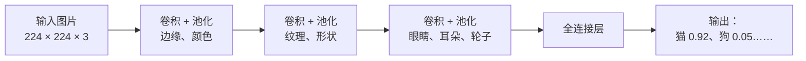
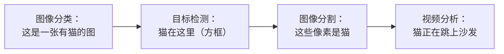
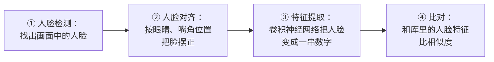
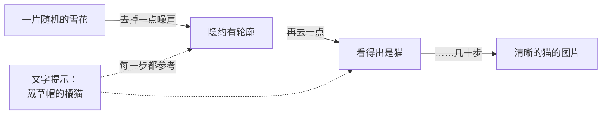
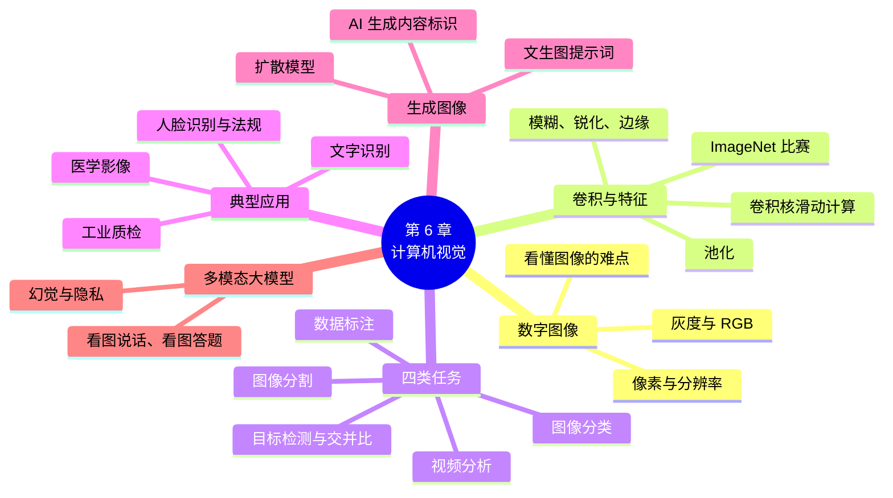

# 第 6 章 计算机视觉

!!! abstract "本章学时"
    理论 4 学时（建议线上 4 · 线下 0）· 在线体验 2 个

## 学习目标

学完本章，你应该能够：

1. **说出**像素、分辨率、灰度和 RGB 颜色的含义，以及计算机视觉的四类主要任务：图像分类、目标检测、图像分割和视频分析（记忆）；
2. **解释**卷积核怎样在图上滑动、提取边缘等特征，卷积神经网络怎样逐层“看懂”图像（理解）；
3. **手算**一个 3 × 3 窗口的卷积结果、一次最大池化，以及两个框的交并比（应用）；
4. **说明**人脸识别、文字识别、工业质检、医学影像的基本流程，以及使用人脸识别的法律要求（理解）；
5. **用自己的话说明**扩散模型生成图像的直观过程，写出结构清楚的文生图提示词，识别 AI 生成内容的标识（应用）；
6. **分析**一个视觉应用属于哪类任务，评价它可能出错的情况和需要的人工把关（分析）。

!!! info "先修要求"
    学习本章前，你需要了解：

    - 卷积神经网络“用小窗口一块块地看图、逐层提取特征”的思路（[4.4.1 卷积神经网络](../04-deep-learning/index.md#441)）；
    - 精确率和召回率（[3.8.3 精确率和召回率](../03-machine-learning/index.md#383)），本章用它们评价质检系统；
    - 提示词的五要素（[5.6.2 提示词的五要素](../05-nlp-llm/index.md#562)），本章用到文生图的提示词。本章的“算一算”只用到加、减、乘、除。

??? abstract "本章概念清单（25 个，点击查看定义和例子）"
    1. [计算机视觉](../../appendix/glossary.md#g-计算机视觉)
    2. [像素](../../appendix/glossary.md#g-像素)
    3. [分辨率](../../appendix/glossary.md#g-分辨率)
    4. [灰度](../../appendix/glossary.md#g-灰度)
    5. [RGB 颜色](../../appendix/glossary.md#g-RGB-颜色)
    6. [通道](../../appendix/glossary.md#g-通道)
    7. [卷积核](../../appendix/glossary.md#g-卷积核)
    8. [卷积](../../appendix/glossary.md#g-卷积)
    9. [池化](../../appendix/glossary.md#g-池化)
    10. [图像分类](../../appendix/glossary.md#g-图像分类)
    11. [目标检测](../../appendix/glossary.md#g-目标检测)
    12. [图像分割](../../appendix/glossary.md#g-图像分割)
    13. [视频分析](../../appendix/glossary.md#g-视频分析)
    14. [交并比](../../appendix/glossary.md#g-交并比)
    15. [数据标注](../../appendix/glossary.md#g-数据标注)
    16. [标注规范](../../appendix/glossary.md#g-标注规范)
    17. [人脸识别](../../appendix/glossary.md#g-人脸识别)
    18. [活体检测](../../appendix/glossary.md#g-活体检测)
    19. [文字识别](../../appendix/glossary.md#g-文字识别)
    20. [工业质检](../../appendix/glossary.md#g-工业质检)
    21. [扩散模型](../../appendix/glossary.md#g-扩散模型)
    22. [文生图](../../appendix/glossary.md#g-文生图)
    23. [多模态大模型](../../appendix/glossary.md#g-多模态大模型)
    24. [显式标识](../../appendix/glossary.md#g-显式标识)
    25. [隐式标识](../../appendix/glossary.md#g-隐式标识)

## 情景导入

小吴在一家手机壳工厂做质检员。生产线上每天下线两万多个手机壳，每一个都要检查有没有划痕、气泡、缺角、色差。以前，十几个质检员坐在流水线边上，拿着手机壳对着灯一个个看。一天下来眼睛又酸又涩，到了下午，漏检的明显多了起来。

今年，工厂在流水线上装了几台工业相机和一套 AI 质检系统。手机壳经过相机时被拍下照片，系统不到一秒就判断出有没有缺陷、缺陷在哪里，把可疑的挑出来，交给质检员复核。小吴现在的主要工作，变成了复核系统挑出来的手机壳，以及给新出现的缺陷照片“画框”，让系统学会认识它们。

小吴有很多疑问：一张照片在计算机里到底是什么？系统是怎样发现一道细细的划痕的？它会不会把手机壳上本来就有的花纹当成划痕？为什么有的缺陷它总是认不出来？

这一章，我们就来看计算机怎样“看”。从一张图片在计算机里是什么讲起，看卷积怎样从像素里找出边缘和形状，再看计算机视觉能完成哪些任务、用在哪些地方，最后看今天的 AI 怎样根据一句话画出一幅画。体验 6-1 里，你可以亲手用不同的卷积核处理图片，看看“找边缘”到底是怎么回事。

## 6.1 图像在计算机里是什么

[**计算机视觉**](../../appendix/glossary.md#g-计算机视觉 "让计算机看懂图像和视频，认出里面有什么、在哪里、在发生什么的技术"){ .term }（Computer Vision，CV）研究的是怎样让计算机“看懂”图像和视频：认出里面有什么、在哪里、在发生什么。人看一眼照片就能说出“一只猫趴在沙发上”，可是对计算机来说，一张照片只是一大堆数字。

### 6.1.1 像素与分辨率

把一张数码照片不断放大，最后会看到一个个小方格，每个小方格只有一种颜色。这些小方格叫[**像素**](../../appendix/glossary.md#g-像素 "数字图像的最小单位，每个像素只有一种颜色"){ .term }（Pixel），是数字图像的最小单位。一张图片横着有多少个像素、竖着有多少个像素，叫它的[**分辨率**](../../appendix/glossary.md#g-分辨率 "图片横向和纵向的像素数，写成“宽 × 高”"){ .term }（Resolution），通常写成“宽 × 高”。

| 常见的分辨率 | 像素数 | 用在哪里 |
|---|---|---|
| 28 × 28 | 784 | 经典的手写数字数据集 |
| 224 × 224 | 约 5 万 | 很多图像识别模型的输入尺寸 |
| 1920 × 1080 | 约 207 万 | 全高清视频、电脑屏幕 |
| 4000 × 3000 | 1200 万 | 手机照片（“1200 万像素”） |

分辨率越高，图片越清楚，但数据量也越大。识别模型通常会先把图片缩小到固定的尺寸再处理，既省算力，又能让不同大小的图片统一起来。

!!! tip "算一算：一张照片有多大"
    一张 1920 × 1080 的彩色图片，每个像素用红、绿、蓝 3 个数表示，每个数占 1 个字节：

    - 像素数：1920 × 1080 = 2 073 600 个；
    - 数据量：2 073 600 × 3 = 6 220 800 字节，约 **6.2 MB**。

    一段 1 分钟、每秒 30 帧的全高清视频，不压缩的话是 6.2 MB × 30 × 60 ≈ 11 GB。实际存下来的照片和视频经过了压缩（比如 JPG、MP4 格式），只有原来的几十分之一甚至更小。即使这样，图像和视频仍然是数据量最大的数据类型之一，这也是计算机视觉需要大量算力的原因。

### 6.1.2 灰度与 RGB 颜色 { #612 }

黑白照片里，每个像素用一个数表示亮度，叫[**灰度**](../../appendix/glossary.md#g-灰度 "用一个 0～255 的数表示像素的亮度，0 是纯黑，255 是纯白"){ .term }值，通常从 0 到 255：0 是纯黑，255 是纯白，中间是各种深浅的灰。所以一张 32 × 32 的灰度图，在计算机里就是一张 32 行、32 列的数字表格。

彩色照片里，每个像素用三个数表示，分别是红（R）、绿（G）、蓝（B）三种颜色的强度，每个数也是 0～255，这叫 [**RGB 颜色**](../../appendix/glossary.md#g-RGB-颜色 "用红、绿、蓝三个 0～255 的数表示一个像素颜色的方法"){ .term }。三种光按不同强度混合，就能调出各种颜色：

| 颜色 | R | G | B |
|---|---|---|---|
| 红 | 255 | 0 | 0 |
| 黄 | 255 | 255 | 0 |
| 白 | 255 | 255 | 255 |
| 黑 | 0 | 0 | 0 |
| 灰 | 128 | 128 | 128 |

所以一张彩色照片，在计算机里是三张同样大小的数字表格叠在一起，分别叫红、绿、蓝三个[**通道**](../../appendix/glossary.md#g-通道 "彩色图片中分别记录红、绿、蓝强度的三张数字表格"){ .term }。很多处理会先把彩色图转成灰度图，常用的公式是：灰度 ≈ 0.299 × R + 0.587 × G + 0.114 × B。绿色的系数最大，因为人眼对绿色最敏感。

### 6.1.3 计算机“看”图难在哪里

既然图片就是一堆数字，计算机为什么不能直接认出猫呢？因为**同一个东西，拍出来的数字可以完全不同**：

- **角度不同**：猫的正脸、侧脸、背影，像素完全不同；
- **光线不同**：白天和晚上、阳光下和阴影里，同一只猫的像素值相差很大；
- **大小和位置不同**：猫可能占满整张照片，也可能只是角落里的一小块；
- **遮挡**：猫可能藏在沙发后面，只露出半个头；
- **同类差异大**：橘猫、黑猫、长毛猫、短毛猫，长得各不相同；
- **背景干扰**：猫趴在花纹复杂的地毯上，很难分清哪里是猫、哪里是地毯。

人能轻松应对这些变化，计算机却要从这一大堆变化不定的数字中找出不变的规律。小吴工厂里的问题也是一样：手机壳上的花纹、反光、灰尘，都可能让系统误以为是划痕。

## 6.2 卷积与特征

### 6.2.1 卷积：一个小窗口滑过整张图

第 4 章说过，卷积神经网络用一个个小窗口来看图。这个小窗口叫[**卷积核**](../../appendix/glossary.md#g-卷积核 "在图上滑动、与像素对应相乘再相加的一小组数，也叫滤波器"){ .term }（Convolution Kernel），也叫滤波器，通常是 3 × 3 或 5 × 5 的一组数字。[**卷积**](../../appendix/glossary.md#g-卷积 "用卷积核滑过整张图，每个位置把对应的数相乘再相加得到输出的运算"){ .term }（Convolution）的计算方法是：

1. 把卷积核放在图片的左上角，盖住 3 × 3 个像素；
2. 把这 9 个像素和卷积核对应位置的 9 个数分别相乘，再全部加起来，得到一个数，作为输出图片在这个位置的值；
3. 把卷积核向右挪一格，重复第 2 步；一行算完了，换到下一行，直到滑过整张图片。

!!! tip "算一算：卷积核怎样找到边缘"
    下面是一张灰度图中的一个 3 × 3 窗口，左边两列是暗的（10），右边一列是亮的（200），中间正好是一条从暗到亮的竖直“边”：

    | 10 | 10 | 200 |
    |---|---|---|
    | **10** | **10** | **200** |
    | **10** | **10** | **200** |

    用“竖直边缘”卷积核（右边减左边，中间一行加倍）：

    | −1 | 0 | 1 |
    |---|---|---|
    | **−2** | **0** | **2** |
    | **−1** | **0** | **1** |

    对应位置相乘再相加：

    - 第 1 行：10 × (−1) + 10 × 0 + 200 × 1 = 190；
    - 第 2 行：10 × (−2) + 10 × 0 + 200 × 2 = 380；
    - 第 3 行：10 × (−1) + 10 × 0 + 200 × 1 = 190；
    - 合计：190 + 380 + 190 = **760**，一个很大的数，说明这里有一条竖直的边。

    如果窗口里 9 个像素都是 10（一片平坦，没有边），结果是 10 × (−1 + 0 + 1 − 2 + 0 + 2 − 1 + 0 + 1) = **0**。

    再用“模糊”卷积核（9 个格子都是 1/9）处理第一个窗口：(10 × 6 + 200 × 3) ÷ 9 ≈ **73**，相当于求 9 个像素的平均值，明暗差别被抹平了。

### 6.2.2 不同的卷积核，不同的效果

换一组卷积核里的数，就能得到完全不同的效果：

| 卷积核 | 九个数 | 效果 |
|---|---|---|
| 模糊 | 都是 1/9 | 每个像素变成周围 9 个像素的平均值，图变模糊，杂点变少 |
| 锐化 | 中间 5，上下左右 −1，四角 0 | 和周围差别大的地方差别更大，图更清晰 |
| 竖直边缘 | 左边一列负、右边一列正 | 左右明暗变化大的地方（竖直的边）变亮 |
| 水平边缘 | 上边一行负、下边一行正 | 上下明暗变化大的地方（水平的边）变亮 |

修图软件里的“模糊”“锐化”滤镜，用的就是这种计算。小吴工厂里的划痕，在照片上就是一道细细的、和周围明暗不同的线，用边缘卷积核一处理，就会变成一道明显的亮线。

<iframe class="sim-frame" src="../../sims/conv-filter/main.html" height="820" loading="lazy" title="卷积滤镜"></iframe>

动画：卷积滤镜。选一张图片和一个卷积核，右边就是卷积的结果；点左图上任意位置，下方显示这一格是怎样算出来的；点“扫描”看窗口一格格滑过整张图。还可以自己修改卷积核里的数，或者用自己的照片试试（照片只在本机处理，不会上传）。[全屏打开](../../sims/conv-filter/main.html){ target=_blank }
{ .sim-caption }

### 6.2.3 卷积神经网络：卷积核是学出来的

上面这些卷积核里的数是人设计的。卷积神经网络最关键的一步是：**卷积核里的数不由人设计，而是通过训练学出来的**。第 4 章的反向传播和梯度下降，调整的就是这些数。

一个卷积神经网络由很多层组成，每一层都有几十到几百个卷积核：

- **卷积**层：用很多个卷积核分别扫过图片，每个卷积核找一种图案，得到一张“特征图”；
- [**池化**](../../appendix/glossary.md#g-池化 "把特征图分成小块、每块只保留一个代表值来缩小特征图的操作"){ .term }层：把特征图缩小，保留最重要的信息。最常用的是**最大池化**：把特征图分成 2 × 2 的小块，每块只留下最大的那个数；
- 卷积层和池化层交替叠很多层，最后用全连接层输出“这张图是猫”的概率。

!!! tip "算一算：最大池化"
    一张 4 × 4 的特征图，按左上、右上、左下、右下分成 4 个 2 × 2 的小块：

    | 1 | 3 | 2 | 0 |
    |---|---|---|---|
    | **5** | **2** | **1** | **4** |
    | **0** | **1** | **7** | **2** |
    | **2** | **6** | **3** | **1** |

    左上块（1、3、5、2）最大的是 5；右上块（2、0、1、4）最大的是 4；左下块（0、1、2、6）最大的是 6；右下块（7、2、3、1）最大的是 7。池化后变成一张 2 × 2 的图：

    | 5 | 4 |
    |---|---|
    | **6** | **7** |

    16 个数变成了 4 个，数据量减少到四分之一。但“这块区域里有没有找到某种图案”这个最重要的信息保留了下来，而且图案稍微挪动一两个像素，结果也差不多。

层数越深，每个位置“看到”的原图范围越大，学到的特征也越复杂。研究者把训练好的网络拆开来看，发现前几层的卷积核学会了找边缘和颜色块，中间层学会了找纹理和简单形状，后面的层能对眼睛、轮子、文字这样的部件做出反应[[1]](#ref6-1)。这和人类视觉系统从简单到复杂的处理过程，有几分相似。

### 6.2.4 ImageNet 比赛：深度学习的转折点 { #624 }

第 4 章提到过 ImageNet 数据集。2010 年到 2017 年，每年都有一场基于它的图像识别比赛：给 1000 个类别、约 120 万张训练图片，看谁的模型在测试图片上认得最准。比赛用的指标是“前 5 错误率”：模型给出 5 个最可能的答案，正确答案不在其中就算错[[2]](#ref6-2)。

| 年份 | 冠军模型 | 前 5 错误率 | 说明 |
|---|---|---|---|
| 2011 | 传统方法（人工设计特征） | 约 26% | |
| 2012 | AlexNet（8 层） | 约 15.3% | 第一次用深度卷积神经网络，比第二名的 26.2% 低了 10 多个百分点 |
| 2014 | GoogLeNet（22 层） | 约 6.7% | 网络更深 |
| 2015 | ResNet（152 层） | 约 3.6% | 残差网络，低于研究者测得的人类约 5% 的错误率 |

短短三四年，错误率从 26% 降到 3.6%。从此，计算机视觉几乎全面转向了深度学习。今天，图像分类已经是比较成熟的技术，研究的重点转向了更难的任务和更广的应用。

## 6.3 视觉的主要任务

### 6.3.1 四类主要任务

同样是“看”，要回答的问题不同，任务也不同：

| 任务 | 回答什么问题 | 输出什么 | 例子 |
|---|---|---|---|
| [**图像分类**](../../appendix/glossary.md#g-图像分类 "判断整张图片属于哪个类别的任务"){ .term }（Image Classification） | 这张图是什么？ | 一个类别和它的概率 | 判断手机壳“合格”还是“有缺陷”，识别花草的品种 |
| [**目标检测**](../../appendix/glossary.md#g-目标检测 "找出图片中所有物体的类别和位置（方框）的任务"){ .term }（Object Detection） | 图里有哪些东西，各在哪里？ | 每个物体的类别和一个方框 | 在路口画面里框出每一辆车和每一个行人 |
| [**图像分割**](../../appendix/glossary.md#g-图像分割 "判断图片中每一个像素属于什么类别的任务"){ .term }（Image Segmentation） | 每一个像素属于什么？ | 一张和原图一样大的“涂色图” | 自动驾驶分出哪里是路、哪里是人行道，医学影像中勾出病灶 |
| [**视频分析**](../../appendix/glossary.md#g-视频分析 "理解视频中物体的运动和行为的任务"){ .term }（Video Analysis） | 视频里发生了什么？ | 物体的运动轨迹、行为类别 | 跟踪一个人在商场里的路线，识别有人摔倒、打架 |

从左到右，回答的问题越来越细，难度也越来越大。图像分类只要一个答案；目标检测要找出所有物体并框出位置；图像分割要判断每一个像素；视频分析还要加上时间，理解前后画面的变化。

### 6.3.2 目标检测：框得准不准

目标检测是应用最广的视觉任务之一。2016 年提出的 YOLO（You Only Look Once，意思是“只看一眼”）方法[[3]](#ref6-3)，把整张图只送进网络一次，就同时得到所有物体的方框和类别，速度快到能实时处理视频，后来不断改进，成为工业界最常用的检测方法之一。

怎样判断一个框“框得准不准”？常用的指标是[**交并比**](../../appendix/glossary.md#g-交并比 "两个框重叠部分的面积除以两个框合起来覆盖的面积，衡量检测框准不准"){ .term }（Intersection over Union，IoU）：两个框重叠部分的面积，除以两个框合起来覆盖的总面积。

!!! tip "算一算：交并比"
    在一张以格子为单位的图上，人工标注的“正确答案”框是从 (1, 0) 到 (5, 4)，模型预测的框是从 (0, 0) 到 (4, 4)，两个框都是 4 × 4 = 16 格。

    - 重叠部分：从 (1, 0) 到 (4, 4)，面积 = 3 × 4 = 12 格；
    - 合起来覆盖的面积：16 + 16 − 12 = 20 格（重叠的部分只能算一次）；
    - 交并比 = 12 ÷ 20 = **0.6**。

    两个框完全重合，交并比是 1；完全不挨着，是 0。很多评测规定交并比大于等于 0.5 才算“检测正确”，这个框就算对了。

    想一想：如果模型的框只往左偏了一点，从 (0.5, 0) 到 (4.5, 4)，交并比是多少？（答案：重叠 3.5 × 4 = 14，合计 16 + 16 − 14 = 18，交并比 = 14 ÷ 18 ≈ 0.78。）

### 6.3.3 训练视觉模型需要标注数据

要训练一个目标检测模型，就要有成千上万张已经画好框、标好类别的图片。这些标注工作大多由人完成：在图片上拉框、选类别，做图像分割还要沿着物体的边缘一点点描出轮廓。小吴给新缺陷画框，就是在做这件事。

标注的质量直接决定了模型的质量。框画得松松垮垮、类别标错、同一种缺陷有人标“划痕”有人标“刮伤”，模型都会学糊涂。所以标注之前要定好统一的[**标注规范**](../../appendix/glossary.md#g-标注规范 "规定标注对象、类别、方法和质量要求的统一说明"){ .term }：什么算划痕、多长的划痕要标、框要贴紧到什么程度，标完后还要抽查。

!!! cert "证书考点 · 人工智能训练师 · 数据标注"
    人工智能训练师国家职业技能标准中，数据采集和处理、[数据标注](../../appendix/glossary.md#g-数据标注 "按照规范为数据添加标签，供模型训练和评估使用"){ .term }是初级和中级的核心内容。图像标注的常见类型有：图像分类标注（给整张图选类别）、拉框标注（目标检测）、多边形或像素级标注（图像分割）、关键点标注（如人脸的眼角、嘴角）。复习时注意：能根据任务选择标注类型，能说出标注规范应包含的内容，能检查出框不贴边、类别标错、漏标等常见质量问题。

## 6.4 典型应用

### 6.4.1 人脸识别

[人脸识别](../../appendix/glossary.md#g-人脸识别 "通过检测、对齐、特征提取和比对，根据人脸确认或辨认身份的技术"){ .term }是我们最熟悉的视觉应用：刷脸解锁、刷脸支付、刷脸进站、酒店入住核验。它一般分为四步：

第 ③ 步得到的一串数字（比如 512 个数），和第 5 章的词向量很像：同一个人不同照片的数字很接近，不同人的相差较远。第 ④ 步比的就是两串数字的相似度，超过阈值就认为是同一个人。

人脸识别有两种用法：**1 比 1** 是验证“你是不是你”，比如刷脸解锁、火车站把你的脸和身份证照片比对；**1 比 N** 是辨认“你是谁”，比如在一个几千人的公司库里找出刷脸进门的是哪位员工。1 比 N 的库越大，认错的风险越高。

人脸属于敏感的个人信息，一旦泄露无法更改，不像密码可以换一个。2025 年 6 月 1 日起施行的《人脸识别技术应用安全管理办法》[[4]](#ref6-4) 规定：使用人脸识别要告知个人并取得同意；存在其他验证方式能达到同样目的的，**不得把人脸识别作为唯一的验证方式**；存储的人脸信息达到 10 万人的，要向网信部门备案。所以，小区门禁、健身房如果只能刷脸进门，就不符合规定，应当同时提供刷卡、密码等方式。

### 6.4.2 文字识别（OCR） { #642 }

[**文字识别**](../../appendix/glossary.md#g-文字识别 "检测并识别图片中的文字，把它变成可编辑文字的技术"){ .term }（Optical Character Recognition，OCR），就是把图片里的文字变成可以编辑、可以搜索的文字。它一般分两步：先**检测**出图片里哪些地方有文字（目标检测），再**识别**每一块里写的是什么字（第 4 章的手写数字识别是它的简化版）。

拍照翻译、扫描文档转 Word、发票和身份证自动录入、车牌识别、快递面单识别，用的都是文字识别。今天的文字识别不但能认印刷体，还能认手写体、表格、公式、弯曲的文字。百度飞桨开源的 PaddleOCR[[5]](#ref6-5) 支持中文、英文等多种语言，很多企业直接拿来用。

### 6.4.3 工业质检

回到小吴的工厂。[工业质检](../../appendix/glossary.md#g-工业质检 "用相机拍摄产品、用视觉模型自动发现缺陷的检验方法"){ .term }用相机拍下产品的照片，用图像分类或目标检测判断有没有缺陷、缺陷在哪里。和人工相比，AI 质检不知疲倦、速度快、标准统一，还能把每一个缺陷的照片和位置都记录下来，帮助工程师找出是哪道工序出了问题。

!!! tip "算一算：AI 质检能省多少事"
    工厂每天生产 20 000 个手机壳，其中约 0.5% 有缺陷，也就是 100 个。AI 质检系统的表现是：

    - 召回率 98%：100 个有缺陷的，能挑出 98 个，漏掉 2 个；
    - 另外，19 900 个合格品中，有 1% 被误判为有缺陷，也就是 199 个。

    系统一共挑出 98 + 199 = 297 个可疑的手机壳，交给质检员复核。精确率 = 98 ÷ 297 ≈ 33%，三个可疑品里只有一个真有问题。

    这样看起来误报很多，但质检员每天只需复核 297 个，而不是看全部 20 000 个，工作量减少了约 98.5%。工厂宁可多挑出一些合格品，也不愿把有缺陷的发给客户，所以优先保证召回率（第 3 章的阈值和精确率、召回率此消彼长）。

工业质检的难点在于：缺陷样本少（一天才 100 个），新的缺陷种类不断出现，而且光照、反光、产品型号变化都会影响效果。所以系统上线后，还需要像小吴这样懂生产又懂标注的人，不断补充新的样本、复核结果。

### 6.4.4 医学影像

CT、核磁共振、X 光片、眼底照片、病理切片，都是图像。AI 可以帮助医生在影像上找出可疑的结节、病灶，用图像分割勾出肿瘤的轮廓，计算大小的变化。在大量筛查的场景下，比如体检中心每天要看上千张胸部 CT，AI 可以先把可疑的挑出来，让医生重点看，减少漏诊。

但医学影像的 AI 只能**辅助**医生，不能代替医生下诊断。AI 给出的结果要由医生结合病人的情况综合判断，诊断的责任由医生承担。我国对辅助诊断类的 AI 软件按医疗器械管理，要经过审批才能在医院使用。

## 6.5 生成图像：扩散模型

### 6.5.1 从“认图”到“画图”

前面讲的都是让计算机“看懂”图像。2022 年前后，AI 学会了另一件事：**根据一句话画出一幅画**。输入“一只戴着草帽的橘猫坐在稻田边，夕阳，水彩画风格”，几秒钟就能得到一张从来不存在的图片。这叫[**文生图**](../../appendix/glossary.md#g-文生图 "根据文字描述生成图片的技术"){ .term }（Text-to-Image）。在一张已有的图片基础上修改，比如把白天的照片变成夜景、把照片变成动漫风格，叫**图生图**。

### 6.5.2 扩散模型：从一片雪花中“洗”出图像

今天的文生图，主要用的是[**扩散模型**](../../appendix/glossary.md#g-扩散模型 "从随机噪声出发、一步步去噪生成图像的生成模型"){ .term }（Diffusion Model）[[6]](#ref6-6)。它的思路可以分两步理解：

- **加噪（训练时）**：拿一张真实的图片，一点一点往上加随机的“雪花点”（噪声），加几百步以后，图片就变成了一片完全看不出内容的雪花。
- **去噪（生成时）**：训练一个神经网络，学会反过来做：给它一张带雪花的图，让它猜出“这一步加了哪些雪花”，减掉一点，图就清楚一点。

生成一张新图片时，从一片完全随机的雪花开始，让网络一步步去噪。**每一步去噪时都参考你写的文字**，于是雪花被一点点“洗”成了符合文字描述的图片。就像雕塑家面对一块石头，一刀刀凿去多余的部分，脑子里始终想着要雕的样子。因为起点的雪花是随机的，同一句提示词每次生成的图片都不一样。

文字和图片是怎样联系起来的？2021 年 OpenAI 提出的 CLIP 模型[[7]](#ref6-7)，在 4 亿对“图片和它的文字说明”上训练，学会了把意思相同的图片和文字变成相近的向量（和第 5 章的词向量是同一个思路）。文生图模型借助这类方法“理解”文字，再用扩散模型画出来。2022 年开源的 Stable Diffusion[[8]](#ref6-8) 让普通电脑也能运行文生图，AI 绘画从此迅速普及。今天，同样的方法也被用来**生成视频**。

### 6.5.3 文生图的提示词怎么写

和第 5 章的大模型一样，提示词写得越具体，生成的图片越接近你的想法。一份好的文生图提示词，通常包括：

| 要素 | 说什么 | 例子 |
|---|---|---|
| 主体 | 画什么，长什么样，在做什么 | 一只戴着草帽的橘猫，坐着望向远方 |
| 环境 | 在哪里，什么时间、天气 | 金黄的稻田边，夕阳西下 |
| 风格 | 照片、水彩、国画、动漫、3D…… | 水彩画风格，笔触柔和 |
| 构图和视角 | 近景还是远景，从哪个角度看 | 远景，猫在画面右下角，留出大片天空 |
| 光线和色调 | 光从哪里来，整体什么颜色 | 暖色调，逆光，有金色的轮廓光 |

很多产品还支持“不希望出现的内容”（比如“不要文字、不要多余的手指”）和画面比例（横图、竖图）等设置。生成后不满意，可以修改提示词中的某一项再试，或者用“局部重绘”只改图片的某一部分。

### 6.5.4 AI 生成的内容要标识 { #654 }

AI 生成的图片和视频越来越逼真，可能被用来造谣、诈骗、侵犯他人的肖像权。我国 2025 年 9 月 1 日起施行的《人工智能生成合成内容标识办法》[[9]](#ref6-9)，要求 AI 生成合成的文字、图片、音频、视频等内容加上标识：

- [**显式标识**](../../appendix/glossary.md#g-显式标识 "以文字、声音、图形等方式呈现、用户能明显感知的 AI 生成内容标识"){ .term }：用户能明显看到的标识，比如图片角落的“AI 生成”字样；
- [**隐式标识**](../../appendix/glossary.md#g-隐式标识 "通过技术措施写在文件数据中、用户不易感知的 AI 生成内容标识"){ .term }：写在文件数据里、用户不容易看到的标识，比如文件的元数据、数字水印，平台可以用它来识别。

用户把 AI 生成的内容发到网上时，也应当主动声明，不得删除、篡改这些标识。用 AI 生成他人的肖像、模仿名人发布虚假信息，可能侵犯他人的权利，甚至触犯法律（第 9 章）。

## 6.6 多模态大模型

### 6.6.1 不只会读文字

第 5 章的大模型只处理文字。能同时处理文字、图片、声音、视频等多种信息的模型，叫[**多模态大模型**](../../appendix/glossary.md#g-多模态大模型 "能同时处理文字、图片、声音、视频等多种信息的大模型"){ .term }（Multimodal Large Model）。“模态”就是信息的形式，文字是一种模态，图片是另一种。

今天主流的大模型产品大多已经是多模态的。你可以拍一张照片发给它，然后问问题：

- **看图说话**：描述照片里有什么，给照片写一段配文；
- **看图答题**：拍一道数学题让它讲解，拍一张植物照片问它是什么花；
- **读图表和文档**：上传一张统计图让它分析趋势，上传一张表格照片让它整理成电子表格；
- **找问题**：拍一张电路板或者设备仪表的照片，问它有没有异常。

### 6.6.2 多模态大模型的原理和局限

多模态大模型的基本做法是：用一个视觉模型把图片切成小块、变成一串向量（就像把句子切成 Token），再和文字的 Token 拼在一起，交给第 5 章的 Transformer 一起处理。这样，模型就能在“看”图片的同时“读”你的问题，再用文字回答。

多模态大模型同样会有**幻觉**：它可能“看到”图片里根本没有的东西，数错物体的个数，读错图表里的数字，把模糊的字认错。所以，和第 5 章一样，重要的信息要核查。不要上传含有身份证、银行卡、病历等敏感信息的照片。

## 6.7 身边的 AI

### 6.7.1 刷脸支付和刷脸进站

在超市自助收银机前看一眼屏幕，就付好了钱。为了防止有人拿照片、视频冒充，刷脸支付和进站都要做[**活体检测**](../../appendix/glossary.md#g-活体检测 "判断摄像头前是否为真人、防止用照片或视频冒充的技术"){ .term }：让你眨眨眼、转转头，或者用红外、深度摄像头判断面前的是不是一个真人的立体的脸。按照前面说的规定，这些场景都要另外提供密码、扫码、刷卡等方式。

### 6.7.2 车牌识别

开车进出停车场，栏杆自动抬起，离场时自动扣费。摄像头拍下车辆，系统先用目标检测找到车牌的位置，再用文字识别认出车牌号码。高速公路、城市路口的违章抓拍，用的也是同样的技术。

### 6.7.3 拍照搜题和拍照识物

学习类应用的“拍照搜题”，先用文字识别认出题目，再到题库里搜索，或者交给大模型讲解。手机相机里的“识物”功能，对着一朵花、一件商品、一个外文菜单拍一下，就能告诉你是什么花、在哪里买、菜单上写了什么。

### 6.7.4 AI 绘画产品 { #674 }

国产的 AI 绘画和视频生成产品有：阿里巴巴的通义万相、字节跳动的即梦、快手的可灵、百度的文心一格等，很多大模型对话产品里也可以直接“画图”。它们广泛用于海报、电商商品图、插画、短视频的制作。不过，商用时要注意平台对生成内容版权和用途的规定，并按要求保留 AI 生成的标识。

!!! example "案例：小吴的质检日记"
    系统上线三个月，小吴记下了几件事：

    1. 换了一批新款手机壳，表面有细细的拉丝纹理，系统把很多合格品当成了“划痕”。工程师让小吴标注了 500 张新款的照片，重新训练后误报就少了。**产品变了，模型也要跟着更新。**
    2. 有一天车间换了新灯管，光线变冷，系统的漏检突然增多。后来规定相机工位要加遮光罩、灯光要定期检查。**拍照条件要稳定。**
    3. 一种新出现的“边角发白”缺陷，系统一个也没认出来，因为它从来没见过。小吴发现后，收集了样本，加进了训练数据。**系统只认识它学过的东西，人要能发现新问题。**

## 在线体验

!!! abstract "体验总览"

    | 体验 | 用到什么 | 时长 |
    |---|---|---|
    | 6-1 卷积滤镜 | 本书动画“卷积滤镜” | 约 20 分钟 |
    | 6-2 识图、OCR 与文生图 | 任意一个支持图片的国产大模型产品，任意一个 AI 绘画产品 | 约 20 分钟 |

    两个体验都只需要浏览器或手机。体验 6-2 中**不要上传含有个人信息的照片**（身份证、银行卡、他人的正脸照片等），可以拍课本、风景、物品。建议边做边把结果填进记录表，课后练习的实操题会用到。

### 体验 6-1 卷积滤镜

**体验目的**：通过亲手计算和观察，理解卷积核怎样在图上滑动、不同的卷积核有什么效果，体会卷积神经网络“用卷积找特征”的基本思路。

**打开方式**：打开 6.2.2 节中的动画，或者[全屏打开“卷积滤镜”](../../sims/conv-filter/main.html){ target=_blank }。

**步骤**

1. 选图片“方块和圆”、卷积核“竖直边缘”，点“扫描”，观察右边的结果是怎样一格格出现的。哪些地方变亮了？
2. 在左图上点深色方块的左边缘，读出下方的计算过程，把窗口里的 9 个像素、计算式和结果记下来，自己用计算器验算一遍。
3. 再点方块内部一片平坦的地方，记下结果。和第 2 步比较。
4. 依次换成“水平边缘”“所有边缘”“模糊”“锐化”，观察“小房子”这张图的变化，用一句话描述每个卷积核的效果。
5. 自己设计一个卷积核：在九个格子里填数，比如只在右边一列的中间填 1、其他都填 0，看看结果会怎样（提示：图片会往哪边挪？）。
6. （选做）点“用自己的照片”，选一张风景或物品的照片，看看“所有边缘”的效果。
7. （选做）展开“彩色像素”，拖动 R、G、B 三个滑块，调出橙色、紫色和你喜欢的颜色，记下它们的三个数。

**记录表**

| 序号 | 操作 | 观察结果 |
|---|---|---|
| 1 | “竖直边缘”处理“方块和圆”，变亮的地方 | |
| 2 | 方块左边缘一格的计算 | 像素：___，结果：___ |
| 3 | 方块内部一格的计算结果 | |
| 4 | 四个卷积核对“小房子”的效果 | 水平边缘：___；所有边缘：___；模糊：___；锐化：___ |
| 5 | 自己设计的卷积核和效果 | |
| 6 | 调出的颜色和 RGB 值（选做） | |

**想一想**

1. 为什么“竖直边缘”卷积核在一片平坦的地方结果是 0？它的九个数加起来等于多少？
2. 卷积神经网络里的卷积核是怎么来的？和你在第 5 步自己设计卷积核有什么不同？

### 体验 6-2 识图、OCR 与文生图 { #6-2 }

**体验目的**：亲手使用多模态大模型和 AI 绘画产品，体会看图说话、文字识别和文生图的效果，学会检查它们的错误，识别 AI 生成内容的标识。

**第一部分：看图说话**

1. 拍一张身边场景的照片（比如教室、书桌、校园一角），发给大模型，提问：“请描述这张照片里有什么，一共有几把椅子（或者其他你能数清的东西）？”
2. 对照照片检查：描述有没有错？数得对不对？有没有说出照片里根本没有的东西（幻觉）？

**第二部分：文字识别**

1. 拍一页课本或者一张打印的表格（不要有个人信息），发给大模型，要求“把图片中的文字原样提取出来”，或者“把这张表格整理成 Markdown 表格”。
2. 和原文逐字核对一段（大约 100 个字），数一数错了几个字，算出错字率 = 错字数 ÷ 总字数。

**第三部分：文生图**

1. 在 AI 绘画产品中，先输入一句简单的提示词，比如“一只猫”，生成一张图。
2. 再按 6.5.3 节的五个要素写一份完整的提示词，主题自选（比如为学校的运动会设计一张海报的背景图），生成一张图。
3. 比较两张图，并检查：图片上或者下载的文件里，有没有“AI 生成”的标识？画面里有没有不合理的地方（比如手指数目、文字乱码、影子方向）？

**记录表**

| 部分 | 观察内容 | 记录 |
|---|---|---|
| 看图说话 | 描述中错误或编造的内容 | |
| 看图说话 | 数东西：实际 ___ 个，模型说 ___ 个 | |
| 文字识别 | 核对 ___ 字，错 ___ 字，错字率 ___% | |
| 文生图 | 我写的完整提示词 | |
| 文生图 | 两次生成的图片有什么不同 | |
| 文生图 | 有没有 AI 生成标识，在哪里 | |
| 文生图 | 画面中不合理的地方 | |

**想一想**

1. 多模态大模型数东西为什么容易出错？如果要统计一个仓库里有多少箱货，你会直接相信它的回答吗？
2. 如果有人用 AI 生成了一张“某地发生火灾”的逼真照片发到网上，会造成什么后果？标识办法是怎样防范的？

## 本章小结

- **计算机视觉**让计算机看懂图像和视频。数字图像由**像素**组成，**分辨率**是横竖的像素数；灰度图每个像素一个 0～255 的数，彩色图每个像素有 R、G、B 三个数（**RGB 颜色**）。角度、光线、遮挡、背景的变化让“看懂”变得困难。
- **卷积**用一个**卷积核**在图上滑动，对应位置相乘再相加。不同的卷积核能模糊、锐化、找边缘。卷积神经网络的卷积核是训练出来的，配合**池化**逐层提取边缘、纹理、部件、物体等特征。2012 年 AlexNet 在 ImageNet 比赛中的胜利，让计算机视觉全面转向深度学习。
- 视觉的主要任务有**图像分类**（是什么）、**目标检测**（有什么、在哪里，用**交并比**衡量框得准不准）、**图像分割**（每个像素属于什么）和**视频分析**（发生了什么）。训练模型需要按统一的标注规范做大量**数据标注**。
- 典型应用有**人脸识别**（检测、对齐、特征提取、比对，要遵守不得作为唯一验证方式等规定）、**文字识别**、**工业质检**（优先保证召回率，人工复核）和医学影像（只能辅助医生）。
- **扩散模型**从一片随机噪声开始，参考文字提示一步步去噪，生成图像，实现**文生图**。提示词要写清主体、环境、风格、构图、光线。AI 生成内容要按规定加显式和隐式标识。
- **多模态大模型**能同时处理图片和文字，能看图说话、看图答题、读图表，但同样会产生幻觉。

!!! info "深入学习"
    本章只讲了计算机视觉的直观思路。想深入学习，可以阅读系列教材《计算机视觉及应用实战》：

    - 图像的读取、颜色空间转换、滤波和边缘检测的编程实现；
    - 卷积神经网络的结构，以及用飞桨、PyTorch 训练图像分类模型；
    - 目标检测（YOLO 等）、图像分割、人脸识别、文字识别（PaddleOCR）的原理和项目实战；
    - 数据标注工具的使用和标注规范的制定。

    卷积神经网络的训练原理见《机器学习》第 11 章；在 GPU 上训练和部署模型见《人工智能开发框架技术》。

**下一章预告**

本章讲的是计算机的“眼睛”。人和人交流，还要靠耳朵和嘴巴。智能音箱怎样听懂你说的话？导航里的语音为什么越来越像真人？几秒钟的录音就能“克隆”一个人的声音，又带来了什么风险？下一章，我们来看语音技术。

## 参考文献

正文中的上标编号（如[[1]](#ref6-1)）对应下面的文献。带链接的可以直接打开；书籍可在图书馆或电子书平台查阅。

**教材与专著**

- [10] Szeliski R. Computer Vision: Algorithms and Applications[M]. 2nd ed. Cham: Springer, 2022. <https://szeliski.org/Book/>
    计算机视觉领域的经典教材，作者在网上公开了电子版，适合学完《计算机视觉及应用实战》后查阅。

**经典论文**

- [1] Zeiler M D, Fergus R. Visualizing and Understanding Convolutional Networks[C]//European Conference on Computer Vision (ECCV 2014). Cham: Springer, 2014: 818-833. <https://arxiv.org/abs/1311.2901>
    把卷积神经网络各层学到的特征画出来的研究，显示了从边缘到物体部件的逐层变化，对应 6.2.3 节。
- [2] Russakovsky O, Deng J, Su H, et al. ImageNet Large Scale Visual Recognition Challenge[J]. International Journal of Computer Vision, 2015, 115(3): 211-252. <https://doi.org/10.1007/s11263-015-0816-y>
    ImageNet 比赛的总结论文，介绍了比赛的数据、评价方法、历年结果和人类错误率的测定，对应 6.2.4 节。
- [3] Redmon J, Divvala S, Girshick R, et al. You Only Look Once: Unified, Real-Time Object Detection[C]//2016 IEEE Conference on Computer Vision and Pattern Recognition. 2016: 779-788. <https://arxiv.org/abs/1506.02640>
    提出 YOLO 目标检测方法的论文，对应 6.3.2 节。
- [6] Ho J, Jain A, Abbeel P. Denoising Diffusion Probabilistic Models[C]//Advances in Neural Information Processing Systems 33. 2020: 6840-6851. <https://arxiv.org/abs/2006.11239>
    让扩散模型生成高质量图像的代表性论文，对应 6.5.2 节。
- [7] Radford A, Kim J W, Hallacy C, et al. Learning Transferable Visual Models from Natural Language Supervision[C]//Proceedings of the 38th International Conference on Machine Learning. 2021: 8748-8763. <https://arxiv.org/abs/2103.00020>
    提出 CLIP 模型的论文，在 4 亿对图片和文字上训练，对应 6.5.2 节。
- [8] Rombach R, Blattmann A, Lorenz D, et al. High-Resolution Image Synthesis with Latent Diffusion Models[C]//2022 IEEE/CVF Conference on Computer Vision and Pattern Recognition. 2022: 10684-10695. <https://arxiv.org/abs/2112.10752>
    Stable Diffusion 背后的潜在扩散模型论文，对应 6.5.2 节。

**在线资源与法规**

- [4] 国家互联网信息办公室，公安部. 人脸识别技术应用安全管理办法[EB/OL]. 2025-03-21. <https://www.cac.gov.cn/2025-03/21/c_1744174262342111.htm>（2026-10-30 访问）
    规范人脸识别技术应用的部门规章，2025 年 6 月 1 日起施行，规定了告知同意、不得作为唯一验证方式、10 万人以上备案等要求，对应 6.4.1 节。
- [5] PaddlePaddle. PaddleOCR[CP/OL]. <https://github.com/PaddlePaddle/PaddleOCR>（2026-10-30 访问）
    百度飞桨开源的文字识别工具库，支持多种语言，对应 6.4.2 节。
- [9] 国家互联网信息办公室，工业和信息化部，公安部，国家广播电视总局. 人工智能生成合成内容标识办法[EB/OL]. 2025-03-14. <https://www.news.cn/politics/20250314/b7a24028f2924b7681e6ed1bfbd8fade/c.html>（2026-10-30 访问）
    规定 AI 生成合成内容显式标识和隐式标识的办法，2025 年 9 月 1 日起施行，对应 6.5.4 节。链接为新华网的发布报道。

## 课后练习

选择题和判断题可以直接点击选项作答，系统会马上告诉你对错，并展开答案与解析；多选题选好后点“提交答案”。简答和实操题请先自己作答，再点开“答案与解析”核对。每道题的解析下方都有“回看”链接，做错了可以直接跳回正文复习。

**一、单项选择题**

**1.** 一张分辨率为 1280 × 720 的图片，一共有多少个像素？（　　）

- A. 2000
- B. 92 160
- C. 921 600
- D. 1 280 720

??? tip "答案与解析"
    **答案：C**

    解析：像素数 = 宽 × 高 = 1280 × 720 = 921 600，约 92 万个像素。

    考查：像素与分辨率 · 认知层次：应用 · [回看 6.1.1](#611)
    { .quiz-meta }

**2.** 在 RGB 颜色中，(255, 255, 0) 表示的颜色是（　　）。

- A. 白色
- B. 红色
- C. 黄色
- D. 黑色

??? tip "答案与解析"
    **答案：C**

    解析：红和绿都是最强、蓝是 0，红光和绿光混合得到黄色。(255, 255, 255) 是白色，(255, 0, 0) 是红色，(0, 0, 0) 是黑色。

    考查：RGB 颜色 · 认知层次：理解 · [回看 6.1.2](#612)
    { .quiz-meta }

**3.** 一个 3 × 3 窗口的 9 个像素都是 50，用“模糊”卷积核（9 个数都是 1/9）计算，结果是（　　）。

- A. 0
- B. 50
- C. 450
- D. 5.6

??? tip "答案与解析"
    **答案：B**

    解析：模糊卷积核相当于求 9 个像素的平均值：50 × 9 × 1/9 = 50。一片平坦的区域模糊后没有变化。

    考查：卷积 · 认知层次：应用 · [回看 6.2.1](#621)
    { .quiz-meta }

**4.** 窗口像素第一列都是 0、第二列都是 0、第三列都是 100，用“竖直边缘”卷积核（三行分别是 −1 0 1、−2 0 2、−1 0 1）计算，结果是（　　）。

- A. 0
- B. 100
- C. 300
- D. 400

??? tip "答案与解析"
    **答案：D**

    解析：第 1 行：100 × 1 = 100；第 2 行：100 × 2 = 200；第 3 行：100 × 1 = 100；合计 400。结果很大，说明这里有一条竖直的边。

    考查：卷积、边缘检测 · 认知层次：应用 · [回看 6.2.1](#621)
    { .quiz-meta }

**5.** 对 2 × 2 小块 (3, 8, 1, 6) 做最大池化，结果是（　　）。

- A. 1
- B. 4.5
- C. 8
- D. 18

??? tip "答案与解析"
    **答案：C**

    解析：最大池化只保留每个小块中最大的数，3、8、1、6 中最大的是 8。

    考查：池化 · 认知层次：应用 · [回看 6.2.3](#623)
    { .quiz-meta }

**6.** 在路口的监控画面中找出每一辆车，并用方框标出它们的位置，属于（　　）任务。

- A. 图像分类
- B. 目标检测
- C. 图像分割
- D. 文字识别

??? tip "答案与解析"
    **答案：B**

    解析：目标检测要回答“有哪些东西、各在哪里”，输出每个物体的类别和方框。图像分类只给整张图一个类别，图像分割要判断每一个像素。

    考查：目标检测 · 认知层次：理解 · [回看 6.3.1](#631)
    { .quiz-meta }

**7.** 正确答案框和预测框重叠部分的面积是 30，两个框合起来覆盖的面积是 50，交并比是（　　）。

- A. 0.3
- B. 0.6
- C. 1.67
- D. 80

??? tip "答案与解析"
    **答案：B**

    解析：交并比 = 重叠面积 ÷ 合起来覆盖的面积 = 30 ÷ 50 = 0.6，大于 0.5，通常算检测正确。

    考查：交并比 · 认知层次：应用 · [回看 6.3.2](#632)
    { .quiz-meta }

**8.** 手机刷脸解锁，验证“你是不是机主本人”，属于人脸识别的（　　）。

- A. 1 比 1 验证
- B. 1 比 N 辨认
- C. 图像分割
- D. 活体检测之外的其他用途

??? tip "答案与解析"
    **答案：A**

    解析：刷脸解锁是把你的脸和手机里保存的机主人脸比对，验证“你是不是你”，属于 1 比 1。在一个人脸库里找出“你是谁”才是 1 比 N。

    考查：人脸识别 · 认知层次：理解 · [回看 6.4.1](#641)
    { .quiz-meta }

**9.** 扩散模型生成一张新图片时，起点是（　　）。

- A. 一张从网上下载的照片
- B. 一片完全随机的噪声
- C. 一张全白的图片
- D. 用户画的草图

??? tip "答案与解析"
    **答案：B**

    解析：扩散模型从一片随机的噪声（雪花）开始，参考文字提示一步步去噪，最后得到清晰的图片。起点是随机的，所以同一句提示词每次生成的图片都不同。

    考查：扩散模型 · 认知层次：理解 · [回看 6.5.2](#652)
    { .quiz-meta }

**10.** 根据《人工智能生成合成内容标识办法》，写在文件元数据里、用户不容易看到的标识叫（　　）。

- A. 显式标识
- B. 隐式标识
- C. 水印广告
- D. 版权声明

??? tip "答案与解析"
    **答案：B**

    解析：隐式标识通过技术措施添加在文件数据中，不易被用户明显感知；显式标识是用户能明显看到的，比如图片角落的“AI 生成”字样。

    考查：AI 生成内容标识 · 认知层次：记忆 · [回看 6.5.4](#654)
    { .quiz-meta }

**二、多项选择题**

**1.** 计算机“看懂”图像困难的原因包括（　　）。

- A. 同一个物体从不同角度拍，像素完全不同
- B. 光线变化让像素值相差很大
- C. 物体可能被遮挡
- D. 同一类物体外观差异大
- E. 图片里的数字太少

??? tip "答案与解析"
    **答案：ABCD**

    解析：角度、光线、大小位置、遮挡、同类差异、背景干扰都会让计算机难以从像素中找出不变的规律。图片的数字其实非常多，E 错误。

    考查：视觉的难点 · 认知层次：理解 · [回看 6.1.3](#613)
    { .quiz-meta }

**2.** 关于卷积神经网络，下列说法正确的有（　　）。

- A. 卷积核里的数是通过训练学出来的
- B. 前几层通常学会找边缘和颜色块
- C. 池化可以减少数据量，并保留最重要的信息
- D. 层数越深，学到的特征越复杂
- E. 每一层只能有一个卷积核

??? tip "答案与解析"
    **答案：ABCD**

    解析：卷积神经网络每一层通常有几十到几百个卷积核，每个卷积核找一种图案，E 错误。

    考查：卷积神经网络 · 认知层次：理解 · [回看 6.2.3](#623)
    { .quiz-meta }

**3.** 下列应用中，用到了文字识别（OCR）的有（　　）。

- A. 拍照翻译外文菜单
- B. 停车场识别车牌号码
- C. 发票信息自动录入
- D. 刷脸支付
- E. 快递面单信息识别

??? tip "答案与解析"
    **答案：ABCE**

    解析：把图片里的文字变成可编辑的文字就是文字识别。刷脸支付用的是人脸识别。

    考查：文字识别 · 认知层次：应用 · [回看 6.4.2](#642)
    { .quiz-meta }

**4.** 按照《人脸识别技术应用安全管理办法》，下列做法正确的有（　　）。

- A. 使用人脸识别前告知个人并取得同意
- B. 小区门禁只提供刷脸一种开门方式
- C. 存在其他验证方式时，不把人脸识别作为唯一方式
- D. 存储人脸信息达到 10 万人时向网信部门备案
- E. 未经同意把顾客的人脸照片卖给其他公司

??? tip "答案与解析"
    **答案：ACD**

    解析：存在其他方式能达到同样目的时，不得把人脸识别作为唯一验证方式，B 不符合规定；E 侵犯个人信息权益，违法。

    考查：人脸识别的法规 · 认知层次：评价 · [回看 6.4.1](#641)
    { .quiz-meta }

**5.** 一份完整的文生图提示词通常包含（　　）。

- A. 主体
- B. 环境
- C. 风格
- D. 构图和视角、光线和色调
- E. 模型的参数个数

??? tip "答案与解析"
    **答案：ABCD**

    解析：文生图提示词要写清画什么（主体）、在哪里（环境）、什么风格、怎样构图、什么光线色调。模型的参数个数与提示词无关。

    考查：文生图提示词 · 认知层次：记忆 · [回看 6.5.3](#653)
    { .quiz-meta }

**三、判断题**

**1.** 灰度图中，像素值 0 表示纯白，255 表示纯黑。

- √ 正确
- × 错误

??? tip "答案与解析"
    **答案：×**

    解析：正好相反：0 是纯黑，255 是纯白。

    考查：灰度 · 认知层次：记忆 · [回看 6.1.2](#612)
    { .quiz-meta }

**2.** 一张彩色图片在计算机里可以看成红、绿、蓝三张同样大小的数字表格叠在一起。

- √ 正确
- × 错误

??? tip "答案与解析"
    **答案：√**

    解析：彩色图片有红、绿、蓝三个通道，每个通道是一张和图片一样大的数字表格。

    考查：RGB 颜色 · 认知层次：理解 · [回看 6.1.2](#612)
    { .quiz-meta }

**3.** 修图软件中的“模糊”“锐化”滤镜，本质上也是用卷积核对图片做卷积。

- √ 正确
- × 错误

??? tip "答案与解析"
    **答案：√**

    解析：模糊用的是 9 个数都是 1/9 的卷积核，锐化用的是中间加强、四周减去的卷积核。

    考查：卷积核 · 认知层次：理解 · [回看 6.2.2](#622)
    { .quiz-meta }

**4.** 2012 年 AlexNet 在 ImageNet 比赛中获胜，用的是人工设计的特征，没有用神经网络。

- √ 正确
- × 错误

??? tip "答案与解析"
    **答案：×**

    解析：AlexNet 是深度卷积神经网络，它的前 5 错误率约 15.3%，比用传统方法的第二名低了 10 多个百分点，计算机视觉从此全面转向深度学习。

    考查：ImageNet 比赛 · 认知层次：记忆 · [回看 6.2.4](#624)
    { .quiz-meta }

**5.** 图像分割要判断图片中每一个像素属于什么类别。

- √ 正确
- × 错误

??? tip "答案与解析"
    **答案：√**

    解析：图像分割输出一张和原图一样大的“涂色图”，每个像素都有类别，比目标检测的方框更精细。

    考查：图像分割 · 认知层次：理解 · [回看 6.3.1](#631)
    { .quiz-meta }

**6.** 标注数据的质量对视觉模型的效果影响不大，只要数量够多就行。

- √ 正确
- × 错误

??? tip "答案与解析"
    **答案：×**

    解析：框画得不准、类别标错、标准不统一都会让模型学糊涂。标注前要定好统一的标注规范，标完还要抽查。

    考查：数据标注 · 认知层次：理解 · [回看 6.3.3](#633)
    { .quiz-meta }

**7.** 工业质检系统通常优先保证召回率，宁可多挑出一些合格品让人复核，也不愿漏掉有缺陷的产品。

- √ 正确
- × 错误

??? tip "答案与解析"
    **答案：√**

    解析：把有缺陷的产品发给客户损失更大，所以优先保证召回率，被误判的合格品由人工复核。

    考查：工业质检 · 认知层次：分析 · [回看 6.4.3](#643)
    { .quiz-meta }

**8.** 医学影像 AI 的准确率已经很高，可以直接代替医生给病人下诊断。

- √ 正确
- × 错误

??? tip "答案与解析"
    **答案：×**

    解析：医学影像 AI 只能辅助医生，结果要由医生结合病人的情况综合判断，诊断责任由医生承担。

    考查：医学影像 · 认知层次：评价 · [回看 6.4.4](#644)
    { .quiz-meta }

**9.** 用同一句提示词在扩散模型中生成两次，得到的图片一般是不同的。

- √ 正确
- × 错误

??? tip "答案与解析"
    **答案：√**

    解析：每次生成的起点都是一片随机的噪声，所以结果每次都不同。

    考查：扩散模型 · 认知层次：理解 · [回看 6.5.2](#652)
    { .quiz-meta }

**10.** 多模态大模型能看懂图片，所以它数图片里物体的个数、读图表里的数字时不会出错。

- √ 正确
- × 错误

??? tip "答案与解析"
    **答案：×**

    解析：多模态大模型同样会产生幻觉，可能“看到”不存在的东西、数错个数、读错数字，重要信息要核查。

    考查：多模态大模型 · 认知层次：理解 · [回看 6.6.2](#662)
    { .quiz-meta }

**四、简答题**

**1.** 用自己的话说明卷积是怎样计算的，并解释为什么“竖直边缘”卷积核能找到图片中竖直的边。

??? tip "答案与解析"
    **参考答案：** 卷积的计算：把一个 3 × 3（或更大）的卷积核放在图片上，盖住的像素和卷积核对应位置的数分别相乘再全部加起来，作为输出在这个位置的值；然后把卷积核一格格向右、向下滑动，直到滑过整张图片。“竖直边缘”卷积核左边一列是负数、右边一列是正数，相当于用窗口右边的像素减去左边的像素。如果左右明暗差别大（有一条竖直的边），结果就是一个很大的数（取绝对值后变亮）；如果是一片平坦的区域，左右相同，正负抵消，结果接近 0（变黑）。所以处理后，竖直的边变亮，其他地方变暗。

    **解析：** 卷积的计算过程（相乘相加、滑动）说清楚得一半分；能用“右边减左边、平坦处抵消为 0”解释边缘检测得另一半分。

    考查：卷积、边缘检测 · 认知层次：理解 · [回看 6.2.1](#621)
    { .quiz-meta }

**2.** 比较图像分类、目标检测和图像分割三类任务：各回答什么问题、输出什么？请为每类任务各举一个工厂或生活中的例子。

??? tip "答案与解析"
    **参考答案：**

    | 任务 | 回答什么问题 | 输出什么 | 例子 |
    |---|---|---|---|
    | 图像分类 | 这张图是什么？ | 一个类别和概率 | 判断手机壳合格还是有缺陷；识别花的品种 |
    | 目标检测 | 有哪些东西，各在哪里？ | 每个物体的类别和方框 | 在手机壳照片上框出划痕的位置；路口画面中框出车和行人 |
    | 图像分割 | 每个像素属于什么？ | 和原图一样大的涂色图 | 勾出划痕的精确形状、计算面积；手机人像模式分出人和背景 |

    **解析：** 三类任务的问题和输出各答对得大部分分，例子恰当得满分。

    考查：视觉的主要任务 · 认知层次：分析 · [回看 6.3.1](#631)
    { .quiz-meta }

**3.** 某工厂每天生产 10 000 个零件，不良率 1%。AI 质检系统的召回率是 95%，并且会把 2% 的合格品误判为不良品。请计算：（1）系统每天漏掉几个不良品？（2）系统每天一共挑出多少个可疑零件交给人工复核？精确率是多少？（3）你认为这个系统值得使用吗？还需要什么措施？

??? tip "答案与解析"
    **参考答案：** （1）不良品 = 10 000 × 1% = 100 个，挑出 100 × 95% = 95 个，漏掉 5 个。（2）合格品 = 9 900 个，误判 9 900 × 2% = 198 个；挑出的可疑零件 = 95 + 198 = 293 个；精确率 = 95 ÷ 293 ≈ 32%。（3）值得使用：人工只需复核 293 个，而不是全部 10 000 个，工作量减少约 97%。但每天仍会漏掉 5 个不良品，还需要：定期抽检系统判为合格的产品；补充漏检的样本重新训练，提高召回率；稳定拍照条件；产品换型时更新模型；记录每个缺陷，帮助找出生产问题。

    **解析：** （1）（2）计算正确各得三分之一分；（3）有合理的判断并至少提出两条措施得三分之一分。

    考查：工业质检、精确率与召回率 · 认知层次：应用 · [回看 6.4.3](#643)
    { .quiz-meta }

**五、实操题**

**1.** 完成体验 6-1，提交记录表和两张截图（“竖直边缘”处理“方块和圆”的结果、你自己设计的卷积核的结果）。回答：方块左边缘一格和方块内部一格的计算结果分别是多少？为什么相差这么大？你设计的卷积核产生了什么效果？

??? tip "答案与解析"
    **参考答案：** 具体数字以动画显示为准。方块左边缘一格的窗口里左右明暗不同，计算结果是一个绝对值很大的数（显示为接近 255 的亮色）；方块内部一片平坦，左右像素相同，正负抵消，结果为 0（黑色）。原因是竖直边缘卷积核相当于右边减左边，只有左右有明暗变化时结果才大。自己设计的卷积核效果因人而异，例如只保留右边一列中间为 1 时，每个像素取它右边像素的值，整张图向左挪一格；九个数加起来为 0 的卷积核一般都能找出某种边缘。

    **解析：** 记录表和截图完整得一半分；能用“右边减左边、平坦处抵消”解释两个结果的差别得四分之一分；能描述自己设计的卷积核的效果得四分之一分。

    考查：卷积与边缘检测 · 认知层次：分析 · [回看体验 6-1](#6-1)
    { .quiz-meta }

**2.** 完成体验 6-2，提交记录表、你写的完整文生图提示词和生成的图片。回答：多模态大模型在看图说话和文字识别中出了哪些错？错字率是多少？你生成的图片有没有 AI 生成标识？画面中有没有不合理的地方？

??? tip "答案与解析"
    **参考答案：** 结果因人而异。一般能观察到：看图说话大体准确，但数东西时容易数错，偶尔会描述照片里没有的东西（幻觉）；印刷文字的识别错字率通常很低（不到 1%），手写、模糊、反光的部分错误较多；完整提示词生成的图片比“一只猫”更符合预期；多数国产 AI 绘画产品会在图片上加“AI 生成”字样，或在文件信息中写入隐式标识；画面中可能出现手指数目不对、文字乱码、光影不一致等问题，说明生成的图片需要人检查后再使用。

    **解析：** 记录表、提示词和图片完整得一半分；能指出至少两处模型的错误或画面问题得四分之一分；能说明 AI 生成标识的情况和意义得四分之一分。

    考查：多模态大模型、文生图与标识 · 认知层次：评价 · [回看体验 6-2](#6-2)
    { .quiz-meta }

