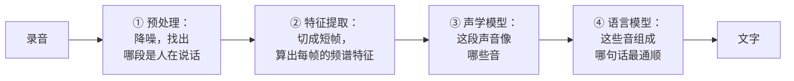
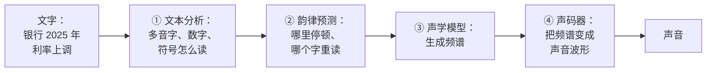
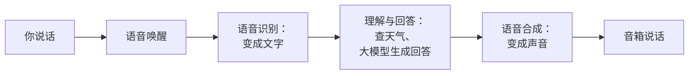
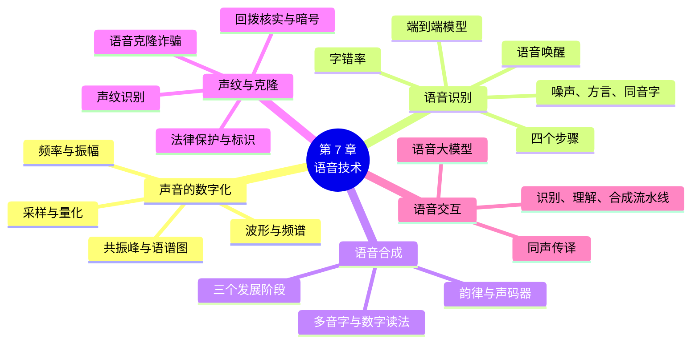

# 第 7 章 语音技术

!!! abstract "本章学时"
    理论 4 学时（建议线上 4 · 线下 0）· 在线体验 2 个

## 学习目标

学完本章，你应该能够：

1. **说出**频率、振幅、采样率、量化位数的含义，以及语音识别、语音合成、声纹识别、语音唤醒分别做什么（记忆）；
2. **解释**波形和频谱的区别，说明为什么计算机通常要从频谱中提取语音的特征（理解）；
3. **手算**一段录音的数据量和一次语音识别的字错率（应用）；
4. **用自己的话说明**语音识别和语音合成的大致流程，以及语音大模型与传统“识别、理解、合成”流水线的不同（理解）；
5. **识别**语音克隆诈骗的常见手法，说出防范办法和使用他人声音的法律要求（应用）；
6. **分析**一个语音应用在噪声、方言、多音字等情况下可能出现的问题，并提出改进办法（分析）。

!!! info "先修要求"
    学习本章前，你需要了解：

    - 循环神经网络和 Transformer 处理序列的思路（[4.4.2 循环神经网络](../04-deep-learning/index.md#442)、[5.4.2 Transformer](../05-nlp-llm/index.md#542)）；
    - 语言模型“预测下一个词”的含义（[5.3.1 语言模型](../05-nlp-llm/index.md#531)），本章用它解释语音识别怎样分辨同音字；
    - 人脸识别的 1 比 1 和 1 比 N（[6.4.1 人脸识别](../06-computer-vision/index.md#641)），本章的声纹识别与它类似。本章的“算一算”只用到乘法和除法。

??? abstract "本章概念清单（20 个，点击查看定义和例子）"
    1. [频率](../../appendix/glossary.md#g-频率)
    2. [振幅](../../appendix/glossary.md#g-振幅)
    3. [波形](../../appendix/glossary.md#g-波形)
    4. [采样](../../appendix/glossary.md#g-采样)
    5. [采样率](../../appendix/glossary.md#g-采样率)
    6. [量化](../../appendix/glossary.md#g-量化)
    7. [频谱](../../appendix/glossary.md#g-频谱)
    8. [共振峰](../../appendix/glossary.md#g-共振峰)
    9. [语谱图](../../appendix/glossary.md#g-语谱图)
    10. [语音识别](../../appendix/glossary.md#g-语音识别)
    11. [端到端](../../appendix/glossary.md#g-端到端)
    12. [字错率](../../appendix/glossary.md#g-字错率)
    13. [语音唤醒](../../appendix/glossary.md#g-语音唤醒)
    14. [语音合成](../../appendix/glossary.md#g-语音合成)
    15. [多音字](../../appendix/glossary.md#g-多音字)
    16. [声纹](../../appendix/glossary.md#g-声纹)
    17. [声纹识别](../../appendix/glossary.md#g-声纹识别)
    18. [语音克隆](../../appendix/glossary.md#g-语音克隆)
    19. [语音大模型](../../appendix/glossary.md#g-语音大模型)
    20. [同声传译](../../appendix/glossary.md#g-同声传译)

## 情景导入

小郑在一个街道社区服务中心工作，每天要接待很多老年人。中心里有一台“智能助手”，老人们对着它说一句“我想办高龄津贴”，屏幕上就会显示要带的材料和办理流程，还会念出来。不识字的王大爷用方言问，它大多也能听懂，偶尔会把“津贴”听成“金铁”，惹得大家直笑。

社区开会时，小郑用手机上的录音转文字功能做会议记录，会一开完，文字稿就出来了，她只要改一改错字、整理一下就行，以前要花一个下午的活，现在半小时就够了。

但上个月，社区里发生了一件让人后怕的事：李奶奶接到一个电话，电话里是“孙子”的声音，哭着说在外地出了车祸，急需两万元。声音、语气和孙子一模一样。幸好李奶奶多了个心眼，挂了电话打给孙子本人，才发现是骗子用 AI “克隆”了孙子的声音。

计算机是怎样听懂人说话的？它为什么能用不同的声音说话，甚至模仿某一个人？我们又该怎样防范声音被冒用？这一章，我们从声音是怎样变成数字的讲起，看看语音识别和语音合成的原理，最后看看今天能和人实时对话的语音大模型。体验 7-1 里，你可以亲眼看到不同声音的“模样”。

## 7.1 声音的数字化

### 7.1.1 声音是什么

声音是物体振动产生的。说话时，声带振动，带动周围的空气一疏一密地传出去，传到别人的耳朵里，引起鼓膜同样的振动，人就听到了声音。

描述声音有两个最基本的量：

- [**频率**](../../appendix/glossary.md#g-频率 "每秒振动的次数，单位是赫兹（Hz），决定音调的高低"){ .term }（Frequency）：每秒振动多少次，单位是赫兹（Hz）。频率高，音调就高（尖细）；频率低，音调就低（低沉）。人耳大约能听到 20～20 000 赫兹的声音。成年男性说话时声带振动的频率一般在 100～150 赫兹左右，女性在 200～250 赫兹左右，所以女声通常比男声高。
- [**振幅**](../../appendix/glossary.md#g-振幅 "振动的幅度，决定声音的响度"){ .term }（Amplitude）：振动的幅度有多大。振幅大，声音就响；振幅小，声音就轻。

把空气压力随时间的变化画成一条曲线，就是声音的[**波形**](../../appendix/glossary.md#g-波形 "空气压力（或电信号）随时间变化的曲线"){ .term }（Waveform）。音叉发出的声音只有一个频率，波形是一条光滑的、有规律起伏的曲线（正弦波）。人说话的声音复杂得多，波形弯弯曲曲，但仔细看，元音部分仍然是一段段重复的图案。

### 7.1.2 采样与量化

麦克风把空气的振动变成连续变化的电信号。计算机只能存数字，要把连续的信号变成一串数字，需要两步：

- [**采样**](../../appendix/glossary.md#g-采样 "每隔一段时间记录一次信号大小，把连续的声音变成一串数字"){ .term }（Sampling）：每隔一小段时间，记录一次信号的大小。每秒记录多少次，叫[**采样率**](../../appendix/glossary.md#g-采样率 "每秒采样的次数，至少要是声音最高频率的两倍"){ .term }（Sampling Rate）。采样率 16 000 赫兹，就是每秒记录 16 000 个数。
- [**量化**](../../appendix/glossary.md#g-量化 "用有限个等级表示每次采样的数值，位数越多越精细"){ .term }（Quantization）：每次记录的数要用多少个二进制位来表示，叫量化位数。位数越多，能分的等级越细，记录越准确。16 位能分 2¹⁶ = 65 536 个等级。

采样率要多高才够？有一条重要的规律：**采样率至少要是声音中最高频率的两倍**，才能把声音完整地还原出来[[1]](#ref7-1)，这叫采样定理。人说话时最重要的信息大多在 4000 赫兹以下，所以：

| 采样率 | 能保留的最高频率 | 用在哪里 |
|---|---|---|
| 8000 赫兹 | 4000 赫兹 | 传统电话，声音能听清，但发闷 |
| 16 000 赫兹 | 8000 赫兹 | 语音识别最常用 |
| 44 100 赫兹 | 22 050 赫兹 | CD 音乐，覆盖人耳能听到的全部范围 |
| 48 000 赫兹 | 24 000 赫兹 | 视频、专业录音 |

!!! tip "算一算：一段录音有多大"
    语音识别常用的录音格式是：采样率 16 000 赫兹、16 位、单声道（一个麦克风）。

    - 每秒：16 000 个数 × 16 位 ÷ 8 = 32 000 字节；
    - 每分钟：32 000 × 60 = 1 920 000 字节，约 **1.9 MB**；
    - 一小时的会议录音：1.92 MB × 60 ≈ **115 MB**。

    CD 音乐是 44 100 赫兹、16 位、双声道：44 100 × 16 ÷ 8 × 2 = 176 400 字节每秒，一分钟约 10.6 MB。我们平时听的 MP3 等格式经过压缩，只有它的十分之一左右。

### 7.1.3 波形与频谱：声音的“指纹”

一束白光通过三棱镜，会分成红、橙、黄、绿、蓝、紫等不同颜色的光。声音也可以这样“分解”：一个复杂的声音，可以看成很多个不同频率的简单声音叠加起来的。把一个声音中有哪些频率、每个频率有多强画出来，就是[**频谱**](../../appendix/glossary.md#g-频谱 "显示一个声音由哪些频率组成、各频率有多强的图"){ .term }（Spectrum）。

- 音叉的声音只有一个频率，频谱上只有一根竖线；
- 人说“啊”时，声带振动产生一个基础的频率（叫基频）和它的 2 倍、3 倍、4 倍……的频率，频谱像一排梳齿。口腔、舌头的位置让其中某些频率特别强，形成几个“山峰”，叫[**共振峰**](../../appendix/glossary.md#g-共振峰 "口腔、舌头等形状使某些频率特别强而在频谱上形成的山峰，是分辨元音的依据"){ .term }；
- 说“衣”时，嘴型变了，共振峰的位置也变了。**计算机正是靠共振峰的位置来分辨不同的元音**；
- 沙沙的噪音没有规律，频谱上各个频率都有，像一片平地。

把声音切成很多个短短的片段，每一段画出频谱，再按时间顺序排起来，就得到一张[**语谱图**](../../appendix/glossary.md#g-语谱图 "把一段声音逐段画出频谱并按时间排列的图，横轴时间、纵轴频率"){ .term }：横轴是时间，纵轴是频率，颜色深浅表示强弱。语谱图上，每个字、每个音都有自己的图案，就像声音的“指纹”。语音识别、声纹识别、听歌识曲，都是从频谱或语谱图中找特征。

<iframe class="sim-frame" src="../../sims/sound-spectrum/main.html" height="900" loading="lazy" title="声音的模样：波形与频谱"></iframe>

动画：声音的模样。选一种声音，上图是它的波形，下图是它的频谱，点“播放”可以听；用麦克风可以看自己的声音（嵌在页面里不能用时，请点“全屏打开”）。展开下方的“采样与量化”，看采样率和量化位数怎样影响数字化的效果。[全屏打开](../../sims/sound-spectrum/main.html){ target=_blank }
{ .sim-caption }

## 7.2 语音识别

### 7.2.1 从声音到文字

把人说的话转成文字，叫[**语音识别**](../../appendix/glossary.md#g-语音识别 "把语音转换成文字的技术，也叫语音转文字（STT）"){ .term }（Automatic Speech Recognition，ASR），也常叫语音转文字（Speech to Text，STT）。手机输入法的语音输入、会议录音转文字、视频自动生成字幕、智能客服听懂你的话，都要用到语音识别。

语音识别有很长的历史。1952 年，美国贝尔实验室造出了能识别 0～9 十个英文数字的机器，但只能听懂一个人说的话。几十年来，语音识别一直进步缓慢，直到 2010 年前后，深度神经网络被用于语音识别，错误率一下子大幅下降[[2]](#ref7-2)，语音输入才真正好用起来。今天，在安静环境下用普通话说话，主流产品的识别准确率已经很高，能接近人工听写的水平。

### 7.2.2 语音识别的大致流程

1. **预处理**：去掉背景噪声，并找出录音中哪些部分是人在说话、哪些是停顿和杂音，这叫端点检测。
2. **特征提取**：人说话时声音变化很快，但在很短的时间里（几十毫秒）可以看成不变。所以把录音切成一帧帧的小片段，一般每帧 25 毫秒，每隔 10 毫秒取一帧，一秒钟就是 100 帧。对每一帧计算频谱，提取出几十个描述这一帧声音特点的数字（特征）。
3. **声学模型**：用深度神经网络判断每一帧、每一段声音最像哪个音，比如“jin”还是“jing”。
4. **语言模型**：同一串音，可能对应很多不同的字。“qi zhong kao shi”是“期中考试”还是“期终考试”？“jin tie”是“津贴”还是“金铁”？这时就要用第 5 章的语言模型来判断：哪种组合在语言中更通顺、更常见。

传统的语音识别系统把这几步分开做；今天的系统大多是[**端到端**](../../appendix/glossary.md#g-端到端 "用一个神经网络直接从输入得到输出、不再分成多个独立步骤的做法"){ .term }的：一个大的神经网络直接从声音特征输出文字，中间不再一步步拆开。2022 年 OpenAI 发布的 Whisper 模型[[3]](#ref7-3)，在 68 万小时的多语言录音上训练，能识别近百种语言，还能直接把其他语言的语音翻译成英文文字。我国的科大讯飞、阿里巴巴、百度等公司在中文和方言识别上积累深厚，很多模型也已开源。

### 7.2.3 字错率：识别得准不准

衡量语音识别准不准，最常用的指标是[**字错率**](../../appendix/glossary.md#g-字错率 "（替换 + 删除 + 插入的字数）÷ 正确答案的总字数，衡量语音识别的准确程度"){ .term }（Character Error Rate，CER）。把识别结果和人工听写的“正确答案”逐字对照，数出三种错误：

- **替换**：一个字被认成了另一个字；
- **删除**：漏掉了一个字；
- **插入**：多出了一个字。

> 字错率 = (替换的字数 + 删除的字数 + 插入的字数) ÷ 正确答案的总字数

英文按单词计算，叫词错率（Word Error Rate，WER）。

!!! tip "算一算：会议录音的字错率"
    小郑开会时说的是：“今天下午三点在三楼会议室开会”，共 14 个字。手机识别出来的是：“今天下午点在三楼会议是开会了”。

    逐字对照：

    - 删除：“三点”的“三”漏掉了，1 个；
    - 替换：“会议室”的“室”认成了“是”，1 个；
    - 插入：最后多了一个“了”，1 个。

    字错率 = (1 + 1 + 1) ÷ 14 ≈ **21%**。

    这句话很短，错一个字字错率就上升 7 个百分点。实际评价时，会用几千句甚至几万句测试录音一起算。另外要注意：字错率只看错了几个字，不看错得严不严重，“三点”漏了“三”，意思就完全不对了；所以重要的时间、数字、人名一定要人工核对。

### 7.2.4 语音识别的难点

语音识别在下面这些情况下容易出错：

| 难点 | 例子 | 常用的改进办法 |
|---|---|---|
| 噪声 | 马路边、工厂车间、几个人同时说话 | 用多个麦克风组成阵列，判断声音方向、过滤噪声；用带噪声的录音训练 |
| 方言和口音 | 粤语、四川话、带口音的普通话 | 收集方言录音训练专门的模型，很多产品支持选择方言 |
| 同音字和专业词 | “期中 / 期终”，公司名、药名、产品型号 | 用语言模型结合上下文判断；添加“热词”（自定义词表） |
| 说话不规范 | 口头禅、“嗯”“那个”、说了一半改口 | 识别后用大模型整理成通顺的书面语 |
| 远距离、回声 | 在大会议室里离麦克风很远 | 用专门的会议麦克风，靠近说话人 |

### 7.2.5 语音唤醒

对智能音箱说“小度小度”“天猫精灵”，它就亮起来开始听你说话，这叫[**语音唤醒**](../../appendix/glossary.md#g-语音唤醒 "在设备本地从持续的声音中认出特定唤醒词的技术"){ .term }（Voice Wake-up）。唤醒和语音识别不同：它不需要听懂你说的每一句话，只需要从源源不断的声音里**认出一个特定的唤醒词**。

为了随时都能被唤醒，设备要一直在“听”。所以唤醒模型通常很小，直接在设备本地运行，耗电很少，也不需要把声音一直传到网上；只有听到唤醒词之后，才开始把后面的话交给云端做完整的语音识别。评价唤醒效果有两个指标，正好对应第 3 章的召回率和精确率：一是叫它时能不能被唤醒（唤醒率），二是没叫它时会不会自己醒来（误唤醒，比如电视里说了一句发音相近的话）。

## 7.3 语音合成

### 7.3.1 从文字到声音

把文字变成自然的语音，叫[**语音合成**](../../appendix/glossary.md#g-语音合成 "把文字转换成自然语音的技术"){ .term }（Text to Speech，TTS）。导航软件的语音播报、手机的“朗读”功能、有声书、智能客服的电话语音、短视频的 AI 配音，用的都是语音合成。

语音合成经历了三个阶段：

| 阶段 | 怎么做 | 听起来 |
|---|---|---|
| 拼接合成 | 预先录好大量的字、词的录音，合成时挑出来拼在一起 | 每个字都清楚，但字和字之间衔接生硬，一听就是“机器腔” |
| 参数合成 | 用统计模型算出声音的参数，再生成声音 | 流畅一些，但声音发“闷”、发“嗡” |
| 神经网络合成 | 用深度学习直接生成声音的波形 | 自然流畅，有感情，很多时候已经很难和真人区分 |

2016 年，谷歌提出了 WaveNet[[4]](#ref7-4)，用神经网络一个采样点一个采样点地生成声音，合成的语音自然程度大大提高。此后，神经网络语音合成迅速普及。

### 7.3.2 语音合成的大致流程

1. **文本分析**：把文字转成要读的音。中文有大量的[**多音字**](../../appendix/glossary.md#g-多音字 "有两个或多个读音的汉字，是语音合成文本分析的难点"){ .term }，“银行”的“行”读 háng，“行走”的“行”读 xíng；还要判断数字怎么读：“2025 年”读“二零二五年”，“2025 元”读“两千零二十五元”，“110”在电话号码里读“幺幺零”。
2. **韵律预测**：决定哪里停顿、停多久，哪个字读得重、读得长，句子的语调是升还是降。“我们 / 去公园”和“我们去 / 公园”，停顿的位置不同，听起来的感觉也不同。
3. **声学模型**：用神经网络根据读音和韵律，生成声音的频谱。
4. **声码器**：把频谱还原成可以播放的声音波形。

今天的语音合成还能调节语速、音调、情感（高兴、悲伤、严肃），能选择男声、女声、童声，还能用一个人的声音朗读多种语言。评价合成的语音好不好，常用的方法是请很多人来听、给自然程度打 1～5 分，再算平均分，叫平均意见得分（MOS）。

## 7.4 声纹识别与语音克隆

### 7.4.1 声纹识别

每个人的声带、口腔、鼻腔的形状和大小都不一样，说话的习惯也不一样，所以每个人的声音都有自己独特的特征，叫[**声纹**](../../appendix/glossary.md#g-声纹 "每个人声音中独特的、可用于识别身份的特征"){ .term }（Voiceprint）。根据声音判断说话的是谁，叫[**声纹识别**](../../appendix/glossary.md#g-声纹识别 "根据声音判断说话人是谁的技术，也叫说话人识别"){ .term }（Speaker Recognition），也叫说话人识别。

声纹识别和第 6 章的人脸识别很像：用神经网络把一段声音变成一串数字，再和库里保存的声纹比较相似度。它也分为“你是不是你”的 1 比 1 验证（比如银行电话客服用声纹核验身份），和“你是谁”的 1 比 N 辨认（比如会议转写时自动区分“发言人 1”“发言人 2”）。

声纹识别的好处是不用接触、打电话就能用；但它会受感冒、情绪、录音设备、环境噪声的影响，而且面临下面要讲的语音克隆的挑战，所以重要的场合往往要和密码、短信验证码等其他方式结合起来使用。

### 7.4.2 语音克隆：几秒钟就能“偷走”一个人的声音

用一个人的少量录音，让语音合成模型学会用这个人的声音说任何话，叫[**语音克隆**](../../appendix/glossary.md#g-语音克隆 "用一个人的少量录音，让模型学会用这个人的声音说任何话的技术"){ .term }（Voice Cloning）。以前要克隆一个人的声音，需要他在录音棚里录几个小时；2023 年，微软的研究人员展示了只用 **3 秒钟** 的录音就能模仿一个陌生人声音的模型[[5]](#ref7-5)。今天，很多开源工具和商业产品都能用几秒到几十秒的录音克隆出相当逼真的声音。

语音克隆有很多正当的用途：为因病失去声音的人保留原来的声音；让影视剧用演员本人的声音配多种语言；让有声书、短视频的配音更省力。但它也带来了很大的风险，最突出的就是**诈骗**。

!!! example "案例：AI 克隆声音诈骗的常见手法"
    1. 骗子从短视频、语音消息、骚扰电话中录下受害人亲友的几句话（“喂，你好，哪位？”就够了）；
    2. 用语音克隆工具合成亲友的声音，有时还配上 AI 换脸的视频通话；
    3. 编造车祸、生病、被拘留、急需交钱等紧急情况，营造“来不及核实”的紧张气氛；
    4. 要求马上转账，而且“千万别告诉爸妈”“别打这个电话，手机被收了”。

    **防范办法**：

    - 凡是电话、视频里**涉及转账汇款**，不管声音和样子多像，都要**挂断后用自己保存的号码回拨**，或者联系其他家人核实；
    - 和家里的老人约定一个只有家人知道的“暗号”，或者问一个只有本人知道答案的问题；
    - 不随意在网上公开发布自己和家人的大段语音、视频；陌生电话少说话，不要被引导说出“是”“对”等词；
    - 遇到可疑情况拨打 96110 反诈专线咨询，被骗后立即报警。

### 7.4.3 声音受法律保护

声音和人脸一样，是一个人的人格特征。我国《民法典》规定，对自然人声音的保护，参照适用肖像权保护的有关规定[[6]](#ref7-6)。也就是说，未经本人同意，不得模仿、使用他人的声音来营利或者损害他人的名誉。

2023 年 1 月 10 日起施行的《互联网信息服务深度合成管理规定》[[7]](#ref7-7)进一步规定：提供人脸、人声等编辑功能的，应当提示使用者依法告知被编辑的个人，**并取得其单独同意**；语音合成、仿声等可能让公众混淆的服务，要在生成的内容上作出显著标识。2024 年 4 月，北京互联网法院审理了一起 AI 声音侵权案：一家公司未经授权，用一位配音师的录音做出 AI 声音并对外出售。法院认定，只要 AI 声音能让人认出是这个人的声音，本人的声音权益就及于这个 AI 声音，判决被告赔礼道歉并赔偿 25 万元[[8]](#ref7-8)。

所以，即使是为了好玩，也不要随意用别人的声音“克隆”去发视频、做配音，更不能冒充别人说话。

## 7.5 语音交互与语音大模型

### 7.5.1 一问一答的语音助手

我们对智能音箱说“明天会下雨吗”，它回答“明天有小雨，记得带伞”，背后传统上是一条流水线：

这条流水线的每一步都要花时间，加起来往往要一两秒，所以和语音助手说话总有一种“一问一答、等它想一想”的感觉。而且，声音变成文字后，说话的语气、情绪、停顿都丢掉了，助手只知道你说了什么，不知道你是怎么说的。

### 7.5.2 能实时对话的语音大模型

2024 年以后，出现了一类能直接“听”声音、直接“说”声音的大模型，叫[**语音大模型**](../../appendix/glossary.md#g-语音大模型 "直接处理语音输入、生成语音输出的大模型，能实时对话"){ .term }。它把声音也切成一个个 Token（和第 5 章的文字 Token、第 6 章的图片小块是同一个思路），交给一个大模型统一处理，不再经过“先转文字、再转回声音”的流水线。2024 年 5 月 OpenAI 发布的 GPT-4o，对语音的平均响应时间约 320 毫秒，和人与人交谈时的反应速度差不多[[9]](#ref7-9)。国内的豆包、通义、智谱等产品也推出了类似的实时语音通话功能。

和一问一答的助手相比，语音大模型能做到：

- **反应快**：你话音刚落它就开始回答；
- **能被打断**：它说着说着，你插一句“等一下，换个问题”，它会停下来听；
- **听得出情绪**：能从你的语气里听出着急、开心、犹豫，并用相应的语气回答；
- **说得有感情**：能笑、能叹气、能用耳语或者夸张的语气讲故事。

语音大模型还让[**同声传译**](../../appendix/glossary.md#g-同声传译 "一边听一种语言、一边几乎同步地用另一种语言说出来"){ .term }变得越来越实用：一边听外语，一边几乎同步地用中文说出来。在国际会议、跨境电商直播、出国旅行时，AI 同传和翻译耳机已经开始普及。不过在外交、法律、医疗等重要场合，仍然需要专业的人工译员。

## 7.6 身边的 AI

### 7.6.1 智能音箱和车载语音

百度的小度、阿里巴巴的天猫精灵、小米的小爱同学等智能音箱，能播放音乐、查天气、定闹钟、控制家里的电灯和空调。汽车里的语音助手，让司机不用动手就能导航、打电话、开空调，提高了行车安全。

### 7.6.2 会议纪要和字幕

讯飞听见、飞书妙记、腾讯会议等工具，能把会议录音实时转成文字，自动区分不同的发言人，再用大模型整理出会议纪要和待办事项。视频平台和剪辑软件能自动生成字幕，让听障人士也能看懂视频。

### 7.6.3 导航播报和有声书

导航软件的语音包里，有很多明星和卡通人物的声音，这些声音有的是本人录制的，有的是经本人授权、用语音合成生成的。有声书平台上，越来越多的书由 AI 朗读，一个人一天就能“读”完一整本书。

### 7.6.4 帮助老年人和残障人士

对不会打字的老年人来说，语音输入、语音搜索让他们也能方便地使用手机；手机的“读屏”功能用语音合成把屏幕上的文字念出来，帮助视障人士使用手机；语音识别把别人说的话变成文字，帮助听障人士交流。很多政务服务、银行、医院的自助设备都加上了方言识别和语音播报，这正是人工智能“让技术更有温度”的地方。

!!! example "案例：小郑的社区语音服务清单"
    小郑整理了社区服务中心里用到的语音技术，以及每一项需要注意的事情：

    | 用在哪里 | 用到的技术 | 注意事项 |
    |---|---|---|
    | 智能助手回答政策问题 | 语音识别、大模型、语音合成 | 方言识别可能出错，屏幕上同时显示文字，让老人确认 |
    | 会议记录 | 语音识别、说话人区分 | 时间、金额、人名要人工核对；涉及居民隐私的会议不上传到公共平台 |
    | 给独居老人打电话提醒 | 语音合成 | 告知老人这是自动语音；不收集老人的录音 |
    | 防诈骗宣传 | — | 教老人“涉及转账先回拨核实”，和子女约定暗号 |

## 在线体验

!!! abstract "体验总览"

    | 体验 | 用到什么 | 时长 |
    |---|---|---|
    | 7-1 声音的模样 | 本书动画“声音的模样” | 约 20 分钟 |
    | 7-2 语音识别与合成 | 手机输入法的语音输入、录音转文字或会议软件；任意一个语音合成产品或手机的“朗读”功能 | 约 20 分钟 |

    体验 7-1 用麦克风的部分是选做的，需要允许浏览器使用麦克风，声音只在你的电脑上显示，不会被录下或上传。体验 7-2 中**不要录下他人的声音**，也不要用语音克隆功能模仿任何真人的声音。建议边做边把结果填进记录表，课后练习的实操题会用到。

### 体验 7-1 声音的模样

**体验目的**：通过观察不同声音的波形和频谱，理解频率、振幅、基频和共振峰；通过调节采样率和量化位数，理解声音数字化的过程。

**打开方式**：打开 7.1.3 节中的动画，或者[全屏打开“声音的模样”](../../sims/sound-spectrum/main.html){ target=_blank }。

**步骤**

1. 选“纯音（音叉）”，把频率从 200 赫兹拖到 1000 赫兹，观察波形和频谱的变化。分别记下 200、500、1000 赫兹时 20 毫秒里有几个波。点“播放”听听音调的变化（请先调小音量）。
2. 拖动“音量”滑块，观察波形的什么变了，什么没变。
3. 依次选“元音 a”“元音 i”“元音 u”，观察频谱上的梳齿和山峰（共振峰），记下每个元音的山峰大约在什么位置。
4. 选“和弦”和“噪音”，描述它们的频谱和纯音有什么不同。
5. 展开“采样与量化”，依次选择 2、4、8、16、48 千赫兹的采样率，观察橙色折线和原来的灰线差多少。再把量化位数从 8 位改到 2 位，观察台阶的变化。
6. （选做）点“用麦克风”，对着麦克风分别说“啊”“衣”“乌”，吹口哨，看看你自己的声音和动画里的有什么异同。

**记录表**

| 序号 | 操作 | 观察结果 |
|---|---|---|
| 1 | 纯音 200 / 500 / 1000 赫兹时 20 毫秒里的波数 | ___ / ___ / ___ |
| 2 | 调大音量，波形的变化 | |
| 3 | 元音 a / i / u 的主要山峰位置 | a：___；i：___；u：___ |
| 4 | 和弦、噪音的频谱特点 | |
| 5 | 采样率多高时，橙色折线开始比较像原来的波 | |
| 6 | 量化位数 2 位和 8 位的区别 | |
| 7 | 用麦克风观察自己的声音（选做） | |

**想一想**

1. 同一个人说“啊”和“衣”，基频（梳齿的间隔）一样吗？计算机是靠什么分辨这两个元音的？
2. 传统电话的采样率是 8000 赫兹，为什么打电话时声音听得清，但听起来有点闷？

### 体验 7-2 语音识别与合成

**体验目的**：亲手使用语音识别和语音合成产品，学会计算字错率，体会噪声、多音字、数字读法对效果的影响。

**第一部分：语音识别**

1. 打开手机输入法的语音输入，或者任意一个录音转文字的工具。在安静的环境下，用普通话读下面这段话（共 50 字）：

    > 本周五下午两点半，社区服务中心将在三楼活动室举办防范电信诈骗讲座，请各位居民带好身份证，提前十分钟到场签到。

2. 把识别结果和原文逐字对照，数出替换、删除、插入的字数，算出字错率。
3. 打开电视、音乐或者到嘈杂的地方，再读一遍，算出字错率。
4. （选做）用你家乡的方言读一遍，看看识别效果。

**第二部分：语音合成**

1. 在任意一个语音合成产品或者手机的“朗读”功能中，输入下面这段话，听它的朗读：

    > 银行的行长说，2025 年 3 月 8 日，他在长江边上长跑了 10 公里，又给 110 打了个电话。

2. 仔细听：“银行”“行长”“长江”“长跑”的多音字读对了没有？“2025 年”“3 月 8 日”“10 公里”“110”的读法对不对？
3. 换两种不同的音色（或者语速、情感），再听一遍，比较哪种更自然，按 1～5 分给每种打分。

**记录表**

| 部分 | 观察内容 | 记录 |
|---|---|---|
| 语音识别 | 安静环境：替换 ___、删除 ___、插入 ___，字错率 ___% | |
| 语音识别 | 嘈杂环境：替换 ___、删除 ___、插入 ___，字错率 ___% | |
| 语音识别 | 方言识别效果（选做） | |
| 语音合成 | 读错的多音字和数字 | |
| 语音合成 | 音色 1 / 音色 2 / 音色 3 的自然程度评分 | ___ / ___ / ___ |

**想一想**

1. 嘈杂环境下字错率增加了多少？如果要在工厂车间里用语音识别记录设备巡检情况，你会采取哪些措施？
2. 语音合成为什么容易读错多音字和数字？它要靠什么来判断“行”读 háng 还是 xíng？

## 本章小结

- 声音是振动产生的，**频率**决定音调，**振幅**决定响度。把空气压力随时间的变化画出来是**波形**；声音的数字化要经过**采样**和**量化**，**采样率**至少要是最高频率的两倍，语音识别常用 16 000 赫兹、16 位。
- **频谱**显示一个声音由哪些频率组成。人说元音时，频谱上有基频及其整数倍的梳齿，口腔形状形成**共振峰**，计算机靠它分辨元音；语谱图是声音的“指纹”。
- **语音识别**把声音变成文字：预处理、特征提取、声学模型、语言模型，今天多用端到端模型。用**字错率**衡量准确程度，噪声、方言、同音字是主要难点。**语音唤醒**只需在本地认出唤醒词。
- **语音合成**把文字变成声音：文本分析（多音字、数字读法）、韵律预测、声学模型、声码器。神经网络让合成的语音自然得接近真人。
- 每个人的声音有独特的**声纹**，可用于身份验证。**语音克隆**几秒钟就能模仿一个人的声音，带来诈骗风险：涉及转账一定要回拨核实。使用他人的声音要取得本人同意，AI 合成的声音要标识。
- **语音大模型**直接听声音、说声音，反应快、能打断、听得出情绪，让实时语音对话和同声传译越来越实用。

!!! info "深入学习"
    本章只讲了语音技术的直观思路。想深入学习，可以阅读系列教材《TTS、SST 与语音克隆》：

    - 音频的读取、重采样、频谱和梅尔频谱的计算；
    - 语音识别模型（如 Whisper、Paraformer）的使用、微调和字错率评测；
    - 语音合成模型的使用、多音字处理和音色控制；
    - 声纹识别和语音克隆的原理、合规使用，以及伪造语音的检测。

    循环神经网络和 Transformer 处理序列的原理，见《自然语言处理导论》第 8、9 章。

**下一章预告**

前面几章的 AI，是在“看”“听”“说”“写”。可是，下围棋的 AlphaGo 是怎样自己学会赢棋的？能帮你订机票、查资料、写报告的“智能体”，又是怎样一步步完成任务的？下一章，我们来看会“做决定”、会“动手干活”的人工智能。

## 参考文献

正文中的上标编号（如[[1]](#ref7-1)）对应下面的文献。带链接的可以直接打开；书籍可在图书馆或电子书平台查阅。

**教材与专著**

- [10] 俞栋，邓力. 解析深度学习：语音识别实践[M]. 俞凯，钱彦旻，等译. 北京：电子工业出版社，2016.
    两位深度学习语音识别的开创者写的专著，系统介绍深度神经网络在语音识别中的应用，适合学完《TTS、SST 与语音克隆》后深入阅读。

**经典论文**

- [1] Shannon C E. Communication in the Presence of Noise[J]. Proceedings of the IRE, 1949, 37(1): 10-21. <https://doi.org/10.1109/JRPROC.1949.232969>
    香农给出采样定理证明的经典论文，对应 7.1.2 节。
- [2] Hinton G, Deng L, Yu D, et al. Deep Neural Networks for Acoustic Modeling in Speech Recognition: The Shared Views of Four Research Groups[J]. IEEE Signal Processing Magazine, 2012, 29(6): 82-97. <https://doi.org/10.1109/MSP.2012.2205597>
    四个研究团队共同总结深度神经网络大幅降低语音识别错误率的论文，对应 7.2.1 节。
- [3] Radford A, Kim J W, Xu T, et al. Robust Speech Recognition via Large-Scale Weak Supervision[C]//Proceedings of the 40th International Conference on Machine Learning. 2023: 28492-28518. <https://arxiv.org/abs/2212.04356>
    Whisper 模型的论文，2022 年发布，在 68 万小时的多语言录音上训练，对应 7.2.2 节。
- [4] van den Oord A, Dieleman S, Zen H, et al. WaveNet: A Generative Model for Raw Audio[EB/OL]. arXiv:1609.03499, 2016. <https://arxiv.org/abs/1609.03499>
    提出 WaveNet 的论文，用神经网络直接生成声音波形，对应 7.3.1 节。
- [5] Wang C, Chen S, Wu Y, et al. Neural Codec Language Models are Zero-Shot Text to Speech Synthesizers[EB/OL]. arXiv:2301.02111, 2023. <https://arxiv.org/abs/2301.02111>
    微软 VALL-E 模型的论文，只用 3 秒录音就能模仿陌生说话人的声音，对应 7.4.2 节。

**在线资源与法规**

- [6] 中华人民共和国民法典[Z]. 2020. 第一千零二十三条.
    规定对自然人声音的保护参照适用肖像权保护的有关规定，对应 7.4.3 节。原文可在国家法律法规数据库查阅。
- [7] 国家互联网信息办公室，工业和信息化部，公安部. 互联网信息服务深度合成管理规定[EB/OL]. 2022-12-11. <https://www.cac.gov.cn/2022-12/11/c_1672221949354811.htm>（2026-10-30 访问）
    2023 年 1 月 10 日起施行，第十四条要求编辑人脸、人声须取得被编辑个人的单独同意，第十七条要求对语音合成、仿声等内容作显著标识，对应 7.4.3 节。
- [8] 光明网. 全国首例 AI 生成声音人格权侵权案一审宣判[EB/OL]. 2024-04-23. <https://m.gmw.cn/2024-04/23/content_1303719951.htm>（2026-10-30 访问）
    北京互联网法院认定配音师的声音权益及于 AI 声音、判赔 25 万元的报道，对应 7.4.3 节。
- [9] OpenAI. Hello GPT-4o[EB/OL]. 2024-05-13. <https://openai.com/index/hello-gpt-4o/>（2026-10-30 访问）
    GPT-4o 的发布介绍，说明语音平均响应时间约 320 毫秒，对应 7.5.2 节。

## 课后练习

选择题和判断题可以直接点击选项作答，系统会马上告诉你对错，并展开答案与解析；多选题选好后点“提交答案”。简答和实操题请先自己作答，再点开“答案与解析”核对。每道题的解析下方都有“回看”链接，做错了可以直接跳回正文复习。

**一、单项选择题**

**1.** 决定声音音调高低的是（　　）。

- A. 振幅
- B. 频率
- C. 采样率
- D. 量化位数

??? tip "答案与解析"
    **答案：B**

    解析：频率是每秒振动的次数，频率高音调高，频率低音调低。振幅决定响度，采样率和量化位数是数字化时的设置。

    考查：频率 · 认知层次：记忆 · [回看 7.1.1](#711)
    { .quiz-meta }

**2.** 一个纯音的频率是 500 赫兹，它振动一次（一个周期）需要（　　）。

- A. 0.5 毫秒
- B. 2 毫秒
- C. 5 毫秒
- D. 500 毫秒

??? tip "答案与解析"
    **答案：B**

    解析：一个周期 = 1 ÷ 500 秒 = 0.002 秒 = 2 毫秒。

    考查：频率 · 认知层次：应用 · [回看 7.1.1](#711)
    { .quiz-meta }

**3.** 根据采样定理，要完整保留最高 8000 赫兹的声音，采样率至少应为（　　）。

- A. 4000 赫兹
- B. 8000 赫兹
- C. 16 000 赫兹
- D. 44 100 赫兹

??? tip "答案与解析"
    **答案：C**

    解析：采样率至少要是声音中最高频率的两倍：8000 × 2 = 16 000 赫兹。这也是语音识别最常用的采样率。

    考查：采样定理 · 认知层次：应用 · [回看 7.1.2](#712)
    { .quiz-meta }

**4.** 一段录音采样率 8000 赫兹、16 位、单声道，每秒的数据量是（　　）。

- A. 1000 字节
- B. 8000 字节
- C. 16 000 字节
- D. 128 000 字节

??? tip "答案与解析"
    **答案：C**

    解析：8000 × 16 ÷ 8 = 16 000 字节。注意 16 位等于 2 个字节。

    考查：采样与量化 · 认知层次：应用 · [回看 7.1.2](#712)
    { .quiz-meta }

**5.** 计算机分辨“啊”和“衣”两个元音，主要依靠频谱上的（　　）。

- A. 基频
- B. 共振峰的位置
- C. 波形的长短
- D. 采样率

??? tip "答案与解析"
    **答案：B**

    解析：同一个人说两个元音，基频可以相同，但口腔形状不同，频谱上共振峰的位置不同，计算机正是靠这个分辨元音。

    考查：共振峰 · 认知层次：理解 · [回看 7.1.3](#713)
    { .quiz-meta }

**6.** 语音识别中，判断“qi zhong kao shi”应写成“期中考试”还是“期终考试”的主要是（　　）。

- A. 端点检测
- B. 特征提取
- C. 语言模型
- D. 声码器

??? tip "答案与解析"
    **答案：C**

    解析：同一串音可能对应不同的字，语言模型根据上下文判断哪种组合更通顺、更常见。声码器属于语音合成。

    考查：语音识别的流程 · 认知层次：理解 · [回看 7.2.2](#722)
    { .quiz-meta }

**7.** 正确答案共 20 个字，识别结果中有 2 个字被替换、1 个字被漏掉、1 个字是多出来的，字错率是（　　）。

- A. 10%
- B. 15%
- C. 20%
- D. 25%

??? tip "答案与解析"
    **答案：C**

    解析：字错率 = (替换 + 删除 + 插入) ÷ 正确答案的总字数 = (2 + 1 + 1) ÷ 20 = 20%。

    考查：字错率 · 认知层次：应用 · [回看 7.2.3](#723)
    { .quiz-meta }

**8.** 智能音箱一直在“听”，却不会把所有声音都传到网上，主要是因为（　　）。

- A. 唤醒模型在设备本地运行，只有听到唤醒词后才开始上传
- B. 音箱没有联网功能
- C. 音箱的麦克风只在白天工作
- D. 所有声音都会被立即删除

??? tip "答案与解析"
    **答案：A**

    解析：语音唤醒模型很小，在设备本地运行，只负责认出唤醒词；听到唤醒词后，才把后面的话交给云端做完整的语音识别。

    考查：语音唤醒 · 认知层次：理解 · [回看 7.2.5](#725)
    { .quiz-meta }

**9.** 语音合成中，决定“银行”的“行”读 háng 而不读 xíng 的步骤是（　　）。

- A. 文本分析
- B. 声码器
- C. 端点检测
- D. 声纹识别

??? tip "答案与解析"
    **答案：A**

    解析：文本分析负责把文字转成要读的音，处理多音字、数字和符号的读法。

    考查：语音合成的流程 · 认知层次：理解 · [回看 7.3.2](#732)
    { .quiz-meta }

**10.** 接到亲人的电话或视频，声音和样子都很像，但对方要求马上转账，最稳妥的做法是（　　）。

- A. 声音一样就马上转账
- B. 挂断后用自己保存的号码回拨，或联系其他家人核实
- C. 按对方说的号码回拨
- D. 先转一半试试

??? tip "答案与解析"
    **答案：B**

    解析：AI 可以克隆声音、换脸，声音和样子都不能作为可靠的证据。涉及转账，一定要用自己保存的号码回拨或通过其他家人核实。

    考查：语音克隆诈骗的防范 · 认知层次：应用 · [回看 7.4.2](#742)
    { .quiz-meta }

**二、多项选择题**

**1.** 声音数字化的过程中，下列说法正确的有（　　）。

- A. 采样是每隔一段时间记录一次信号的大小
- B. 量化位数越多，记录越精细
- C. 采样率越高，数据量越大
- D. 传统电话的采样率是 8000 赫兹
- E. 采样率越低，声音越清楚

??? tip "答案与解析"
    **答案：ABCD**

    解析：采样率太低会丢失高频的信息，声音变闷甚至失真，E 错误。

    考查：采样与量化 · 认知层次：理解 · [回看 7.1.2](#712)
    { .quiz-meta }

**2.** 下列情况中，容易让语音识别出错的有（　　）。

- A. 背景噪声大
- B. 说方言或带口音
- C. 说到不常见的公司名、药名
- D. 几个人同时说话
- E. 在安静的环境下用标准普通话慢慢说

??? tip "答案与解析"
    **答案：ABCD**

    解析：噪声、方言口音、专业词、多人同时说话都是语音识别的难点。E 是最理想的情况。

    考查：语音识别的难点 · 认知层次：分析 · [回看 7.2.4](#724)
    { .quiz-meta }

**3.** 语音合成的文本分析步骤需要处理的有（　　）。

- A. 多音字的读音
- B. 数字的读法，如“2025 年”和“2025 元”
- C. “110”在电话号码中读“幺幺零”
- D. 把频谱还原成声音波形
- E. 符号的读法

??? tip "答案与解析"
    **答案：ABCE**

    解析：把频谱还原成声音波形是声码器的工作，不属于文本分析。

    考查：语音合成的流程 · 认知层次：理解 · [回看 7.3.2](#732)
    { .quiz-meta }

**4.** 关于使用他人的声音，下列说法正确的有（　　）。

- A. 《民法典》规定对自然人声音的保护参照适用肖像权保护的规定
- B. 提供人声编辑功能的，应提示使用者取得被编辑个人的单独同意
- C. AI 声音能让人认出是某人的声音时，本人的声音权益及于这个 AI 声音
- D. 只要不收钱，就可以随意克隆别人的声音发视频
- E. 语音合成、仿声等可能让公众混淆的内容要作显著标识

??? tip "答案与解析"
    **答案：ABCE**

    解析：不营利也不能随意使用他人的声音，冒充他人还可能损害他人的名誉，D 错误。

    考查：声音的法律保护 · 认知层次：评价 · [回看 7.4.3](#743)
    { .quiz-meta }

**5.** 与“语音识别 → 理解回答 → 语音合成”的传统流水线相比，语音大模型的特点有（　　）。

- A. 反应更快
- B. 说话时可以被打断
- C. 能听出说话人的情绪
- D. 能用不同的语气、带感情地说话
- E. 完全不会出错

??? tip "答案与解析"
    **答案：ABCD**

    解析：语音大模型同样可能听错、答错，重要的内容仍然要核实。

    考查：语音大模型 · 认知层次：理解 · [回看 7.5.2](#752)
    { .quiz-meta }

**三、判断题**

**1.** 振幅越大，声音越响。

- √ 正确
- × 错误

??? tip "答案与解析"
    **答案：√**

    解析：振幅是振动的幅度，振幅大声音响，振幅小声音轻。

    考查：振幅 · 认知层次：记忆 · [回看 7.1.1](#711)
    { .quiz-meta }

**2.** 音叉发出的纯音只有一个频率，频谱上只有一根竖线。

- √ 正确
- × 错误

??? tip "答案与解析"
    **答案：√**

    解析：纯音的波形是正弦波，只包含一个频率。

    考查：频谱 · 认知层次：理解 · [回看 7.1.3](#713)
    { .quiz-meta }

**3.** 噪音的频谱上有几个非常明显的尖峰。

- √ 正确
- × 错误

??? tip "答案与解析"
    **答案：×**

    解析：噪音没有规律，各个频率都有，频谱像一片平地，没有明显的峰。

    考查：频谱 · 认知层次：理解 · [回看 7.1.3](#713)
    { .quiz-meta }

**4.** 语音识别通常把录音切成一帧帧的小片段，每帧几十毫秒，再计算每帧的频谱特征。

- √ 正确
- × 错误

??? tip "答案与解析"
    **答案：√**

    解析：一般每帧 25 毫秒、每隔 10 毫秒取一帧，一秒钟就是 100 帧。

    考查：特征提取 · 认知层次：理解 · [回看 7.2.2](#722)
    { .quiz-meta }

**5.** 字错率越高，说明语音识别越准确。

- √ 正确
- × 错误

??? tip "答案与解析"
    **答案：×**

    解析：字错率是错误的字数占总字数的比例，越低越准确。

    考查：字错率 · 认知层次：理解 · [回看 7.2.3](#723)
    { .quiz-meta }

**6.** 字错率只看错了几个字，不看错误对意思的影响有多大，所以时间、数字、人名等关键信息仍要人工核对。

- √ 正确
- × 错误

??? tip "答案与解析"
    **答案：√**

    解析：比如“三点”漏了“三”，只算一个字的错误，意思却完全不对了。

    考查：字错率 · 认知层次：评价 · [回看 7.2.3](#723)
    { .quiz-meta }

**7.** 拼接合成的语音比神经网络合成的语音更自然。

- √ 正确
- × 错误

??? tip "答案与解析"
    **答案：×**

    解析：拼接合成的字与字衔接生硬，有“机器腔”；神经网络合成的语音自然流畅，很多时候已经很难和真人区分。

    考查：语音合成的发展 · 认知层次：理解 · [回看 7.3.1](#731)
    { .quiz-meta }

**8.** 每个人的声音都有独特的特征，可以用来识别说话人。

- √ 正确
- × 错误

??? tip "答案与解析"
    **答案：√**

    解析：每个人的发声器官和说话习惯不同，声音有独特的声纹，声纹识别就是利用它判断说话的是谁。

    考查：声纹识别 · 认知层次：理解 · [回看 7.4.1](#741)
    { .quiz-meta }

**9.** 今天的语音克隆技术需要被克隆者在录音棚里录几个小时的声音才能实现。

- √ 正确
- × 错误

??? tip "答案与解析"
    **答案：×**

    解析：2023 年的研究已经展示只用 3 秒录音就能模仿陌生人的声音，今天很多工具用几秒到几十秒的录音就能克隆出逼真的声音。

    考查：语音克隆 · 认知层次：记忆 · [回看 7.4.2](#742)
    { .quiz-meta }

**10.** 手机的“读屏”功能用语音合成把屏幕上的文字念出来，可以帮助视障人士使用手机。

- √ 正确
- × 错误

??? tip "答案与解析"
    **答案：√**

    解析：语音技术能帮助老年人和残障人士更方便地使用数字产品。

    考查：语音技术的应用 · 认知层次：理解 · [回看 7.6.4](#764)
    { .quiz-meta }

**四、简答题**

**1.** 用自己的话解释波形和频谱的区别，并说明为什么语音识别通常要从频谱中提取特征。

??? tip "答案与解析"
    **参考答案：** 波形是空气压力随时间变化的曲线，横轴是时间，描述声音“什么时候大、什么时候小”；频谱是把一个声音分解成不同频率后，各频率强弱的图，横轴是频率，描述声音“由哪些频率组成”。语音识别要从频谱中提取特征，是因为不同的音在频谱上的区别更明显：比如不同元音的共振峰位置不同，而它们的波形看起来都是弯弯曲曲的曲线，很难直接比较；频谱还不太受声音大小、录音时刻的影响，更适合作为识别的依据。

    **解析：** 波形和频谱的含义各说清得三分之一分；能用共振峰等例子说明频谱更容易区分不同的音得三分之一分。

    考查：波形与频谱 · 认知层次：理解 · [回看 7.1.3](#713)
    { .quiz-meta }

**2.** 比较语音识别和语音合成：各自的输入和输出是什么？分别说出它们流程中的主要步骤，并各举两个身边的应用。

??? tip "答案与解析"
    **参考答案：**

    | | 语音识别 | 语音合成 |
    |---|---|---|
    | 输入 → 输出 | 声音 → 文字 | 文字 → 声音 |
    | 主要步骤 | 预处理（降噪、端点检测）→ 特征提取 → 声学模型 → 语言模型（今天多为端到端模型） | 文本分析（多音字、数字）→ 韵律预测 → 声学模型 → 声码器 |
    | 应用 | 语音输入法、会议录音转文字、自动字幕 | 导航播报、有声书、手机读屏 |

    **解析：** 输入输出正确得四分之一分；两者的步骤基本正确各得四分之一分；应用恰当得四分之一分。

    考查：语音识别、语音合成 · 认知层次：分析 · [回看 7.3.2](#732)
    { .quiz-meta }

**3.** 社区要给老年人做一次防范“AI 克隆声音诈骗”的宣传。请写出：（1）骗子常用的手法；（2）给老年人的三条防范建议；（3）年轻人自己可以做些什么来减少家人被骗的风险。

??? tip "答案与解析"
    **参考答案：** （1）骗子从短视频、语音消息或骚扰电话中录下亲友的几句话，用语音克隆工具合成亲友的声音，有时配上 AI 换脸视频，编造车祸、生病、被拘留等紧急情况，要求马上转账，并叫受害人不要告诉别人、不要打电话核实。（2）凡是电话、视频里要转账，不管声音多像都先挂断，用自己保存的号码回拨或问其他家人；和家人约定暗号或只有家人知道的问题；遇到可疑情况拨打 96110 咨询，被骗后立即报警。（3）年轻人要提醒长辈这种骗术，和长辈约定暗号；少在网上公开发布自己的大段语音和视频；接到陌生电话少说话；帮长辈开启手机的反诈提醒功能。

    **解析：** （1）答出录音、克隆、编造紧急情况、催促转账中的三点得三分之一分；（2）三条建议合理得三分之一分；（3）至少两条措施得三分之一分。

    考查：语音克隆诈骗的防范 · 认知层次：应用 · [回看 7.4.2](#742)
    { .quiz-meta }

**五、实操题**

**1.** 完成体验 7-1，提交记录表。回答：纯音的频率从 200 赫兹升高到 1000 赫兹，波形和频谱分别有什么变化？元音 a、i、u 的主要山峰分别在哪里？采样率要多高，还原出的折线才比较像原来的波？

??? tip "答案与解析"
    **参考答案：** 具体读数以动画显示为准。频率升高时，20 毫秒里的波数从约 4 个增加到约 20 个，波形变密；频谱上的竖线向右移动。调大音量时波形变高，但波的疏密不变，频谱竖线的位置也不变。元音 a 的山峰约在 750、1200 赫兹，i 约在 280、2250 赫兹，u 约在 320、800 赫兹，它们的梳齿间隔都是 130 赫兹。1000 赫兹的声音，采样率 2 千赫兹时已经完全不像，8 千赫兹以上才比较像，16、48 千赫兹时几乎和原来的曲线重合，这符合“采样率至少是最高频率的两倍，越高越接近”的规律。

    **解析：** 记录表完整得一半分；频率变化、元音山峰、采样率三个问题答对各得六分之一分。

    考查：频率、共振峰与采样 · 认知层次：分析 · [回看体验 7-1](#7-1)
    { .quiz-meta }

**2.** 完成体验 7-2，提交记录表和语音识别结果的截图。回答：安静和嘈杂环境下的字错率分别是多少？语音合成读错了哪些多音字或数字？你认为哪种音色最自然，为什么？

??? tip "答案与解析"
    **参考答案：** 结果因人而异。一般能观察到：安静环境下用普通话朗读，字错率通常很低（不到 5%）；嘈杂环境下字错率明显上升，常见的错误是数字、时间被认错或漏掉。语音合成通常能读对“银行”“行长”“长江”，“长跑”偶尔会出错；“2025 年”“3 月 8 日”多数能读对，“110”可能读成“一百一十”而不是“幺幺零”。不同音色的自然程度不同，言之成理即可，比如停顿自然、语气起伏接近真人的音色得分更高。

    **解析：** 记录表和截图完整得一半分；字错率计算正确得四分之一分；能指出多音字或数字读法问题并评价音色得四分之一分。

    考查：字错率、语音合成 · 认知层次：应用 · [回看体验 7-2](#7-2)
    { .quiz-meta }

