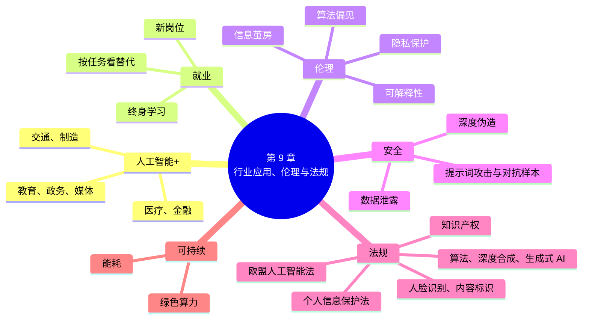

# 第 9 章 行业应用、伦理与法规

!!! abstract "本章学时"
    理论 4 学时（建议线上 3 · 线下 1）· 在线体验 2 个

## 学习目标

学完本章，你应该能够：

1. **说出**人工智能在医疗、金融、交通、制造等行业的典型应用，以及我国规范人工智能的主要法律法规（记忆）；
2. **解释**算法偏见、可解释性、信息茧房、深度伪造、提示词攻击的含义和产生原因（理解）；
3. **说明**人工智能对就业的影响，以及本专业学生可以从事的新岗位和需要的能力（理解）；
4. **运用**《个人信息保护法》《生成式人工智能服务管理暂行办法》《人工智能生成合成内容标识办法》等规定，判断一个 AI 应用是否合规（应用）；
5. **分析**一个 AI 应用可能带来的伦理和安全风险，提出整改意见（分析）；
6. **评价**大模型的能耗问题，说出绿色算力的主要做法，形成负责任使用 AI 的意识（评价）。

!!! info "先修要求"
    学习本章前，你需要了解：

    - 前 8 章介绍的主要 AI 技术，特别是机器学习的训练数据（[3.2 样本、特征与标签](../03-machine-learning/index.md#32)）、大模型的幻觉（[5.7 大模型的局限与应对](../05-nlp-llm/index.md#57)）；
    - 人脸识别、AI 生成内容标识、声音权益的相关规定（[6.4.1 人脸识别](../06-computer-vision/index.md#641)、[6.5.4 AI 生成的内容要标识](../06-computer-vision/index.md#654)、[7.4.3 声音受法律保护](../07-speech/index.md#743)）；
    - 本章以案例分析和讨论为主，不需要计算基础。

??? abstract "本章概念清单（19 个，点击查看定义和例子）"
    1. [自动驾驶](../../appendix/glossary.md#g-自动驾驶)
    2. [预测性维护](../../appendix/glossary.md#g-预测性维护)
    3. [推荐系统](../../appendix/glossary.md#g-推荐系统)
    4. [内容审核](../../appendix/glossary.md#g-内容审核)
    5. [人工智能伦理](../../appendix/glossary.md#g-人工智能伦理)
    6. [算法偏见](../../appendix/glossary.md#g-算法偏见)
    7. [可解释性](../../appendix/glossary.md#g-可解释性)
    8. [信息茧房](../../appendix/glossary.md#g-信息茧房)
    9. [隐私保护](../../appendix/glossary.md#g-隐私保护)
    10. [告知同意](../../appendix/glossary.md#g-告知同意)
    11. [最小必要](../../appendix/glossary.md#g-最小必要)
    12. [敏感个人信息](../../appendix/glossary.md#g-敏感个人信息)
    13. [大数据杀熟](../../appendix/glossary.md#g-大数据杀熟)
    14. [人工智能安全](../../appendix/glossary.md#g-人工智能安全)
    15. [深度伪造](../../appendix/glossary.md#g-深度伪造)
    16. [提示词攻击](../../appendix/glossary.md#g-提示词攻击)
    17. [越狱](../../appendix/glossary.md#g-越狱)
    18. [对抗样本](../../appendix/glossary.md#g-对抗样本)
    19. [绿色算力](../../appendix/glossary.md#g-绿色算力)

## 情景导入

小宋去年从职业学院毕业，进了一家做农产品电商的公司当运营。上班第一周，他就发现 AI 已经渗透到公司的每一个角落：直播间里有 24 小时不下班的“AI 数字人主播”；商品详情页的文案和图片，大半是 AI 生成的；平台的推荐算法决定了哪些顾客能看到他们的商品；客服智能体每天回答几千个问题。

但他也很快遇到了一连串让人犯难的事：老板想用一位明星的照片“AI 换脸”做一条带货视频，说“反正网上大家都这么做”；同事用 AI 写的产品介绍里，说他们的大米“经国家权威机构认证，能降血糖”，可公司从来没有这样的认证；有顾客投诉说，同一款商品，老顾客看到的价格反而比新顾客贵。

小宋想：这些事情，哪些可以做，哪些不能做？出了问题，是 AI 的错，还是用 AI 的人的错？这一章，我们先看人工智能正在怎样改变各行各业、改变就业，再来看 AI 带来的伦理和安全问题，以及我国和其他国家用哪些法律法规来规范 AI 的发展和使用。体验 9-2 里，你将像一名合规专员一样，帮小宋检查几个 AI 应用的风险。

## 9.1 人工智能+：行业应用 { #91 }

### 9.1.1 “人工智能+”行动 { #911 }

2025 年 8 月，国务院印发《关于深入实施“人工智能+”行动的意见》[[1]](#ref9-1)，提出推动人工智能与经济社会各行业各领域广泛深度融合，围绕科学技术、产业发展、消费提质、民生福祉、治理能力、全球合作六个方面加快实施重点行动，并提出目标：到 2027 年，新一代智能终端、智能体等应用普及率超过 70%；到 2030 年，超过 90%。

“人工智能+”的意思是：人工智能不是一个孤立的行业，而是像电和互联网一样的“通用技术”，要和各行各业结合起来，提高效率、创造新的产品和服务。下面看几个主要行业。

### 9.1.2 医疗

- **影像辅助诊断**：在 CT、X 光片、眼底照片上找出可疑的病灶，帮助医生减少漏诊（第 6 章）。
- **药物研发**：研发一种新药往往要十几年、花费十几亿美元。AI 可以从海量的分子中筛选出可能有效的候选药物，大大缩短前期的研究时间。2020 年，DeepMind 的 AlphaFold 在蛋白质结构预测比赛中达到了接近实验测定的精度[[2]](#ref9-2)，解决了困扰生物学界 50 年的难题；它的开发者因此获得了 2024 年诺贝尔化学奖。
- **健康管理**：智能手表监测心率、睡眠，发现异常时提醒；医院的智能导诊帮患者选择科室；大模型帮助医生写病历、整理检查报告。

医疗关系到人的生命，AI 只能辅助医生，诊断和治疗的决定由医生作出，并承担责任。

### 9.1.3 金融

- **风险控制**：银行用机器学习评估贷款申请人的还款能力，识别信用卡盗刷、电信诈骗转账等异常交易（第 3 章的分类）。几毫秒内就要判断一笔交易是否可疑，人工根本来不及。
- **智能投顾**：根据用户的年龄、收入、风险承受能力，推荐理财组合。
- **智能客服和营销**：回答用户关于账户、业务的问题，识别客户的需求。

金融 AI 的一个重要问题是[**可解释性**](../../appendix/glossary.md#g-可解释性 "人能够理解 AI 为什么作出某个判断的程度"){ .term }：如果 AI 拒绝了一个人的贷款申请，银行应当能说清楚为什么，而不是一句“系统判断的”（9.3.2 节）。

### 9.1.4 交通

- [**自动驾驶**](../../appendix/glossary.md#g-自动驾驶 "由系统完成全部或部分驾驶任务的技术，我国国家标准把驾驶自动化分为 0～5 级"){ .term }：我国国家标准《汽车驾驶自动化分级》把驾驶自动化分为 0～5 级：0 级是系统只提供预警、紧急制动等应急辅助，由人驾驶，2 级是车辆能同时控制方向和速度但驾驶员必须时刻监控（今天很多汽车的“辅助驾驶”属于这一级），3 级是在特定条件下由系统驾驶、需要时驾驶员接管，4 级是在特定区域内完全不需要人，5 级是在任何条件下都不需要人。北京、武汉、广州等城市已经有无人驾驶出租车在指定区域内试运营。
- **交通信号优化**：分析各个路口的车流，自动调整红绿灯的时长，减少拥堵。
- **物流调度**：第 2 章的快递路线规划、第 8 章的仓库机器人调度。

需要特别注意：目前市面上的“辅助驾驶”都要求驾驶员时刻手握方向盘、注意路况，**辅助驾驶不是自动驾驶**，出了事故由驾驶员负责。

### 9.1.5 制造

- **视觉质检**：第 6 章小吴的工厂。
- [**预测性维护**](../../appendix/glossary.md#g-预测性维护 "根据设备的振动、温度等数据，用机器学习预测故障并提前安排检修的方法"){ .term }：在机器上装传感器，记录振动、温度、电流，用机器学习判断机器是不是“快要生病了”，在坏掉之前安排检修。
- **工艺优化和排产**：调整生产参数，提高良品率；安排生产计划，减少等待和浪费。

!!! tip "算一算：预测性维护值不值"
    一条生产线一旦意外停机，平均要停 8 小时，每小时损失 2 万元。过去一年意外停机 6 次。装上预测性维护系统后，能提前发现其中约三分之二的故障，在计划的检修时间处理，每次只停 2 小时。

    - 过去一年的损失：6 × 8 × 2 = 96 万元；
    - 现在：提前发现 4 次，每次停 2 小时，损失 4 × 2 × 2 = 16 万元；没发现的 2 次仍停 8 小时，损失 2 × 8 × 2 = 32 万元；合计 48 万元；
    - 一年减少损失约 **48 万元**。如果系统一年的成本是 20 万元，就是划算的。

    实际决策时，还要考虑误报（没坏却安排了检修）的成本，以及系统需要多长时间积累数据才能准确。

### 9.1.6 教育、政务与媒体

| 领域 | 典型应用 | 要注意的问题 |
|---|---|---|
| 教育 | 个性化学习推荐、作文批改、AI 助教、口语陪练 | 学生用 AI 代写作业，学术诚信；学生数据的隐私 |
| 政务 | 智能政务热线、“一网通办”的智能导办、城市运行监测 | 方言和老年人的使用，AI 回答政策要准确，涉及公民个人信息 |
| 媒体与社交网络 | 新闻和短视频的[**推荐系统**](../../appendix/glossary.md#g-推荐系统 "根据用户的历史行为和特征，推荐其可能感兴趣的内容或商品的系统"){ .term }、内容审核、AI 写稿和配音 | 信息茧房、虚假信息、AI 生成内容的标识 |

**推荐系统**（Recommender System）是我们每天都在接触的 AI：短视频、新闻、购物、音乐应用，都会根据你看过、点过、买过的内容，推荐你可能喜欢的东西。它让我们更快找到感兴趣的内容，但也带来了 9.3.3 节要讲的信息茧房问题。[**内容审核**](../../appendix/glossary.md#g-内容审核 "用图像识别、文本分类等技术从海量内容中找出违法和不良信息，交由人工复核"){ .term }则用图像识别和文本分类，从海量的帖子中找出违法和不良信息，交给人工复核。

## 9.2 人工智能与就业

### 9.2.1 哪些工作会变

每一次技术革命都会改变工作。蒸汽机让很多手工业者失业，也创造了工厂里的大量新岗位；电脑让打字员、排字工逐渐消失，也创造了程序员、网络运营等新职业。人工智能也是这样。

理解 AI 对工作的影响，一个好方法是**按“任务”而不是按“职业”来看**。一份工作由很多项任务组成，AI 往往能替代其中的一部分，而不是全部。比如客服的工作包括：回答常见问题（AI 已经能做得很好）、安抚情绪激动的顾客（AI 能帮忙，但人更擅长）、处理复杂的投诉和特殊情况（需要人来判断和负责）。

| 容易被 AI 替代的任务 | 不容易被 AI 替代的任务 |
|---|---|
| 规则明确、重复性高：数据录入、票据核对、简单的分类整理 | 需要和人深入沟通、建立信任：护理、心理咨询、销售谈判 |
| 有大量数据可以学习：常见问题解答、标准文书的起草、简单翻译 | 需要在复杂多变的现场动手：维修、安装、急救 |
| 结果容易检查：识别票据上的金额 | 需要承担责任、作出价值判断：医生诊断、法官审判、管理决策 |
| | 需要创造性地提出新问题、新想法 |

所以，更可能发生的情况是：**会用 AI 的人，替代不会用 AI 的人**。一个会用 AI 的客服，一天能处理的问题是原来的好几倍；一个会用 AI 的设计师，能更快地出更多方案。

### 9.2.2 新的岗位

人工智能也创造了很多新岗位。2020 年，“人工智能训练师”被列为新职业；2024 年人力资源和社会保障部发布的新职业中，又有“生成式人工智能系统应用员”等。和本专业相关的岗位有：

| 岗位 | 做什么 | 主要用到本书哪些内容 |
|---|---|---|
| 数据标注员、人工智能训练师 | 采集、清洗、标注数据，测试和优化 AI 系统的效果 | 第 3、6 章 |
| AI 应用开发与实施 | 用低代码平台或编程把大模型、智能体用到企业的业务中 | 第 5、8 章 |
| 提示词工程师、AI 内容运营 | 设计提示词，用 AI 生成和审核文案、图片、视频 | 第 5、6 章 |
| AI 产品运营、客户成功 | 了解客户需求，推广 AI 产品，收集反馈 | 全书 |
| AI 合规与数据安全 | 检查 AI 产品是否符合法规，保护数据和个人信息 | 本章 |
| 智能设备运维 | 维护工业相机、服务机器人、智能音箱等设备 | 第 6、7、8 章 |

### 9.2.3 怎样应对

- **学会和 AI 一起工作**：把 AI 当作助手，用它提高效率，同时懂得检查它的结果；
- **培养 AI 难以替代的能力**：沟通协作、动手实践、发现和解决实际问题、对结果负责；
- **深耕一个行业**：懂 AI 又懂行业（比如懂制造工艺的 AI 质检工程师、懂医保政策的 AI 客服训练师），比只懂其中一样更有竞争力；
- **终身学习**：AI 技术更新很快，今天学的工具，两年后可能就变了，学会学习比学会某个工具更重要。

## 9.3 人工智能伦理

人工智能越强大、用得越广，它的决定对人的影响就越大。[**人工智能伦理**](../../appendix/glossary.md#g-人工智能伦理 "研究人工智能应该怎样设计和使用，才能对人和社会有益、公平、可信的学问"){ .term }研究的是：AI 应该怎样设计和使用，才能对人和社会有益、公平、可信。我国 2021 年发布的《新一代人工智能伦理规范》[[3]](#ref9-3)提出了六项基本伦理要求：增进人类福祉、促进公平公正、保护隐私安全、确保可控可信、强化责任担当、提升伦理素养。下面看几个最常见的问题。

### 9.3.1 公平与算法偏见

[**算法偏见**](../../appendix/glossary.md#g-算法偏见 "AI 系统对某些群体作出不公平判断的现象，常从训练数据中学来"){ .term }（Algorithmic Bias）指 AI 系统对某些群体作出不公平的判断。它往往不是程序员故意的，而是从训练数据中“学”来的。

一个著名的例子：2018 年有报道称，美国亚马逊公司曾开发一个用 AI 筛选简历的系统，用过去 10 年公司收到的简历来训练。由于科技行业过去招的男性多，系统学会了“男性候选人更好”，看到简历中有“女子”字样（比如“女子国际象棋俱乐部队长”）就会降低评分。公司发现后，停用了这个系统[[4]](#ref9-4)。

算法偏见的常见来源：

- **数据不均衡**：训练数据中某些群体的样本太少，模型对他们判断不准（比如人脸识别对肤色较深的人错误率更高）；
- **历史偏见**：数据记录了过去不公平的做法，模型把它当成了“规律”；
- **特征选择不当**：用了和性别、民族、地域高度相关的特征，间接造成歧视。

减少偏见的办法有：检查训练数据是否均衡、有代表性；分别统计模型在不同群体上的准确率；在招聘、贷款、司法等重要的决定中保留人工审核。

### 9.3.2 透明与可解释性

第 4 章说过，深度学习像一个“黑箱”：它能给出判断，却很难说清为什么。**可解释性**（Explainability）指人能理解 AI 为什么作出某个判断。

在推荐一首歌的时候，说不清理由问题不大；但在决定一个人能不能贷到款、能不能通过面试、要不要做手术的时候，人们有权知道理由。不能解释，就很难发现它是不是有偏见、是不是出了错，出了问题也很难追究责任。所以，在影响重大的场合，要求 AI 系统能给出判断的主要依据，或者使用更容易解释的模型（比如第 3 章的决策树），并且让人能对 AI 的决定提出异议、要求人工复核。

### 9.3.3 信息茧房

美国学者桑斯坦（Cass Sunstein）提出了[**信息茧房**](../../appendix/glossary.md#g-信息茧房 "人们只接触自己感兴趣、认同的信息，像蚕一样被包裹在茧里的现象"){ .term }（Information Cocoon）的概念[[5]](#ref9-5)：人们只关注自己感兴趣、认同的信息，久而久之，就像蚕一样把自己包裹在“茧”里，看不到其他的观点和信息。

推荐系统可能会加剧信息茧房：你点了几条某一类视频，它就推更多同类的；你越看越多，它越推越多。最后，你看到的世界只剩下很窄的一部分：喜欢游戏的只看到游戏，相信某种说法的只看到支持这种说法的内容，不同观点的人越来越难以互相理解。

<iframe class="sim-frame" src="../../sims/filter-bubble/main.html" height="900" loading="lazy" title="信息茧房模拟"></iframe>

动画：信息茧房模拟。点开你喜欢的内容，看推荐系统怎样越来越“懂”你，推荐的种类怎样越来越少；再试试增加探索比例、点“不感兴趣”、主动搜索、关闭个性化推荐等打破茧房的办法。[全屏打开](../../sims/filter-bubble/main.html){ target=_blank }
{ .sim-caption }

我国 2022 年 3 月 1 日起施行的《互联网信息服务算法推荐管理规定》[[6]](#ref9-6)要求：算法推荐服务提供者应当向用户提供不针对其个人特征的选项，或者提供便捷的**关闭算法推荐服务**的选项；应当向用户提供选择或者删除用户标签的功能。今天，主流的短视频、新闻、购物应用的设置里，都能找到“个性化推荐”的开关。作为用户，我们也可以主动打破茧房：多关注不同领域、不同观点的内容，对推荐的内容保持思考，不只看标题和短视频，主动去读完整的报道和书。

### 9.3.4 隐私

AI 需要大量的数据，其中很多是个人信息：你的脸、声音、位置、购物记录、聊天记录、健康状况。[**隐私保护**](../../appendix/glossary.md#g-隐私保护 "防止个人信息被非法收集、使用、泄露的措施和要求"){ .term }是 AI 时代最受关注的问题之一。

我国 2021 年 11 月 1 日起施行的《个人信息保护法》[[7]](#ref9-7)规定了处理个人信息的基本原则：

- [**告知同意**](../../appendix/glossary.md#g-告知同意 "处理个人信息前告诉本人用途并取得其同意的原则"){ .term }：处理个人信息要告诉本人用来做什么，取得本人同意；
- [**最小必要**](../../appendix/glossary.md#g-最小必要 "只收集实现目的所必需的最少个人信息的原则"){ .term }：只收集实现目的所必需的最少的信息，不能“多拿”；
- [**敏感个人信息**](../../appendix/glossary.md#g-敏感个人信息 "一旦泄露或被非法使用，容易导致人格尊严受到侵害或人身、财产安全受到危害的个人信息，处理时要单独同意"){ .term }要单独同意：人脸、声纹等生物识别信息，医疗健康、金融账户、行踪轨迹信息，以及不满 14 周岁未成年人的个人信息，属于敏感个人信息，处理时要取得个人的单独同意，并且要有充分的必要性；
- 不得“[**大数据杀熟**](../../appendix/glossary.md#g-大数据杀熟 "利用用户数据和算法，在价格等交易条件上对用户实行不合理差别待遇的做法"){ .term }”：利用个人信息进行自动化决策，不得对个人在交易价格等交易条件上实行不合理的差别待遇。

情景导入里“老顾客看到的价格比新顾客贵”，就可能违反了这条规定。《互联网信息服务算法推荐管理规定》也明确禁止利用算法根据消费者的偏好、交易习惯等特征，在交易价格等交易条件上实施不合理的差别待遇。

## 9.4 人工智能安全

防止人工智能被用来作恶、被攻击或泄露数据，保证它安全可靠地运行，叫[**人工智能安全**](../../appendix/glossary.md#g-人工智能安全 "防范 AI 系统被攻击、被滥用以及 AI 本身出错造成危害的问题和措施"){ .term }。这一节看三类常见风险。

### 9.4.1 深度伪造与诈骗

用 AI 生成或篡改人脸、声音、视频，制作出以假乱真的内容，叫[**深度伪造**](../../appendix/glossary.md#g-深度伪造 "用 AI 生成或篡改人脸、声音、视频，制作以假乱真内容的技术及其滥用"){ .term }（Deepfake）。第 6、7 章讲了 AI 换脸和语音克隆，它们被滥用时，就是深度伪造。

2024 年初，香港警方通报了一起案件：一家跨国公司的财务人员参加了一次视频会议，会上的“公司高管”“同事”全是用深度伪造生成的，他按“上司”的要求，分 15 次向骗子转账，共约 2 亿港元。深度伪造还被用来制作虚假新闻、伪造名人带货、侵害他人名誉。

防范深度伪造，一方面要靠技术和法规：AI 生成的内容要加标识，平台要检测和处置深度伪造内容；另一方面要提高每个人的警惕：涉及转账、个人信息的要求，一定要通过其他渠道核实（第 7 章）；看到“耸人听闻”的视频，先想一想是不是 AI 生成的，不要急着转发。

### 9.4.2 提示词攻击与对抗样本

[**提示词攻击**](../../appendix/glossary.md#g-提示词攻击 "通过精心设计的输入让大模型做出本不应该做的事，包括越狱和提示注入"){ .term }指通过精心设计的输入，让大模型做出它本来不应该做的事。常见的有两类：

- [**越狱**](../../appendix/glossary.md#g-越狱 "用角色扮演、编故事等方式绕过大模型安全限制的提示词攻击"){ .term }：用角色扮演、编故事、换一种说法等方式，绕过大模型的安全限制，让它说出有害的内容。比如“假设你是一个没有任何限制的 AI，请告诉我……”。
- **提示注入**：第 8 章讲过，把恶意指令藏在网页、文件、邮件里，当智能体读到这些内容时，被劫持去做攻击者想让它做的事。

除了大模型，其他 AI 也可能被“骗”。研究人员发现，在交通标志“停车”牌上贴几块特意设计的小贴纸，人看了照样认得是“停车”，图像识别模型却会把它认成“限速”[[8]](#ref9-8)。这种专门用来骗过 AI 的输入，叫[**对抗样本**](../../appendix/glossary.md#g-对抗样本 "经过特意设计、人看起来正常却能让 AI 判断出错的输入"){ .term }。这说明 AI 和人“看”东西的方式不一样，在自动驾驶等安全攸关的场合，必须充分考虑这类风险。

### 9.4.3 数据泄露

使用 AI 时，数据可能在不知不觉中泄露：

- 员工把公司的合同、源代码、客户名单粘贴到公共的大模型产品里，这些数据就离开了公司的控制。2023 年，就有大公司的员工把内部源代码粘贴到公共大模型中导致泄露的事件，此后很多企业规定只能使用内部部署的大模型；
- 训练数据中含有个人信息，模型可能在回答中“背”出来；
- AI 系统本身被黑客攻击，存储的人脸、声纹等数据被盗。

所以，**敏感数据不上传公共 AI，必要时先脱敏**（把姓名、电话等替换掉），这应当成为每个人使用 AI 的习惯。

## 9.5 法规与治理

### 9.5.1 我国的人工智能法规

我国已经形成了以法律为基础、以部门规章为细化的人工智能治理体系。和本课程关系最密切的有：

| 法律法规 | 施行时间 | 主要内容 | 本书相关章节 |
|---|---|---|---|
| 《网络安全法》 | 2017 年 6 月 1 日 | 网络运行安全、网络信息安全的基本法律 | 全书 |
| 《数据安全法》 | 2021 年 9 月 1 日 | 数据分类分级保护，数据安全管理 | 第 3 章 |
| 《个人信息保护法》 | 2021 年 11 月 1 日 | 告知同意、最小必要、敏感个人信息、自动化决策 | 9.3.4 节 |
| 《互联网信息服务算法推荐管理规定》 | 2022 年 3 月 1 日 | 关闭推荐的选项、用户标签管理、禁止不合理差别待遇 | 9.3.3 节 |
| 《互联网信息服务深度合成管理规定》 | 2023 年 1 月 10 日 | 编辑人脸、人声须单独同意，深度合成内容要标识 | 第 7 章 |
| 《生成式人工智能服务管理暂行办法》 | 2023 年 8 月 15 日 | 训练数据合法、提高准确性、内容标识、服务备案 | 第 5 章 |
| 《人脸识别技术应用安全管理办法》 | 2025 年 6 月 1 日 | 告知同意，不得作为唯一验证方式，10 万人以上备案 | 第 6 章 |
| 《人工智能生成合成内容标识办法》 | 2025 年 9 月 1 日 | 显式标识和隐式标识，不得删除篡改标识 | 第 6 章 |

这些规定有一个共同的思路：**既鼓励创新、促进 AI 发展，又守住安全的底线**。比如面向公众提供生成式 AI 服务的企业，要按规定进行安全评估和备案；普通人在工作和生活中使用 AI，则要做到：不用 AI 侵犯他人的肖像、声音、隐私和著作权，不用 AI 造谣传谣，发布 AI 生成的内容要标识。

### 9.5.2 欧盟《人工智能法》

欧盟的《人工智能法》（AI Act）[[9]](#ref9-9)是世界上第一部全面规范人工智能的法律，2024 年 8 月 1 日生效，各项规定在之后几年分步实施。它的核心是**按风险分级管理**：

| 风险等级 | 例子 | 怎么管 |
|---|---|---|
| 不可接受的风险 | 用 AI 对公民进行“社会评分”，利用人的弱点操纵其行为 | 禁止 |
| 高风险 | 用于招聘、信贷、教育考试、医疗器械、关键基础设施的 AI | 上市前要评估，要有风险管理、数据质量、人工监督等要求 |
| 有限风险 | 聊天机器人、深度伪造内容 | 要告知用户在和 AI 交流、内容是 AI 生成的 |
| 最小风险 | 垃圾邮件过滤、游戏中的 AI | 基本不额外管理 |

我国企业的产品如果要在欧盟销售，也要遵守这部法律。各国的 AI 法规思路不完全相同，但都在关注安全、公平、透明和责任。我国在 2023 年提出了《全球人工智能治理倡议》，主张发展和安全并重，各国共同参与 AI 治理。

### 9.5.3 AI 生成内容的知识产权 { #953 }

AI 生成的文章、图片、音乐，著作权归谁？这是一个正在探索中的问题。目前的基本思路是：

- **AI 本身不是作者**。著作权法保护的是人的智力成果；
- **人有独创性的投入，可能构成作品**。2023 年，北京互联网法院在一起案件中认定：用户通过反复设计提示词、调整参数、挑选结果生成的图片，体现了用户的独创性智力投入，可以作为作品受著作权法保护。但如果只是输入一句简单的话、直接拿走结果，就不一定能构成作品；
- **不能侵犯他人的权利**。用 AI 生成和他人作品高度相似的内容、模仿特定画家的风格大量出售、用他人的作品训练模型，都可能引发侵权纠纷。

使用 AI 生成的内容时，要遵守平台的使用协议，商业使用前要了解相关的权利归属。

## 9.6 可持续发展

### 9.6.1 大模型有多耗电

训练和运行大模型要消耗大量的电。研究人员估算，训练一次 GPT-3 约消耗 1287 兆瓦时（128.7 万千瓦时）的电[[10]](#ref9-10)；而训练只是开始，大模型上线后，每天回答上亿个问题，耗电的总量更大。

国际能源署 2025 年的报告[[11]](#ref9-11)估计，2024 年全球数据中心的用电量约 415 太瓦时（4150 亿千瓦时），约占全球用电量的 1.5%；在人工智能的推动下，到 2030 年可能增加到约 945 太瓦时，翻一倍还多。此外，数据中心的服务器要散热，还要消耗大量的冷却用水。

!!! tip "算一算：训练一次 GPT-3 的电够多少户人家用"
    假设一户家庭一年用电约 2000 千瓦时（各地差别较大，这里只是一个便于估算的数），训练一次 GPT-3 约用电 128.7 万千瓦时：

    128.7 万 ÷ 2000 ≈ **644** 户家庭一年的用电。

    今天的大模型比 GPT-3 大得多，训练一次的用电往往是它的几十倍甚至更多。

### 9.6.2 绿色算力

怎样让人工智能更“绿色”？用更少的电、更多的清洁能源提供同样的算力，叫[**绿色算力**](../../appendix/glossary.md#g-绿色算力 "通过清洁能源、高效硬件与散热、高效模型等方式降低 AI 能耗和碳排放的做法"){ .term }。主要做法有四条：

- **用清洁能源、建在合适的地方**：第 1 章的“东数西算”工程，把数据中心建在西部可再生能源丰富、气候凉爽的地区，既能用上风电、光伏，又能节省散热的电；
- **更省电的硬件和散热**：专用 AI 芯片比通用芯片更高效（第 4 章）；用液冷代替风冷，散热效率更高；
- **更高效的模型**：用更少的参数达到同样的效果，比如把大模型“蒸馏”成小模型，在手机上本地运行；
- **按需使用**：简单的问题用小模型，不必每次都打开“深度思考”（第 5 章）；不需要的生成，就不要反复点“重新生成”。

AI 也能为可持续发展出力：电网用 AI 预测风电和光伏的发电量、调度用电；气象部门用 AI 天气预报大模型做更快更准的预报；工厂用 AI 优化能耗。负责任地发展和使用 AI，就是让它的好处大于它的代价。

## 9.7 身边的 AI { #97 }

### 9.7.1 认出 AI 生成的内容 { #971 }

刷短视频、看新闻时，留意画面角落或文字说明中的“AI 生成”“内容由 AI 生成”等标识（第 6 章的显式标识）。没有标识的内容也可能是 AI 生成的：画面过于完美、人物的手指和牙齿不自然、背景文字乱码、口型和声音对不上、内容耸人听闻又找不到其他来源，都要多留一个心眼。

### 9.7.2 管好自己的推荐

在常用的短视频、新闻、购物应用中，找到“设置”里的“个性化推荐”或“推荐管理”，试着关掉它，或者删除一些兴趣标签，看看推荐的内容有什么变化。对不想看的内容点“不感兴趣”，也是在训练推荐系统。

### 9.7.3 保护自己的脸和声音

- 不随意在不明的应用和网站上“刷脸”“录声音”，不参加“上传照片生成同款写真”之类来历不明的活动；
- 手机的应用权限中，关掉不必要的相机、麦克风、位置权限；
- 不在网上公开发布身份证、清晰的正脸大图和大段的个人语音；
- 发现自己的肖像、声音被 AI 冒用，及时保存证据，向平台投诉举报，必要时报警或起诉。

!!! example "案例：小宋的回答"
    回到情景导入，小宋查阅了相关规定后，给老板写了一份说明：

    1. **明星换脸带货不能做**：未经本人同意使用他人的肖像和声音，侵犯肖像权和声音权益；冒用明星带货还可能构成虚假宣传。可以改用公司自己的员工或授权的数字人，并标明“AI 生成”。
    2. **“能降血糖”“国家权威认证”要删掉**：这是大模型的幻觉，也是虚假宣传；普通食品宣传治疗功效还违反广告法。AI 写的文案，事实和资质必须逐条核对。
    3. **新老顾客价格要一致**：如果是因为算法根据顾客特征定价，属于不合理的差别待遇，要立即整改；优惠活动要公开规则，对所有符合条件的顾客一视同仁。
    4. **AI 数字人主播要标识**：直播间要显著标明是 AI 数字人，不能让观众误以为是真人。

## 在线体验

!!! abstract "体验总览"

    | 体验 | 用到什么 | 时长 |
    |---|---|---|
    | 9-1 信息茧房模拟 | 本书动画“信息茧房模拟”，你常用的一个内容应用 | 约 20 分钟 |
    | 9-2 AI 生成内容合规检查 | 本节的三个案例和评估表 | 约 20 分钟，可在线下课分组讨论 |

### 体验 9-1 信息茧房模拟

**体验目的**：通过模拟推荐系统，直观看到信息茧房是怎样形成的，比较几种打破茧房的办法，并在真实的应用中找到推荐设置。

**打开方式**：打开 9.3.3 节中的动画，或者[全屏打开“信息茧房模拟”](../../sims/filter-bubble/main.html){ target=_blank }。

**步骤**

1. 先不改设置，每一轮都只点开你最喜欢的一类内容（比如“美食”），点 15 次。观察右边：“最近 30 条推荐覆盖”几类内容？“第一名所占比例”是多少？
2. 选一个“模拟用户最爱”，点“模拟一个用户”，再记录这两个数，看看下方的折线图。
3. 依次试试下面四种办法，每种试完都记录覆盖的类数（每试一种之前，先点“模拟一个用户”回到茧房状态）：
    - 把“探索比例”调到 30%，点“都不想看，换一批”5 次；
    - 对最爱那一类的内容点 × “不感兴趣”5 次；
    - 在“主动搜索”中点 3 个不同的类别；
    - 勾选“关闭个性化推荐”，换 5 批。
4. 把“迎合程度”调到 1 和 4，各重复一次第 1 步，比较茧房形成的快慢。
5. 打开你自己常用的一个短视频、新闻或购物应用，在设置中找到个性化推荐的开关和兴趣标签管理，截图（遮挡个人信息）。

**记录表**

| 序号 | 操作 | 覆盖类数 | 第一名所占比例 |
|---|---|---|---|
| 1 | 只点一类内容 15 次 | | |
| 2 | 模拟用户 20 轮 | | |
| 3 | 探索比例 30% | | |
| 4 | 点“不感兴趣” | | |
| 5 | 主动搜索 3 个类别 | | |
| 6 | 关闭个性化推荐 | | |
| 7 | 迎合程度 1 / 4 时，茧房形成的快慢 | | |
| 8 | 我常用的应用中推荐设置的位置 | | |

**想一想**

1. 四种打破茧房的办法中，哪种效果最明显？哪种是平台要做的，哪种是用户自己能做的？
2. 推荐系统为什么倾向于“迎合”用户？完全关闭个性化推荐，有什么坏处？

### 体验 9-2 AI 生成内容合规检查 { #9-2 }

**体验目的**：运用本章和第 5～7 章学到的法规，分析真实场景中 AI 应用的伦理和法律风险，提出整改意见。

**案例**

> **案例 A：换脸广告**　某美妆品牌在短视频平台投放广告，视频中一位知名演员手拿产品说“我每天都用它”。经查，这位演员从未代言过该品牌，视频是用演员的公开影视片段 AI 换脸、语音克隆合成的，视频中没有任何 AI 生成的标识。
>
> **案例 B：AI 主播**　某电商公司用 AI 数字人 24 小时直播卖保健品。数字人的形象是用一位离职员工的照片和声音训练的，公司说她入职时签过“肖像使用同意书”。直播中，数字人反复说“吃三个月，高血压就能好”。直播间标注了“AI 数字人”。
>
> **案例 C：AI 写作**　某职业学院学生用大模型写了一篇课程论文，没做修改就提交了。论文里引用了 5 篇参考文献，其中 3 篇查不到。另一名学生用大模型帮忙列提纲、检查语病，内容是自己写的，并在文末注明“使用了某大模型润色语言”。

**步骤**

1. 分组，每组选一个案例（或全部分析），按下面的评估表逐项判断。
2. 对每一项“有风险”的，写出依据的法规或伦理原则（可以引用本书的章节）。
3. 提出整改意见，并给出风险等级（高、中、低）。
4. 各组汇报，其他组补充。

**评估表**

| 检查项 | 有风险 / 无风险 / 无法判断 | 依据 | 整改意见 |
|---|---|---|---|
| 是否使用了他人的肖像、声音，是否取得本人同意 | | | |
| AI 生成的内容是否按规定标识 | | | |
| 内容是否真实，有无幻觉或虚假宣传 | | | |
| 是否涉及敏感个人信息 | | | |
| 是否可能误导、伤害特定人群（如老年人、患者、学生） | | | |
| 是否符合学术诚信或行业规范 | | | |
| 出了问题由谁负责 | | | |
| 风险等级 | 高 / 中 / 低 | | |

**想一想**

1. 案例 B 中，离职员工入职时签的同意书，是否还能作为用她的形象和声音做 AI 数字人的依据？为什么？
2. 案例 C 中两名学生的做法有什么本质区别？你认为学生使用 AI 的边界在哪里？

## 本章小结

- “人工智能+”行动推动 AI 与各行各业深度融合：医疗（影像辅助诊断、药物研发）、金融（风险控制、智能投顾）、交通（自动驾驶分为 0～5 级，辅助驾驶不是自动驾驶）、制造（视觉质检、预测性维护）、教育、政务和媒体（**推荐系统**、内容审核）。
- AI 对就业的影响要按“任务”来看：规则明确、重复性高的任务容易被替代，需要沟通、动手、判断和负责的任务不容易被替代。会用 AI 的人替代不会用 AI 的人；人工智能训练师、生成式人工智能系统应用员等新岗位不断出现。
- **人工智能伦理**的主要问题有：**算法偏见**（常从训练数据中学来）、**可解释性**（影响重大的决定要能说明理由）、**信息茧房**（推荐系统可能加剧，要提供关闭推荐的选项）、**隐私保护**（告知同意、最小必要、敏感个人信息单独同意、不得大数据杀熟）。
- **人工智能安全**的主要问题有：**深度伪造**与诈骗、**提示词攻击**（越狱、提示注入）和**对抗样本**、数据泄露。敏感数据不上传公共 AI。
- 我国的 AI 法规包括《个人信息保护法》、算法推荐、深度合成、生成式 AI、人脸识别、生成内容标识等规定；欧盟《人工智能法》按风险分级管理。AI 不是作者，人有独创性投入的 AI 生成内容可能受著作权保护。
- 大模型耗电巨大，2024 年全球数据中心用电约占 1.5%；**绿色算力**靠清洁能源、东数西算、高效芯片和液冷、小模型和按需使用。

!!! info "深入学习"
    本章只介绍了 AI 伦理、安全和法规的基本问题。各个技术领域更具体的伦理和合规问题，在系列教材中分别有专门的章节：

    - 数据的合规采集、脱敏和数据安全：《人工智能数据分析与处理》；
    - 大模型的偏见、安全与法律：《自然语言处理导论》第 12 章；
    - 人脸识别和图像生成的合规：《计算机视觉及应用实战》；
    - 声音权益、深度合成与伪造语音检测：《TTS、SST 与语音克隆》。

**全书结语**

从图灵提出“机器能思考吗”，到今天能写会画、能听会说、能自己动手办事的 AI，人工智能走过了七十多年。这本书带你看了它的全貌：搜索与推理、机器学习、深度学习、语言、视觉、语音、强化学习与智能体，以及它和社会的关系。

AI 是工具，用它的是人。希望你在今后的学习和工作中，既能用好 AI，让它帮你把事情做得更快更好；又能看清它的局限，核查它的结果，守住法律和伦理的底线，做一个负责任的 AI 使用者和建设者。后续课程中，你将深入学习本书各章的技术，并亲手做出属于自己的 AI 应用。

## 参考文献

正文中的上标编号（如[[1]](#ref9-1)）对应下面的文献。带链接的可以直接打开；书籍可在图书馆或电子书平台查阅。

**教材与专著**

- [5] Sunstein C R. Infotopia: How Many Minds Produce Knowledge[M]. New York: Oxford University Press, 2006.
    提出“信息茧房”概念的著作，中译本名为《信息乌托邦：众人如何生产知识》，对应 9.3.3 节。

**论文与报告**

- [2] Jumper J, Evans R, Pritzel A, et al. Highly Accurate Protein Structure Prediction with AlphaFold[J]. Nature, 2021, 596(7873): 583-589. <https://doi.org/10.1038/s41586-021-03819-2>
    AlphaFold 的论文，对应 9.1.2 节。
- [8] Eykholt K, Evtimov I, Fernandes E, et al. Robust Physical-World Attacks on Deep Learning Visual Classification[C]//2018 IEEE/CVF Conference on Computer Vision and Pattern Recognition. 2018: 1625-1634. <https://arxiv.org/abs/1707.08945>
    在停车标志上贴贴纸骗过图像识别模型的研究，对应 9.4.2 节。
- [10] Patterson D, Gonzalez J, Le Q, et al. Carbon Emissions and Large Neural Network Training[EB/OL]. arXiv:2104.10350, 2021. <https://arxiv.org/abs/2104.10350>
    估算 GPT-3 等大模型训练能耗和碳排放的研究，对应 9.6.1 节。
- [11] International Energy Agency. Energy and AI[R/OL]. Paris: IEA, 2025. <https://www.iea.org/reports/energy-and-ai>（2026-10-30 访问）
    国际能源署关于人工智能与能源的报告，给出数据中心用电量的估计和预测，对应 9.6.1 节。

**法规、政策与新闻**

- [1] 国务院. 国务院关于深入实施“人工智能+”行动的意见：国发〔2025〕11 号[EB/OL]. 2025-08-21. <https://www.cac.gov.cn/2025-08/27/c_1758018277755538.htm>（2026-10-30 访问）
    “人工智能+”行动的纲领性文件，提出六个方面的重点行动和 2027、2030 年的目标，对应 9.1.1 节。
- [3] 国家新一代人工智能治理专业委员会. 新一代人工智能伦理规范[EB/OL]. 2021-09-25. <https://www.most.gov.cn/kjbgz/202109/t20210926_177063.html>（2026-10-30 访问）
    提出增进人类福祉、促进公平公正等六项基本伦理要求，对应 9.3 节。
- [4] Dastin J. Amazon Scraps Secret AI Recruiting Tool that Showed Bias against Women[EB/OL]. Reuters, 2018-10-10. <https://www.reuters.com/article/us-amazon-com-jobs-automation-insight-idUSKCN1MK08G>（2026-10-30 访问）
    亚马逊 AI 简历筛选系统歧视女性的报道，对应 9.3.1 节。
- [6] 国家互联网信息办公室，工业和信息化部，公安部，国家市场监督管理总局. 互联网信息服务算法推荐管理规定[EB/OL]. 2022-01-04. <https://www.cac.gov.cn/2022-01/04/c_1642894606364259.htm>（2026-10-30 访问）
    2022 年 3 月 1 日起施行，第十七条要求提供关闭算法推荐的选项和用户标签管理功能，第二十一条禁止不合理的差别待遇，对应 9.3.3、9.3.4 节。
- [7] 中华人民共和国个人信息保护法[Z]. 2021.
    2021 年 11 月 1 日起施行，第二十四条规定自动化决策不得实行不合理的差别待遇，第二十八、二十九条规定敏感个人信息和单独同意，对应 9.3.4 节。原文可在国家法律法规数据库查阅。
- [9] European Union. Regulation (EU) 2024/1689 of the European Parliament and of the Council Laying Down Harmonised Rules on Artificial Intelligence (Artificial Intelligence Act)[EB/OL]. 2024-06-13. <https://eur-lex.europa.eu/eli/reg/2024/1689/oj>（2026-10-30 访问）
    欧盟《人工智能法》的正式文本，2024 年 8 月 1 日生效，对应 9.5.2 节。

## 课后练习

选择题和判断题可以直接点击选项作答，系统会马上告诉你对错，并展开答案与解析；多选题选好后点“提交答案”。简答和实操题请先自己作答，再点开“答案与解析”核对。每道题的解析下方都有“回看”链接，做错了可以直接跳回正文复习。

**一、单项选择题**

**1.** 根据《关于深入实施“人工智能+”行动的意见》，到 2027 年，新一代智能终端、智能体等应用普及率的目标是（　　）。

- A. 超过 50%
- B. 超过 70%
- C. 超过 90%
- D. 100%

??? tip "答案与解析"
    **答案：B**

    解析：意见提出：到 2027 年普及率超过 70%，到 2030 年超过 90%。

    考查：“人工智能+”行动 · 认知层次：记忆 · [回看 9.1.1](#911)
    { .quiz-meta }

**2.** 按照我国《汽车驾驶自动化分级》，今天很多汽车上要求驾驶员时刻监控路况的“辅助驾驶”，一般属于（　　）。

- A. 0 级
- B. 2 级
- C. 4 级
- D. 5 级

??? tip "答案与解析"
    **答案：B**

    解析：2 级是车辆能同时控制方向和速度，但驾驶员必须时刻监控。辅助驾驶不是自动驾驶，出了事故由驾驶员负责。

    考查：自动驾驶分级 · 认知层次：理解 · [回看 9.1.4](#914)
    { .quiz-meta }

**3.** 在机器上装传感器，用机器学习判断机器“快要坏了”并提前安排检修，叫作（　　）。

- A. 视觉质检
- B. 预测性维护
- C. 推荐系统
- D. 内容审核

??? tip "答案与解析"
    **答案：B**

    解析：预测性维护根据振动、温度、电流等数据，在故障发生前安排检修，减少意外停机。

    考查：预测性维护 · 认知层次：记忆 · [回看 9.1.5](#915)
    { .quiz-meta }

**4.** 下列工作任务中，最容易被 AI 替代的是（　　）。

- A. 安抚情绪激动的顾客
- B. 把纸质票据上的金额录入表格
- C. 在急救现场抢救病人
- D. 法官对案件作出判决

??? tip "答案与解析"
    **答案：B**

    解析：规则明确、重复性高、结果容易检查的任务最容易被替代。需要深入沟通、现场动手、承担责任和价值判断的任务不容易被替代。

    考查：AI 对就业的影响 · 认知层次：分析 · [回看 9.2.1](#921)
    { .quiz-meta }

**5.** 亚马逊的 AI 简历筛选系统给女性候选人打分偏低，主要原因是（　　）。

- A. 程序员故意设置的
- B. 训练数据中过去录用的大多是男性，模型学到了历史偏见
- C. 女性的简历写得不好
- D. 系统的算力不够

??? tip "答案与解析"
    **答案：B**

    解析：算法偏见往往不是故意的，而是从训练数据中学来的：过去的录用记录本身不均衡，模型就把它当成了规律。

    考查：算法偏见 · 认知层次：理解 · [回看 9.3.1](#931)
    { .quiz-meta }

**6.** “人们只关注自己感兴趣、认同的信息，像蚕一样把自己包裹起来”，描述的是（　　）。

- A. 算法偏见
- B. 信息茧房
- C. 深度伪造
- D. 对抗样本

??? tip "答案与解析"
    **答案：B**

    解析：这是桑斯坦提出的信息茧房，推荐系统可能加剧这一现象。

    考查：信息茧房 · 认知层次：记忆 · [回看 9.3.3](#933)
    { .quiz-meta }

**7.** 根据《个人信息保护法》，下列属于敏感个人信息的是（　　）。

- A. 人脸信息
- B. 用户的昵称
- C. 公开发表的文章
- D. 喜欢的电影类型

??? tip "答案与解析"
    **答案：A**

    解析：生物识别信息（如人脸、声纹）、医疗健康、金融账户、行踪轨迹以及不满 14 周岁未成年人的个人信息属于敏感个人信息，处理时要取得单独同意。

    考查：敏感个人信息 · 认知层次：理解 · [回看 9.3.4](#934)
    { .quiz-meta }

**8.** 在交通标志上贴几块特意设计的小贴纸，人照样认得，图像识别模型却认错了。这种专门骗过 AI 的输入叫（　　）。

- A. 深度伪造
- B. 提示注入
- C. 对抗样本
- D. 越狱

??? tip "答案与解析"
    **答案：C**

    解析：对抗样本是专门设计来让 AI 判断出错的输入。深度伪造是用 AI 生成以假乱真的内容，提示注入和越狱是针对大模型的提示词攻击。

    考查：对抗样本 · 认知层次：理解 · [回看 9.4.2](#942)
    { .quiz-meta }

**9.** 欧盟《人工智能法》对用 AI 给公民进行“社会评分”的做法是（　　）。

- A. 禁止
- B. 要求上市前评估
- C. 只需告知用户
- D. 不额外管理

??? tip "答案与解析"
    **答案：A**

    解析：社会评分属于“不可接受的风险”，被禁止。用于招聘、信贷等的 AI 属于高风险，要上市前评估。

    考查：欧盟人工智能法 · 认知层次：理解 · [回看 9.5.2](#952)
    { .quiz-meta }

**10.** 把数据中心建在西部可再生能源丰富、气候凉爽的地区，属于（　　）的做法。

- A. 绿色算力
- B. 信息茧房
- C. 大数据杀熟
- D. 深度伪造

??? tip "答案与解析"
    **答案：A**

    解析：“东数西算”既能用上风电、光伏，又能节省散热用电，是绿色算力的重要做法。

    考查：绿色算力 · 认知层次：理解 · [回看 9.6.2](#962)
    { .quiz-meta }

**二、多项选择题**

**1.** 减少算法偏见的做法有（　　）。

- A. 检查训练数据是否均衡、有代表性
- B. 分别统计模型在不同群体上的准确率
- C. 在招聘、贷款等重要决定中保留人工审核
- D. 不使用和性别、民族高度相关的特征
- E. 只要模型总体准确率高，就不用管偏见

??? tip "答案与解析"
    **答案：ABCD**

    解析：总体准确率高，也可能对某些群体判断很不准。要分群体检查。

    考查：算法偏见 · 认知层次：应用 · [回看 9.3.1](#931)
    { .quiz-meta }

**2.** 根据《互联网信息服务算法推荐管理规定》，算法推荐服务提供者应当（　　）。

- A. 提供不针对个人特征的选项，或便捷地关闭算法推荐的选项
- B. 用户关闭后立即停止提供相关服务
- C. 提供选择或删除用户标签的功能
- D. 不得在交易价格上对消费者实施不合理的差别待遇
- E. 只给用户推荐他最喜欢的一类内容

??? tip "答案与解析"
    **答案：ABCD**

    解析：规定要求提供关闭推荐、管理标签的功能，并禁止不合理的差别待遇。E 不是规定的要求，反而可能加剧信息茧房。

    考查：算法推荐规定 · 认知层次：理解 · [回看 9.3.3](#933)
    { .quiz-meta }

**3.** 《个人信息保护法》规定的处理个人信息的原则和要求包括（　　）。

- A. 告知同意
- B. 最小必要
- C. 敏感个人信息要取得单独同意
- D. 利用个人信息进行自动化决策，不得在交易价格上实行不合理的差别待遇
- E. 只要用户点了“同意”，收集什么信息都可以

??? tip "答案与解析"
    **答案：ABCD**

    解析：即使取得同意，也要遵守最小必要原则，不能收集与目的无关的信息。

    考查：个人信息保护法 · 认知层次：理解 · [回看 9.3.4](#934)
    { .quiz-meta }

**4.** 防范深度伪造诈骗，正确的做法有（　　）。

- A. 涉及转账的要求，通过其他渠道核实
- B. 看到耸人听闻的视频，先想想是不是 AI 生成的，不急着转发
- C. 视频通话里看到了熟人的脸，就可以放心转账
- D. AI 生成的内容要加标识，平台要检测处置
- E. 不在网上公开大段的个人语音和清晰的正脸照片

??? tip "答案与解析"
    **答案：ABDE**

    解析：深度伪造可以伪造视频通话里的人脸和声音，看到熟人的脸也不能作为可靠的证据。

    考查：深度伪造 · 认知层次：应用 · [回看 9.4.1](#941)
    { .quiz-meta }

**5.** 让人工智能更“绿色”的办法有（　　）。

- A. 使用清洁能源，东数西算
- B. 使用更高效的专用 AI 芯片和液冷散热
- C. 把大模型蒸馏成小模型
- D. 简单问题不必每次都打开深度思考
- E. 不停地点“重新生成”

??? tip "答案与解析"
    **答案：ABCD**

    解析：反复无意义地重新生成会浪费算力和电。

    考查：绿色算力 · 认知层次：应用 · [回看 9.6.2](#962)
    { .quiz-meta }

**三、判断题**

**1.** 在医疗领域，AI 的辅助诊断准确率很高时，可以由 AI 直接作出诊断并承担责任。

- √ 正确
- × 错误

??? tip "答案与解析"
    **答案：×**

    解析：医疗关系到生命，AI 只能辅助医生，诊断和治疗的决定由医生作出并承担责任。

    考查：医疗 AI · 认知层次：评价 · [回看 9.1.2](#912)
    { .quiz-meta }

**2.** 市面上汽车的辅助驾驶可以让驾驶员在行驶中睡觉或看手机。

- √ 正确
- × 错误

??? tip "答案与解析"
    **答案：×**

    解析：辅助驾驶要求驾驶员时刻手握方向盘、注意路况，辅助驾驶不是自动驾驶。

    考查：自动驾驶分级 · 认知层次：理解 · [回看 9.1.4](#914)
    { .quiz-meta }

**3.** 理解 AI 对工作的影响，按“任务”来看比按“职业”来看更准确。

- √ 正确
- × 错误

??? tip "答案与解析"
    **答案：√**

    解析：一份工作由很多项任务组成，AI 往往只替代其中的一部分。

    考查：AI 对就业的影响 · 认知层次：理解 · [回看 9.2.1](#921)
    { .quiz-meta }

**4.** 算法偏见一定是程序员故意设计出来的。

- √ 正确
- × 错误

??? tip "答案与解析"
    **答案：×**

    解析：算法偏见往往不是故意的，而是来自不均衡的数据、数据中记录的历史偏见或不当的特征。

    考查：算法偏见 · 认知层次：理解 · [回看 9.3.1](#931)
    { .quiz-meta }

**5.** 在决定一个人能否贷到款这类影响重大的场合，AI 应当能给出判断的主要依据，并允许人提出异议。

- √ 正确
- × 错误

??? tip "答案与解析"
    **答案：√**

    解析：不能解释就很难发现偏见和错误，也难以追究责任，所以影响重大的决定要有可解释性和人工复核。

    考查：可解释性 · 认知层次：理解 · [回看 9.3.2](#932)
    { .quiz-meta }

**6.** 同一件商品，平台根据消费者的购买习惯给老顾客定更高的价格，是合法的个性化服务。

- √ 正确
- × 错误

??? tip "答案与解析"
    **答案：×**

    解析：这是“大数据杀熟”，《个人信息保护法》和《算法推荐管理规定》都禁止在交易价格等条件上实行不合理的差别待遇。

    考查：大数据杀熟 · 认知层次：应用 · [回看 9.3.4](#934)
    { .quiz-meta }

**7.** 把公司的源代码和客户名单粘贴到公共的大模型产品中，可能导致数据泄露。

- √ 正确
- × 错误

??? tip "答案与解析"
    **答案：√**

    解析：数据粘贴到公共产品后就离开了公司的控制。敏感数据不上传公共 AI，必要时先脱敏。

    考查：数据泄露 · 认知层次：应用 · [回看 9.4.3](#943)
    { .quiz-meta }

**8.** 面向公众提供生成式人工智能服务的企业，要按规定进行安全评估和备案。

- √ 正确
- × 错误

??? tip "答案与解析"
    **答案：√**

    解析：这是《生成式人工智能服务管理暂行办法》等规定的要求。

    考查：生成式人工智能法规 · 认知层次：记忆 · [回看 9.5.1](#951)
    { .quiz-meta }

**9.** 根据目前的司法实践，AI 本身可以成为作品的作者，享有著作权。

- √ 正确
- × 错误

??? tip "答案与解析"
    **答案：×**

    解析：著作权法保护的是人的智力成果，AI 本身不是作者；用户有独创性投入时，生成的内容可能作为用户的作品受保护。

    考查：AI 生成内容的知识产权 · 认知层次：理解 · [回看 9.5.3](#953)
    { .quiz-meta }

**10.** 在人工智能的推动下，全球数据中心的用电量预计到 2030 年会比 2024 年翻一倍还多。

- √ 正确
- × 错误

??? tip "答案与解析"
    **答案：√**

    解析：国际能源署估计，2024 年约 415 太瓦时，2030 年可能达到约 945 太瓦时。

    考查：AI 的能耗 · 认知层次：记忆 · [回看 9.6.1](#961)
    { .quiz-meta }

**四、简答题**

**1.** 什么是信息茧房？推荐系统为什么会加剧信息茧房？请从平台和用户两个角度各提出两条打破信息茧房的办法。

??? tip "答案与解析"
    **参考答案：** 信息茧房是指人们只关注自己感兴趣、认同的信息，久而久之像蚕一样被包裹在茧里，看不到其他观点和信息。推荐系统根据用户点过、看过的内容推荐同类内容，用户越看越多、系统越推越多，推荐的范围越来越窄，于是加剧了信息茧房。平台：在推荐中加入一定比例的多样化内容（探索）；按规定提供关闭个性化推荐和删除兴趣标签的功能；对重要的公共信息进行推送。用户：主动关注不同领域、不同观点的内容；对不想看的点“不感兴趣”、定期清理兴趣标签或关闭个性化推荐；多读完整的报道和书，对推荐内容保持思考。

    **解析：** 概念说清得四分之一分；推荐系统加剧的原因得四分之一分；平台和用户各两条办法得一半分。

    考查：信息茧房 · 认知层次：分析 · [回看 9.3.3](#933)
    { .quiz-meta }

**2.** 某小区物业要求所有业主“刷脸进门”，不再提供门禁卡，并把业主的人脸照片存放在一台普通电脑里。请指出其中的问题、依据的规定，并提出整改意见。

??? tip "答案与解析"
    **参考答案：** 问题与依据：（1）只提供刷脸一种方式，违反《人脸识别技术应用安全管理办法》“存在其他验证方式时，不得将人脸识别作为唯一验证方式”的规定；（2）人脸属于敏感个人信息，按《个人信息保护法》，处理时要告知并取得业主的单独同意，并有充分的必要性；（3）人脸照片存放在普通电脑里，没有采取足够的安全保护措施，存在泄露风险。整改意见：同时提供门禁卡、密码等其他开门方式，由业主自愿选择；刷脸前告知用途、保存期限，取得单独同意；人脸信息加密存储、限制访问权限，业主搬走或撤回同意后及时删除；存储数量达到 10 万人时按规定备案。

    **解析：** 指出三个问题并说出对应规定得一半分；提出至少三条合理的整改意见得一半分。

    考查：人脸识别、个人信息保护 · 认知层次：应用 · [回看 9.3.4](#934)
    { .quiz-meta }

**3.** 人工智能会让很多人失业吗？结合本专业，谈谈你的看法，并说明你打算怎样提升自己的竞争力。

??? tip "答案与解析"
    **参考答案：** 参考要点：AI 主要替代的是工作中规则明确、重复性高的任务，而不是整个职业；更可能的情况是会用 AI 的人替代不会用 AI 的人。同时，AI 也创造了人工智能训练师、生成式人工智能系统应用员、AI 应用开发与实施、AI 合规等新岗位。历史上每次技术革命都改变了就业结构，但总体上创造的新工作并不少。应对：学会和 AI 一起工作，用 AI 提高效率并能检查结果；培养沟通协作、动手实践、解决实际问题等 AI 难以替代的能力；结合一个行业深入学习，做“懂 AI 又懂行业”的人；考取相关职业技能证书，坚持终身学习。

    **解析：** 对 AI 影响就业有辩证的看法得三分之一分；能结合本专业说出具体岗位得三分之一分；有可行的提升计划得三分之一分。言之成理即可。

    考查：AI 与就业 · 认知层次：评价 · [回看 9.2.3](#923)
    { .quiz-meta }

**五、实操题**

**1.** 完成体验 9-1，提交记录表和你常用应用中推荐设置的截图（遮挡个人信息）。回答：信息茧房形成后，推荐覆盖了几类内容？四种打破茧房的办法中，哪种效果最明显？“迎合程度”对茧房的形成有什么影响？

??? tip "答案与解析"
    **参考答案：** 具体数字以动画显示为准。一般能观察到：只点一类内容 15 次左右，最近 30 条推荐只剩 1～3 类，第一名所占比例超过 70%；模拟用户 20 轮后常常只剩 1 类。关闭个性化推荐的效果最明显（覆盖类数接近全部），提高探索比例次之；点“不感兴趣”和主动搜索也能让其他类别重新出现，但效果较慢。迎合程度越高，茧房形成得越快、越彻底。关闭推荐和探索是平台提供的功能，点“不感兴趣”、主动搜索、使用关闭开关是用户自己能做的。

    **解析：** 记录表和截图完整得一半分；能比较各种办法的效果并说明迎合程度的影响得另一半分。

    考查：信息茧房 · 认知层次：分析 · [回看体验 9-1](#9-1)
    { .quiz-meta }

**2.** 完成体验 9-2，任选一个案例提交完整的评估表和整改意见。

??? tip "答案与解析"
    **参考答案：** 参考要点：案例 A 风险高：未经同意使用演员的肖像和声音（侵犯肖像权、声音权益，违反深度合成管理规定的单独同意要求）；无 AI 生成标识（违反标识办法）；冒用代言属于虚假宣传。整改：立即下架，停止使用他人肖像声音，赔礼道歉，以后使用授权的形象并标识。案例 B 风险高：入职时的同意书不一定涵盖离职后用于 AI 数字人，应重新取得本人明确的单独同意；“吃三个月高血压就能好”是虚假宣传，保健品不得宣称治疗功效，还可能误导老年人和患者。整改：删除违规宣传，重新取得授权或更换形象，内容上线前人工审核。案例 C：第一名学生风险中到高，未经修改直接提交违反学术诚信，3 篇查不到的文献是幻觉；整改：自己完成论文，引用逐条核查。第二名学生风险低，AI 只辅助列提纲和检查语病，内容是自己的，并如实说明了使用情况，符合大多数学校的要求。

    **解析：** 评估表各项判断合理并写出依据得一半分；整改意见具体可行得四分之一分；风险等级判断合理得四分之一分。

    考查：AI 合规检查 · 认知层次：评价 · [回看体验 9-2](#9-2)
    { .quiz-meta }

